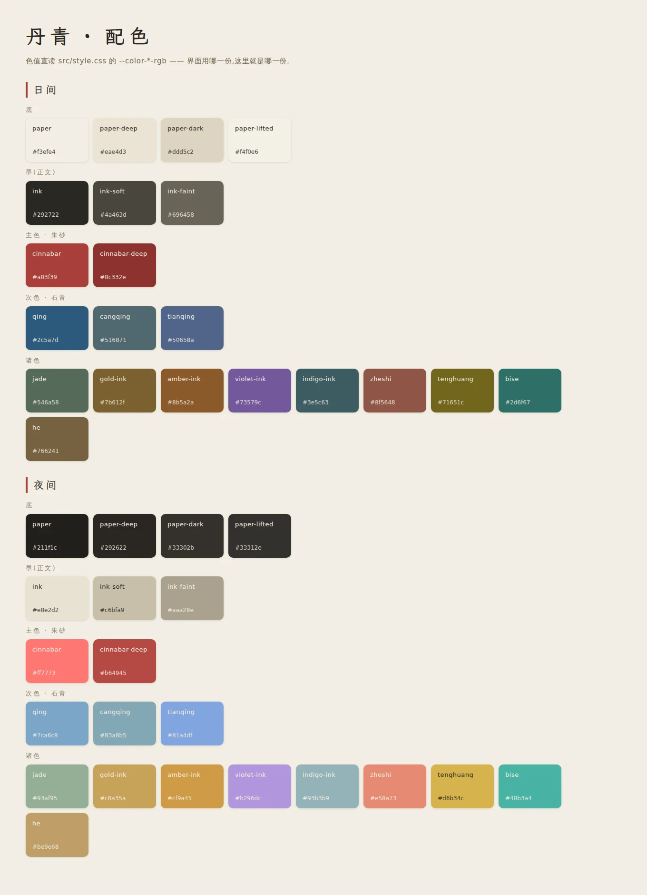

# 设计规范

## 配色:丹青 —— 水墨为底、朱砂为主、石青为次



> 上日间、下夜间。色值直读 `src/style.css` 的 `--color-*-rgb`(`bun run shots` 生成),
> 与界面同源 —— 改色只改一处,这张图跟着变。

`style.css` 存裸 RGB 通道变量(`--color-x-rgb`),`tailwind.config.js` 用
`rgb(var(...) / <alpha-value>)` 合成语义色 —— 斜杠透明度与 `color-mix` 两条路径共用一份变量。
夜间主题只覆盖通道值一处,就能同时换肤。

三色定了整幅画的调子:宣纸(`paper`)做底、松烟墨(`ink`)写字,**朱砂**(`cinnabar`,
主色:行动、要紧处)与**青**(`qing`,次色:信息、增益、可前往)是仅有的两个强色。

### 次色为什么是「青」而不是「蓝」

**题材**:国画里与朱砂并称的次色就是青 —— 「丹青」这个词本身即朱砂加青。蓝不是另一套
语言,它是青的深端(靛)。现代蓝色卡(blue/sky 那类)在暖宣纸底上读作网页超链接,
与水墨气质打架。

**可辨识**:色板里已有 `jade`(石绿一系的绿),青必须落在偏蓝的一侧才分得开,
故取石青而不是竹青。

**可读**:青是全站小字的主色(增益说明、属性数值、品阶名,10–11px)。原先照搬西式
`azure` 的明度(`#4F7699`)只有 4.17:1,低于 WCAG AA 的 4.5;国画颜料里的石青/花青
本身就是深色,压深到 `#2C5A7D` 得 6.38:1,反而更接近颜料真身。

界面实际承载文字的底色有四类,全部随昼夜翻转:**纸**(页面与当前道途卡)、
**纸深**(索引、胶囊与舞台起笔)、**抬纸**(`--color-paper-lifted`,仍需分组的纸面段落)
与**纸暗**(洞府、修炼卷首的渐变收笔)。抬纸最容易漏 —— 夜间主题里它比页面底色还亮,
浅色的字放上去对比度最低,只按前两张算会漏掉一整档(实测漏过一次:4.07:1)。
纸暗现在会承载卷首文字,故渐变上的最弱墨也纳入真浏览器像素门:修行副题在卷首内抬到
`ink-soft`,洞府卷首的眉题、天时与「其后」同样不低于这一档。

| 用在哪 | 色 | 对纸 `#F3EFE4` | 对纸深 `#EAE4D3` |
| --- | --- | --- | --- |
| 正文 | `ink` | 12.99 | 11.75 |
| 次级正文 | `ink-soft` | 8.18 | 7.40 |
| 三级正文 | `ink-faint` | 5.13 | 4.64 |
| 主色(朱砂) | `cinnabar` | 5.32 | 4.81 |
| 次色(石青) | `qing` | 6.38 | 5.77 |

**承载文字的每一档都按 AA 取**(≥4.5:1,《palette.spec.ts》逐档核)。这条以前欠着:
石绿 2.95、藤黄 1.90、琥珀 2.84、天青 2.54 等十一档比现在还浅,而它们全在做 10–13px
的说明文字(增益、品阶名、灵根名)。压深之后反而更像国画颜料本身的颜色。

书口暗场另用一组固定色:深墨 `42 39 33` / `31 29 25` 不跟主题换,上面只放奶油墨
`244 239 226`、淡墨 `201 193 174`、朱印 `255 153 143`、赭金 `214 178 104` 与
石青 `143 184 216`。这五档对两层暗底的最差对比度仍有 7.10:1。固定色组只用于
玄枢图题头这类真正的书口外壳,不再借给首页主舞台、修炼内观或手机顶栏、底栏。
固定色组与暗场对比度由 `palette.spec.ts` 核。

**纸上的墨只有三档**。原先还有第四档 `ink-ghost`(#B9B2A0,1.66:1)当最淡的一层,用在
118 处说明文字上 —— 但纸上放不下第四档还能读的字:再淡就低于 AA,再深就与 `ink-faint`
重合,故撤掉这一档,那些字落到 `ink-faint`。需要更淡的**装饰性**线条/色块(不是字),
用墨的透明度写:`border-ink/15`。

**印面是另一类角色**:`.btn-seal` 那行字是写死的奶油色 `#f6f1e5`,托它的底按
「奶油字 ≥4.5:1」取,而不是按它在纸上的对比度。暗色主题下这两种算法互相打架 ——
朱砂当字要够亮(255 119 115),当印面却要够深(182 73 69),故两边分工,见 `style.css`
夜间主题里那两行 `.btn-seal` 覆盖。

**禁用态:压色不压字**。按钮灰掉有两种做法,只有一种读得出来 —— 压色(边框/底色让位,
字保留一档能读的墨)读得出,压字(整块 `opacity-40`)读不出。禁用态那行字往往正是
「为什么不让我点」(「尚差 N 道源」「修为未至圆满」),它是答案不是装饰;整块压透明度
会让它和底一起向对方靠,实测浅色 2.31:1、夜间 2.94:1,连 3:1 都够不着,而
`getComputedStyle().color` 读到的仍是压之前的值 —— 源码里看着完全正常。
四个可禁用基类(`.btn-seal` / `.btn-ghost` / `.chip-ink`,以及当按钮用的 `.card-ink`)
各自带禁用态;夜间印面另有一档 `html[data-theme="dark"] .btn-seal:disabled`,
因为那条深朱覆写的特指度高过基类的 `:disabled`。

两条跟着来的写法约束(都由真浏览器那道门`scripts/layout-check.mjs`盯着):

- **文字不叠透明度**。`text-cinnabar/80` 这种写法算不出对比度,实测正好卡在 3.9:1;
  写字就用整色,要淡是设计的事(换一档 token),不是让浏览器去混。
- **同色底最多 6%**。「底 = 字色自己 6% 的墨」是品阶方块那类画法:底色比卡片亮一点,
  同色字放上去对比度就低一点。原先有 /8 /10 /15 几种写法,实测 8% 就已经掉到 4.44:1 ——
  6% 是既看得见底色、又托得住字的那一档,浓了就降回 6%(视觉上几乎看不出)。
- **投影墨不当纸上墨用**。色板上同名的两档墨分工:`--shadow-ink-rgb` 是投影的墨,夜间
  重定义成近黑(8 7 5);`--color-ink-rgb` 是纸上的墨,夜间翻成浅墨(232 226 210)。白天
  两者都是 41 39 34,看不出区别 —— 可一旦拿投影墨去画分隔线、进度槽、按下时的底色,
  夜间就成了「深纸上画深线」,22% 的透明度合成出来只差三五个色阶,等于没画。故 **只有
  `box-shadow` 许用投影墨**,凡是要在纸上被看见的(线、槽、滑块、冲击波)一律取纸上墨。
  背景里的墨浓度另有上限 25%:再浓就不是装饰,是第二条边框(`src/ui/ornament.spec.ts` 守着)。

### 命名与事实源

语义色名取中国传统色/国画颜料名,不取西式色名(`azure`/`amber` 这类):
`cinnabar` 朱砂、`qing` 石青、`jade` 石绿、`gold-ink` 赭金、`indigo-ink` 靛、
`violet-ink` 紫、`amber-ink` 琥珀、`zheshi` 赭石、`tenghuang` 藤黄、`bise` 碧色、
`he` 褐、`cangqing` 苍青、`tianqing` 天青。

九品色阶(凡→神)也照这套名字走,两两色差 ≥10(CIE76),相邻两档不许糊在一起 ——
压深之后最容易撞上的是地品(琥珀)与天品(藤黄),故一档偏赤、一档偏橄榄。

一份事实源在 `src/style.css`,界面与数据一律引用 `var(--color-*)` / utility 类名。
**引用的类名必须指向色板上真有的 token** —— Tailwind 对不存在的 token 不报错、不生成,
模板照写不误,浏览器照旧忽略:那个类编译后一个字节都没有,元素静默落到继承色。
这类缺陷行为测试看不见(元素在、字在、只是没颜色),人眼也容易当「设计就这样」;
实测清出九处,其中 `text-accent` / `text-ink-success` / `text-ink-warn` / `focus:border-azure`
指向的是**从来没定义过**的 token。判据按 `tailwind.config.js` 的 colors 与 theme.opacity
枚举(`uiLayering.spec.ts` 的「语义色类」),新增 token 自动纳入。
品阶九色(`qualities`)、器魂六阶(`souls`)、五行与特殊灵根(`linggen`)、天赋档位
(`talents`)原先各自手抄一份裸 hex,现全部改成引用变量 —— 它们从此跟着色板换肤,
也才有夜间档可言。

`public/privacy.html` 是唯一的例外:它是**独立成篇**的静态页(离线也要能直接打开),
只保留了它自己用到的几个颜色,与 `style.css` 是手抄关系 —— 改配色时两处都要动,
故 `palette.spec.ts` 会把这张手抄表与色板逐条核对。

## 版式:竖版文字风格,移动端优先

页面按手机竖屏的阅读节奏排:一屏一件事,长列表用章线、留白与小印分组。
全量路由 × 五档视口的排版审计在 `scripts/layout-check.mjs`。

### 卷首瘦身 —— 「一屏一件事」的前提是那件事在首屏

本文开头写着:

> 页面按手机竖屏的阅读节奏排:**一屏一件事**,长列表用章线、留白与小印分组。

实测 390×844(showcase 档),四页的第一件「事」都不在首屏 —— 在首屏的是
「这是哪一页」:

| 页 | 卷首高 | 占屏 | 正文从 |
| --- | --- | --- | --- |
| 修行 | 375px | 44% | 442px |
| 洞府 | 312px | 37% | 382px |
| 道躯 | 205px | 24% | 275px |

卷首内部拆开量:册名 33 + 副题 18 + meta 24 + **主视觉 140~151** + 印章 44 +
册目 24。最大的一块是主视觉 —— 一张圆环 / 山门图 / 法球,**看一眼就够**,却常驻。

#### 做法:一个可选的 compact 档,不是全站改版

十六页里其余十页本来就不挤,一并改会把它们掏空。故只给**量出来确实过密**的四页
(道躯 / 修行 / 洞府 / 藏珍)开一个开关 `FolioPageHeader` 的 `compact`:

- **主视觉不再常驻**,收进一枚「观 象」按钮 → 弹框;
- **副题一并收进去** —— 它答「这一页是关于什么」,与 meta 读数的「现在怎么样」
  不是同一件事,首屏留给后者;
- **册名、返回、册目、meta 读数、眉批「下一步」全部保留** —— 收的是装饰,
  不是导航与行动。

观象弹框抽成 `FolioVisualFolio`,而不是写在卷首里:那条「弹窗同族刻度」判据的
扫描面是「凡 components/ 下用了 BaseModal 的文件」,卷首一旦自带弹框,它的匾额字
(19 / 18px)就会被卷进弹窗刻度去核,而卷首根本不是弹窗。抽开之后两条判据各扫各的。

效果:道躯 205→121、洞府 312→132、藏珍 —— 卷首 116,首屏从「只有页头」变成
「页头 + 整张战力卡 + 下一章章首」。

行囊页同理:主视觉是九佩陈列(InventoryReliquary),卷首 205px —— 那是「一眼看个
大概」的图,不是此刻要操作的东西。收进观象之后 205→140px,首屏装得下「今日检点」
与整片九佩。

**内观台三格并排**:修行页卷首里那块「本境 / 此刻行速 / 灵气」原是「第一格独占整行,
下面两格两栏」,共 140px。卷首瘦身之后三格各自只报一件短事(四层 / 亿每秒 / 0%),
没有一条需要整行 —— 改三栏之后 140→83px,修行卷首整 333→276px,首屏因此装得下
境界阶梯、本境修为与「下一步」章首。极窄档(≤220 CSS px = 200% 缩放)退回单列:
195 下三栏每栏不到 60px,「2.355亿/秒」这种七字读数会被压成两行,那是排版门钉过的坏形状。

#### 顺带清掉同一屏的两处复读

卷首瘦下来之后,正文一露头,重复就读得出来了。修掉两处(与「行速归内观台、
正文不复读」同一条纪律):

- **本境余程**:卷首一格与正文行功账都在报「还剩 N% · 约多久」→ 卷首只留
  「本境 · 四层」与阶段一句,百分比与时长归行功账(它本来就有进度条);
- **界序号**:卷首 meta 与章首右侧读数席各一个「第 10 / 21 境」→ 归章首。

两处撤下的 `.cultivation-masthead__ordinal` / `__state` 样式一并删除 ——
`deadStyle.spec` 当场点名两条孤儿类,不留给人猜它活没活。

判据 `ui/mastheadCompact.spec`:compact 默认关闭、主视觉在 compact 档不常驻而
有观象入口、弹框走共享 BaseModal 且不自己铺浮层、导航/读数/眉批三样不许一起收掉、
默认档版式一字不动,以及那四个过密页确实开了 compact。

#### 观象:点开它要看得更清楚

卷首那几张主视觉都是固定小尺寸,因为它们得在题头那一行里与册名并排
(`DongfuAtlas` 168×146 / `CultivationDial` 140×140 / `CharacterSigil` 140×140 /
`CelestialGateMap` 150×124),而且那几个实尺寸各自被判据钉着,不能改。

但「观象」是玩家**主动点开**的动作:他要看清七座建筑的方位、二十一道刻度走到哪、
灵根两根各占几分。给他一张和刚才一样大的图,这个动作就白点了。

故弹框容器里加 `transform: scale(1.3)` —— 只影响绘制、不动布局盒。放大之后
168→218、140→182,弹框宽 350 装得下,不溢出。**不改 width/height**:那几个尺寸
被 `cultivationDesk.spec` 等判据连着,改它们会把卷首挤坏,而且同一个组件在两种场合
有两套尺寸语义,下一个读它的人得先判断「我现在在哪儿」。

放大还让一处原先看不见的瑕疵现了形:山门图的两条地形路径都收在画布底边
(`V144 H2 Z`),小图上像「山脚齐平」,放大 1.3 倍之后成了一条硬边切口。
修法是把山脚做成渐隐(SVG `linearGradient`),路径形状一个字不动 ——
节点位置与 `level/cap` 现算都挂在同一张图上。

**附带修了一处判据的脆弱定位**:`layout-check` 里「人物读数详情」那条探针原写
`main button` 的第一个 —— 卷首加了「观 象」之后那个位置被它占了,判据于是去量
观象弹框,报红时却仍说「人物读数详情」,名不副实。给 `TapNumber` 加 `data-tap-number`
落点,探针改点它。**「第一个按钮」这种定位一旦页面结构变了就会指错地方,而且
错得很安静** —— 它不会报「找不到」,只会量到另一个东西。

判据 `ui/folioVisualScale.spec` 五条:弹框里的图放大过 / 放大走 transform 不改宽高 /
卷首那几件自己的尺寸没被动 / 弹框标题报册名 / 山脚不许是硬边。

#### 同类:规则解释默认收起

人物页行藏底下那三条边界注(进阶成功率只管小进阶 / 护盾 50% 顶 / 标「软」者
已到软上限)约 110 字,是**算法边界**不是此刻读数。它们与四组行藏抢同一块版面,
把正文拖长;而玩家翻开这一页先想看的是「我有多少」。

改成一行「注 · 这三项的算法边界」,默认收起,点开才展开(`aria-expanded` 报开合)。
**文案一个字没删** —— `characterDossier.spec` 原本就钉着「进阶成功率边界仍保留」
「护盾上限边界仍保留」,收的是版面,不是内容。判据另加四条:有展开键、报开合状态、
正文默认 `v-show` 收起、初值必须 `false`。

这是本仓第二次做同一件事:上一处是「来源拆卷」从内联面板改成浮层 ——
两种收法(就地展开 / 进弹框)都归同一条纪律:**解释归解释,读数归读数**,
两者不该抢同一块版面。挑哪一种看内容量:两三行就地展开,成段或带图进弹框。

#### 正文分层:一页只摊一件事,长名单进册

卷首瘦身之后,正文还是「三类东西同权」:此刻读数、可做的决定、参考目录,都铺成
一样的账行。量了一遍五张最密的页(390×844,展品档):

| 页 | 正文高 | 屏 | 常驻的逐项清单 |
| --- | --- | --- | --- |
| 藏珍 | 2728px | 3.2 | 16 枚榜牌 + 默认展开那一路 21 行(含 10 行已达成) |
| 道躯 | 2645px | 3.1 | 行藏四组 21 行 |
| 洞府 | 2134px | 2.5 | 七作 7 行,每行「现 / 将」两段 |
| 修行 | 1942px | 2.3 | 丹药 5 行 + 功法 3 席 |
| 行囊 | 1617px | 1.9 | 藏品 15 件 |

问题不在长度 —— 一页 2~3 屏对一个放置游戏不算病。问题是**每一行的重量一样**:
玩家扫过去,分不出哪一行是「现在要做的事」,哪一行是「以后想查再查的账」。

故补一条分层纪律(不是「什么都进弹框」):

- **此刻读数留在首屏**:身份、境界、战力、天时、当前目标 —— 不点也知道。
- **决策行留在页上**:要做的那件事(升级、出发、服用、突破)连同代价、把握与
  收益一起可见 —— 这是 `AGENTS.md` 的「决策信息完整」,不进弹框。
- **参考目录收进册**:逐项词条、来源、历史、长名单 —— 它们回答「为什么 / 从哪来」,
  不回答「现在做什么」。页上只留「类名 + 项数 + 头两条读数」,点开再拆。

为什么不是「全部弹框」:弹框是一次上下文切换。把「今天该做什么」也塞进去,
玩家每走一步都要开一扇窗,页面反而更慢;而「让看不见的机制可见」要求的是**可查**,
不是**常驻**。收的是版面,不是内容 —— 册里一项不少。

第一处落地:道躯「行藏周天」。四组 21 行原样摊在页上,是这一页最长的一段
(实测约 1000px / 1.2 屏)。现在页面上是四行账目:

- 每行报「类名 + 项数 + 组内头两项读数」(键序即重要度序,不按数值重排 ——
  同一份存档每次读到的都是同一批位置);
- 点任一行开「行藏周天」全册:四组同席、逐项一行不少,点一行仍拆它的来源;
  来源明细浮层带 `top`,叠在全册之上,不会被盖住;
- 默认合着;从哪一组点进来,卷身就滚到哪一组。

实测 390×844:正文 2645 → 1842px(3.1 → 2.2 屏),320 / 195 两档无横向溢出。

第二处落地:藏珍「功名榜」的已达成。默认展开那一路原有 21 行,其中 10 行是
「已经拿过什么」。现在「在追」留在卷上,「已达成 N 枚」收成一叠,点开才铺赏格与
达成记录;一条功名抽成 `AchievementEntry` 一处渲染,两叠不再手抄两份。
实测 2728 → 2058px(3.2 → 2.4 屏)。

第三处落地:洞府「山门续账」的七作。章壹已经报过「已营 7/7」与「眼前一锤」,
章贰再铺七行逐作 —— 同一件事在首屏说了三遍。现在页上只留一枚账行:报
「可动工 N 座 + 下一座」与「7/7 已营」,要逐作比较时再展开;七行、连升与详情
一项不少。章首 fact 也从「7/7 已营 · 72 时离线」改成「七作 · 家业 · 灵脉」——
同一屏不再把同一读数说三遍。实测 2134 → 1101px(2.5 → 1.3 屏)。

判据:`dongfuDesk.spec` 守住「账行默认合着 / 报可动工座数与下一座 / 展开后
七座不少」;`layout-check` 的 `taskDongfu` 先量合着的账行(aria-expanded=false、
账身不可见),再展开量七行行宽、升级键与详情开关;营造账目那条也先展开再点。

第四处落地:规则解释收成一枚「注」。门庭四条门规(约 10 行)、历练的途中三档与
行旅之则,都是**解释**不是此刻的读数;摊在正文里只会把页面拖长。抽出共享原语
`FolioNote`:一行抬头 + `aria-expanded` / `aria-controls` + 正文默认 `v-show` 收起,
文案一字不删。三档的缘起状态(「缘在续,奇缘会来」)留在注外 —— 它是此刻的状态,
不是解释。实测门庭 1663 → 1436px、历练 1434 → 1327px;点开「注」后各自回到原高度。
判据:`apprenticeDesk.spec` 与 `adventureDesk.spec` 各补一条(默认合着、
点开四条/三档一字不少、状态留在注外)。

判据:`characterDossier.spec` 守住「页面不再直接铺 21 行 / 全册四组一项不少 /
默认合着 / 来源明细叠在全册之上」;`collectionDesk.spec` 守住「在追与已成两叠
分开取数 / 默认合着 / 换方向不继承展开态 / 行只有一个渲染来源」;
`layout-check` 的 `taskCharacterFold` 与 `taskAchievementFold` 在真浏览器里量
「四行账目 → 开册 → 点行 → 拆来源 → 合册」与「已达成叠默认合着 → 点开 → 收回」。

修行与行囊两页的逐项清单仍是常驻,按上表的高度排序往后收。

#### 第五到第八处:同一把尺量到的下一批

上面四处收完之后,同一把尺(390×844、展品档、`#folio-main` 的 `scrollHeight`)再量
一遍全站十七页,**平均 1.74 屏**(共 25006px);下面四处的收前 / 收后:

| 页 | 收前 | 收后 | 常驻的是什么 |
| --- | --- | --- | --- |
| 名号 | 1800px / 2.13 屏 | 772px / 0.91 屏 | 名号谱 30 顶 + 灵兽谱 42 只,两册同摊 |
| 器魂 | 946px / 1.12 屏 | 778px / 0.92 屏 | 章法整章:引子 + 三步 + 一枚二级开合 |
| 首页 | 1477px / 1.75 屏 | 1195~1477px | 今日日课八行同权 |
| 天界 | 1258px / 1.49 屏 | 1254px / 1.49 屏 | 卷首 571px(占首屏 68%)→ 300px |

第五处:名号谱与灵兽谱。两章都是**参考目录** —— 三十顶名号、四十只灵兽逐条查,
回答「为什么 / 从哪来」,不回答「此刻佩哪一顶」「此刻伴哪一只」(两者都在章壹)。
此前两章同时摊开,实测正文 1220px,玩家要先滚过三十顶才够得着灵兽那一册。
现在每册页上只留一枚账行(落款印 + 「逐顶查阅」+ 一句读法 + `已藏 N/M` + 开谱),
点开才铺全谱,分批与翻页一字不动。实测 1800 → 772px。

第六处:器魂章法。它常驻约 280px,而且章内还叠了第二套开合(「怎么个章法」)——
读全一段要连点两次。整章是**解释**,不是三席读数(三席在章壹总账里,一枚不少),
故与门规、历练三档同归共享原语 `FolioNote`:一行抬头、默认合着、三步与两段细读
一并进注身,第二套开合撤掉。实测 946 → 778px。

第七处:首页今日日课。八行同权铺开常驻 571px,占首页 39%;而其中**已经做完**的
那几行不再回答「今天该做什么」。现在未做的留在页上,已做的收成一叠(默认合着,
报「已成 N 笔」);行号仍读它在今天八笔里的位次,收起之后「03」不会变成「01」。
收的是版面,不是内容 —— 每一行的进度与赏格仍逐行可达。实测(五笔已成)1477 → 1246px。

第八处:天界卷首。它是全站单块最高的卷首(571px = 736 首屏的 68%),原因不是主视觉
大,而是 `LedgerPulse` 被放进了 `FolioPageHeader` —— 卷首本该只答「这是哪一页」,
而「今日天门」四格答的是「今天先做哪一册」,属于正文的第一件事。

修法是把总账**搬出卷首**,放到 `</FolioPageHeader>` 之后、四册页签之前:这正是
坊市页早就用过的位置(它的「今日行市」总账就在 `</FolioPageHeader>` 之后、
`MarketChapterRail` 之前)。搬的是位置不是内容,四册读数、可点的选中态与四个运行时
落点一字不动。卷首 571 → 300px,首屏从「只剩页头与一张总账」变成「页头、今日天门、
四册页签与道途章壹」。判据加在 `celestialDesk.spec`:总账落点必须排在
`</FolioPageHeader>` 之后,搬回去就当场红。

这一步没有动 `mastheadCompact.spec` 钉住的五页 compact 名单,也没动
`folioMasthead.spec` 的十一页落点 —— 那两个文件管的是「卷首该不该收主视觉」,
与「总账该不该住在卷首里」是两件事,不该一起改。

四处的共同点,也是这一轮补进纪律的一句:**收起一个东西之前,先问它答的是哪个问题。**
答「现在做什么」的不许收(决策行);答「为什么 / 从哪来」的必须收(参考目录);
答「这是哪一页」的按卷首规则办(观象或留在原处),而不是与正文抢首屏。

判据:`titlesDesk.spec` 守住「两册账行有落点 / 默认合着 / `v-show` 收起后行仍在 DOM /
开合指向自己那一册 / 账行读数走同一份 total·owned」;`soulDesk.spec` 守住「章法挂在
`FolioNote` 上 / 不再自铺第二套开合 / 三步细读一字不少」;`homeDesk.spec` 守住
「两叠从同一组 `dailyRows` 分出 / 行号是原始位次 / 达成叠默认合着 / 赏格与进度一字不少」,
并把原来那条「首页模板里一个 `<button>` 都没有」改成它真正要守的「页上的 `<button>`
必须都带开合或跳转语义」—— 当年首页确实全是只读账行,现在是收档案的那枚键。

真浏览器侧补了 `openNameBeastBook(page, kind)`:谱用 `v-show` 收起时行仍在 DOM,
故「DOM 里有没有」那类判据照旧,但**量几何、点行内按钮**的判据必须先开谱,否则
量到的是 `display:none` 的盒子(高度 0),判据会以「没有」告终而不是以「坏了」告终。
`taskTitlePetOverflow` 也把「首屏够得着谱」的落点从「谱里第一枚按钮」改成那枚账行 ——
谱收着时后者的盒子是 0×0、`top: 0`,拿它判「首屏装得下」会永远绿,而绿得毫无意义。

八处收完再量一遍同一组十七页:**平均 1.64 屏**(共 23480px)。

#### 第十与第十一处:同名读数与解释文的收法

同一把尺再量一遍,又清出两处。它们与前面八处的形状不同 —— 那八处收的是
「成块的目录」,这两处收的是**同一个数说了几遍**与**一段解释**。

第十处:名号页的 `13/29` 在首屏说了**四遍**(390×844 展品档实测):

| 位置 | 读数 |
| --- | --- |
| 213px 双契切换签 | `13/29` |
| 338px 章壹 fact | `已藏 13/29` |
| 608px 章贰 fact | `已藏 13/29 顶` |
| 656px 名号谱账行尾数 | `13/29` |

改法不是删计数(读者要知道还差多少),是让两枚章首各答各的:章壹报「此刻
佩印是谁」(`尚未佩印` / `名字 · 已佩`),章贰报**余量**(`余 16 顶未得`);
账行只负责开合,尾数与它那一格样式一并删除。灵兽册同一条。
页面高度 736px 不变 —— 改的是「说了几遍」,不是「占多高」。

第十一处:道躯灵根那一段解释(`倍率口径` + 五行牌面两条,占 171px 里的约 120px)
收进 `FolioNote`,章内此刻读数(真灵根 / ×1.2 / 水 63 木 44)全部留着。
实测 390 档 **1842 → 1788px**(2.18 → 2.12 屏),「贰 行藏周天」章首 685 → 644px。
点开后口径与两条牌面一字不少。

这两处之后,**同一个「短读数说了几遍」也进了判据**:`layout-check` 的
`repeatedShortLines` 原先只认 6~40 字,`13/29` 只有 5 个字符,一条都抓不到;
现在降到 3 字且要求含数字,并允许章首 fact 跨块比较(见 7.1 那段注释)。
口径是量出来的:2 字下限实测在十七页产出 16 处误报(「历练 / 行囊 / 静音 / 开声」
这类页名与选项标签),收到 3 字 + 含数字后归零。

十一处收完再量一遍同一组十七页:**平均 1.60 屏**(共 22913px)。

#### 第九处:一次夹具偏差,和它盖住的那个真问题

上一轮结尾写的是「剩下的长页长在决策本身,再收就会收掉决策信息」。那句话在**展品档**
上成立,但它有一个前提没被验:所有量测都只用了一份「真仙四层、320 岁」的终局存档。

补齐另外几档再量,结论就变了 —— 最长的页不是终局,是**开局**:

| 档 | 藏珍 |
| --- | --- |
| 展品档(真仙) | 2058px / 2.44 屏 |
| 新号(炼气一层、无收藏无成就) | **2550px / 3.02 屏** |

差在「境界精进」那一组:它默认展开(按「最近三策」挑的那一路),组里 19 行在追。
展品档只有 9 行,因为另外 10 行已经达成、收进了「已达成」那一叠;**新号一枚都没达成,
于是 19 行全铺出来**。第一行叫「金丹得道」,而玩家还在炼气 —— 这一屏上 1260px 是
「很久以后才轮得到的事」,与「今天能做什么」抢同一块版面。

这不是「决策信息」,是**参考目录**:一条功名的条件、进度与赏格,回答的是
「这一路还差哪些、下一枚是谁」,查着看的东西。故按第九处的同一条纪律办,
用仓库里已有的分批原语(`core/listRender` 的那一套,九柜、名号谱、法宝册都在用):
一组先铺一批,玩家显式续开再放下一批。

判据 `collectionDesk.spec` 补两条,第二条尤其重要:

- 一组每次只铺 `ACHIEVEMENT_GROUP_BATCH` 枚,续开键只在确有余额时出现,
  且带 `data-promised`(与名号谱、法宝册同款),换一路回到首批;
- **「最近三策」跳得到窗口之外的那一行**。这是分批引入的回归,而且是最坏的那种 ——
  *静默失败*:目标在第 9 行以后时它根本没进 DOM,原实现 `scrollIntoView` 前的
  `querySelector` 拿到 `null`,`?.` 一跳过,玩家点了「02 金丹得道」页面上什么都没发生,
  控制台也没有一条错。修法是**先按目标位次把窗口开到它出现,再滚过去**;
  判据直接钉住这个顺序(开窗的 `indexOf` 必须小于 `scrollIntoView` 的最后一次出现),
  而不是只钉「有滚动」——有滚动正是它原来就有的样子。

实测:新号 2550 → 1907px(3.02 → 2.26 屏),展品档 2058 → 1907px。逐行内容一省未删,
点「再看 8 枚 · 余 11」就接着往下铺,19 行仍可逐条到达。

#### 这一轮学到的量法

**一份夹具量不出全站。** 前一轮那张「剩下的长页」结论只覆盖终局态;把新号、
中期、终局三档一起摆上桌,才发现最长的一页在开局,而且成因与「决策」无关。
往后凡是要下「这页不能再收了」的判断,至少摆这三档 —— 空态与满态从来不是同一页。

临时的量具脚本(`.measure/`)在收尾时整目录删除,不进仓库。

### 玄枢视觉 v2：天穹卷

全站是一张连续的玄墨星场纸面,不再用整条深墨书口夹住正文。手机顶栏是一条悬浮的
天幕批注带:身份、境界、寿元与资源直接写在纸上,只以一道世界色星轨收口;底栏是
收敛的章印式导航,当前册只落朱砂光晕与文字色,不铺整块深墨 `dock`,也不抬起第二张
浅色卡片。二者都不是 App bar,不靠外框、投影或厚底色把自己从页面里切出去。

公共页首是开页题签而不是卡片:留册次水印、印章、世界色淡线与底缘切口,不再同时画
四边框和 4px 内框。章节、此刻账、总账、通用纸片、页签、弹窗与桌面书脊沿用同一条
规矩:**一个页面最多一层容器边**;已有页框或标题线时,内部只用留白、底线、落款与
光晕再分组。卡片可为纸色渐隐,不得超过一层容器边;弹窗可以靠悬浮投影离开纸面,
但不再加第二道内框。浮层卷身内也不再铺第二张纸卡:关于、数值体系、灵脉、天道熔炉、
道痕纪元变迁、器魂散置/凝炼两册、开炉丹方与灵草坊只沿卷身的上下账线与分段线续排。

首页洞府指挥台与修炼内观台是全出血晨昏纸面舞台:左右铺到页边,下缘用大圆角收住,
底色随主题从纸深走到纸暗,星盘、轨道与远山只做氛围层。它们下方的道途、日课与门径
继续落在连续纸面,以章线和小印组织,不再连续堆叠同权重方卡。朱砂仍只表示行动与
要紧处,石青仍只表示信息、增益与可前往;视觉减框不改这两条语义,也不改任何文字底色
与 AA 对比度判据。

### 册页骨架:玄枢图 + 书口落点

全站不再只靠五个底栏页签找路。顶栏左端是一枚方角「玄」印,打开 `玄枢图`:
十七册按修行、道场、行旅、身外、天机五卷展开,每册有一句「它回答什么」的说明,
当前页在图上留一枚「在」印,并压成一条只报卷次、册次、册名与身份的册口签。
卷目本身是一组 `tablist`:五枚卷次签同时报卷名与册数,只展开当前选中的一卷;
其余卷宗用 `v-show` 留在 DOM 里,检索、读屏与键盘仍能读到全部十七册。切卷只换
当前册页,不再沿用旧长目录的滚动跳转,刚点过的卷签与寻册口都留在视口内。
720px 以上把卷签铺到左侧、当前卷册页放右侧,总图上限放宽到 68rem;390 与 195
CSS px 仍按单列阅读。桌面的当前卷册页铺满右侧整张案台,不再沿用旧版双栏索引把
后一半留成空白;每册前补两位册次,用来对住五卷卷签与册口签。底栏只放洞府、修炼、
历练、背包、人物五个高频去处;其余页面从玄枢图进入,不再散落在人物页的入口卡里
靠记忆寻找。

总图顶部另有一枚「寻」口,按册名、说明、分卷、册内分册与玩家日常叫法一起检索:
写「背包」能找到册名「行囊」的页,写「人物」能找到「道躯」,写「周易」「灵兽」
则直接落到对应分册的 `?tab=`,不是只把玩家丢在页首。空格分词要求全部命中。桌面
书脊上有常驻「寻册」入口,全站也可按 `Ctrl K` / `⌘ K` 直接开图;打开后焦点落在
输入框。触屏设备改落当前卷签,不因开图自动弹起软键盘遮住五卷;寻册口仍只隔一次
轻点或 Shift+Tab。上下键循环结果时,polite 播报会报出第几处、卷名、册名与分册,
回车即入册。关键词、分册与路由一起住在 `NAVIGATION_ENTRIES`,
七册长页共用 `useRouteTab`,页面内换签也会把落点写回地址。不另维护第二份快捷表;
中文输入法组合期间的回车与方向键让给选字,不抢作翻册。

玄枢图不把跨页待办留在图外:行囊有新货时,「身外」卷签先落一枚朱砂点,行囊册报
「N 新」;可以破境时,「修行」卷签与修炼册各落一枚石绿点并写「可破境」。这些章与
手机底栏、桌面书脊同读 `useNavigationSignals`,不靠玩家点开每一卷才发现。键盘快捷键
只在精细指针设备上显示,触屏不摆一枚按不出的 `Ctrl K`,寻册口本身仍在原位。

键盘玩家第一次按 Tab 时,书页上缘会展开一枚「直入正文」朱砂书签,越过玄枢图、
书脊与底栏把焦点交给正文滚动宿主;hash 路由地址不因这条跳读改变。每次翻册后,
隐藏的 polite 播报区还会从玄枢册目同源报出「第几卷 / 第几册 / 册名」,让视觉上的
卷首、书口签与顶栏换页在读屏里也有同一个落点。判据在 `folioChrome.spec.ts` 与
`layout-check.mjs` 的首次 Tab 场景。

手机顶栏是一条悬在纸面上的天幕批注带,只有一行:左侧玄枢印的右下角压当前卷次,
中间是名号、境界与寿元,右侧是灵石、灵气与设置。灵石与灵气本身就是 40px 高的
精确值入口,点开仍报同一份资源账;五卷跳转归玄枢图,书首不再另起
第二行位置签,也不重复卷首册口签与底栏主册。620px 以上在同一行中段补出
「卷次 + 分卷 / 册次 + 册名 / 世界」;359px 以下先收寿元,220px 以下再收境界。
`data-folio-position` 留在 header 上供播报与测试同源读取,但不再占一行视觉高度。

桌面在 1100px 以上撤下书首,把名号、寿元、灵石、灵气与设置并进左侧书脊的
「随身账」,正文从书桌顶缘直接开卷。960~1099px 的窄桌面仍保留书首,因为那一档
书脊只露图标,没有身份与资源;桌面书首若常驻,同一册次会在书脊、书首和页头各报
一遍,还永久占掉一截阅读高度。

1200px 以上再把书脊五卷摊成两列总目:左列修行、道场、行旅,右列身外、天机。
十七册在一屏内全部可见,不把末卷藏进没有明显滚动条的暗处;每册仍保留 28px
触达高度,当前册用右上角一枚朱砂小印落位。960~1199px 的单列书脊仍可滚动,
因为窄桌面没有第二列需要的横向余量。

详情页共用一枚 `FolioPageHeader`:分卷、册名与册目说明从玄枢图同一份数据读出,
父页兜底也收在组件里;页面不再各手搓「返回 / 标题 / 读数」三栏。卷首页口再摊出
本卷诸册签,同卷兄弟册可直接横跳,当前册与顶栏当前卷共用同一份 `navigationPositionOf`。
卷首主标题是真正的 `h1`,左侧返回只报父册,右侧动作与页内读数各有独立槽位;
195 CSS px 时动作落整行,不把册名与说明挤成竖排。

手机与桌面卷首共用同一枚开页题签:只留底缘切口、世界色落款与右侧淡墨册次水印,
不再把卷首做成压在正文上的第二张厚卡。册次仍由 `navigationPositionOf` 的同一位置
生成,返回、动作与读数槽位不变。

历练、行囊、道躯与「人间」再走一层 `featured` 开卷版式:
册名、印章与读数放大成这一页的第一眼;`#backdrop` 铺世界色远山,
`#visual` 只放法球这类主视觉,默认正文槽承接行旅条与今日天时。它们仍与详情页
共用同一枚 `FolioPageHeader`,不是第二套页头;页面内不再另写 `h1`、旧 hero 或
同名的栏目标题。首页与修炼内观台是两处例外:它们不是另一册需要“开卷”的页面,
而是玩家每天停驻、反复查看的主屏。首页拥有唯一一枚 `h1`「洞府总览」与独立
晨昏指挥台;修炼页把同一枚卷首组件换纸成晨昏内观台,`h1` 仍是当前境界名。

修炼内观台把「我在哪一境、修为走到多远、此刻在做什么」压在上半屏:境界名、
阶段判据与仅展开一次的典籍来路在左,主题周天盘在右,底部一行同报余程、行速与
灵气。阶段按「关隘已开 → 修为已满 → 带伤行功 → 闭关中 → 吐纳中」排序,由
`cultivationStageOf` 单点判定,页面不另拼一套状态优先级。周天盘外圈二十一境读
`realmLadderPoints` 的三态,内圈读 `expProgress`,中心报本境百分比、境界名与全路
序号;读数在正文完整呈现,故整盘 `aria-hidden`,不重复进读屏。620px 以下不把周天盘
挤成第二个栏位:它退到右上的星盘水印,只留环与刻度,中心读数收起;320 与 195
直接收掉纯装饰盘。

正文从卷首直接续成一册「行功续卷」:壹「修行」先报本境修为、行速与灵气,贰
「下一步」把破境与闭关收成两条行动账,叁「随身」续上状态与速服丹药,肆「功法」
再接主辅秘三册。四章共用一条上下账线与同一枚章首,不再让破境、闭关、状态、丹药
与书目各套一层 `card-ink`;桌面双页里修行与下一步并读,其余两章跨栏续排,手机仍按
同一阅读顺序单列。修为进度、行速、灵气、章内计数等信息层统一走墨/石青;只有破境、
闭关、参悟这些真正可点的动作才落朱砂短笔与 6% 以内的淡底,主键不铺满整条账行。
结构与章序由 `cultivationDesk.spec.ts` 守住,阶段判据仍由 `cultivationStage.spec.ts`
单点给出。

满级择道之后,分支面板多一行**道记**(见 `core/daoNote`):「一百二十岁 · 金丹圆满时择此道,
舍『守御』『归一』未行」。它是择道那一刻的落款 —— 年岁取 `utils/format` 的年岁口径、
境界名取 `data/realms`、舍掉的路取当时其余的每一条分支,拼句只在 `daoNoteLine` 一处。
它落在已选分支那张纸签的最末一行,不给底色、不套框、不新增第四种字号;悟道录里
同一条目也读同一句。道记进存档(记的是当时的世界状态,事后算不出来),但不进任何结算。

功法「修到顶」与装备「连强到顶」共用一枚「本轮预算」纸签:修前先报本轮实际能走几层、
共耗多少悟道点 / 残页或器灵尘 / 灵石,以及止于料尽还是可至圆满。层数、总耗与按钮文案
分别由 `planGongfaUpgradeAll` / `planEquipmentUpgradeAll` 现算,结算也按同一份计划走;
材料只够一截时按钮改口「修至料尽 / 连强料尽」,不再承诺一次到顶。195 CSS px 下纸签
把止点落到下一行,预算读数仍完整可读;真渲染判据在 `layout-check.mjs` 的功法三册场景。

历练卷首用一枚「行旅罗盘」只报今日值日之宿与所利界域,四界位置从 `WORLDS`
现取,整盘同样 `aria-hidden`;本世路线、已行程数与眼下去处继续由
`worldView` / `mortalStageStatuses` 驱动,不另算一套进度。正文把星象、本世所钟、
途中三档概率、遇事勿扰、山河地界、秘境与行旅之则收成一张四章开口续卷:共用整册
上下账线、同一套章首与分段线,不再给任一章另套四边卡。界域首尾相接,每处地界是
一条连续账行:先收图标、身份与主行动,再排镇压 / 转收益服务账,最后把路况判据与
地点说明并读;620px 起条件与说明分栏,手机仍按同一阅读顺序单列。
首个可行项读统一准入且排除镇压收益态,并在行缘抬出独立青色左笔。界域章头、左侧
连续山河线与序号节点把当前可见地界串成一册行旅图,当前程用石青圈、眼前可往用
朱砂字、已靖用石绿、镇压用旧金、未至只留虚线;记号只翻译 `row.isRouteCurrent`、
`nextActionableId`、镇压、已靖与统一准入结果,不另判一次能否出发。秘境等旁路
内容退到主线地界之后,行旅规则留在页尾。620px 让秘境与规则并读;960px 起山河主册
占右侧大栏,今日账、秘境与规则沿左栏续排。390px 收起重复正文的装饰罗盘并收薄章首,
首屏必须看得到这枚出发入口。
三档不再拆成三列窄签,而是三行连续概率账:档名、来由与「约每几程」各守一格,
390/375/320 都不把短句挤成竖排;195 再把节点移到账行上方、按档逐行落开,章态
退到章名下一行,不拿正文宽度换地图装饰。结构与事实源由 `adventureDesk.spec.ts`
守住。

历练中的战局谱续成一册连续战卷:征途簿、敌我对阵、战报、最近一战与所知/分析
共用整册上下账线和章间线,不再让任一段另套四边纸卡。390/320 让战绩独占一行,
际遇、拾获、悟道三格并读,把战报推回首屏;195 仍守三格横排,只把身份与时钟分层。
战报框退成透明账页,回放行只用左笔区分技击、暴击、护盾与闪避;最近一战和展开
情报继续沿账页续排。源码契约与 390/320/195 真浏览器几何探针由
`adventureDesk.spec.ts` 与 `layout-check.mjs` 守住。

低境踏入已解锁的高境地界不封路,改由 `core/realmPressure.ts` 记一笔「境界压制」。
境界差取目标大境界减去玩家大境界,同境与向下取 0;金丹闯元婴记 1 境差。每一境差
给敌方三维 ×1.12、增伤 +16%、减伤 +6%,五境封顶;所以五境及以上的实际倍率固定为
三维 ×1.60、增伤 +80%、减伤 +30%,不会把跨十几境的挑战变成另一套不可达的硬墙。
压制同时写进选地卡、出行弹窗、在线战斗、离线结算与战报来源,不许一处乘进数值、
另一处只说形容词。战力与法宝够强仍可打赢,打满二十场且均回合、均受伤达标便照常
取得镇压资格;读档只修坏字段,不按 `minRealm` 反删镇压,只有转世会清空本世权益。
函数与胜负边界由 `realmPressure.spec.ts` 守住。

高境修速另守一条硬边界:渡劫期雷海淬体把基础吐纳 ×8,飞升入界外时仙灵之气再 ×26;
配合界外需求复利 3.4、基础修速复利 3.2,渡劫起每一大境界的**完整修满耗时**
(含突破失败与灵气等待)都压在 30 天以内。当前在线等效读数为:

| 阶段 | 本境完整耗时 | 从零修满累计 |
| --- | ---: | ---: |
| 渡劫 | 16.8 天 | 59.2 天 |
| 真仙 | 14.7 天 | 73.9 天 |
| 大罗 | 25.2 天 | 148.3 天 |
| 神帝 | 28.9 天 | 237.2 天 |
| 混沌道祖 | 24.2 天 | 307.0 天 |

曲线读数由 `progressionSim.spec.ts` 现算,不许回到「单境卡数月」的长尾。

地界志把原来的卷首三格、行旅图、地界卡与来源卡收成一张「本世山河案」。卷首仍先报
世界名,但把地界、层级与已行压成一行总账,并把命数、所钟、换界代价摊在同一处;
桌面右侧的「山河盘」只做 `aria-hidden` 的段数与当前程方向感,精确状态全部留在正文。
正文的山河案先给 `MortalRouteMap` 全图,再沿同一条路线列出每段地名、镇守、事件密度、
眼下可往 / 旧路可往与统一准入结果;前尘山河另成一册,不复造一排同权卡片。本世与前尘
两册都只留上下账线、世界色落款与浅纸色渐隐,不再套四边卡或地图内框。
卷首山图、本世总账与路线标题共用 `worldDeskMeter`,阶段状态仍只来自
`worldView` / `mortalStageStatuses`;结构与事实源由 `worldDesk.spec.ts` 守住,
真浏览器首屏与 200% 缩放档由 `layout-check.mjs` 复核。

行囊卷首只留身份与一枚 `aria-hidden` 的「容量总印」:九席方位由真实佩戴事实点亮,
外圈只画容量弧,不再把精确件数在卷首和正文各报一遍。页签之后,装备签收成一册
「行囊续卷」:壹「今日检点」、贰「九佩」、叁「藏品」沿同一组章首与账线续排,章序
只由 `ui/inventoryDesk` 装配。检点章把藏珍、新得、可换、共鸣与收纳/分解入口收在
一处,新得切换、逐槽候选、一键换装与穿齐共鸣继续读 `itemScope`、`equipUpgrades`、
`equipAllBest` 与 `equipSetCombo`;一键换装只占账行一段朱砂短笔,不再整行铺底。
九佩是九席阵账而非九张同权卡:已佩、空席与可换席靠账线、底色和席尾状态分层。
藏品改为连续清单行,保留新得先列、分批窗口与前后回翻。丹药、材料与法宝不再另起
通用节题和卡壳,也同住「行囊续卷」:丹药壹「丹房」收开炉与灵草坊、贰「丹匣」按味
列存量;材料壹「炉材」收进炉的草、铁、尘与残页、贰「账材」收悟道点与灵石;法宝
壹「法宝」把阵账、祭炼与全册接在同一章。八章共用 `FolioChapterHead` 报章号、
题名、读法与章内真值,丹药与材料格只留账页分栏线。手机各签单列续读,360px 起容量、
新得、可换三栏并读;960px 起九佩与藏品、丹房与丹匣、炉材与账材分别左右并读,藏品
清单两列续排;220 CSS px 以下整册退单列。结构与事实源由 `inventoryDesk.spec.ts`
守住,真浏览器门还核对四签八章的章序、题名与真值、九席齐全、零旧卡壳、容量只报
一次、主行动不超过账行 72%,以及 390 / 1280 / 195 三档的续排与横向溢出。
开炉丹方也续在同一张上下账线里;把握百分比与「平均 N 炉成一炉」分层,后者在
390 与 195 两档都锁成完整单行,不让「一炉」孤零零掉到下一行。
灵草坊的五品购草也收进同一张上下账线:每行只留品阶印、存量、单价、落处与两枚动作,
不再逐品套纸卡;195 档让品阶印与品名独占一层,读数续排,买一与买十在独立动作区
整宽并排,不再把品名挤成竖排或让买十越出面板。

品阶的视觉强度（`ui/qualityTier`）在三段晕染之外，**稀有段内部再分三层**：
天 0.85 / 仙 0.92 / 神 1.00（边框），底色 0.13 / 0.17 / 0.22。此前天、仙、神全落在同一个
`{0.85, 0.13}` 上——同一圈边、同一层底，而这三档恰是玩家会摆在一起比的东西。
只破稀有段这一处：九档各给一个值就又回到「记不住」，档内一致正是为了让玩家只记三段；
选稀有段破例是因为那里分辨意愿最强、件数最少。天品保持原值，不动已发到玩家眼里的那一档。

行囊格子的「新得」标记带入场动画（`animate-new-pop`，0.42s）。这一枚此前跟着
`components/equipment/EquipmentCard.vue` 一起沉了下去 —— 那个组件全仓已无 import
（行囊早换成 `InventoryCollectionRow`），而 `uiLayering.spec` 仍在对着它断言，
于是断言绿了、玩家看到的新件是静态的。本轮把那两条判据改守在用的组件上，并删掉死组件。
标记要用 `inline-block`：`scale` 对纯 inline 元素不生效，类名挂着也一动不动。

真正消费这份强度的只有**器评帖**（写进 `--equip-edge` / `--equip-wash`）。行囊格匣走
ledger 模式（细线网格），刻意不铺品阶色——那是账目式版面，铺上色整屏会花掉。

丹方的门槛收在 `core/recipeGate`：`recipeReachable({minRealm, rank}, {major, ceiling})` —— 两道，
境界与阶位；**炉子等级不是方的门槛**（它是产能，见 `data/buildings` 的 `alchemyYield`）。
`studiableRecipes` 读它。注意 `seedLoreIfNeeded` 的补账**刻意不读它**：那是一段旧口径的
一次性迁移，补的是「旧版里凭炉子够级就能炼、却没记成掌握度」的方子。两者看似矛盾，
实为两个不同的判定；这条已写进 `loreService` 的代码注释与 `recipeGate.spec`，
免得下次有人（包括我）看到注释就改错方向。

法宝神通的**节拍**由 `ui/artifactBeat` 给出：`interval ≤ 1` 读「随身常在」（那几件不按回合出手，
读「每 1 回合」是与事实相反的意思），`≥ 2` 读「每 N 回合」。法宝谱与图鉴读同一份；
「随身常在」那件在图鉴里省略这一句（desc 已经说了常在，再说一遍是同屏两遍）。

资源拦截的提示统一走 `ui/shortfallText` 的 `blockedBy("X不成", rows)`：先说是哪一样没成，
再用「尚差 …」报确切差额。覆盖强化 / 祭炼 / 重铸 / 封存 / 熔炉五处。差额由调用方从
**同一份代价与同一份持有**算出，本模块只拼句子、不做减法。

`core/deadFallback.spec` 守「只说 X 不足」的泛泛提示：core 里面向玩家的资源警告要么报差额，
要么登记进白名单。同一份判据也钉住已清掉的死兜底（洞府升级那条永远走不到的
`notify("灵石或玄铁不足")`）不许回来。

灵品以上器物的**成色**旁多一句档位评语（`ui/temperGrade`）：`成色 67/100 · 中上`。
七档等距（均匀掷点按等距切，不按正态——正态切会让「中」吃掉大半而两端几乎不出现），
两端改口成「尚未淬出」「掷满」。它只产出一个词，不进任何判定（与器铭本体同一条纪律）。
坊市的摊签视图模型（`ui/marketShelf`）与器评帖读同一份。

转世前的代价清单**要说全**：「落印之前」那一章原先只写「资源、装备、法宝与外物散去」，
而 `reincarnation.ts` 会一并重置洞府（及全部建筑）、灵脉、灵兽、弟子（只留一丝真传缘）、
关系、道途、本世命题。「外物」把洞府与弟子盖进去了——技术上不算撒谎，但玩家读到那三样时的
想象，多半不包含养了十世的弟子与升满级的洞府。故把最意外的两样点出来，其余仍在「外物」里，
但那个词的边界由这两样划清。

转世的「回照」那一屏印出**这一世的名号**（`LifeReview.name`）。那一屏已经写得很细——
第几世、什么境界、活了多少载、立的什么命题、得的什么宿慧——唯独没有名字。而玩家给自己起过道号，
转世时还会重掷一个，这个世界却从没在叙事里叫过他的名字。「元婴 · 八百六十载」是档案的写法，
「李长风踏雪 · 元婴 · 八百六十载」才是碑的写法。

名号必须是**那一刻的快照**：确认页会让玩家掷/改下一世的新道号，若回照那一屏读当下的玩家，
就会印成「下一世的名」。空名整行不出（旧档可能没有名字）。

首页与修行页的星空是**同一片天**：`--sky-star-rgb` / `--sky-brightness` 挂在页面根节点上，
一处算、两处继承。两页的星样式逐字相同，第 47 轮只让首页跟着天时变时，修行页没跟——
同一天里首页抬头是稀星，翻到修行页却是满天亮星。以后再加第三处星空，只要挂在同一个根上
就自动一致。两处样式都留缺省值（`var(--color-gold-ink-rgb)` / `0.62`），没有天时的场合仍是金色。
浏览器判据量的是两页算出来的颜色与不透明度**逐字相同**——不必知道今天哪种天时，这个比法任何天时都成立。

首页那片星空随今日天时变（`ui/weatherSky`）：星的颜色、亮度、多寡各按三档调——沉（月蚀、罡风、
仙劫日、雷鸣：星稀而晦）、暖（赤阳、霞光、紫气东来：偏赤金偏浓）、清（其余五者：最平常的一档）。
分组依据是天时名字本身的意思，不是机械平均。这是本作里**唯一一个完全没有功能的东西**：不提示、
不奖励、不判定——放置游戏最缺的往往不是内容而是此刻感，玩家每次打开看到的都是同一屏，
而一行天时文字与一片跟着变的夜色，后者才让人觉得「现在是此刻」。

大境之槛另有一声与一道光（`core/audio` 的 `majorBreak` + `.burst-ring--major`）。每重境界十个小层
（`SUB_LEVELS = 10`），十次突破里只有一次真换了重天——而从前两者共用同一句 `playSfx("breakthrough")`、
同一圈金环，大境只多一个「大 境」小章。音效这条尤其明显：`rare`/`rareHigh`/`rareTop` 三档早分了，
`worldRise`（跨界）也单有一档，**中间那一档是空的**。新档的分量靠三样拉开，不另创乐汇：
更低更久的底钟、两个八度的上行刮奏、双钟叠定音。

大境必渡劫（`needTribulation = isMajor`），故浏览器判据要一份能渡过劫的存档：渡劫每道伤害乘
`rng.float(0.85, 1.15)`，把随机源钉成 0 即取下限；波数随 major 涨，故用最低的可用大境（major=1）。
major=0 时突破钮不可点（炼气是起始境），major=3 有七道劫、直接被打死。

日课全部结清时，首页那张卡落一枚「日课已结」的朱砂小印（`ui/dailySettle`）。日课是玩家每天
都会经过一次的路径，也是放置游戏里最容易被忽略的节拍——它重复、可预期、做完就过去了。
此前全清只有三处静态文字变化（标题、正文、一个 `is-complete` 类），屏幕上没有发生任何**事件**。
印不编号：本作没有累计天数的账（日课按天重置），编一个 N 就是假的。判定复用既有的
`dailyAllDone`，不再抽第二份。用朱砂实框、微斜 0.8 度——像真盖下去的一方印，与导航那枚
石青细线的「通途印」区分开。

头一回遇见的凶物挂一枚「初见」章（`ui/firstSight`）。世界里已有敌人的**认知**系统
（`core/loreService` 的 `noteEnemy`：打得多就提示「你摸清了它的招式」），那套讲的是熟识；
「第一次」它没有——第一次遇见山魈与第十次看到的界面完全一样。

判定**必须在结算那一刻取**并写进战报（`LastBattleView.firstSight`）：照面次数记在
`adventure.recordBattle(view)` **之后**（`noteEnemy`），界面读战报时已经 +1，拿它判初见
永远得到 false。这份账随神魂带走，故「初见」说的是生生世世头一回。

这一块的条件与内容现已同源（`ui/combatChips`）：块显示与否 = `chipsOf(...)` 结果非空，
块内渲染的也是同一个数组。此前那块的条件是 `isBoss || isNemesisFoe || shownTraits.length`——
一串「每枚章条件之或」，加一枚新章忘了改它，屏幕上一片空白，而编译、类型、单测全绿。
第 42 轮的「旧仇已雪」与第 43 轮的「初见」连续两轮踩了同一个坑，都是真浏览器探针
量到 `chipsWrap: 0` 才发现。修法不是「下次记得」，是让条件的来源只剩一处。

宿敌那一枚章写全（`ui/nemesisChip`）：未雪耻时「宿敌 · 已败三次」，雪耻后换成「旧仇已雪」。
章背后两个字段此前一直没上界面——`lossCount`（输给它几次）与 `avengedAt`（哪一次赢回来的）。
雪耻那一刻尤其安静：打赢之后 `isNemesis` 立刻返回 false，章直接消失，玩家看到的是
「什么都没发生」；而 `core/worldMemory` 那边已经把 `avengedAt` 记上，还会据此产出「残魂」形态。
章里写**门槛值**（三次）而不是实际次数——`lossCount` 值域是 3 到 ∞，一章撑不住，
具体次数留给传承页那张宿敌表。

那条「旧仇已雪」必须放在 chips 块**之外**：那一块的条件是
`isBoss || isNemesisFoe || shownTraits.length`，而雪耻一过 `isNemesisFoe` 就是 false——
挂在里面永远显示不出来（探针量到 `chipsWrap` 为 0 才发现）。

重复遭遇同一事件时，正文下面多一句「你想起上一次，自己走的是「…」；这已是第 N 次。」
（`ui/eventRecall`）。95 个事件里只有 8 个标了 `once`，其余 87 个可以反复出现，而第二次遇到时
标题正文选项一字不差。弹窗里那块「余波」（`core/worldMemory`）要 `times ≥ 2` 且只
`AFTERMATH_CHANCE = 0.2` 抽——于是**第二次遭遇完全没有标记**，第三次起也有八成不亮。
这一句补的正是那一格：必出、不掷骰、从第二次起就有。两句分工：余波是世界那侧的、偶发的、
带情绪的；这一句是你自己那侧的、每次都有的、只陈述事实。

突破失败弹窗在安慰之后补一行**下一步**（`BreakthroughView.nextStep`）：失败那一刻有三件事同时
发生——准备加成被 `consumeBreakthroughPrep()` 取走（失败也不退）、挂上伤势、修为掉一截——而这是
一扇全屏弹窗，遮住了修行页上那些准备按钮。只说「来日再战」等于让玩家自己回想刚才少了什么。
那一行从结算里取（`sparedByHeritage` / `breakthroughPrepState()`），不手写话术。

名字的上限只有一处定义：`utils/nameLimit` 的 `NAME_MAX = 8`。道号、构筑名、挑战书名、
转世名号草稿四处都读它；`PLAYER_NAME_MAX` 保留为别名（第 37 轮建立的调用方不用改）。
这个 8 不属于任何一个模块，放在 store 里会让另外三处为了一个常数去 import player store。

道号的上限是 `PLAYER_NAME_MAX`（`NAME_MAX` 的别名），创建页的 `maxlength` 与
提交时的裁剪都读它。此前这个 8 只手写在创建页两行里，而 store 的 `setName` 完全不裁——
契约活在页面上，谁都能从代码里调 store 绕过去。顶栏那行 `truncate` 仍是必要的兜底
（旧档里可能有更长的名字），但**新输入**不该依赖它：玩家敲进去的字被悄悄削掉，不会报错也不会提示。

`formatPercent` 的极小值守卫按**取整之后**是否为零来判，不按取整前的量级。原先写的是
`Math.abs(v) < 10^-dp`——`dp=0` 时阈值是 1，于是 0.9% 也被清零印成「0%」；而 0.9% 四舍五入
就是 1%，抹掉它等于凭空否定一次真实的收益。道果边际在软上限后正好落在这个量级。

道果边际的百分数（`fruitMarginalInfo().deltaPct`）改用 `formatPercent(delta, 2)` 而不是手写
`toFixed(2) + "%"`：手写那份不处理上溢（`eff` 极小时比率可以是 Infinity，会印「Infinity%」）。
取两位而非全仓默认的整数位是有依据的：这个数掉到 0.9% 一带，取整会把它压成 1% 或 0%，
而 0% 会让玩家以为「再攒一枚也没用」——与事实相反。

倍率的写法收在 `ui/multText`（`multText` / `multNumberText`）：两位精度、削尾零、带 `×` 前缀。
此前同一份值是三种写法——`toFixed(2)` 印「×1.20」、直接插值印「×1.2」、
`Number(x.toFixed(2)).toString()` 又是另一种。同一份灵根倍率在人物页与转世确认页
印成两个样子，看上去像两个精度。保留两位而非一位，是因为倍率差 0.01 有意义
（灵根 1.02 与 1.03 差的是整条修速曲线）；削尾零是因为 1.20 与 1.2 同数。

灵兽也记「何时与它结的缘」（`petMoments`）：第 27 轮给称号补这一刻时只修了称号那条，
而 `quests.petCompanions` 同样只是个 id 数组。转世会把灵兽清零，故谱上每一只都是这一世
结的缘——但没有时间读数时，二十只并排就分不出哪只是刚遇见的。与称号、图鉴共用同一份道历
（`ui/codexMoment`）。旧档照实说「早年收录」，不补造。

注意：「拥有」看 `collections.pet`，「相伴过」看 `petCompanions`，两者不是一回事。

称号也记「得它的那一刻」（`titleMoments`）：此前称号只有个 id 数组，玩家有一排功名，
却分不出哪个是刚才得的、哪个是上一世挂着的。与图鉴共用同一份道历（`ui/codexMoment` 的
`codexMomentOfPlayer` / `codexMomentText`），不另写一套历法。旧档里已到手的称号没有这对读数，
照实说「早年收录」，不假装是这一世得的。

卷首眉批说「此刻最该做的一件事」（`ui/nextStep`）。修行页早已有一个「当前阶段」，
但那**只讲突破这一件事**且只在该页；玩家点开洞府、法宝、灵兽，卷首各自只报本页的账，
没有一处回答「我现在该去做什么」。规则按**卡住了什么**排序、只吐一条：挂着的际遇 >
正在历练 > 破境条件齐 > 终点已至 > 未领的赏 > 可收的洞府账 > 法宝空位 > 更好的装备 >
修为已满待关。指向本页的建议不出（玩家已站在那儿），一条都不成立时整行不渲染。
规则是纯函数（不 import 任何 store），取数在 `ui/useNextStep` 一处完成。
取数三项各有既有来源、不重造：未领的赏读 `currentMainQuestProgress()?.done`（与领赏判定同一份）、
法宝空位比 `artifactSeatCap()`（与整理装配表同一个函数）、未上阵的一件看行囊里有没有没穿的。
「更合手」那项**不做换装模拟**——那要跑一遍 `finalStats`，到这里只会变成又一份账，
文案也随之收敛成「行囊里有未上阵的一件」，说到的正好是它知道的那件事。
「终局已至」读 `endgame.daoPath`——道途一旦选定不可改（来世方可另择），选过了就是终局已至。

那行字**可以点**：它说「该去哪」就把玩家送过去。初版是一枚 `<p>`——写着「关隘已开，可去破境」
却不能点，等于把「去导航里找」的成本推回给玩家。语义上用 `<button>`（站内单页应用，
没有可分享的 URL 语义），`aria-label` 里带上目的册名。热区扩到 28×28 的触控下限，
靠负外边距 + 等量内边距实现，**视觉位置与行高都不动**；悬停反馈包在
`@media (hover: hover) and (pointer: fine)` 里，否则触屏点过之后那枚箭头会一直偏着。

八句**用这本书自己的口吻**，不用通知体：去掉「正」「已经」「手里还有」这类播报用的虚字，
留下的都是动作与去处。「此程未完，且先走完」比「这一程尚未了结，先走完它」少六个字，
意思一点没丢；每句不超过 14 字（眉批与副题同段，长一句就把下面挤走）。

稀有提示的那**一声**也分层（`ui/rareSfx`）：灵/玄/地是原来那一响（管钟 D5 + 高音 D7），
天/仙升到 F5 + A7，神品升到 A5 + A7 并补一个低八度 A3 作根基。用**音高与声部数**分，
不用音量——音量在手机扬声器上几乎听不出差别，而和声的厚度会变。三层始终留在「管钟」
这一族，不刮奏：刮奏冲顶是「大境界突破」的语义，借过来会把那件事稀释。

声与光共用一份判定（`flashPlanOf` 同时给出 `tier` / `seconds` / `colorToken` / `sfx`）：
同一条提示不该出现「光按神品闪、声按灵品响」这种分叉。判据两侧都核。

稀有提示落地时那道**全屏一闪**按品阶分层（`ui/flashTier`）：`rank < 6` 走默认金色 1.1s，
天/仙 用那一档的品阶色 1.35s，神品 1.6s。从前只有一种色一种时长——神品与灵品落地时，
屏幕上最重的那一层完全同款。时长比颜色更有效：品阶色在暗场与亮场观感差别很大，
而 1.1s 与 1.6s 的差别不需对比就能感到。本模块只分类（哪一档、多久、色从哪个 token 取），
RGB 由界面用 `getComputedStyle` 求一次——品质表里写的是调色板 token，纯函数不该假装知道它。

提示条可带**去路**（`ui/toastTarget`）：`Toast.target = { kind: "equipment" | "artifact", id }`，
拾得装备与法宝入手时由 core 填上，界面点一下即打开对应详情并收起提示。去路是**动作**不是路由链接 ——
提示条浮在任意页面上，链接会把玩家从当前页带走。不填去路时点击只收掉自己（绝大多数提示）。

`setNotifier` 的转发器必须用 `...args`：这里栽过两次（先漏 `seal`，再漏 `target`），两次都类型合法
——JS 丢实参不报错，而单测直接调 store 的三/四参版本全绿，只有真浏览器里「怎么没效果」。

「第几册」的读法收在 `ui/folioPosition`：`卷三 · 第三册`、顶栏 `第三册 · 行囊`、玄枢图册目清单的
册次也读汉字。此前是「卷三 · 第 03 册」——同一句里前半汉字、后半两位数字。**册次与行号分开**：
册次是体例（五卷十七册，读序数词），行号是计量（行囊 200 件、藏珍 400 枚，仍是 `01`/`02`），
后者不动。转写同样走 `utils/format` 的 `cnNumber`；「第…册」的**外壳**由本模块提供，
因为「三」是数字而「第三册」是序数词，两者从十起就分叉。

卷首那枚最大的**册次水印**写汉字（`ui/folioOrdinal`）：`一` `二` … `十` `十七`，与卷次小字「卷三」、
章序「壹贰叁」、页签「乙丙」同一套序数语言。此前它是 `01`/`02`——页面上最重的视觉元素，
却是全作唯一一处读得出来的阿拉伯序数。转写走 `utils/format` 的 `cnNumber`，不另写一张数字表；
数字仍留在 `data-folio-ordinal` 上供机器核对，两者同源于 `navigationPositionOf` 的册目位置。

自动重铸的预算行多一条**总账**（`ui/reforgeBudget`）：`洗满 N 次至多 器灵尘×X · 灵石 Y`，
付不齐时改写成 `尚差 …`。它只做乘法 —— 单价取自 `core/reforge.reforgeCost`，不另算一份。
明写「至多」是因为自动重铸会提前收手，预算次数对应的是上界；「预计」要按命中概率加权，
那已由逐条的「约 N 次」给出，两个数混成一句会自相矛盾。预算上界与输入框的 `max`
共用 `REFORGE_BUDGET_MAX`，不在模板里再写一个字面量。

悟道分支择定之后,已选那一块末尾多一行**未行之道**（`ui/unwalkedBranch`）：其余几条的名字 + 各自
当时会给什么，按原表顺序，写成字不写成按钮（它们已不可选）。只列没走的那几条 —— 自己那条就在上一行。
与悟道录的 `branchStage`（没走的那条记为「已见」）是同一个事实的两个面。

器评帖的共鸣段多一行**共鸣缺口**（`ui/resonanceGap`）：`还差 N 件凑成「X」：槽位·件名（处境）`。
三种处境分开写 —— 在行囊 / 见过待刷 / 未曾见，因为下一步完全不同；「见过」以 `lore.equipLore`
为准（不是「行囊里有」）。缺口只取**按槽位序的前 N 件**（N 为还差件数），不是把所有未穿件都列出来；
凑齐后整行不出。本模块不给数值、不改 hook —— 能不能共鸣仍由 `core/equipSet` 的库调用说了算。

图鉴页脚的「收录时间」读**道历**（`ui/codexMoment`）：`第 N 世 · M 岁`，两枚读数在收录那一刻
由 `quests.collect` 写下（`collectedMoment`），此后不随玩家变老而改。它替掉的是此前唯一的
`new Date(ts).toLocaleString("zh-CN")` —— 全作唯一一处露出现实世界的钟，且带时区。
旧档没有这对读数时照实说「早年收录」，不按现在的年岁往回编。

界域志的境界谱在三态（已渡 / 此刻 / 未至）之外多读一种「**曾至**」（见 `core/peakRealm`）：
转世把 `major` 折回起点，而 `player.reincarnation.peakMajor` 只增不减地记着历世到过的最高一境。
两者刻意分开——合并就等于让门槛跟着历史放宽，那是另一套游戏；`peakMajor` 只读，不参与任何分支判断。
谱上当前境仍是「此刻」（信息量更大），曾至的那几行用石绿字与虚线印面（虚线＝属于上一世）；
卷首那行「此身曾至 X」只在当前境低于历世最高时出现，否则整行不出。

提示条（`components/common/ToastHost.vue`）可带一枚**品阶印**：`Toast.seal` 是可选品质 id，
`notify` 的第三个参数把它递下去。印的画法与 `QualitySeal` 同一套阴文口径（纸底 + 品阶色字 + 细边），
尺寸取行高内，故不改提示条高度；没有印的提示布局一字不差。转发器必须把第三个参数
原样送到落点 —— 曾经写成 `(text, kind) => toast(text, kind)`，类型合法、实参被静默丢弃，
单元测试直接调 store 全绿而界面永远收不到印；判据现由 `toastSeal.spec` 走端口直测。

装备详情的眉题行在品阶名之后另有一句**品评**(见 `data/qualityVerdicts`):九档各一句
「这一档凭什么」,不写数字也不重复品阶名,与品阶名、器类、阶数、在佩状态同处一行。
坊市验货签与藏珍详情读同一份;`CodexEntry.quality` 是可选的 —— 灵材、见闻与成就没有档,
那几册整句不出,不给它们硬安一句「山野之物」。它有排版上界(一行以内),由
`qualityVerdicts.spec` 与真浏览器的「品评说得出一档的分量」两侧盯住。

装备详情收成一张「器评帖」:卷首先报品阶、器形、本件战力与相对当前同槽件的真实
增减;空槽只报可补位,已佩本件只报在佩。灵品以上的器首还带一行**器铭**
(见 `core/inscription`):两字铭名走楷体、铭文退说明档、成色是这一件词条掷点均值
的读数(0~100),三段同处器首那一条虚线之下,不另起卡片。铭里**不再复述器类与界域**——
那一行眉题已经报过,同一屏说两遍正是本仓反复清掉的那类。同一枚铭在坊市验货签、
拾得提示与归来卷轴里说的必须是同一句话 —— 它只由 uid 决定,存盘与导出导入
之后不许改口。**器铭不参与选件**:它描述「这一件是谁」,不提供任何数值、不进排序。
候选列表和详情共用 `equipPowerComparison`,不在界面另减一遍。器性、词条、换装后流派、炼器进度与
工坊依序展开,只沿弹窗内的上下账线、栏间线与器色上缘续排,不再逐段另套四边框;
自动重铸与词条转移展开后仍是同一张账,连强预算也只留上下账线与左侧短笔;
封存价签只以账栏分隔,不伪装成第二枚按钮;品阶只落在器首左侧短笔与器印。
部位候选也沿同一张上下账线续排,佩戴件只留石绿淡染,逐件不再套纸卡;常态是
器印、正文、战差与动作三段账,195 CSS px 下决策退整行而战差与换上仍守同排。
重铸长账回到可滚正文,页脚只留卸下、强化与分解返还。结构与窄屏判据由
`equipmentDossier.spec.ts` 与 `layout-check.mjs` 守住。页脚的换装对照与分解返还
只许在「标签 / 代价」之间换行;当前同槽战力、器灵尘与灵石各自把数字和量词锁成一段,
不许在数字中间落行。

行囊的法宝分册收成一页「阵位长账」。卷首先报阵位结论、随身数与真实席位:
`equippedArtifacts` 逐席给名字与祭炼重数,席位只靠栏线与石青短笔分隔,不再各自套
虚线方卡;其下三格把「料已备齐可炼」「欠料待补」「已满重」按全册现算,三数合计就是
全册件数。祭炼增益、封顶与下一法宝位仍读 `ARTIFACT_LEVEL_BONUS`、
`ARTIFACT_MAX_LEVEL`、`ARTIFACT_MAX_SLOTS` 与境界表。空册只在这同一张阵账里说一次
「尚无法宝随身」,并给出去历练战利与际遇寻找第一件的真实下一步,不再在卷末另铺空态。
全册每件法宝改为一条连续账行,保留品阶左缘、名字与稀有角章、祭炼进度、被动、神通、
下一重、换位提示、两种代价与差额,不再逐件套四边纸卡。法宝位已满时,待入位行先点名
会替下的法位与法宝,成功后回执读同一份计划。720px 起正文与动作左右分读,手机顺排;
220 CSS px 以下席位、三格读数、账行事实与动作退成单列。结构与事实源由
`inventoryDesk.spec.ts` 与 `layout-check.mjs` 的法宝全册场景守住。

洞府卷首用一枚「山门图」先给七作位置与状态意象:每座节点读真实等级与可达上限,
已营、满级与眼下一锤分别用石青、石绿与朱砂点标出,精确数字仍在正文,故整图
`aria-hidden`。正文收成一册两章:壹「七作营造」把已营座数、合府加成、每时藏收、
门庭弟子与离线存续阶梯收在同一处,并给出「眼前一锤」;它和七作账行共用
`buildingUpgradeInfo` 与 `upgradeBuilding`,按下前就把目标级、灵石与玄铁一次摊开。
贰「山门续账」接七作、家业与灵脉:七座建筑按「基业 / 修行 / 丹器 / 生计」四章逐行
续排,每行先报名称、真实等级、当前首项与下一级首项。两章共用 `FolioChapterHead`
报章号、眉题、题名、读法与章内真值,只沿整册上下账线与章间线续排;首章共享此刻账
只留 `headless` 账格,不再另搭通用节题或共享账首。
等级、进度与已营计数统一归石青信息色,真正可动的主升级键只占一行内短笔与淡底,
不再把七条账行铺成七道等重的朱砂横带。完整效果、灵兽/藏经阁联动与连升总账收进
同一行的 `aria-expanded` 详情。坊市、门庭与灵脉不再各套入口卡,改作续账里的两章门径。
离线存续是一条连续刻度,不是五个实心按钮:过去档留石青实点,现档只点亮一枚
「现档」圆印,未来档留空心;当前上限从 store 的 `offlineCapHours` 反推,
重复档位不会再被整排铺成朱砂。刻度下同时摊明「修为与灵气全额、材料/钻研/历练
按 9 折挂机」与下一档真实上限。
桌面账行把现效与主键并读,220 CSS px 以下账行内部再拆成上下、章内真值退到章名下方,
离线刻度也退成单列纵轨,避免 200% 缩放下价格、读数与动作互相挤压。
结构与事实源由 `dongfuDesk.spec.ts` 守住,390 首屏与续账行数由
`layout-check.mjs` 真渲染复核。

门庭卷首用一枚「门庭图」先给谁在候差、谁在路上的方位感:每个门位读真实弟子状态,
在途者的弧长读差事进度,空位只按当前槽位补齐;姓名、归期与产出都在正文完整出现,
故整图 `aria-hidden`。正文把「今日门庭」总账、值日簿与门规收进同一张开卷:
三章共用 `FolioChapterHead` 的章号、眉题、读法与章内真值,整册只留上下账线与
章间线,不再各套一张卡纸;共享 `LedgerPulse` 以无账首态只交账格,首章不再另起一枚
与后两章不同年代的账头。今日总账先在章首落一张「案头一令」:令面直报闲置人数、目标门
与择门依据,朱砂只收成一枚窄动作印,不再用整宽红条压过账页;手机首屏先看见这一令,
四门存底退到其后作依据。最近归期直接报弟子名与差事名,全员在途时令面改报最近归来。
总账里的「四门存底」把灵草、玄铁、悟道点与历练的存量、水位、相对缺度和并列态摊开,
四门只沿上下账线与门间线续排,不再另套第二张四边表:四行、目标门、令面正文与按钮目标都读
`apprenticeDispatchPlan` 同一份计划,单门胜出标朱砂、并列标石青,灵石兜底不再伪装成
器尘库存;库存水位与择门原因也回写令面,寻机缘为何不参与自动调拨写在案脚。
正文「值日簿」候差在前、在途按归期
先后续列,
每名弟子同屏摊开品阶文字、本命门类、等级、羁绊下一档与进度;在途行只保留一条带
读屏语义的任务进度,并报归来可得之物。候差行先选差事签,票面再展开说明、真实所得、
本命倍率与锁定分钟数,票尾确认钮才真正派出;换签或误触不会改变在途人数。门规只读
`APPRENTICE_TALENT_BONUS`、`APPRENTICE_MAX_LEVEL` 与
`BOND_TRUECODE_MIN` 等机制源,品阶不再另借强色。手机候差与在途两格并读,最近归来
跨行;620px 起三格并读,960px 起值日簿作正文、门规作右侧边注,边注里的门规退回单列;
220 CSS px 以下章内真值退到章名下方,读数、弟子行与门规全退单列,避免 200% 缩放时
归期和动作互相挤压。差事签本身也只留行线,选中时沿左缘落一道朱砂短笔。结构与事实源
由 `apprenticeDesk.spec.ts` 守住,390 / 1280 / 195 三档由 `layout-check.mjs` 真渲染复核。

坊市卷首用一枚「市桥图」先给货、赏、寄三摊方位:货摊读未售格数,赏摊读可交单数
并在有货可交时落一枚「可」印,寄摊按真实寄卖格点亮;精确件数、价格、缺口与倒计时
都在正文完整出现,故整图 `aria-hidden`。今日行市只报一条先手,不再先铺一组总账、
再铺一排页签;可买/总格、可交/开单与寄卖/格数交给紧接其后的三摊册口,册口本身
带倒计时或最近归账并直接切册,今日行市、册口与当前摊面同住一张开口续卷。
三册正文各接一枚长账内章首:壹「本架货目」报可买/总格与换货时刻,贰「本期赏单」
报可交/开单与换榜时刻,叁「寄卖与即时柜」报寄卖/总格与最近归账;章号、读法与真值
只续在册口之后,不再借通用节题另起自动编号。
货架改成逐格摊签:物件名、品阶、底档、价格与买不起/行囊满的就地原因同屏;
兵刃摊签可在买前展开「验货签」,把本件战力、当前同槽战力、平铺三围增减、
按稀有度排的词条全文、固有与共鸣当前件数一次摊开;验货帖只沿同一账线续开,
不再另套一张四边卡。
悬赏改成赏单,所需、缺口、酬劳与交货动作各占一位;售出拆成寄卖架与即时柜,
寄卖件报出售价、入账倒计时与真实进度,丹药与材料再逐项明码。三摊都只留当前正文,
货架、赏单与寄卖架不再另包一层四边卡。总格数、可交数与开单数仍由
`marketOverview` 一处汇总,册口与当前摊面共用这一份;方向键、Home 与 End 同步移动
焦点、选中态、地址和唯一 tabpanel。手机三摊册口并读,960px 起货架、赏单与寄卖架
并读;220 CSS px 以下册口、摊签、赏单、章首与正文退单列,章内真值也落到题名下方,
避免 200% 缩放时价格和动作互相挤压。结构与事实源由
`src/ui/marketDesk.spec.ts` 守住。

天界卷首用一枚「天门星图」先给道、征、试、痕四册方位:道位读是否已择道途,
征位读已破天界与在途远征,试位读今日天道待战 / 已成,痕位读卷内道痕是否已开写;
精确道源、战次、首破数与余量都在正文完整出现,故整图 `aria-hidden`。卷首的
「今日天门」把道途是否已定、远征已破/总数、试炼首破/总数、道痕则数/上限收在同一张
总账里,四栏本身就能切到对应册页。先手只负责带路:在途远征先续行,未择道途先定道,
今日天道可战则先应题,其后才报可启程界数,不替玩家直接开战。道途册收成一册两章:
壹「道途与门径」把已定道途、代价、章法、剑意与叙事分层,贰「两处门径」只留熔炉与
器魂。两章共用同一组章首,章内读数分别取当前道途与器魂槽位真值;七道选择仍是开口账行,
不再另起通用节题。手机总账两栏,960px 起四栏、道途两栏与两处门径并读,220 CSS px
以下总账与门径退单列。总账、星图与页签朱点共用
`core/celestialOverview` 的同一份判据,结构与事实源由 `src/ui/celestialDesk.spec.ts`
守住。

远征册也收成两章常在:壹「在途远征」没有行程时仍报未启程空态,而不是整章消失;
贰「特殊规则世界」的章首只报世界数据源与虚门是否已窥,不再另算一份可启程界数。
特殊世界与虚界同住一组开口账行,境界压制、规则、星象、启程代价与缺口都在行内摊开;
手机单列,960px 起两界并读。道痕册用同一枚章首直报卷内则数与上限,今昔对照、主卷与
空态都撤掉同权卡壳。

试炼册也收成一册「天界试炼续卷」:壹「今日天道」、贰「天道变数」、叁「天道试炼」、
肆「天道挑战书」沿同一组章首与账线续排。八场试炼先收成一张「八门印谱」:每枚门印
只报门字、场名与最佳回合,点印或方向键把下方唯一一份「证道帖」换成该场说明、规则、
门票与首破赏,朱砂主键也只在证道帖里出现一次。390 四列两行,960px 起八门同排,
200% 缩放档退两列。挑战书再收成一座「四程立契约台」:择界 / 叠变数 / 立契 / 命名
四程只摊当前一程,程签同时报当前界、已叠数、契名与题名;约文、已选规则正文、验价与
验约 / 立约主键始终留在台下,换程不把决策信息藏走。390 四程两列两行,960px 起收成
左四程、右一程,220 CSS px 以下退单列。结构判据由 `celestialDesk.spec.ts` 守住,
真浏览器门还核对四章顺序、八门互异、点印与方向键联动、四程单选与约文同步,以及
390 / 960 / 195 三档印阵与四程几何。

战报浮层也收成一册「证道战卷」:壹「战果」先报整程终局、胜负与回合,贰「战局」摊开
当前场对阵与逐回合回放,叁「逐场」把每场胜负、回合与余血续成账行,肆「此战之判」再
写下一次出发的依据。四章共用整册上下账线和章间分段线,场签、对阵、战报与逐场行都不再
另套四边纸卡。场签是一组真正的 roving tablist:方向键与 Home / End 同时移动选中场、
键盘焦点、战局与战报,逐场账行同步标出当前场;回放仍由暂停感知时钟推进,关动效时直接
落满。960px 起对阵在左、战报在右,390 单列续读,220 CSS px 以下场签退单列。结构契约由
`celestialDesk.spec.ts` 守住,390 / 960 / 195 的真渲染几何与键盘联动由
`layout-check.mjs` 的证道战卷场景复核。

器魂卷首只留题签与道源,不再先铺一张与正文同义的装饰阵图和重复开炉键。题签后的
正文先开一册三章「器魂续卷」:壹「三席阵账」总报装配 / 闲置 / 可凝并给出先手,
贰「两处门径」摊开散置形意与凝炼台,叁「器魂章法」交代不可逆代价与取舍。三章共用
一套章首、整册上下账线和章间线;阵账内的三席仍沿同一张开口阵谱分栏,印章、名字词条
与装配 / 卸下动作各守一行副本,空席报序号与可入席的下一手。两处门径与章法不再另套
四边卡:620px 起两扇门径并读,960px 起门径与章法左右并读,220 CSS px 以下章内读数
退到章名下方。有闲置先装配,三席已满先取舍,有可凝件再按道源是否够开炉带路,
没有可凝件才回行囊找下一件带形意的法器。手机总账三栏并随卷首进入第一屏,
320 CSS px 以下先手动作落到标题下方,220 CSS px 以下三席退成三行、总账与门径退单列。
三席只用 `soulAt` 这一处判断,结构与事实源由 `src/ui/soulDesk.spec.ts` 与
`src/core/soulOverview.spec.ts` 守住。

藏珍页不再用一排横页签平分两册。卷首之后先落两扇**阁门**:「功名榜」与「藏珍阁」
各是一册两章,门面直接报功名进度或藏珍总量 / 新得数;原「成就 / 收藏」保留为读屏名,
`?tab=` 深链、方向键漫游与 roving tabindex 也继续走同一套 tab 语义。

功名榜的行动章先列最近三策,名称、条件、真实进度与去向同时摊开;卷目章把方向收成
三列榜牌,每牌报完成数、进度线、最近目标与所在路名。榜牌只展开一路卷轴,点最近一策
会把对应榜牌与条目一并展开并滚到目标。藏珍阁的行动章摆九柜:柜架按三列分格,每格
报单字印、册名、已录 / 总数,以及「新 N」「余 N」「尽收」「未启」中唯一一种状态;
卷目章只抽开其中一屉,柜屉里再续来源、已收条目、问号墙与前后分批。合上的柜屉只留
一个供 `aria-controls` 定位的空壳,正文不留在 DOM;因此切柜不会让九册清单层层累积。

手机两章单列续读,最近三策在 620px 起并成三列;960px 起行动章与榜 / 柜章左右并读。
220 CSS px 以下阁门与章内真值退单列,方向榜与九柜退成两列,避免 200% 缩放时册名、
计数与动作互相挤压。九柜单字印、缺口与新得由 `src/ui/collectionDesk.ts` 从同一份
`collectionProgress` 汇总搬运,结构与事实源由 `src/ui/collectionDesk.spec.ts` 守住。

界域志卷首用一枚「四界谱」先给四界长短与此刻落点:每界只读一枚单字印、已行境数
与当前三态,整图 `aria-hidden`;精确界名、范围与状态都在正文卷目完整出现。
「此刻在此」把当前境、界内序号、全路序号、前后境与二十一境刻度收在同一张卷首,
首屏不再从炼气一路滚到当前境。四界卷目用同一份 `realmCodexWorldRows` 汇总,
每界可独立展卷;境界谱格再按「已渡 / 此刻 / 未至」三态逐境列出,释文与典籍来路
默认收口,当前境默认展开,点典籍互链跳回时也会先开目标界与目标境。
此刻、四界卷目、每界卷身与每境谱格共享同一张连续纸面:当前境只留世界色上缘,
四界与卷身只留账线和淡色光晕,境界格以行线续排,当前格用左笔落位;不再让每一层
各包一张方卡。典籍、周易、紫微、星象与奇门也续在同一张开口长账里:六册共用外层
上下账线,切册只换 `data-chapter`,章首、内册与账段之间只以分段线续排。六册同起
一章:卷次、题名、读法与章内真值各归其位;界域报四界 / 总境 / 已渡,典籍报原典数,
周易报八卦 / 重卦 / 在身卦,紫微报宫位 / 主星 / 命格之力,星象报宿数 / 今日所利与
加成,奇门报门数 / 洛书宫数。手机先把真值落到题名下方,620px 起才回到右侧。典籍退成
题名 / 出处与释文两列账,八卦、紫微十二宫、二十八宿与八门退成逐行账,在身卦、长表
展开与行动入口不再各套一层 `card-ink`。命格之力在极窄档先报题、再让整行读数落到
下一行,不让长词条和标签挤成一根竖线。
手机卷目两列,620px 起四界并读、境界谱两列;220 CSS px 以下卷目与谱格退单列,
典籍两列、八卦三栏与奇门两列也在 620px 起展开,220 CSS px 以下典章、宫位、宿名
与门位统退单列,避免 200% 缩放时界名、范围、星名与状态互相挤压。1100px 起当前境与四界卷目留在左页,
境界谱直接摊到右页,首屏不必先越过目录才见下一境;左页的界目同时退回单列。
界印、范围、进度与三态由
`src/ui/realmCodexDesk.ts` 从 `core/realmCodex` 的同一份行搬运,结构与事实源由
`src/ui/realmCodexDesk.spec.ts` 守住。

名号与灵兽页收成一册连续「双契账」:卷首两条契约索引并排,只留册次、契约印、
当前名号 / 灵兽、收集分数与一条进度墨线,不再给两册各包一张卡,精确名字、状态与
下一步仍完整可读。名号与灵兽各收成一册两章,章首同报章号、眉题、题名、读法与章内
真值:壹「此刻佩印 / 此刻相伴」先摊当前与来路,贰「名号谱 / 灵兽谱」再逐条查阅、
换佩 / 唤伴、分批续开与回翻。正文的此刻、下一印、相伴与结缘共用同一道账线,纸面
左缘以「今 / 次 / 伴 / 谱」落位;行态统一落成「佩 / 藏 / 未」与「伴 / 曾 / 契 / 未」。

**灵兽谱按命途聚排。** 灵兽的性格决定历练走法(`data/petTraits` 六种),玩家在四十只里
要做的判断是「同一种走法里哪只数值最合」—— 按品阶降序排会把同类走法打散在四十行里,
逼玩家从头扫一遍再心算归堆。故排序定为六根键:相伴中置顶 → **已结缘的整段在前**(未逢的
沉到底下自成一条榜)→ 已契那一段按**命途**(性格)聚、命途之间按已拥有的只数降序 →
**热度打平时按 `data/petTraits` 的定序** → 同段内按**同行深浅**(相伴中 > 曾相伴 > 已结缘,
刻度取自 `ui/titlesDesk` 的 `PET_ENTRY_DEPTH`,与图鉴 `PET_STAGE_NAMES` 同一把尺)→ 品阶降序。
后三键都是这一版在真浏览器门(`scripts/layout-check.mjs` 的灵兽谱探针)里补出来的:少了定序,
两条同热度的走法会按品阶一行行交错,「按命途聚」只在收藏悬殊时成立;少了深浅,一只唤作过伴
的灵兽会被只结过缘的压在下面;少了未逢沉底,神品的「???」会插进真正的伙伴中间——而
「伴 / 曾 / 契 / 未」这四档本就是同一份相伴史(`quests.petCompanions`)撑起来的。
未结缘的行不声称命途(界面上是「???」,DOM 也就不写 `data-fate`、不盖印)。
排序规则收在 `core/petFateOrder`(纯函数、可直接测),视图只调 `orderPetsByFate`;每行名字旁盖
一枚**命途印**(`data-pet-fate-mark`,墨字 + 淡底 + 朱砂小笔,不加第三个强色),让「这一段
是哪一种走法」可扫。卷首提示同步为「相伴置顶 · 已契在前 · 按命途聚 · 品阶降序」。
「此刻相伴」面板在 flavor 之下另起一行**契语**(见 `data/petVows`):四十只各一句、
只对你说的话,楷体、墨色、左缘一道细短笔,像一行批注落在相伴帖上,不铺底色也不套框。
契语与上一行的分工固定 —— 上一行答「它是什么」,这一行答「它对你是什么样」;灵兽谱的
逐行长列表**不铺**契语(四十句并排就成了文案表),它只在唤伴的那一刻、结缘的回执与
护主的那一报里出声,且护主那句要署上是哪一只挡的。契语不给任何数值、不参与选哪一只。
手机双契并排,359px 以下收起册次与长注、只留名字、分数和进度,279px 以下才退单册;
620px 起当前与来路并读,960px 起壹、贰两章摊成左右两页,由中缝收口,220px 以下
章内真值退到章名下方。两册进度与行态由 `src/ui/titlesDesk.ts` 从同一份拥有 / 当前
选择搬运,结构与事实源由 `src/ui/titlesDesk.spec.ts` 守住。

设置页收成一册「天机匣」:卷首用一枚天机盘同时报声息、观照与存续三段,静音、主题
与备份旧新都只读真实设置 / `saveBackup` 状态,精确读数在卷首 meta 与正文完整出现,
故整盘 `aria-hidden`。卷首以下不再另起「本机法度」总案,而是六章续卷:壹声息、
贰观照、叁行止、肆存续、伍留痕、陆卷末。六章共用同一套章首、账行与分段线,旧页的
「天机总案 / 存续案 / 留痕案」三层卷名、通用案头与四圈卡壳全部退场。声息分别报
背景音乐与音效的开关、当前音量;观照用账页式选项切主题与战报速度;行止把减少动效、
遇事勿扰的后果直接写在开关下。声息两章、观照两章与行止两章共六组选择都走同一枚
`aria-pressed` 账签,每枚至少 40px 高,选中态只落朱砂底线与 5% 淡底,不再保留
38×22 的原生 checkbox。存续把版本、修行时长、上次导出与备份状态摊成三格账,
「上次导出备份」只报一次时间,状态另守一格;危险动作仍保留导入确认与清档确认。
留痕只报最近一条异常与复制 / 清空,卷末再收关于、隐私与数值来路。
手机六章逐章续排;620px 起声息与观照并读、行止跨栏,存续横跨整册,留痕与卷末并读;
960px 起声息、观照、行止三章并列,存续占左侧七列并跨两行,留痕与卷末叠在右侧五列,
让后半册不再各占一整段长滚。220 CSS px 以下章态、控制读数、选项、存续动作与留痕
动作逐项落行,六组账签也逐枚占满整行;动作仍守 28px 触达下限,避免 200% 缩放时
按钮与标签互相挤压。声息、
主题、备份与留痕读数由 `src/ui/settingsDesk.ts` 装配,结构与事实源由
`src/ui/settingsDesk.spec.ts` 与 `scripts/layout-check.mjs` 守住。

轮回录收成一册「三生录」:卷首用一枚三生盘同报本世宿慧阶梯、随身所知与未了缘,
三弧各读 `legacyStageMeter` / `legacyCoverage` / 未了奇缘的真实比例,中心只留本世
境界与世数;精确读数在卷首 meta 与正文完整出现,故整盘 `aria-hidden`。修行画像、
四册册口与当前正文同住一张开口续卷,不再让画像、吸顶页签与账册各套一层卡壳。
`LegacyChapterRail` 的每枚册口先报该册真值:轮回报本世、征程报节点、缘迹报未了、
纪录报已立;方向键、Home 与 End 同步移动焦点、选中态、地址与唯一 tabpanel。
轮回册把宿慧阶梯、灵材丹方器谱敌手与此世命题收成一案,再以旧世归档续接;征程册
分修行节点与宿敌,缘迹册分未了奇缘与世界回响,纪录册只列跨世极境与「未立不是零」
的说明。历世履历与行迹录仍按批续开、回翻并把焦点送到新内容。手机册口 2×2,
620px 起四列并读,220 CSS px 以下退单列;960px 起轮回三案并读,1200px 起才把轮回
主账与旧世归档并读,并让主账占更多宽度,不为了并排把三案压成窄柱。三生装配与
事实源由 `src/ui/legacyDesk.ts` 搬运,结构与响应式契约由
`src/components/legacy/LegacyChapterRail.vue`、`src/ui/legacyDesk.spec.ts` 与
`layout-check.mjs` 守住。

道躯卷首用一枚「命盘」先给根骨意象:外圈三段按攻 / 防 / 血在战力中的真实占比
分色,内圈最多五点读灵根,中心只报名号首字与修行倍率;精确读数都在正文完整出现,
故整盘 `aria-hidden`。正文收成一册三章「道躯续卷」:壹「道躯总案」把三围原值、
`POWER_WEIGHTS` 权重与占战力比放在同一行账里,右半账再讲灵根名号、资质、倍率与
天然倾向;贰「行藏周天」把 `finalStats.mods` 的全部非零词条按修行、历练、斗法、百艺
四组续排,每行先报值与来源数,点开就在同一册里摊出来源条、来源占比、另乘标记、
递增递减与软上限说明;叁「卷末云笈」才接九处去向。三章共用一枚章首与一条上下账线,
不再让行藏退回一张两列小字卡,也不给组、行、拆卷各套一层卡壳。

属性键的完整集合由 `STAT_NAMES` 守住,`ui/characterDesk` 的四组必须逐个覆盖,漏一枚
或多抄一枚都会在单测里红。手机每类行藏单列,组题只报类别、用途与项数;720px 起行藏
四组铺成两栏,总案仍让战力与灵根并读;960px 起卷末三组并排。520 CSS px 以下章首读数、
组题项数与行内来源退到下一行,主值、展开口与触达高度都不压缩。结构与事实源由
`characterDesk.spec.ts`、`characterDossier.spec.ts` 守住,390 的三章顺序、四组行藏、
来源拆卷开关与 1280 的两栏几何由 `layout-check.mjs` 的 `taskCharacterFold` 实测。

修行画像再收成一册两章「人物小传」:卷首先由称谓、归言行与倾向词报此世是谁,
壹「此身所历」摊开师承、道途、流派、悟道四项根因,并把取过的机缘按事件原文续成
落印账;相伴灵兽也从灵兽表现读姓名、说明与性格,不再只写一句「随行」。
贰「行迹三数」只报杀伐、历练、破境三项累计事实,再以同一份风险倾向落一句行止判词,
并明说画像只描述、不提供任何数值加成。机缘与灵兽都不在视图里另抄标题表或状态词,
名字、原文和性格统一从 `identityService` 的归纳结果现读。手机根因单列,620px 起
四项根因并读;220 CSS px 以下根因值、灵兽身份与三数逐项退成上下段。章与章只留
一条上下账线,册内不再叠第二张纸底或四边框卡壳。结构与同源判据由
`src/core/identityService.spec.ts`、`src/ui/characterDossier.spec.ts` 守住,
390 / 620 / 1280 / 195 的章序、真值、并读列数、横向溢出与 200% 收口由
`layout-check.mjs` 的 `taskIdentityFolio` 实测。

师承入口收成一张「择师谱」:四脉不再各作一张只写名号的按钮,而是在同一条比较列里
依次摊开方印、师承名、门风、师尊与 `modsPills` 生成的入门词条。谱首先说明师承不是
职业、不封流派,随后用朱砂「契」印写明拜入后永久保留、转世不失且不可改投。点一签
只把该脉收进卷尾待确认位,高亮该签并露出所得与师尊;卷尾再以「再想想 / 确认拜师」
落定,点选本身不写存档。定契后的师承帖把师尊评语、行为契合刻度与同源词条留在一页,
并再次标明此门随神魂保留。手机为单列横读,220 CSS px 以下签身与卷尾动作改上下两段。
结构与两步契约由 `characterDossier.spec.ts` 守住,390 / 195 的实际签身与确认动作由
`layout-check.mjs` 的「择师谱的两步定契」场景复核。

缘法入口收成一张「同行帖」:先报她是谁、性情、道途与是否仍在同行,再把「此刻要答的事」
提到三衡与履历之前。她主动提的事与共同事件逐项摊开三项关系代价,并直接读
`respondTo` / `previewBondChoice` 的同一份预演;会殒落或会离开的选项必须在落定前说穿。
三衡不只报「缘分尚浅」,而是由 `nextGateHint` 同时给出下一阶与四项真实缺口。手机单列,
620px 起人物与三衡并读,220 CSS px 以下选项正文与关系读数上下收住。结构与事实源由
`characterDossier.spec.ts` 与 `daoluService.spec.ts` 守住,390 / 195 的实际后果预告与
缺口数字由 `layout-check.mjs` 的「同行帖的此刻与后果」场景复核。

兵解入口收成一帖「往生帖」:壹「此刻要决定的事」先报金丹门槛和当前尚差境数,
贰「随魂所积」再摊道果总账与先天之姿,叁「此世交割」列「留 / 折 / 散」三项计数与
主要损失,肆「本世最后一笔」才接逆旅契和开卷说明。四章与道躯续卷共用同一枚章首和
同一条上下账线,不再在浮层里叠第二层纸卡;功法回一层、法宝归尘、境界与灵根重掷等
主要损失直接列在卷中,完整去留再按同一份 `heritageGroups()` 展开,每条说明点得开。
卷尾说明当前一按只开往生三程,真正不可撤回的落子仍在末程「踏入轮回」,逆旅契也仍可
在此补立。手机摘要单列,620px 起道果与天赋并读,260 CSS px 以下门槛、留折散与主按钮
各自上下收住。结构与同源判据由 `characterDossier.spec.ts` 守住,390 / 195 的实际章序、
计数、主要损失与全账由 `layout-check.mjs` 的「往生帖的门槛与去留」场景复核。

往生帖之后的三程收成一册「往生录」:一程「辞世」只说明皮囊已尽、尚未落账;
二程「回照」先摊此生命题、宿慧与「随魂 / 折损 / 归尘」三账,主要损失列在全部去留项之前;
三程「择生」才铺道号、灵根、先天之姿与命题,并把不可撤回的警告放在「踏入轮回」旁。
三程路签由 `ReincarnationStageRail` 同源装配,只留上下账线与当前程的朱砂底线;
每章共用 `FolioChapterHead`,辞世为一章、回照为此生命题 / 随魂所积 / 此世交割三章,
择生至少五章,道统传承有得时才续一章。先天之姿、命题、道号与落印说明都退成开口账行,
不再在浮层里叠四边框纸卡或第二张纸底。三程路签只读 `reincarnationDesk` 的
`REINCARNATION_STAGES`;去留账分别复用 `samsaraLedger` / `samsaraBalance` /
`criticalSamsaraRows`,不再另抄一份继承清单。
先天之姿尚有可选而尚未择定时,末程主按钮置灰,并在同一处说明欠哪一步;留白道号按核心契约
沿用旧号,不另许一个结算没有的口径。手机单列,620px 起回照的双账并读,
220 CSS px 以下路签、账行状态与末程动作各自上下收住。结构与读写语义由
`reincarnationDesk.spec.ts` 和 `characterDossier.spec.ts` 守住,三程真走一遍及
390 / 195 下的阶段状态、全账展开、条目说明与置灰门由 `layout-check.mjs` 的
「走完一次转世」场景复核。

首页不再是若干同权重卡片的堆叠,也不复读一张册页封面。上半屏是独立「洞府指挥台」:
晨昏纸面主舞台先报名号、境界、寿元状态、今日天时、修为法球与近期天时,再把系统递到
眼前的一步压成唯一主按钮(`firstStep` 优先,退场后由 `currentGoal` 接管)。当前道途的
五类去向(修炼、构筑、历练、行囊)都由目标本身给出,卡片把进度与「去某册 →」同屏摊开,
不是一张只有判断、没有入口的说明卡;220 CSS px 以下去处退到第三行。下半屏
才落纸面仪表盘:壹「长期道途」摊开主线阶段、进度与赏格,贰「今日日课」把完成数、
逐项进度、奖励与结算态放在同一格,叁「门径」只保留洞府与天界的去向和当下最要紧
读数。天界有未做日课、洞府有新进度时才挂朱砂或石青小印。

这台指挥台不新增存档字段,也不替玩家改目标,所有数字仍读 `firstStep` / `goal` /
`mainQuestAt` / `dailyRowsOf` / `modsText(weather.mods)` 这组原有事实源。手机单列,
620px 起道途与日课并读,359px 以下收起纯装饰法球与同排主视觉,先保住身份、天时与
今日一步;天时倒计时仍走 `countdown-slot` 定宽槽,不能因逐秒倒数把整行推歪。
结构与事实源由 `src/ui/homeDesk.spec.ts` 守住,真浏览器排版由 `layout-check.mjs` 复核。

视觉上采用连续卷面而不是 App 卡片的语言:章节头收成一枚世界色左线与大号章号,
不再另叠方框;弹窗沿用同一道世界色上缘,底栏是一排落在纸面上的章印导航。
页内纸片与控件只留方角或底线,
旧的 `rounded` / `rounded-md` 中圆角、
旧底栏胶囊和旧顶栏布局不再作为视觉兼容层保留;
存档前缀迁移、旧 `.save` 导入与旧字段修复属于玩家数据安全,不是视觉 legacy,
继续保留并由 `saveMigration` / `rebrand` 判据守着。

常规页统一住在 `.folio-page` 页框里:左右留白、首尾留白与页面纵向节奏只从这里取,
195 CSS px 时页边自动收到 12px。页内章首不再挂一套全局 CSS counter 的旧层,
各续卷页的章首统一由 `src/components/common/FolioChapterHead.vue` 写出章号、眉题、题名、
读法、章内真值与可选动作尾槽;历练与天机两册的宽案账头仍由页内自持,不另复制一套
续卷章首 CSS。组件自带 scoped 版式,异步浮层不依赖页面样式先加载;
页级强调色只通过 `--folio-chapter-accent` / `--folio-chapter-accent-rgb` 注入,
不再复制一套章首 CSS。手机与 200% 缩放档先让章号与题名并读,章内真值和动作退到
题名下方。旧 `SectionTitle`、`.section-title` 与逐页复制的 `*ChapterHead.vue`
均已退场;现役章首保留 `data-folio-chapter-head` 巡页标记。卷首与正文之间只留底缘、
世界色落款和淡墨册次水印;通用纸片只在需要分组时铺一层纸色渐隐,不再加内框与错版影。

深页里的总案头另走同一枚 `LedgerHeader`:左侧方印、眉题、主标题与说明是一条身份栏,
右侧总账只报这张账最要紧的一位,容器只交一枚 `--ledger-accent` 决定朱砂或石青。
眉题、标题与说明可经同名列槽承接带读数的富文本,结构仍只留这一处。流派、三生录、
名号与灵兽、山河行旅与前尘、界域志此刻、功名与藏珍、天机三案的总案和页内长列表头
以及洞府山门、道躯总案、门庭总账、坊市行市、器魂此刻与天界天门都已并回这一处,不再各写
`__head / __seal / __identity / __score`;`variant="index"` 用于谱册、履历这类无印小账头。
常规宽度三席并读,195 CSS px 时总账退到身份栏下方,仍与标题同一条左边线。
卷首总账再共用一枚 `LedgerPulse`:上下账线、朱砂或石青上缘、账首与先手动作位只留一处。
坊市行市、器魂此刻与天界天门把可切册的行数据交给 `LedgerTally`;坊市的三摊册口
由 `MarketChapterRail` 接住 roving tablist,器魂与天界仍把账格留在此刻账里。洞府山门
与门庭今日则复用同一张纸边、不另搭壳。`LedgerTally` 的读数默认落成静态 `div`,
只有真的切页时才显式开成按钮;作为页签时用 `aria-selected` 与 roving tabindex,
普通切页才用 `aria-current`,不靠装饰假装可点。结构与退行由 `ledgerHeader.spec.ts`
与 `ledgerPulse.spec.ts` 守住。

未开启的终局册页不再用一块大白卡占位。天界与器魂共用 `UnopenedFolio`:册名只留在
公共页首,正文以紧凑「封」印起笔,先把目标写成一句「尚待 真仙 · 再越 N 重境」,
再把**当前境界 / 门限 / 尚隔几重境**摊成一张门径账。账下按 `gateMajor` 逐重境落齿:
已过落石绿、当前落朱砂、门限落朱砂方齿,并由完整 `progressbar` 语义报出同一对境界。
720px 起左读封卷缘由与两条去路、右读门径账;390 与 195 仍单列续读,但三格账不再逐行
堆塔,齿列也不横向溢出。背景的天门与云气退到右侧低透明水印,只做 `aria-hidden` 的
氛围层;前景不套外框、实底或第二道内框,与所有册页同走开口卷面。
这样玩家看到的是「离门还有多远、下一步去哪」,而不是一页没有信息的留白或一块压纸
方卡;门槛与齿数都由 `currentMajor / gateMajor` 现算,不再手抄「九重」。
结构与事实源由 `folioChrome.spec.ts` 守着,390 / 320 / 195 的真浏览器齿数与裁切由
`layout-check.mjs` 复核。

构筑页的卷首是同一张「铸道盘」:六段契合弧、六枚路印与中心当前路印都读
`buildAffinityRows`,整盘只做 `aria-hidden` 的方向感,精确读数留在正文。道途未成时,
`BuildDiscovery` 先报眼下有没有核心词条、哪一路最近、差多少跨过雏形线,再把六路全谱
按实时契合排序摊开;每一路都列核心词条当前值、参考值与尚缺条数,末尾只给修行配功法
与行囊看装备两条真实去路。发现页本身也只留上下账线,六路沿同一条账线续排,不再各套
纸卡。成路后,正文收成一册「铸道续卷」:壹「道途阶梯」报当前阶段
与下一门槛,贰「下一步」只列核心词条的当前值 / 参考值 / 尚差,叁「五维形状」逐维展开
词条贡献,肆「实战面」把七类对局短板与主派封印后的韧性并读,伍「构筑快照」接上换装
底账,有道痕时再续陆「旧筑对照」。整册只留上下账线与章间线,六章共用一套章首;
主案、实战、快照与旧筑不再各套一层四边卡。390px 不把铸道盘铺成第二个栏位,而是退到
卷首右缘作水印,让「下一步」在首屏内接住阶梯;620px 阶梯与下一步先并读、五维续整行,
960px 前三章并读,实战与后续各章整行接续。阶段读数由
`buildStageMeter` 换算,缺口由 `buildCoreGaps` 从同一份 `BuildAffinityRow` 取,识别、
发现页与铸道续卷不许各算一套;结构与事实源由 `buildDesk.spec.ts` /
`buildDiscovery.spec.ts` 守住,真浏览器排版由 `layout-check.mjs` 复核。

### 开卷两页:山门总账与问心命书

欢迎页先立山门:题字下是一册两章续卷,壹「山门未闭」先报界数、境数与入世入口,
贰「本作所守」再摊本机、断网与去留三则;两章及建号页三章共用
`FolioChapterHead` 的序印、眉题、题名、读法与章内真值,不再各写一套小节题头。
桌面 820px 起把「山门 / 三则」并读,390 首屏主入口仍在折线内;章与章只留上下账线,
不再套入山卡或命书卡。建号页是一册三章命书:壹「留名」实时报已写字数,
贰「验根」直读当前灵根等级,叁「定卷」随落印状态改口;灵根圆盘、资质、倍率与
天然牌面都从当前重掷真值读,重掷与踏入仙途仍是各自唯一的动作。
首次入山不再落一枚通用说明框,而先摊开一张「入山契」:档只留本机、断网仍可修行、
去留由你三则各占一行,契尾才落完整隐私政策;勾选与「署印入山」构成唯一放行动作。
取消后再次开契会清掉旧勾选,避免一次误点把同意状态带进下一回。
完整隐私政策也从长说明框收成一张「隐私总账」:卷首先报本机、零请求、不接第三方三项
结论,再用七枚石青序号逐条展开原文;设置页与入山契共用这一扇,极窄档把三项结论改为单列。
验根盘按可用宽度自适应:390/375/320 五枚灵根同排,195 CSS px 收成三列,不再让第五枚
孤悬到连线之外;320 以下收起纯装饰「命」印,把整行让给四字题名;
重掷保留读屏播报,踏入仙途才触发鉴定。760px 起桌面先把留名与验根并读,960px 起定卷
再加入右列成三章并读,极窄档仍单列并锁住重掷动作一行。两页共用 `OpeningBackdrop`
的山影、日轮与纹线,并以同一枚
`FolioChapterHead` 接续全站的开卷语法,不引入卡片皮肤;
结构与真浏览器判据由 `openingDesk.spec.ts` 与 `layout-check.mjs` 守着。

### 桌面书桌:左书脊导航,右册页阅读

手机与横屏仍是一张竖版单叶;960px 以上、游戏已经开局时,外壳从 430px 手机框展开成
最宽 88rem 的书桌。左侧不再是空白,而是一条真正可导航的「书脊」:它从玄枢图同一份
册目读出十七册,并常驻玩家名号、境界、寿元、此世与在世数。960~1099px 先收成
4.25rem 的图标书脊,保留 28px 触达高度;1100px 以上展开成 14rem,显示卷次、卷名与
册名。手机底栏在桌面退场,不再把五枚页签平均拉长到一千多像素。书脊本身也按 960px
断点真实挂载,不只在手机用 CSS 藏起 —— 十七册目录和身份读数不该占着手机 DOM。

矮横屏(620px 以上、560px 以下)仍是单叶,但卷首要先让给正文:右侧与正文重复的
法球、星图、灵根印与门图收起,只留标题、说明、当前读数与卷首内嵌总账;上下留白与
题签间距也同步收紧。844×390 档的十七页由真浏览器逐页核对,无内嵌总账的页面至少
要露出下一段正文,手机竖屏与桌面书桌不受这条断点影响。

620~959px 仍是单叶,但不再把正文锁在 430px 手机栏里:外壳铺到视口两侧各留一指,
最宽收到 60rem,页面内部原有的两栏硬账因此有地方展开;底栏五册继续常驻,真正的
书脊与双页仍从 960px 开始。五枚章印签在宽叶里不跟着拉成一条长栏,而在 40rem 处
收束居中,每枚仍留 96~128px 触达宽度;手机宽度下照旧铺满栏底。高屏平板上下各留
一指并描出页边,844×390 这类矮横屏则让高度优先、不加上下留白。620×900、
768×1024、844×390 与 959×1024 四档的十七页都由真浏览器逐页核对外壳宽度、居中、
底栏保留、书脚索引收束与书脊不得提前出现;开局欢迎页和建号页共用同一张宽叶。

960~1099px 的书首收在正文列内,仍是同一条天幕批注带:图标书脊没有册名,顶栏保留玩家
身份、玄枢入口与资源账。1100px 以上书首整条撤下,身份、资源、卷册与世界都由展开
后的书脊承担,避免同一份名号在左右两栏重复。桌面正文按阅读密度分三档:设置这类线性读卷收在 48rem,
避免长文被拉成长行;历练、人间、坊市、界域志、器魂、营造、门庭、流派、名号、轮回录、
天界这类内部已有两到三栏账目的案卷放宽到 60rem,仍沿一条阅读顺序,不硬切双页;
只有能稳定落成成对关系的四册才展开成 66rem 的双页。

修炼、行囊、道躯、藏珍四册的信息能成对阅读,再展开成
`1.08fr / 0.92fr` 的双页:修炼的「修行」与「下一步」并置,人物页的「道躯总案」跨两栏,
其下行藏四组按两栏续排,卷末道途 / 缘法 / 行迹再收成三栏;行囊四签同住一册续卷,
装备的九佩与藏品、丹药的丹房与丹匣、材料的炉材与账材分别左右并读,法宝单章跨栏
续读;藏珍的行动章与卷目章同住一册,960px 起再左右并读,页签横跨两页。双页中缝只画
一道低浓度折影,真正的分栏由内容承担,不加第二套边框。

首页单独走宽案,在内部自己排主舞台与双列仪表盘;哪一册走读卷、宽案还是双页由
`src/ui/folioSpread.ts` 决定,不是「屏幕够宽就全部硬切」。
外壳同时带 `data-game-shell` 与 `data-folio-layout`:欢迎页与建号页不进入书脊书桌,
而在开卷态单独放宽到 72rem;单叶、宽案与双页也各有明确数据属性。源码契约在
`folioSpread.spec.ts`,
真实浏览器在 1280 档逐页核外壳宽度、
网格列数、宽案下限与读卷上限。书脊的册目完整度、当前册唯一与手机底栏退场由
`desktopSpine.spec.ts` 和同一轮真浏览器巡页守着,避免只改断点、App 没接上或宽屏
仍靠一条拉长的手机导航时假装完成。

这是一款游戏,不是按章回顺序阅读的电子书,故正文末尾不铺「回翻 / 续翻」页签。
跨册去向只走底栏、桌面书脊与玄枢图:玩家去的是「洞府」「器魂」「坊市」这些目的地,
不是第 N 册之后必然接着第 N+1 册。长列表自己的分批「续开 / 回翻」仍保留,那是同一
清单内的窗口控制,与全站页面顺序无关。

导航与浮层也归同一套装帧,而不是另起一套控件皮肤:

- **玄枢图**是一张五卷案台。顶部先给「寻」口与快捷入口,中间一条当前落点册口签,
  五枚卷次签是 `tablist`,只展开当前卷;每卷仍以方印、淡墨卷名水印与连续目录行呈现,
  当前卷留朱砂书脊,当前册用「在」印标出。720px 以上卷签在左、册页在右。
- **页签**是书口索引签:只留一道下缘墨线,当前签以文字与底边朱砂短线落位,不再
  铺整块纸底或画方框。选中态不是实心胶囊,滑动的是那条落款线。
- **底栏**只在手机与横屏出现,是一排落在纸面上的章印导航:当前册只亮朱砂光晕与
  文字色。图标角标与「可破境」提示与桌面书脊共用同一份信号,换壳不丢提醒。
- **弹窗**是一张摊开的笺:世界色上缘是书签带,题签先报分卷与卷页,右上角以
  「合」收卷;纸色、世界光晕与纸纹共用同一层,不加四边框与第二道内框。
- **限时机缘卷**是弹窗里必须作答的一支:顿悟与洞府巡游共用同一张卷,卷首以
  「悟 / 巡」方印、来源与题名先报来历,真实剩余时间同时给出数字与进度轨。
  三签各摊开签文、风味与由结算同源现算的得失;有惩罚的签单独标「有代价」。
  临散前十秒,时机与进度轨一起转朱砂。背板、Esc 与关闭键都不静默舍签,
  卷尾动作必须写明后果:顿悟说清只舍本次,巡游说清今日不再。

这五处的结构判据在 `src/ui/folioChrome.spec.ts`,机缘卷另由
`src/ui/opportunityDesk.spec.ts` 守住取数、急色与极窄档;桌面书脊的独立判据在
`src/ui/desktopSpine.spec.ts`。旧版的圆角分段控件、两列入口卡、拉宽的手机底栏
和图标关闭键不再作为视觉兼容层保留。

### 字号只有五档，桌面分紧凑与阅读两档

**字号档位**：18 / 15 / 14 / 11 / 10
960px 出现书桌骨架时先沿用紧凑桌面档 20 / 16 / 15 / 12 / 11，卷首题字 28；
1100px 完整书脊展开后切到阅读档 24 / 18 / 16 / 14 / 12，卷首题字 34。
后一档的正文从 12 提到 14、注脚从 11 提到 12，宽屏不再把手机字号原样放大一份。
手机与 200% 缩放档仍用第一组，不因桌面改版变大。

这些值只住在 `src/style.css` 的 `--type-heading / --type-section / --type-title /
--type-body / --type-note / --type-display`。模板写 `text-heading` 这类语义类，
不再写 `text-[18px]` 裸值；Tailwind 只负责把类名转发到变量。这样桌面放大时，
正文、卡片题头、页签、弹窗与导航一起换档，不会出现标题变大了、说明仍是手机 10px
的两套账。

这对数字与 `uiLayering.spec` 里的 `PAGE_TIERS` 是同一份清单 —— 判据会逐个数比对，
改动一处而不改另一处会当场红。
各断点内不许再长出 13 / 9 这类私档 —— 相邻两档只差 1px 时，读者分不出主次，
层次就塌了。这条由 `uiLayering.spec.ts` 的「主巡页 · 字阶同一套」逐页守着。

**排版角色**（`src/style.css`，每个角色只管字号/字距/行高，颜色由调用处挑）：

| 角色 | 用在 | 度量 |
| --- | --- | --- |
| `.t-card` | 卡片题头 | title 档 · 字距 0.1em |
| `.t-entry` | 入口卡 / 列表项的标题 | title 档 · 字距 0.2em |
| `.t-item` | 卡内条目名 | title 档 · 字距 0.25em |
| `.t-body` | 正文一句话 | body 档 · 行高 1.625 |
| `.t-note` | 脚注（紧跟正文，不另起一行） | note 档 · 行高 1.625 |

为什么要有名字：配色早有一整套 token 与五条判据，排版此前只有「竖版阅读节奏」
一句话。于是同一个角色被手写了上百遍 —— 正文那三连（`text-[11px] leading-relaxed
text-ink-*`）逐字重复 97 次，卡名四种字距并存。**没有名字的角色，每写一张新卡
就得凭印象抄一遍，抄歪了也没人发现**（字号档位那轮 9/12/13 私档正是这么长出来的）。

新增角色要先在这里登记，并想清楚它与前四个的差别；只差一点字距的不算新角色，
那是其中一档没写对。

**这一轮把「手写三连」收编成角色**：`text-note leading-relaxed`（69 处）与
`text-body leading-relaxed`（11 处）都改用 `.t-note` / `.t-body` —— 两组写法与角色
类逐字等价（同一枚 `--type-*` 加同一行高 1.625），换过去版式不动，但从此「脚注」
只有一个名字。字阶判据也同步认这些角色类，否则会出现「换成角色类之后扫描器
当这页没写字号」的假绿。

**样式里没有尸体**：同理，重构摘掉某段模板时留在样式表里的类不会再报错，只会让
下一个人反复判断它活没活。`src/ui/deadStyle.spec.ts` 把「每条带连字符的类选择器
都得有人在用」立成判据，放行三类：Vue `<Transition name>` 生成的过渡类、
模板里 `is-${state}` 拼接的状态类、BEM `--变体`；以及上面这张角色词表
（它本就是「给下一张卡准备的名字」）—— 但角色词至少得有一个真在用，否则整节
就是一块谁也不认的公告板。

**角色类住在 `@layer shared` / `@layer page` 里**。这两层定的是「谁让位」,不是装饰:角色
(`.card-ink` / `.chip-ink` / `.btn-seal` / `.t-*` / `.tap-row` …)裸写在
`@tailwind utilities` 之后时,同特指度下后出现的赢 —— 模板里拼在角色上的工具类会
**静默失效**(实测 36 处:胶囊上的 `text-[10px]` 仍是 11px、卡上的 `border-dashed`
仍是实线、`bg-cinnabar/6` 与 `shadow-lg` 一个都没落地,连秘境卡「未解锁 = 虚线框」
从上线起就没画出来过)。全局层序固定为 `reset < shared < page < app-utilities`;
页面样式随路由分片加载,但后到的 `page` 仍不会翻到工具类上面。角色定基线,
调用处的工具类永远能盖 —— 这才是上面「装饰性间距/颜色仍用 utility 拼」那句约定的
真实含义。层内仍是普通书写顺序,暗色覆写照旧按特指度与先后生效。

## 字体:三端统一用随包内置的楷体子集

正文走系统字体栈;标题、境界名、名号走 `font-kai`(楷体),**三端统一用随包内置的
霞鹜文楷子集**(`src/assets/fonts/`,1.7MB)。

为什么内置:iOS 的华文楷体与 Windows 的楷体(还属"中文补充字体",没装的机器本就没有)
各是各的字形,同一款游戏摆在一起会是三种气质。用的这一支是 **GB 屏幕阅读版** ——
GB 版按 G 源改了字形(原版源自日本的 Klee One,「这 边 过 运」的辶旁是日式两点辶),
屏幕阅读版把笔画调实,10~13px 的小字清楚得多。系统楷体退到字体栈第二位,
只替子集盖不住的生僻字兜底。

重做切片(加了新内容、字表不够用时,或要调片的大小):

```bash
uv run scripts/fonts/build-kai-font.py        # 每片约 180 常用字 + 700 储备字
```

子集分成二十来片按需下载(每片一段 `unicode-range`,声明是生成物
`src/assets/fonts/kai-subset.css` 与 `kai-subset-rest.css` 两份:前者只放首屏那片、
进阻塞路径,后者装其余 21 片、由 `core/kaiLateFaces` 在正文可读之后注入):
一份 1.8MB 的子集在冷启动时是整份下载的,而首屏真正用到的字不过一两百个 —— 切片之后浏览器
只取页面上真出现的那几片。字体覆盖、切片 ↔ `unicode-range` 对得上、以及「阻塞路径只该带
首屏那一片」由 `kaiFontCoverage.spec.ts` 盯着,首屏到底取了几片、多少字节由
`scripts/first-paint.mjs` 量(口径与实测见 [development.md](./development.md) 的
「首屏与构建时长」)。

## 图标:全套水墨笔意(`src/ui/inkIcons.ts`)

图标是最后换掉的一层,如今**整层都是自己画的**:界面其余部分(宣纸底、松烟墨、楷体、
印章按钮、五声音阶配乐)本来就是古风的,唯独图标那一层曾是 lucide 的西式几何线性图标
—— 等宽笔画、圆头圆角、左右严格对称。单看没毛病,摆在楷体与印章旁边就是「现代 App」的
口音。

换的是**形与笔,不换语言**:同 24 网格、同线宽(2 起)、同圆头圆角。

- **形**用中式名物:山(洞府)、丹炉(修炼)、双剑(历练)、囊(背包)、打坐的人(人物)、
  灵石、云气(灵气)、墨齿毂(设置)、兽爪、枯骨、横头斧、长枪、仙禽、草檐屋舍、锻锤、
  灵苗、典籍、亭台(界域)、葫芦、文书、水纹…… 原先是火焰、登山包、人像、齿轮、
  西式尖顶小房子那一套。
- **笔**留一点手写偏差:峰不顶尖、两侧不对称、起收笔略短。
- **功能性图标只改笔不改形**:锁、开锁、分解、关闭、刷新这几枚是入口的形状约定 ——
  把「锁」画成中式挂锁可以,换成别的意象就让人找不到入口了。

每一枚都对着**真尺寸的真上下文**定稿(导航条 20px、背包格 16px、界域卡 16px)。其中两枚
改过两轮:斧(数据里刀、戈都归它)试过「大刃短柄」与「长柄小刃」,放进 16px 的背包格都
读成一把钩子,横头那版才立得住;长柄兵器(枪、钩都归它)原画「杖头一颗珠」,16px 下与
字母 P 无异,改成斜杆加倒刺才读得出是杆兵器 —— 只对着原型图看,这两处都会自以为是。

判据在 `src/ui/inkIcons.spec.ts`:常驻那八处必须是水墨版、每一枚都得在界面真的用得到
(画了没人用只是多出来的第二种语言)、笔路不许越出 24 网格、写死的图标名必须登记过
(认不出的名字会静静落成星芒,`shield-check` 就这样藏了很久)。

兵器的名目按件分开了:刀 `saber`、戈戟 `halberd`、枪 `spear`、钩 `hook`、斧 `axe`,
长条的鞭与尺归 `wand`。原先只分两类(刀戈斧都归 `axe`、枪钩戟都归 `wand`),于是
「长刀配斧形图标、长枪配枪形图标」这种近似对得上、细看不对的情形一直在。

敌人与灵宠的形按**族类**发(`src/data/beastFamilies.ts`),不按「大类够用」。原先是数据里
直接写 icon,于是 132 只敌人只用了 19 枚形:46 只挤在一枚骷髅里(独角妖狼、霞光巨蟒、
黑风妖王、玄冰蛟、万妖林主都是一枚骷髅),兽爪那一枚同时是野狼、野猪、石猿、灵狐 与
「麒麟」;灵宠那边应龙与螭龙幼子是星芒、麒麟是兽爪、雪背小龟是一面盾。现在数据里写的是
族类(`family`),形由 `BEAST_FAMILIES` 给出 —— 29 族对 29 枚形,146 条(132 名敌人 +
14 只灵宠)各归其族:狼 `wolf`、狐 `fox`、豕 `boar`、熊 `bear`、猿 `ape`、鹿 `deer`、
蛇蛟 `serpent`、龙 `dragon`、麒麟 `qilin`、龟 `turtle`、蝠 `bat`、羽禽 `bird`、鱼 `fish`、
走兽 `paw`、草木 `leaf`、水属 `waves`、亡灵 `ghost`、傀儡 `puppet`、剑器 `sword`、枪器
`spear`、甲士 `shield`、妖魔 `demon`、仙 `immortal`、神 `god`、灵 `sparkles`、星辰 `star`、
月华 `moon`、天外 `cloud`、金玉 `gem`(雷属那一条没立:御雷猴的名物是猴,归 `ape`)。

判据在 `inkIcons.spec.ts` 的「图标 · 族类」一节:**一枚形被一个以上族类共用即红**;另加
「同族共用同一枚形、数据不许自己写 icon」与「族类表里不留闲族」两条。新画的十五枚形都
在 16px(灵宠列表)与 18px(战斗面板)的真尺寸下核过 —— 走兽那一类形近,靠耳、角、吻、尾
这类可辨的部件拉开,不是靠原型图上的细节(斧与长枪当年就是这么返工的)。

### 三生录的「行年」:把散在四处的道历收成一本按岁读的谱

图鉴、名号与灵兽三处各自记着「何时得来的」(道历 = 第几世 · 多少岁,见
`src/ui/codexMoment.ts`),但三张表**各按自己那一册的规矩排序** —— 图鉴按品类、
称号按名录、灵兽按品阶。那是那三册的正事(找某一件东西时按品类才好翻)。

可「我这一世都做了什么」是另一件事,而它此前没有一页在讲。行年就是这一页:把
四处已记的道历合成一条年谱,按**世分卷、卷内按岁**排开。

版式上只做三件事,都有理由:

- **按世分卷,卷次从新到旧**。道历的两个读数本来就是一粗一细(`世`跨世不变、
  `岁`在每一世里从零数),故「世 → 卷,岁 → 行」是那对读数自己的形状,不是排版偏好。
- **一枚小方印标来路**(册 / 名 / 兽 / 世),沿用全页 `.legacy-duel__mark` 那种方印,
  不另造记号。旧世那一卷的印用虚线边 —— 它是归档,不是这一世新得的。
- **卷内分页,先铺 8 行**。后期此世光图鉴就两百多条,一帧全铺会让这一册比同页其余
  几册重一个量级;续开按钮报「余 N 笔」,与全站长列表同一套(`core/listRender`)。

两条**诚实**口径,比版式重要:

- 旧档里已收录的条目没有道历(那三处的用例各自钉着「不补造」)。它们进不了年谱,
  卷首照实说一句「另有 N 笔早年的账未记道历」—— 把不知道的时刻编出来比空着更坏。
- 前几世没有逐笔道历,旧世那一卷只写那一世的**终局一笔**(终点境界与终寿,取自
  `LifeRecord`),不假装记得那一世某年某月做过什么。

册口在手机上铺 2×2、末一枚**整宽收束**(第五册落第二列会读成"少了半格");
620 起五列并读。两条都由 `scripts/layout-check.mjs` 量住,含「续开真的多出行」一条。

### 四册的道历都要报「何时得来」—— 法宝册是最后一册补上的

「何时得来的」是一类事实,记在**同一个入口**:`quests.collect()` 给每条收录写下
`collectedMoment = { life, age }`(第几世 · 多少岁),`ui/codexMoment` 把它说成
「第 N 世 · M 岁」。

但**读**它的地方是陆续补上的:装备与丹药图鉴(第 7 轮)、称号(第 27 轮)、
灵兽(第 34 轮)。行囊的法宝册一直没读 —— 数据早就在,只是那张行卡从没印过。
于是四册里三册报得出「刚得的还是早就有的」,唯独最稀缺的那一类报不出
(全表 45 件、神品 5 件,还是「天降机缘」式地落进手里)。

补法只有一句:**读同一份 `collectedMoment`,用同一个 `codexMomentText`**。
不新记字段、不新写历法;旧档里没有读数的照实说「早年收录」—— 与其余三册同一条口径。
行卡上的位置、落点(`data-artifact-moment`)与灵兽谱「结缘的那一刻」一脉相承。

顺带修掉了夹具的一个盲区:展品档的 `inventory.artifacts` 恒为空数组,
于是法宝册在**所有**截图与排版门里都是空态 —— 行卡上的被动、神通节拍、下一重、
何时得来,一个分支都没被量到。现在夹具里放了神品与凡品各一件(混沌钟 + 墨玉葫芦),
高档与低档的行卡同时在场。

### 灵兽谱也盖品阶角章 —— 全库最后一份兑现「形状线索」的名册

`ui/qualityTier` 把规矩写死过一句:

> 稀有档另有 QualitySeal 角章作形状线索 —— 色弱玩家不靠颜色也能分档。

各处都照做了:装备格、功法书目、法宝行卡、候选件、坊市货架,天品起都盖一枚阴文小章。
唯独**灵兽谱**没有 —— 而它恰恰最需要:那是唯一一张四十只**全部排在一起**的长名册,
颜色相近的邻行挨得最近(良品 jade 与精品 qing 同属青绿系,纸面上几乎难分)。

颜色是**顺序标尺**(要比较),章是**离散标记**(扫一眼就有)。两者并存才既排得开也认得出。

补法不新造记号:直接用现成的 `QualitySeal`,位置与功法书目那一枚同款(名字前、`shrink-0`),
判定走共享的 `isRareQuality` —— 界在哪一档只由 `ui/qualityTier` 一处决定。
相伴面板与逐行各盖一枚,落点 `data-pet-quality-seal`。

**未结缘那几只刻意不盖**,也不给名字(显示「???」)—— 名都不给看,自然不该透露品阶,
那是「去结缘」的钩子。判据因此只量已结缘的行,且**两侧都量**:该盖的要盖,
精品的一枚都不许多。两个方向的变异都试过(删掉角章 / 去掉稀有判定),判据都当场红。

### 器魂六类的形意来历 —— 六句话写了,却一个字都没进过界面

顺着上一节同一个方向再看一遍器魂页:把 `soulTypeDef(` 在界面里的调用点逐个读过去,
只有两处 —— **取印章单字**与**取类型名**。而 `SoulTypeDef.desc` 那句话从没被读过。

六句都写好了(`data/souls.ts`):

```text
锋魂  此器生来向前,不曾回头——形意里只剩一往无前的那一分锐
盾魂  挡过太多次,连魂里都是那道罡气的形状
棘魂  被劈砍得久了,便学会了把力还回去
连魂  出手从来不止一次,这习惯连天道也抹不掉
泽魂  养过太多伤,魂里存着一点不肯断的生机
背魂  越是绝境越亮,这器物大约陪主人走过几回鬼门关
```

于是器魂详情那一屏的说明性文字只有三样:类型名、阶名、一行 `modsText` 词条账 ——
玩家读到「锋魂·通灵 · 暴击率 +7% 首回合伤害 +15.75%」,一个编号加一串数,
没有一句说**形意是什么**。而器魂恰恰最该有这一句:它是从别的器物上剥下来的,
「它原先属于什么样的主人」就是它唯一的身世。

补法:**新增 `soulTypeDesc(type)`**,详情面板读它,凝炼台那一行「将凝出」之下也读同一句
(入炉之前就该知道会凝出什么样的形意)。三句分工写死在注释与文档里:

| 那一句 | 答什么 |
| --- | --- |
| 形意来历 | 它从哪来 |
| 阶名 | 它有多浓 |
| 词条账 | 它给你什么 |

与灵兽那边「desc / 契语 / 词条」同构 —— 同一屏出现三句,不许说同一件事。

判据 `ui/soulTypeLore.spec` 四件:六类都有句、都不带数字、六句两两不同、
详情与凝炼预览两处都读它。真浏览器那条(`layout-check` 的「器魂阶章与形意来历都读得到」)
另外**逐字核对**面板上那一句等于 `soulTypeDesc` 的返回值 —— 只核「有字」证明不了接对了
(换一类器魂就换成另一句)。

### 器魂六阶也盖形意章 —— 「形状线索」这条纪律的最后一处漏项

`ui/qualityTier` 那句纪律在库里被引用了七八次:

> 稀有档另有角章作形状线索 —— 色弱玩家不靠颜色也能分档。

装备格、功法书目、法宝行卡、候选件、坊市货架、灵兽谱、九佩 —— 都照做了。
而**器魂**只有两样东西:`soulGradeDef(grade).color` 与阶名(朦胧 → 化真)。
色弱玩家读不出那一格色的差别,等于读不出这一缕的强弱 —— 而六阶的倍率是
1.0 → 2.3(化真比朦胧多 130%),不是可以忽略的差别。

**与九档那边分开量,但同一条纪律**:九档只给稀有段(rank ≥ 6)盖章,因为那是九档里
「稀有」的界;器魂只有六阶,没有稀有段那回事 —— 六阶本身就是它全部的分档,故**每阶都盖**。
界不同,判据不同,硬塞进同一个组件会让两边都长出条件分支,于是分成两个小组件。

新增 `components/common/SoulGradeSeal.vue`,画法与 `QualitySeal` 完全一致
(纸底 + 阶色字 + 细边),首字取自 `data/souls` 新增的 `soulGradeSeal(grade)` ——
不在界面里切字符串。三席、闲置形意、凝炼预览、详情面板四处各盖一枚,
落点 `data-soul-grade-seal`。

判据 `ui/soulGradeSeal.spec` 三件:首字两两不同(改阶名改出两个同首字时章就分不出档)、
视图里不许抄第二份阶名表、三处落点都得在。

### 提示条停多久 —— 四条感官里最后一条跟上了品阶

品阶的分层是逐轮补起来的:

| 层 | 轮次 | 分档 |
| --- | --- | --- |
| 颜色与边框 | 第 18 轮 | 灵/玄/地 · 天仙 · 神 |
| 全屏那道光 | 第 21 轮 | 1.1s · 1.35s · 1.6s(`ui/flashTier`) |
| 那一声玉振 | 第 22 轮 | rare · rareHigh · rareTop(`ui/rareSfx`) |
| **提示条停多久** | **本轮** | 2600 · 4200 · 5200 · 5600(`ui/toastLife`) |

前三条都是「一瞬间」的反馈,第四条是玩家**真正去读**的那一层:「天降机缘!获得法宝
「混沌钟」」这种句子要读完,还要决定点不点开去看详情。神品那条更长、更值得读,
此前却和灵品同时消失 —— 读慢一点就没了。

时长比颜色更稳:颜色在暗场与亮场观感差别很大(品阶色有深有浅),而 4.2 秒与 5.6 秒的差别,
人不需要对比就能感到。这与 `flashTier` 选时长当主尺是同一条理由。

**四层读同一把尺**:分层的界(rank < 6 / 6-7 / ≥8)只在 `ui/qualityTier` 定,其余三处都引它。
同一条提示不许出现「光按神品闪、声按神品响、却按灵品的时长停」。

**寻常提示逐位不变**:info / success / warn 仍是 2600,没有印的 rare(转世 / 突破 /
里程碑)仍是 4200 —— 这次只给稀有段那两档加时。

判据落在真浏览器里:停留时长是四条感官里唯一**看不见**的那条,只能实测。故算出来的毫秒
落到 `data-toast-life` 上,门才能量「神品那条真的比灵品久」。判据做的是**两档对比** ——
同一条真路径(藏经阁参悟)跑两遍,只把池里剩下的那一部换成另一档的功法,
差只差在品阶。变异验证:把 high/top 都压成 4200,三条判据同时红。

### 器评帖补一行「行迹」—— 它经历过什么,不只是它生来是谁

每件装备身上早就记着四笔账(`types` 的 `EquipmentInstance`):强化等级、
重铸次数、封存词条、累计投入。但这四笔此前**分散在四个角落**:

| 账 | 此前在哪读得到 |
| --- | --- |
| `level` | 器评帖眉题上一枚 `+N` 角标 |
| `reforgeCount` | 只有重铸面板那一行 |
| `sealedAffixIds` | 同上 |
| `invested` | 只有分解返还与器魂警告 |

于是玩家点开一件跟了自己几百场的旧器,看到的是「品质 + 词条 + 器铭」这一套**出厂信息** ——
它经历过什么,详情页里一句都没有。

器铭讲的是「**它生来是谁**」;行迹讲的是「**它后来成了什么**」。两件事,两处:
不把工序塞进铭文,也不把出身复述进行迹。版式沿用器铭那一行(虚线分隔、note 字号、
左「行迹」右读数)—— 同一张帖里两种分隔线会读成两套账。

**不新增任何字段**:四笔账都是既有字段,这条信息一行都不缺,谈不上迁移。
**不给任何加成、不参与任何判定**(与器铭同一条纪律)。

诚实口径三条:

- 什么都没做过的一件 —— **整段不出**,而不是印一句「尚无经历」占地方;
- 只有 `invested` —— 也不算经历:投入说的是"花了多少",不是"做过什么工序";
- 坏值(负数 / NaN / 封存条数超过词条数)夹回合法范围,不印出「封存 5/2」。

判据落在真浏览器里,且**两侧都量**:炼过的那件要真读得出那三笔,
全新那件一个字都不许多说。变异验证:把 `v-if` 改成 `false` → 做过工序的两件报红;
改成 `true` → 全新的那件报红。还原即绿。

### 品质读数只增不减 —— 分解不该让「曾得过」消失

**复现出来的事故**:成就谱上「天品 / 仙品 / 神品」那几行的进度条,读的是
`inventory.items` 里**此刻**最高的那件(两页各写了一遍 `reduce`)。而分解会
`inventory.removeEquipment(uid)` 把那一件拿掉 —— 于是:

```text
得一件仙品 → 「现持 仙品 → 神品」 → 分解掉它 → 「现持 凡品 → 神品」
```

更糟的是已解锁的成就不掉回(`quests.achieved` 只增),所以同一屏会出现
「✓ 已达成」与「0% 尚未达成」并存,两张卡互相打脸。

**为什么「曾得过」才是对的**:成就是**一次性事实**,与 `core/peakRealm`
(历世最远那一境,「转世折回起点不会把足迹抹掉」)同一条规矩。品质这一处漏了。

**做法**:新记 `quests.peakQualityRank`,只增不减 ——

- 抬升只在**一处**:`progress.checkQualityAchievement`,凡是"见过这一档"的路径
  都从那里过(与 `player.notePeak` 同一条纪律:两个调用点就是两本账);
- 兜底在 `sanitize`:旧档没这一栏时按**当前持有**回填一次,不按成就反推更高的值;
- 折算法是纯的,落在 `core/qualityPeak`;读 store 的编排落在 `ui/qualityPeakStores`
  —— 因为 `core` 不许 import store(`core/layeringAudit.spec` 的名单制判据当场红)。

**只算装备,不扩到四类**:品质不是装备独有(法宝 46 件、灵兽 42 只、功法 70 部各有品阶),
初版一度把四类一起算了。但 `a_q8` 的条件原文是「获得一件**神品装备**」—— 把法宝/灵兽/功法
也算进来,成就就比它自己说的更宽松:玩家拿一只神品灵兽就点亮了「神物自晦」。
故这一处**只读装备**;要扩到四类,该改的是成就条件原文与被它读的口径,不是悄悄放大读数。
(这条是排版门当场撞出来的:夹具有一件神品法宝,四类算法把该行顶成"已持 神品",
整组因此被排到第一位,另一条成就判据当场红。)

判据走**真路径**:种一件仙品(a_q8 差一档)→ 记读数 → 器评帖垃圾桶 → 确认分解 →
读数必须一致。中间补了一条**反空转**判据:「那一件真的没了」 —— 第一版就是栽在
东西没分解掉、读数当然不变、门看起来是绿的。

### 九佩也盖品阶角章 —— 同一件装备,两处长得不一样

`ui/qualityTier` 写死了规矩:「稀有档另有 QualitySeal 角章作形状线索 ——
色弱玩家不靠颜色也能分档」。库里各处都照做了,**连同一套装备的另一处也照做了**:

| 位置 | 此前 |
| --- | --- |
| 点开某一席看的候选清单(`SlotCandidatesDialog`) | 有章 ✓ |
| 行囊主页那九张席位卡(`InventoryView`) | 只有名字的字色 ✗ |

于是玩家扫九佩时分不出哪一张是天品,点开候选清单才看得到章 —— 同一件装备,
两处长得不一样。

而九佩恰恰比候选清单更要紧:候选清单是"换装时"才打开的,九佩是**每局都在眼前**的
那一屏;九张并排,颜色相近的邻格挨得最近(良品 jade 与精品 qing 同属青绿系)。

补法同前几轮:直接用现成的 `QualitySeal`,判定走共享的 `isRareQuality`,
位置沿用其他名册的规矩(名字前、`shrink-0`)。

**这一轮的夹具教训值得单记**:第一版把「凡品那席」也填成 `w_zhuqing`(一把剑),
而 `head` 槽根本不收武器 —— 入库层当场把那件丢了,于是"不该有章"那半边**根本没渲染**,
判据空转还不报红。是变异测试(给所有席位都盖章)撞出来的:
两个方向都该红,结果只红了一个。现在夹具按槽位给模板,并补了一条
「两席里有一席没装上件 → 判据空转」的显式守卫。

### 品质成就的报喜也盖品阶印 —— 同一件事的两次报喜不该差着量级

`progress.announceAchievement` 对所有成就发同一条提示:

```text
notify(`成就达成「${def.name}」`, "rare")
```

而 rare 这一族早就按品阶分层了(印 / 光 / 声 / 停留时长)。于是:

| 事件 | 提示 |
| --- | --- |
| 拾得一件神品装备 | 盖「神」印 · 神品色的光 · 神品那一响 · 停 5.6 秒 |
| 成就「神物自晦」达成 | 什么都没有,与「初有积蓄」同款 |

而「神物自晦」的达成条件**就是**获得一件神品装备 —— 同一件事的两次报喜,
第二次比第一次轻了一整个量级。

做法与前面几轮一致:**从条件里读**,不在数据里再抄一栏。成就定义里已经有
`cond: { type: "quality", rank }`,那一档的名字与颜色全在品质表里,故只做一次
「rank → QualityId」的翻译(`ui/achievementSeal`),不新增字段、不往每条成就里
各抄一遍品质 id。

**只管品质型成就**:累计击杀、境界、自定条件没有「品阶」这回事,给它们编一个印
就是在撒谎 —— `achievementSealOf` 对非品质条件返回 undefined,提示条退回原样。

判据走真路径(老档自愈:身上有一件神品、成就还没解锁 → 启动补扫触发报喜),
两侧都量:**神品那条要有「神」印,非品质成就一枚都不许多**。
判「哪条该有印」读的是 `ACHIEVEMENTS` 的 cond,不靠名字猜 ——
第一版就是按名字列的,把「玄光初现 / 天命之子 / 仙缘深厚」当成了非品质成就,
而它们**正是**品质成就(rank 4/6/7),判据当场把自己举报了。

### 战报里的法宝也带品阶 —— 全作最后一处没有品阶通道的屏

品阶在这一作里已经有很完整的表达(角章 / 光 / 声 / 停留时长 / 器铭),
唯独**战斗回放里那几十行字**没有任何品阶信息:每行只有 `t`
(atk / skill / crit / shield / heal / dodge / proc / info / win / lose),
颜色按 `t` 分档。

而法宝自动出手走的是 `t: "proc"` —— 与「锋连诀」「罡盾崩碎」同一个桶。
于是凡品「墨玉葫芦」回血,与神品「混沌钟」轰出单位伤害,在战报里是**一模一样的字**。

战报是玩家**反复看**的那一屏(每场都回放一遍,一场几十行),而法宝出手是玩家自己
攒出来、配上去的东西 —— 它该在回放里认得出自己。

做法上只加一个可选字段,不动任何既有形状:

- `CombatLogEntry` 加 `quality?: QualityId`,七处法宝出手全递进去;
  老存档没有这一栏,渲染退回原样(与 `LastBattleView.loot` / `firstSight` 同一条先例)。
- **不改 `t` 的联合类型** —— 那会让所有按 kind 分支的地方都要加 case。
- 九档只折三档(`ui/combatLogTone`):战报是密排的几十行,九色认不出;
  只有天/仙/神那三档才描色,神品再加一档分量(竖线加厚)。

**一个 CSS 顺序的坑**:`proc` 本来就有自己的紫(「特殊触发」)。品阶那几条规则
必须写在 `data-log-kind` 那批**之后** —— 同优先级下后写的赢,写在前面就被紫色盖掉。
判据当场撞出来了:神品那行读到的色是 `rgb(178,150,220)`(紫)而不是它该有的朱砂。

判据两侧都量,且**判「染的是不是这一档」而不是「与别的行不同」**:
把该行自己的 `--log-quality` 求一次值,再与实际 `color` 逐一相等比对 ——
只核"与凡品不同"会漏掉"染错了档"。

### 注释里的规模数,是最难发现的那本账

`views/CollectionView.vue` 在分批渲染那段注释里写着:

```text
九册全收是 809 枚 chip,首帧全铺实测 1326 DOM;
```

而按当前数据算,图鉴九册是 **816** 枚:

```text
装备 288 · 悟道 151 · 事件 104 · 功法 68 · 丹药 69
法宝 46 · 灵兽 40 · 天赋 34 · 材料 16  =  816
```

差 7 枚 —— 内容是长出来的,注释留在原地。这种偏差不报错、不崩,只是让下一个读它
的人按错误的分母估算首帧预算。

**它是最难发现的一本账**:不参与任何计算,没有任何判据会红。上轮那条「一律」
是同一形态 —— 写下来的规矩若没人守,它只是一句话。

故补 `ui/codexScale.spec` 三条:

- 九册都非空(空册子说明取数路径断了);
- 注释里「九册全收是 N 枚」与实物相等,红时把九册构成全列进消息;
- 注释里那串构成明细也逐册对得上(写进注释的每个数都得是真的)。

同时把注释改成 816 并把构成列全 —— 下一个读它的人不必再数一遍。

变异验过:把 816 改回 809,判据立刻红,消息里直接给出九册构成,哪一册长胖了一眼看得出。

（这一处是绕了弯才找到的:我先怀疑 816 本身错了,手工估成 528 —— 那是因为漏算了
悟道录 151、事件 104、天赋 34 三册。用 Pinia 起一份真 codex 数出来才确认 816 是对的,
错的只是注释。）

#### 同类:风味文字不许带数值,三处声明只有一处有判据

三份数据文件各自写着同一句话:

| 文件 | 原话 |
| --- | --- |
| `data/earlyGame.ts` | 「`desc` / `effect` 只写**风味**,一个数字都不许带」 |
| `data/inscriptions.ts` | 「每句都不带数字:铭文是叙事,数字该来自这一件自己的成色」 |
| `data/petVows.ts` | 「每句都不带数字:数字该来自 `mods` 与 `petTraitText`」 |

理由是同一个:同一个数既写在结算里又抄进文案,改常数那天文案就开始撒谎。

实测只有铭文那条有判据(`core/inscription.spec`),早游戏与灵兽誓词两头空着 ——
与前一轮那处同一形态:规矩写了,没人守。故补 `core/flavorTextNoNumbers.spec`
把三处一起管住。

**只禁阿拉伯数字,不禁汉字。**灵兽誓词里有「一坐下去,脚下的土都实了三分」——
「三分」是文学虚指(实了三分 = 很实),不是数值承诺,判成红就是误伤。
真正的风险是 `+8%` / `3 分钟` 这类阿拉伯读数:它们长得就像结算真值,抄进文案
才有撒谎的余地。故判据只认 ASCII 数字,并另用一条用例把「汉字数字合法」锁住,
免得后来者收紧口径时误伤。

变异验过两个方向:给 earlyGame 的 desc 加「修行 +8%」→ 红;
把誓词的「三步」改成「3 步」→ 红。

#### 同类:代码注释里的表规模

`core/engineUnlocks.ts` 的头注释写着「内容(`data/achievements` 的 **62** 枚)」,
而成就实际是 **66** 枚。这行字不参与任何计算、没有任何判据会红,
只是让读它的人按错的分母理解「成就对库的接入」这件事。

本仓此前两处规模数都有判据守着:

- `data/*.ts` 的文件头注释 —— `dataHeaderAudit` 读源码文本、取声明的数字比对数组长度;
- 玩法文档 `docs/usage.md` —— 同一份 spec 从表数出数、再要求文档里那句话长得一样。

**而代码注释两头都没管。** 判据只认一个机器可识别的形状:
反引号包住的 `data/<表名>` + 数 + 量词(枚/条/件/部/个/种/只)。认宽了会把散文里
所有数字当成承诺,那是另一种噪音;认这个形状,既抓得住真引用,也不误伤普通叙述。

补完之后另有一条反空转:若一处都扫不到,说明判据退化了,它自己先红。
变异验过:把 66 改回 62,立刻红并点名是哪一行。

顺带说明两处**不是**缺陷的: `core/divination.ts` 的「手写 64 套数值」是在解释
为什么不给六十四卦各写一套(数值只写八卦,`TRIGRAMS` 正是 8);`bossArchetypes.ts`
的「8 种机制家族」与实物一致。注释里出现数字本身是正常写作,判据只盯「引用表规模」
那一种。

### 一条写了"一律"的纪律,却没有判据守着 —— 白泽就是这么漏掉的

`data/events.ts` 在仙品灵兽那批发放事件前写着:

> 境界带纪律:r7 收在 14-17(god),r8 收在 18-20(chaos)。
> 神品**一律不收进** god 带 —— 否则神界就能开出 0.76 预算的镇岳尊。

这条纪律保护的是**稀缺性**:神品被动预算是仙品的一倍多,若神界就能开出神品,
"混沌海才有的东西"这层意思就没了 —— 与法宝那头「早窗的神品仍是这一窗该有的强度」
是同一种保护。

**但没有任何判据守它。**把发放事件按带摊开:

```text
chaos(18-19):10 只,全是神品
god(14-17):  7 只仙品 + 白泽(神品,realm 15)
```

白泽的预算 1.64 是最低的神品,甚至低于最高的仙品(古岳犀 1.77)—— 它大概是
规则收紧之前放的,没被回头清理。注释里那句「0.76 预算的镇岳尊」也已过时
(实际 3.37),说明这段话立得比数据早。

补判据 `core/petWorldBand.spec`:举凡神品灵兽,其发放事件的境界带必须落在 chaos。
另加一条仙品不许落回人间界、一条反空转(混沌海确实收着神品)。

随后把白泽挪到 chaos 带:tags `god → chaos`、`minRealm 15 → 18`,
事件文本里的「神迹荒原」也改成「混沌之滨」—— 与同带事件(北冥化鹏、混沌凶兽)
同一套意象。预算曲线一分未动,只是把位置摆回纪律之内。

**这类缺口的形态值得记住:注释里的"一律/必须/永远"若没有对应判据,它只是一句话。**
变异验过:只改 tags 不动 minRealm 时判据仍绿(判据按 minRealm 优先,符合设计);
连 minRealm 一起改回才红。

### 文档里的分档数字,是三处一起过期的

`docs/usage.md` 的「神通的节拍」那节写着:

```text
全库 44 件的节拍分布:每 4 回合 27 件、每 3 回合 17 件、随身常在 1 件
```

而实际是 **46 件 / 27 / 18 / 1**。两处过时:总数(补了天品法宝)与「每 3 回合」
(那一档多了一件)。更早的信号其实就摆在同一句话里 —— **27 + 17 + 1 = 45 ≠ 44**,
三档之和与它自己写的总数对不上,只是从来没人加过一遍。

分档数字是最容易安静过期的一类:加一件法宝,只要它的 `interval` 落在某一档,
这句话就有三处要改(总数、那一档、以及三档之和的自洽)。

故补一条判据(`core/dataHeaderAudit.spec` 的「神通的节拍分布与法宝表一致」):
从 `ARTIFACTS` 现算三档,逐档比对文档那句话,并**额外要求三档之和正好等于全库件数**
—— 27 + 17 + 1 = 45 那种自相矛盾从此会被直接抓住。

变异验过:把 46/18 改回 44/17,判据立刻红并点名「文档写全库 44 件,实际 46 件」。

**这一轮我绕了远路**:先想在界面里找缺陷,连试三处都是误判 ——
「全新档却有 6 条新得」是 `showcaseSlices` 自带的收藏没被清干净,
「日课奖励只占 1.4%」查下来是设计取向(文档强调的是把奖励**摊开**而非比量级),
「构筑页全 100%」是夹具强度太高。转回「读文档里的数字、用数据核对」才找到这一处。
这个教训第 22 轮记过一次,这轮又撞上:**界面观感不可靠,数字与事实的对照才可靠。**

### 五个感官对得上 —— 触感只有真浏览器验得出来

触感补完之后,单测只验得了型样表本身:`navigator.vibrate` 在 Node 里不存在,
「三档真的震出三种型样」「两个开关真的都压得住」「寻常提示真的不震」这三件事
在单测里都只能靠替身,而替身验的是替身。

故补一条真浏览器判据(`scripts/layout-check.mjs` 的「五个感官对得上」):
换掉 `navigator.vibrate` 记录调用,从 pinia 取 ui store 发真提示。四件事:

| 验什么 | 实测 |
| --- | --- |
| 三档品质震出三组不同型样,且逐档变长 | `12` / `14+40+16` / `16+35+18+30+30` |
| 关掉触感 → 不震 | 空 |
| 开「减少动效」→ 也不震 | 空 |
| 寻常提示(`info`/`success`)→ 不震 | 空 |

**为什么从 pinia 取 store 而不是点 UI**:要覆盖三种品质与两个开关的交叉,
点 UI 凑不齐 —— 没有哪条真实路径能让你在一屏里连拿凡品、天品、神品。

变异验过两个方向,报错都点名说清了原因:

- 三档改成同一型样 → 「三档品质震出了重复型样 ["12","12","12"] —— 档位没有分开」
- 把 `&& !settings.reduceMotion` 删掉 → 「开了「减少动效」仍震了 —— 两个开关该是「都得开」」

这一条也补上了前一轮的欠账:那次只做了手工探针,验过就散了,没有留在门里。

### 转世那一刻也该看见道龄 —— 那是它最有力量的地方

道龄(见下面那节)最初只接进了「修行画像」。而**转世对话框没接** —— 那是
「这一世结束了」的一屏,header 里写着:

```text
第 3 世 · 寿数已尽
行世 320 载,止步于真仙。皮囊坐化,神魂仍可再启一程。
道果 12 枚
```

「行世 320 载」是**这一世**的寿数(游戏内时间)。「你陪他走了多久」是另一件事,
恰好在"这一世收官"时最该被看见,却一个字都没有。

**措辞是这一处的关键。**两件不同的量并排最容易误读:`player.age` 是本世的,
`totalPlaySec` 是全账号的。若只写「伴道 45 天」,玩家会以为"这一世玩了 45 天"。
故那一行写「**至今共** 45 天」。

判据两层:

- 单测(`ui/rebirthCompanion.spec`)守接线与措辞 —— 读 `companionTime` 同一对函数、
  读 `totalPlaySec`、带累计标记;
- 浏览器门挂在既有的「走完一次转世」流程上(夹具把 `totalPlaySec` 从 0 改成 45 天,
  否则读数没有量级可言),两侧都量:要有那一行、要读出 45 天、要带「至今」。

变异验过两个方向:去掉「至今」→ 红(「会读成一回事」);整行隐藏 → 红。

### 道龄 —— 一条从没被读过的存档事实

`game.totalPlaySec` 是「**活跃游玩**时长」的存档事实,语义被刻意钉死过
(见 `core/engine` 的注释):缺席时段只走离线那本账,**不进**它 ——
挂机一晚不换天、不白得八小时。它同时是天时、值日宿与际遇概率的派生源
(DEC-120:序号只由游戏内时长决定)。

而这条事实**从来没有被展示过**:全仓对它只有一处读取(星宿对齐),界面上一个字都没有。
于是玩家玩了三个月,看不到任何「我陪这一号人物走过多久」的读数 ——
而这恰恰是放置类游戏最该有的那种感觉。

**放在「修行画像」而不是顶栏**:顶栏是**此刻**的读数(灵石、灵气、寿元),每秒都在变;
道龄是**累计**事实,变了也没有意义去盯着。与「行年」把散落的道历收成一册同一条取向 ——
累计的东西集中在一处读。

**只说人话,不报精确到秒**(`ui/companionTime`):

| 量级 | 标签 | 读数 |
| --- | --- | --- |
| 一分钟内 | 初入此世 | 才开卷 |
| 一天内 | 道龄 | 3 小时 20 分 |
| 一天以上 | 伴道 | 45 天(四舍五入,不带更小单位) |

秒级读数在累计语境里是噪音:玩了 37 小时的玩家不关心多出来的 12 分钟。
两个词也都短(≤6 字),进得去画像那一行。

判据走真路径(夹具种 45 天),两侧都量:要读得出「45 天」,且**不许带更小的单位** ——
后一条防的是「累计读数退化成秒表」。变异验证:藏起那一行 → 红;让更小单位漏出来 → 红。

### 「曾相伴」—— 同一段相伴史,两本书各抄了一半

`quests.petCompanions` 的注释写得很明确:

> 唤作过伴的灵兽 —— 灵兽册「曾相伴/相伴中」档的**唯一来源**。
> 由 player.setPet 唤伴时记档;暂别/换伴都不除名,册上留的是「此世同行过」。

图鉴照做了(`ui/codex` 的 `petStage` 收 `wasCompanion`,四档:
未录 / 已结缘 / 曾相伴 / 相伴中)。

而名号页的灵兽谱**没读它**:`ui/titlesDesk` 的 `petEntryState` 只收
`{ owned, active }`,于是只有三档。结果:

```text
一只你唤作伴、后来换了别的伙伴的灵兽 → 名号页上仍是「已结缘」
与一只从没相伴过的灵兽          → 长得一模一样
```

那段同行在名册里根本不存在。更别扭的是名号页自己的分组提示写着
「**相伴置顶** · 已契次之 · 品阶降序」—— 排序键里只有 `active`,
一只"曾经相伴、此刻不随行"的灵兽既不置顶,也没有任何地方说明它曾相伴过。

补法:让名册与图鉴读同一份 `quests.petCompanions`,`petEntryState` 加收
`wasCompanion`,排序也跟着「相伴中 → 曾相伴 → 已结缘 → 未结缘」——
与提示语逐字对齐。

**两份实现不必逐格相等,而且不该相等**。它们回答两个问题:

- `codex.petStage` —— 图鉴的**深度**(我把它记到多深)。故「相伴中」要求
  曾相伴标记真记过档,`current` 单独撑不起最深的档(防存档缺标记就当满了)。
- `petEntryState` —— 名册的**当下事实**。正伴着就是「相伴中」,不必再查历史。

硬把两者拉齐会把其中一边改错。真正必须共享的是**底线**:
没结的缘,两边都不认相伴标记。

判据两侧都量:A 有结缘 + 有相伴标记 + 非当前伴 → 必须「曾相伴」;
B 有结缘 + 无相伴标记 → 必须仍是「已结缘」。后一条防的是"人人曾相伴"。

**夹具坑**:`seedSave` 是一个只跑一次的 `addInitScript`(靠 localStorage 守卫位),
同一页再种第二次不会生效 —— 第一版两侧探针共用一页,结果都读成「曾相伴」,
判据当场红。改为每次探针单开一页、单用一个守卫键。

### 逆旅契进履历 —— 「被记住」是这份契约唯一的回报,而它没被记住

`data/lifeTrials.ts` 的文件头把这份设计讲得很清楚:

```text
花道果 → 为这一世签一份只加难度的契 → 本世历练全程生效
      → 转世时记入履历 → 记录不进任何计算
```

为什么回报只能是「记录」—— 四条给收益的路(属性 / 资源 / 宿慧 / 道果)全被出口空间
审计堵死,「剩下的只有『这一世确实与众不同,且它被记住了』」。

`core/reincarnation` 照做了,写进 `LifeRecord.trialId`,注释也是同一句:

```text
// 逆旅契入履历 —— 这是契约唯一的回报:被记住,且不进任何计算
```

而**历世履历那一屏从头到尾没读过这一栏**:`LegacyView` 的 `lifeRows` 只取境界名、
寿数、命题与宿慧。玩家花道果买下一世的逆境,转世后翻履历,看到的与从没签过契的
那一世**一模一样** —— 这份契约在玩家眼里确实没有任何回报。

补法只加一行:把 `trialId` 翻成那一契的名与印(`ui/lifeTrialArchive`),
在履历那一世下面补一枚朱砂印 + 契名。纯读 —— 与文件头那条「记录不进任何计算」逐字对齐。
不带 `paid`:实付道果是签约那一刻的账,履历要说的是「那一世你立过此契」,不是一个价签。

判据两侧都量:签过的两世要有那一行(且契名对得上),没签过的不许有。

**夹具坑两道**:①履历按世序**倒排**,签过契的第 1、2 世在最末一页 ——
判据得先把后十八世铺开才量得到;②那一段必须跑在既有的续开/回翻流程**之后**,
自己在中间再点一次「再看」会与既有的 `waitForFunction` 抢状态,任务当场抛异常。

### 历世履历的灵根徽记:同一处缺口,补的是另一半账

转世灵根那一轮(`2026-09-14-reincarnation-linggen-visibility`)写了两个交付:
转世弹窗里**当次**看得见来世灵根,历世履历里**日后**回望得到每世牌面。
前者做完了(第二程那张「来世根骨」),后者的数据那一半没落地 ——
`LifeRecord` 里根本没有灵根字段。

于是同一个现象重复了一次:玩家转过几世,翻历世履历,每一行只有「旧境 X · 寿 N 载」;
转世那一刻看到的天灵根,下一次转世之后就再也查不到了。**「回望」是这一屏的全部意义**,
而它看得见的东西里少掉了玩家最在意的那个随机分叉。

补法与逆旅契那条同形,只是落点从「印」换成「徽记」:

| 层 | 落点 | 做什么 |
| --- | --- | --- |
| 存档 | `data/samsara.ts` 的 `LifeRecord.linggen?` | 可选字段;老档缺这一栏不崩 |
| 归档 | `core/reincarnation.ts` 的 `recordLife({…})` | **在 `rebirth` 之前**取一份浅拷贝 |
| 翻译 | `ui/lifeLinggen.ts` | 存档字段 → 一行可显示徽记,不读 store、不进结算 |
| 界面 | `LegacyView` 的历世履历行 | 品阶名 + 逐根圆章(`data-life-linggen`) |

两处细节值得单说:

- **拷贝不是洁癖**。`rebirth` 里就是 `linggen.value = newLinggen`,归档若塞本体,
  每一世会共用同一个引用 —— 十世履历会一起显示成最新那一世的牌面。判据里有一条专门
  篡改当年那个灵根对象、要求旧世记录纹丝不动。
- **五行只有牌面没有数值**。徽记复用 `data/linggen` 的单字与该系语义色,
  与人物页、创角页、转世确认页同一份;资质进 `title` 与读屏,不占行宽。
  「五行只定亲近之路,不分高低」那条承诺(`core/elementNeutral.spec`)不受影响 ——
  履历只显示当年抽到了什么,不参与任何计算。

**为什么没有落在人物页**:计划里 Task 5 写的是「人物页内嵌历世卡,最近 5 世」。
没做,理由是那里三组(`道途 / 缘法 / 行迹`)全是**这一世**的入口,而历世履历是旧账;
同一份事实在人物页切 5 条,等于给它开第二个出口(还会让卷末目录多一组)。
人物页已有 `修仙录 · 展卷` 一行直达,旧账留在旧账该在的那一册。

### 资质地板:两条跨世复利通道,此前只看得见一条

同一屏上还有一处同形的缺口。转世的永久收益里有两条**自动通道**(见
`core/compoundingAudit` 的判定:资产是否最终汇入下一世的 `cultivationSpeed`,
且无需玩家额外操作):

| 通道 | 引擎处 | 弹窗里有没有账 |
| --- | --- | --- |
| 道果 | `effectiveDaoFruit → cultExtra + 战力乘区` | 有:今生凝得 / 落账后共有 / 跨世用途 |
| **资质地板** | `aptitudeFloorNow → growthMult → linggenMult → cultExtra` | **没有** |

于是玩家在「来世根骨」那一格看到的 `水 63 木 44` **已经是垫过地板的数**
(`rollLinggen` 里 `aptitude = Math.min(100, rng.int(40,100) + floor)`),
而「抬它的那一份从哪来、抬了多少」一个字都没有。转过三世的人会觉得资质
「怎么总是偏高」,却没有一页能告诉他为什么;也没法判断「再多攒一世值不值」。

补法不是加一句「资质随宿慧上浮」的定性说明 —— 那是 AGENTS 明令不算数的形容词。
四行读数,各答一个具体问题:

| 行 | 答的是 |
| --- | --- |
| 资质地板 +N · 哪条口径在顶 | 这一世垫着多少、是转世保底还是宿慧折算 |
| 一根资质的期望 `70 → 95.1` | 这枚 99 里有多少是攒出来的(裸掷 vs 垫地板) |
| 离封顶 尚差 N · 上限 100 | 这条维度有多短 |
| 再攒 N 宿慧 · 抬一格 | 「再多攒一世值不值」 |

**两处是真浏览器截图撞出来的,不是坐在桌前想出来的**:

- 第一版把「再攒 N 宿慧 / 资质地板抬一格」写成了常驻行。转过三世、宿慧 420 时
  地板 36、灵根掷出三根全 100 —— 地板确实还能涨(36 → 37),但掷点早被
  `Math.min(100, …)` 顶死,**涨地板换不来任何一根更高的资质**。那不是四舍五入,
  是许诺了一个不会兑现的结果。现在那一行由 `raisesRoll` 把关,地板到顶时整条不出。
- 第二版把地板值印出来了,但玩家仍回答不了「这枚 99 是我运气好还是攒出来的」——
  因为 `36` 这个数本身不说明问题。补上两个期望(裸掷 70 / 垫了 95.1)之后,
  「宿慧真的换来了什么」才第一次读得出来。

**数值一律读常数,不手抄**:地板两条口径读 `REINCARNATE_APTITUDE_FLOOR` 与
`INSIGHT_PER_APTITUDE`,`ui/reincarnationDesk` 的 `aptitudeFloorBrief` 是纯函数
(不读 store)。**快照而不是现算**:`aptitudeFloorNow()` 读的是当下宿慧,而确认
那一刻宿慧已经加过 `review.insightGained` —— 现算会多一格,与真正掷进去的那份
对不上。故 prepare 与 `nextLinggen` **同一刻**把输入快照进 `view.linggenFloor`,
与「灵根只 roll 一次」同一条 WYSIWYG 纪律(`reincarnationConfirm.spec` 两条用例守着)。

**后来补的一处:人物页也要说得出同一件事。** 地板是**持续生效**的跨世资产 ——
它留在玩家身上的每一天,道躯页灵根牌面上那几枚数字都带着它。而上一轮只把账补进了
转世弹窗:同一个数,转世那一刻答得出「这 63 是怎么来的」,平时这一页答不出。
故灵根牌面下补一行注脚(`data-character-floor`):地板值、哪条口径在顶、离上限还有几步。
它与转世弹窗**读同一个 `aptitudeFloorBrief`**,不各算一套;到顶时「离上限」自动消失,
与弹窗那一行的 `raisesRoll` 同一条自洽。

这一行是注脚不是主读数 —— 牌面报「此刻是多少」,它答「那几枚数怎么来的」。
故字号走 note、色走 `ink-faint`,只有 `+N` 抬到 `ink-soft`,上缘一条细线把它与牌面分开。

### 铸道章首那一句「还差 N%」:两处相邻的读数席报了同一件事

同一轮跑门时 959×1024 上撞出来的另一处:

```text
✗ [959x1024] /build 首屏把同一句说了两遍:«25%»
```

两个来源在同一章里 —— 章首 fact 报「距下一形态还差 25%」,正文紧接着写
「距成形还差 25% 契合」。它们**是同一个 25%**,而措辞还不一样(「下一形态」/「成形」),
读起来像两个不同的数。

这不是第一次:那一格此前写的是「契合 N%」,被卷首 meta 与阶段行各念过一遍,第一次修法
把它改成「还差 N%」—— 修对了「不复述当前值」,却撞上了正文那一句。判据从 320 档挪到
959×1024 才看见,是因为宽视口首屏装得下两处。

修法与卷首那一组同一条纪律:**两处相邻的读数席不许报同一件事**。
章首改报**正文没有的汇总**「识别线 2/3」,明细(还差多少契合)留给正文那一句。
顺带把 `stageGapText` 收进 `stageMeter.gap` —— 它原本自己写了一行 `target - aff`,
与进度条那一份是第二本账。

### 历世灵根的横向对照:十世摆在一起,才看得出「攒宿慧换来了什么」

转世灵根那两轮把每一世的灵根记进了 `LifeRecord.linggen`,历世履历逐行也印得出来。
但玩家真正会问的不是「第三世是什么根」,而是 **「我这一路抽到的根,在变好吗」**。
逐行读十世要自己心算十次 —— 而这件事有现成答案,只是此前没有一处把它算出来。

`ui/lifeLinggenSpread` 把记过灵根的那几世摆成一张小表(世 | 品阶 | 微章 | 均资质 | 最佳),
表头直接报首末差:夹具里六世从 42 走到 95,写「第一世 42 → 这一路 95 +53」。

几处口径:

- **只算记过灵根的世**。老存档缺这一栏,那些世不进对照 —— 与「历世履历不许凭空印一行」
  同一条规矩;一世都没记时整块不出,只有一世时明说「还谈不变变化」而不是编一个「+0」。
- **均值,不是最强那一根**。五根里有一根 95、其余 40 就是杂灵根;`growthMult` 用的也是
  均资质。取最大值会让「五根里恰好有一根高分」冒充成一副好牌。
- **打平取更早那一世**。同样的均资质,先到的先算 —— 用 `>` 而非 `>=` 是有意的。
- **差值可以为负**。后来的世抽得更差是合法结果,不夹成 0。
- 这一层是纯函数(收 `LifeRecord[]`,不读 store),过滤口径只写在它一处 ——
  视图不再自己先滤一遍。

它排在逐行履历**之前**:先看总趋势,再往下读每一世的细账。

### 历世足迹:十世摆成一条线,才看得出「我这一路走到哪」

「历世灵根」答的是「牌面在不在变好」,而另一个同样自然的问题是**「路有没有在变长」**——
上一世走到元婴就寿尽,这一世到合体,下一世能不能再深一层。`LifeRecord` 里每一世都记着
终点境界、终寿与本世宿慧,但逐行读要自己比较十次。

`ui/lifeFootprint` 给出四项事实:世数、走到最深(第几世 · 哪一境)、平均终寿、宿慧累计,
抬头报走向(「比首世深 5 境」)。

几处口径:

- **只报事实,不给评价**。本作没有「这一世打得不好」这种评分 —— 转世是主动选择,
  短命的一世可能是为了早点换一手灵根。故没有评分、没有评级。
- **走向只看首末两端**。中间某一世走得浅不该改变「这一路是往上还是往下」的结论。
- **最高那一世打平取更早的**。同一个境界,先到的先算(用 `>` 而非 `>=`)。
- **读不出就不进那一条统计**。`major` / `age` / `insight` 在类型上必填,但老存档可能被
  sanitize 成 0 或缺失 —— 0 境 = 凡人、0 岁 = 没活过,两个都是会被误读的数。读不出的世
  照样算「一世」,只是不进那一条统计;均寿那一行因此要**说清按几世算的**。
- **走向那句话在纯函数里拼**,不在模板里写:`trend` / `majorDelta` / `trendText` 若各算一遍,
  改口径时必有一处先撒谎。持平时说「与首世同一境」而不是「深 0 境」—— 后者像是没读到数。

浏览器门把夹具的 30 世逐项对账(首 3 / 末 8 → 深 5、最高首见第 6 世、均寿 94.5、
宿慧 945):任何一个数与夹具对不上,就说明界面自己另算了一份。

### 历世履历的逐世道历:同一页里一处有、一处没有

`LifeRecord.at` 是那一世的归档时刻。同一份 `LifeRecord[]` 在修仙录里被用在两处:

```text
  长恨录(未了之缘)   formatDate(l.at)   → 印了日期
  历世履历            ——                → 一个字都没有
```

于是玩家读到「第 3 世 · 元婴境 · 寿 210 载」,却不知道那是**什么时候**的事。
一份十世的履历没有年份,回望时少了一条最自然的索引:我上一次转世是几天前?
而 `at` 已经记在存档里、`formatDate` 也已经在同页用着 —— 不是要造新数据。

**不复用 `formatDate`**。它给的是「M月D日」,那是给**本世**的近事用的(长恨录只记
这一世的缘)。历世履历横跨十世、可能跨年,只印「3月5日」会让两个不同年份的世
看起来挨着。故另给 `ui/lifeDate` 的 `lifeDateText`,带年份。

**读不出就不印**。`at` 在类型上必填,但老存档可能是 0 或缺失 ——
`new Date(0)` 会给出一个真实存在但错误的日期(1970 年),比不印更糟。
故 0 / 负数 / 非有限值一律当作「没有」,由调用方整条不出。

浏览器门两侧都对账:每一行都要有 `YYYY 年 M 月 D 日` 格式的日期、**各不相同**
(夹具每世差一天,全都一样说明读的不是那一世自己的 `at`)、且不许出现 1970。

### 战斗分析:赢了也要说「为什么赢」

`core/battleAnalysis.analyzeBattle` 在**战败**时归因做得很细:被抢先是不是主因、承伤池
怎么被打穿、下一步该往哪条路借力。而**胜利**时它直接返回:

```ts
  return { headline: `此战 N 回合而胜…`, findings: [], directions: [], dataRows };
```

界面那一侧早就铺好了 `findings` 与 `directions` 的渲染路径(`BattleIntelPanel` 的
`v-if="analysis.findings.length"`)—— 于是胜利时那一段永远是空的,玩家只看到一句
「此战 3 回合而胜,战后气血 100%」。

**为什么赢了更该说**:胜利是**可复用的经验** —— 这一场靠什么赢下来的,下一场换个地界
还能不能这么打。战败时玩家自己会去翻分析(他要找原因);胜利时他没这个动机,而这恰恰是
最该学到东西的一刻。同一个面板,败了有归因、赢了没有,读起来像「赢了没什么好说的」。

补的 `victoryFindings` 守着三条:

- **每一条都由读数支撑**,不写「你很稳」这种形容词:战后气血(完胜 / 惨胜)、回合数
  (速杀 / 鏖战)、有没有被抢先、闪避与暴击次数、真伤承伤占比。读不出支撑就干脆不写。
- **胜局不给方向建议**。方向属于败局 —— 硬推一条等于劝玩家换掉一套刚赢下来的打法。
  这条写进了判据(胜局出现 `directions` 即红)。
- **绝不指责**。胜局归因里不许出现「落空 / 乏力 / 不是办法 / 无以为继」这类败局措辞。

**一条既有判据被改了,理由要留**:`battleAnalysis.spec` 里原本断言
「胜利只给数据,不找茬」为 `findings.length === 0` —— 那写的是当时的实现,而不是
一条该守的契约。它保留下来的部分(不找茬)反而更清楚:改成查「胜局无方向、无败局措辞」,
并保留 `dataRows.length > 5`。

浏览器门还补了一份**固定胜利夹具**(`mkWinBattle`,带完整遥测):
原先那份 `mkBattle` 没有 `stats`,`analyzeBattle` 会直接返回 null(它本来就是这么判旧档的),
于是胜利归因那条路永远走不到。真打一场的胜负又不确定 —— 只有固定夹具才能保证这一侧必然被执行。

### 洞府「每时藏收」:那个速率是全额,离线不是

洞府页的「每时藏收」由 `core/engineFacilities.hourlyYieldText` 给出,读的是
`buildingRates(levels)` —— **全额速率**,与实时 accrual 同源。而离线结算
(`core/offline`)对材料/钻研/历练恒有 `OFFLINE_EFFICIENCY = 0.9` 的挂机折扣。

`offline.ts` 的注释自己就点出了这件事:

```text
  挂机折扣是**恒有的**(每天离线都按 9 折折算材料/钻研/历练),不是封顶才发生的事;
  只在超限时提一句,绝大多数短离拿到 9 折产出却以为"少了点什么",就把机制藏起来了。
```

机制那边承认「藏起来了」,只在**超限**的归来卷轴上才提。可这一页就在玩家眼前摆着
「每时藏收 灵草 30 株」,他乘 72 小时算出一个数,实际到手是 2160×0.9 ——
而「离线能攒多久、攒满是多少」正是这一页帮玩家做的决定。

**不改数值,只加口径**。`hourlyYieldText` 是实时 accrual 的真值,离线那 9 折只在
离线那一侧发生;改它的数值会让在线结算变成假的。故只在这一行后面加一句限定,
折数读 `OFFLINE_EFFICIENCY` 现算,不写死「9 折」。

**一处必须避免的重复**。初版写的是「实时按全额;离线挂机时材料与历练按 9 折计,
修为与灵气仍全额入账。」—— 而同一页的「离线存续」区早就写着「修为与灵气全额计入;
材料、钻研与历练按 N 折挂机」。同一事实在同一页说两遍,正是本仓「不做两本账」要避免的。
故收紧成只补半句、并指向那一格:

```text
  此数为实时全额;离线挂机按 9 折计(口径与上限见下「离线存续」)。
```

判据把这一条钉住:口径那一句里**不许**出现「修为」「灵气」(那归下面那一格讲),
但**必须**指向「离线存续」—— 只补半句不等于可以不给出处。

### 行囊「可动槽」的空态:同一块里三次说「没有」

行囊首屏「今日检点」的可动槽那一块,`upgradeRows` 为空时相邻渲染两段:

```text
  可换  0 无事                 ← 上方读数
  可动槽
    没有空槽,也没有更强藏品。   ← 空态说明
  [ 已无可换之器 ]             ← 紧跟着的禁用按钮
```

三处都在说「没有可换的」,读完三遍才知道这一件事。禁用按钮那句**是对的**
(它描述这个按钮此刻不能做),读数也是对的 —— 该改的是空态:它应该答玩家的
**下一个**问题(「是不是我漏了什么?要不要去刷装备?」),而不是把「没有」再说一遍。
故改成说判定依据:「按真实战力比过九席,没有更高的了。」

**一个当场发现的错**:第一版我把席数写成 `Object.keys(EQUIP_SLOT_NAMES).length`,
实测渲染出「比过 **十** 席」—— 而同一页章首写着「9 / 9 已佩」。`EQUIP_SLOT_NAMES`
有十项,第十项 `artifact`(法宝)单独成册、不在九佩里。真正的数据源是这一页的 `SLOTS`。
空态那句是玩家判断「要不要去刷装备」的唯一依据,数字不能不对;判据现在要求
席数读 `SLOTS.length`,且与章首那个「N / 9 已佩」对得上。

浏览器门为此另起一份**九席皆已佩最强**的夹具 —— 上面那份夹具刻意有可换的槽
(它要量一键换装),照搬的话空态那半边永远走不到。

### 转世弹窗里的「灵根对照」:天平两边都得看得见,方向得由数字自己说

「来世根骨」那一章把来世灵根、资质地板、一根资质的期望都写清了 —— 玩家知道下一手
大概什么水平。但灵根是**重掷**的:真正要权衡的是「我手里这副会不会被换掉」。
弹窗一个字都没说本世灵根是什么,于是玩家只能凭记忆比较,而记忆恰好在这一刻最不可靠
(这个弹窗只在寿元耗尽时出现,离上一次看人物页可能过了几天)。

补一行 `data-reincarnation-linggen-cmp`,三行:修行倍率 / 均资历 / 根数,每行都写
「本世 → 来世」与差值,涨跌各自上色。

**第一版这里有个会读反的错**:只报了「根数 2 → 3 · 多 1 根」与均资质。而根数越**多**
倍率越**低**(`COUNT_FACTOR` 单根 1.6 / 五根 0.9),于是「多 1 根」读起来像变好,
实际是变差。实测那一格:均资质 90 → 100(+10)、根数 2 → 3,而倍率 2.03 → 1.92(-0.11)
—— 三个数各自说对了一面,合起来却在撒谎。

修法是把**真正的答案**摆到最前面:**修行倍率**。它读引擎已经算好的 `growthMult`
(均资质 / 60 × 根数系数,混沌灵根再乘 1.5),**不按根数自己乘一遍** ——
自己乘会立刻漏掉混沌那 1.5(它是 `rollLinggen` 里的独立分支),那就是第二本账。
倍率涨跌走石青 / 琥珀,根数那一行退成不带色的说明(「多 1 根」/「少 1 根」/「根数不变」),
因为它已经不再是判断依据。

倍率的写法走 `ui/multText`(两位精度、削尾零、带 `×`),与同一章首那句
「修行 ×1.92」同源 —— 第一版用了 `toFixed(2)` 印「×1.20」,同一个数在同一章里两种精度,
正是 `multText` 文件头点名要收掉的分化。

### 灵根牌面:把「亲近」说成数,同时不许它变成「更强」

道躯页的灵根注此前只有两句倾向文案(「草木功法亲近你」「你懂得以柔卸力」)——
那是**定性形容词**,而本仓的决策信息纪律写着「不能只给定性形容词（『皆有裨益』
『更容易』不算数）」。而 `data/linggenAffinity` 的 `ELEMENT_AFFINITY` 表里
全是实打实的倍率:

```text
  gongfaWeight  2.2（特殊根 2.6 / 混沌 3.0）  —— 同源功法被参悟到的权重
  fortuneWeight 2.5（特殊根 2.8 / 混沌 3.2）  —— 同源机缘撞见的权重
  relief        护盾回填 0.5 / 生机回填 0.5 / 正面对冲减弱 0.35 …
```

故在「注」里补一块 `data-character-element-gains`:逐系报两个权重与渡劫那一线的
具体通道与读数,抬头写「牌面折算 —— 更容易遇到,不是只有你能遇到」。

**这块与 `core/elementNeutral.spec` 不冲突,而且是它的补充。** 那条判据禁的是
「五行变成数值高低的来源」(「火系攻击 +5%」那种),守的是道躯页那句
「灵根倍率作用于修行所得；五行只定亲近之路,不分高低」。而这两个权重倍的是
**更容易遇到**(无此灵根者权重仍为 1,路没被关掉),`relief` 是**减免** ——
恰好是 `elementNeutral.spec` 注释里点名的那四处之一。露出来不改变「不分高低」,
只是不再让玩家自己猜 2.2 还是 3。

三条纪律写进了判据:

- **只读表,不手抄**。数字一律从 `ELEMENT_AFFINITY` 现读(页面里不许出现 `2.2` 这类字面倍率),
  改平衡时界面自动跟上。
- **`multText` 自带 `×`,不许再手写一个**。第一版模板写成 `功法 ×{{ multText(...) }}`,
  实测印出「××2.2」—— 浏览器门现在有一条专门拦 `××`。
- **措辞不许滑成「更强」**。判据剥掉注释后查渲染文本,出现「更强 / 战力提升 / 攻击加成」即红。
  剥注释是必要的:说明里正写着「不是『更强』」,连注释一起扫就成了「谁把话说清楚谁红」。

**同一件事在决策现场也得说得出。** 人物页补上倍率之后,功法弹窗里仍然只有一个
「同源」小章 —— 而玩家**正是在那个弹窗里**决定参悟哪一门。于是同一件事两处深浅不一:
人物页读得到 ×2.2,决策现场读不到。故章上补出倍率(「同源 ×2.2」),`title` 改成
「与你的灵根同源，藏经阁参悟时更易撞见（参悟权重 ×2.2）」。

倍率读**同一个** `gongfaAffinity`:`sameRoot` 原本就是 `gongfaAffinity(...) > 1`,
现在两者共用 `sameRootMult`,标签与实际权重不可能分叉(不会出现「同源 ×1」)。
非同源时不印 `×1` —— 那是「没有加成」,印出来会像一个不存在的档位。
写法仍走 `multText`,与人物页同一套。

真机实测踩到两次值得记:

- **`××2.2`**:`multText` 自带 `×` 前缀,模板里再手写一个就印成两个。人物页那次是这样,
  功法弹窗这次判据里专门有一条拦 `××`。
- **「不同源却出章」的一次误判是自己读错了夹具**:探针里那门木系功法对
  `water + wood` 的灵根**确实**同源(第二套夹具的灵根就是这两根),不是代码错。
  换成火系功法(对 `water + wood` 不同源)才验到 `count: 0`。
  —— 判据与探针都要先确认**夹具真值**,否则会把「判据读错」记成「代码写错」。

### 机缘弹窗:把「为什么偏偏撞见这一件」说出来

`core/eventEngine` 抽机缘牌时是**加权**的:

```ts
weightMultiplier: (entry) => fortuneAffinity(entry.def.element, elements)
```

与灵根同源的机缘权重更高(普根 2.5 / 特殊根 2.8 / 混沌 3.2)。这段代码有注释、有判据、
在真实抽取里生效 —— 而玩家那一头,弹窗里连一个「同源」字样都没有
(实测:`EventDialog.vue` 里 `element` 出现 **0 次**)。于是「灵根 → 机缘 → 师承 → 流派」
这条因果链的起点是隐形的:玩家不知道这次撞见与自己那副根有关,也就不会把灵根当回事。

故弹窗抬头补一句 `data-event-fortune-affinity`:

```text
金  与你金系灵根同源,权重 ×2.5 —— 更容易撞见,但无此灵根者也遇得到
```

几条口径:

- **只读同一个函数**。同源判据是 `fortuneAffinity(...) > 1`,与抽取那条路用的是同一个;
  不按元素去表里手比一遍。权重恰好为 1 时整句不出 —— 那时说什么都是噪音。
- **措辞守「更容易撞见」**。`affinityMult` 的注释写着「注意是『更容易遇到』,
  不是『只有你能遇到』—— 无此灵根者权重仍为 1,路没有被关掉」。判据把
  「只有你 / 独有 / 才配 / 专属 / 必定」列为禁用词。
- **元素名后接「系」**。初版写成 `与你{{ name }}属灵根同源`,渲染出「与你金属灵根同源」——
  「金」+「属灵根」会先断成「金·属灵根」,读起来像另一种东西。改成「金系灵根」。
- **不带 element 的际遇不许挂**。`ev_merchant` 这类普通际遇没有五行,挂一句同源
  就是硬造因果;浏览器门两侧都量。

**一次自己踩的坑值得记**:探针跑了几轮都是 `hint: null`,一度怀疑 computed 的响应性
捕获。真因是**dist 没重建** —— 加完样式只跑了 `bun run check`(它不产出 dist),
探针跑的还是旧包。`check` 绿不等于 `dist` 新,浏览器门与探针之前必须先 `bun run build`。

### 渡劫面板:「留了一线」是几线

`core/linggenAffinity.tribulationRelief` 返回五个通道的**具体读数**:

```text
  shieldRestore      护盾回填 0.5（金/暗 0.45）
  healRestore        生机回填 0.5（木/冰 0.4）
  frontLoadEase      正面对冲减弱 0.35（水）/ 0.4（风）
  burstTierBonus     劫威削去 1 档（火/光）
  reductionToResist  雷罚分担 0.35（土）/ 0.45（雷）
```

这些数**已经进了结算** —— `TribulationPanel` 的 `tribLedger` 把 `relief` 传给了
`settlementResist` / `sustainScore` / `guardScore`。而界面上关于它的全部文字是:

```text
  灵根相应:金、水——此劫为你留了一线,能走到哪一步仍看自身准备
```

「留了一线」是**形容词**。玩家按这句话决定要不要补词条、要不要换灵根,却不知道那一线
是 50% 还是 5%。故在它下面补一行 `data-tribulation-relief`:

```text
  解法通道:生机回填 50%
```

三条口径:

- **经同一个入口取读数**。用 `currentTribulationRelief`(就是 `tribLedger` 传给结算的
  那一个,见 `core/tribulationDecision` 的「都必须经这一个入口取 relief,否则又会出现
  看的一套、算的一套」),不直接调 `tribulationRelief` 绕过那层约定。
- **通道名与人物页共用一份表**。`ui/elementGains` 的 `RELIEF_LABEL` 与 `reliefOf`
  这次导出,两处同一套:各写一份,迟早一处叫「护盾回填」另一处叫「护盾恢复」。
- **两侧自洽**。说了「灵根相应」就必须报出读数,报了读数就必须说「灵根相应」;
  没通道时整块不出 —— 印一行全零等于说「有通道但是 0%」。

浏览器门为此开了**两份夹具**:原渡劫夹具(灵根未必对上那一劫,走「没通道不印」那侧),
以及一份五行全覆盖的存档(五系总有一系对上,必定执行到「读数」那侧)。只量一侧都不算数。

### 出行模式窗:把「每场」当成了「整趟」—— 差了两三个数量级

出行前要选一个时长档。那一窗此前每个档位写着四行:

```text
寻常游历  安稳                    30分
                        预计材料 ≈ 1.9 件
              装备 约 3.2 趟一件 · 丹药 约 12.5 趟一枚
                    收益 ×1 · 敌势 ×1
```

读法是「走这一趟,大约带回来这些」。而它其实是**每场**的数。

#### 差多少

那三个期望值来自 `core/loot`,读的是 `afterWin` 用的同一张掉落表 —— 每胜一场调一次。
一趟「寻常游历」是 30 分钟,而遭遇每 12 秒一次(带历练速度词条后更密):

| 档 | 时长 | 遭遇格 | 交手场次 | 界面旧读数 | 整趟真值 |
| --- | ---: | ---: | ---: | ---: | ---: |
| 寻常游历 | 30 分 | 150 | 132 | 1.9 件 | 约 237 件 |
| 深入探寻 | 1 小时 | 300 | 265 | 1.9 件 | 约 477 件 |
| 涉险求机 | 2 小时 | 600 | 529 | 2 件 | 约 1005 件 |
| 长线云游 | 4 小时 | 1200 | 1058 | 2.1 件 | 约 2116 件 |

装备那一行更糟:「约 3.2 趟一件」用「趟」当单位,而 3.2 是**场**。玩家读到的是
「跑三趟才出一件」,实际一趟出四十来件。

#### 为什么这一处值得单列

它不是四舍五入,也不是过期的常数 —— 是**两个不同的量共用了同一个名字**。
这一作对「同一件事不许有两个事实源」写了很多判据(`singleSourceAudit`、
`engineSettlementParity`),但那些判据守的是「同一个数算两遍」;
这里坏的是**一个数被当成了另一个数**,源码层完全自洽,行为测试也全绿:
`expectedMaterialsPerRun` 返回 1.9 是对的,它确实就是每场的期望。

所以真正缺的不是算术,是一句「**一趟是几场**」。这句话此前谁都没说过,
于是「每场」与「整趟」之间没有可换算的距离,谁都能混着说。补上它之后,
那一窗才第一次能回答它本来要回答的问题:多花一倍时间,多拿多少。

#### 改法

1. `core/explorationPlan` 立规模账:`exploreTripPlan` 给出这一趟的实发时长、
   遭遇间隔、遭遇格数、际遇次数与交战场次;`encountersIn` 与离线结算
   ( `Math.floor((simSec / EXPLORE_BATTLE_INTERVAL) * speed)` )逐字等价 —— 同源,不是巧合。
2. `core/loot` 那三个函数改名:`expectedMaterialsPerRun` → `expectedMaterialsPerBattle`,
   `expectedEquipmentTripsPerRun` → `expectedEquipmentBattlesPerPiece`,丹药同理。
   函数体一行没动 —— 它们本来就是对的,脏的是名字。名字一改,「拿它当整趟用」
   这件事在类型与读代码时就不顺手了。
3. `ui/exploreModeText` 把这一窗的文案收成纯函数:整趟读数 = 每场期望 × 场次,
   一行报规模(约 132 场 · 约每 11.2 秒一场 · 途中约 28 次际遇),一行报整趟产出。
4. 时长也走规模账:带「慢稳」上路时窗里写 33 分而不是 30 分 —— 灵兽性格真的改它
   (`startExploration` 与窗里读同一份 `exploreDurationSec`)。

#### 顺手修掉的两处挤压

同一窗在 390 上量出来两个问题,都是「卡片没溢出、只是挤」那一类:

- 风险词被档名与右侧四行读数夹在中间,「安稳」折成「安 / 稳」两行(实量:盒宽 81px、
  首字宽 11px)。改成一枚 `nowrap` 的自有格子后是 23px、一行;
- 右侧读数右对齐成一列,320 上「装备 约 3.2 趟一件 · 丹药 约 12.5 趟一枚」
  折成十段,数字与量词分家。现在四行左对齐、以整句为单位断行,三档宽度
  (390 / 320 / 195)量下来 `unitBreaks`、竖排、行内横向溢出都是零。

#### 判据三层

- `explorationPlan.spec`:场次与离线算式等价、四档严格递增、场次 + 际遇 = 遭遇格数、
  整趟读数必须是乘出来的、命中率为 0 时给「—」不编无穷;
- `loot.spec`:三个改名后的函数仍守「倍率越高场数越少」「同参数两次一致」;
- `layout-check` 的「出行模式窗的整趟账」:390 / 320 / 195 三档真渲染,
  核「屏上的场次与规模账一致」「场次随档位递增」「不许再出现 `趟一件` 这种单位」
  「风险词不折、数字与量词不拆、行不横溢」。

### 战局与地界卡上的三处断线 —— 数据都在,没人接

同一轮还收拾了三处「数据有、界面没用」。三者形状一样:会话或存档里早就有那个数,
类型对、编译过、行为单测全绿 —— 只是屏幕上一个字都没说。

#### 一、上一趟的战报挂在新一趟上

`AdventureSession` 起新一程时会清掉待处理事件(那条注释写着「起新一程前清掉历史
遗留的待处理事件」),但**没清战报**:`adventure.lastBattle` 是全局一份,只在真打到
一场时才写。于是刚出发、一场未打的面板上是这样:

```text
征途簿 · 寻常游历   余 29分50秒
战绩 胜 0 场   际遇 0   拾获 0   悟道 0
战局 … 上一趟的旧敌     战报 2 / 2 行 · 你出手 12 · 你胜了
最近一战 此战 5 回合 · 战后气血 80% · 胜   本战所得 灵石 ×9
```

会话账全 0 与战局有胜果,在同一屏里互相矛盾。修法是在 `startExploration` 落 session 处
`recordBattle(null)` —— 「最近一战」本来就是**这一程**的上下文,跨趟的战史另有去处
(宿敌账、认知层、行年)。

#### 二、「下一战还要多久」写了七处、读零处

`nextBattleAt` 在 `core/exploration` 里有七处写入(首战、每胜后、灵兽护主、际遇超时、
勿扰结清、事件选择后、暂停顺延),而 `grep -rn nextBattleAt src/components src/views`
是空的。屏上只有一句「搜寻猎物中」加三点省略号 —— 首战固定等 12 秒,四小时档要等
一千多次,每一回都分不出「正在等」与「卡住了」。

补在敌人名右边一格:`00分10秒 后现身`。读数走 `formatCountdown` + `.countdown-slot`
(与整趟倒计时同一把尺子,秒针顺走而行宽不变),与它共用 `useNow` 的秒级心跳。
倒数到 0 整句收起 —— 那一帧正是战斗换上新敌人名的同一拍,写个「0 秒」只会闪一下。

#### 三、镇压资格的两本账,界面上不解释

地界卡那三行读 `regionStats`(随神魂不灭),而「转为镇压收益」按钮读
`suppressQualified`(转世清空)。两本账都是合法的,但转世之后它们会分叉。实测
(夹具:上一世在这块地打满 20 胜、三条判据全过,新一世资格令为空):

```text
镇压资格  20/20 胜   均 2.5 回合(需≤3)   均受伤 5%(需≤10%)
```

三项全绿,却没有按钮,也没有一个字解释为什么。玩家只能猜自己看错了。

修法**不是**让按钮改读 `regionStats` —— 资格令随世清空是刻意的,`stores/player` 的
注释写着理由:旧世压下的远境(多为高阶)若跨世,新世炼气仍按旧阶位派发高阶装备与灵石,
数值当场爆炸。真正的瑕疵是**没有一句话**。补一句:

```text
本世尚未取得资格令 —— 再胜一场即可镇压(前世战绩仍记于此)
```

顺带把页尾规则注里那句「资格永久」改成「资格**本世**永久……转世重证」——
旧那句是会把玩家骗过一世的承诺。

#### 判据

`ui/adventureWiring.spec` 三条:起新一程必须清战报(且真打过一场仍照常记)、面板要读
`nextBattleAt` 且挂得上心跳、三条判据达标而无资格令时必须有一句解释。另有一条守着
「清空资格令的机制别为了让文案成真而被拆掉」—— 那条机制是防数值爆炸的那一道。
两条破坏实验各自红在自己的判据上(删 `recordBattle(null)` / 删那一格倒计时)。

### 出行窗在窄屏上:先给决定,再给参考

模式窗要回答的是「走哪一档」。而它原来把「此地与我这套打法合不合」那一段
(当前构筑、适配星级、三条理由、此地相性、战力)整段摊在四个档位**上面**。

320×568 上实测:卷身 405px,那一段占 176px(43%),四个档位只有一个能完整落在屏内。

本仓早就有一条纪律对着这件事:**窄屏只留关键信息,详情进弹层**。故把适配预览
收成一行抬头(「▸ 当前构筑 背水·锋芒 ★★★☆☆」),默认合着,点开全数照旧。

**境界压制不在此列** —— 它说的是「这一趟你会被压着打」,是决定本身的一部分,
不是参考。故它留在折叠区**外面**常驻。判据里专门钉了这一条:压制若被收进去就是红。

#### 顺带收的两处冗余

- **交兵间隔只说一次。** 它只取决于历练速度词条(`EXPLORE_BATTLE_INTERVAL / speed`),
  四个档位是同一个数。写进每一行是同一件事说四遍,还把矮窗行高压到 134px。
  现在在四行上方报一次「此行约每 11.2 秒一场」,模板断言钉住「行内不许再出现秒一场」。
- **矮窗收留白。** 640px 以下把模式行的 `padding-block` 与账距收一档(119 → 104px)。
  阈值取 640 而不是既有的 560:560 那一档是给「横屏手机 / 桌面矮窗」的,
  而 320×568 的视口高度是 568 —— 差 8px 匹配不上,规则等于白写(实测踩过)。

#### 收完之后还剩多少

| 视口 | 卷身 | 内容 | 结果 |
| --- | ---: | ---: | --- |
| 390×844 | 616 | 616 | 四档全见,一次不用滚 |
| 320×568 | 405 | 611 | 仍要滚 |

320 仍要滚是**取舍不是漏修**:要把四档全塞进 405px,只能砍掉「整趟约 装备 N 件…」
那一行 —— 而它正是这一窗要回答的问题(见前一节:那个数从前差三个数量级)。
宁可滚,不许撒谎。判据钉的是「滚得动、不挤压、每档都读得出」,不钉「全见」;
390 那一档则钉死「四行全落在卷身内」。

#### 极窄档的断行:折在分句处,不折在数字中间

195 CSS px(390 宽机型按 200% 放大)上,卷身只有 147px,一段「整趟约 装备 814 件 ·
丹药 203 枚 · 材料 2116 件」必然折行 —— 而默认折法会断在「约 132 / 场」这种地方,
数与量词分家,读起来是两个数。

修法在文案层:`tripScaleParts` / `tripHaulParts` 给出**分句数组**,模板逐段渲染成
各自 `nowrap` 的小格,中点用 `::after` 挂在「后面还有一段」的格子上。
于是折行只发生在格与格之间。宽档仍连成一句(分段之间中点相连),
两档读到的是同一份数、同一份措辞,只是断行位置不同 —— 不是两套文案。

这条是**新判据先红出来的**:`layout-check` 的 `[195-modes] 数字与量词分家:
normal «约 132 场 · 途中约 28»` 三次 —— 加上判据当天就抓到了真问题。

### 一张卡不许同时说「已镇压」和「还没踏足」

顺着上面那条查数的时候撞出来的另一处。一份夹具同时摆 `suppressedRegions` 与空的
`unlocked`,屏上就出现了:

```text
落霞谷  已镇压 · 繁盛 · 自动产出 376灵石/时 · 玄铁4/时 · 已守 1 日
        炼气境相宜 · 平缓 · 此地之敌:层级补偿 ×1.06
        需先击败青云山麓之主,方可踏足此地。      ← 与上面同一张卡
```

先按纪律查它是不是真 bug:镇压只发生在**胜利分支**里(`runBattle` 的 `result.win` /
offline 的胜利路径),而能打赢就必然已经进去过 —— 所以**正常流程走不到**这两个条件
同时成立。这是我的夹具构造出来的形态,不是玩家能遇上的。

那还改不改?改。理由不是「防玩家」,是**坏档与旧档读得通**:本仓对存档的一贯口径是
「读档只修形状、坏字段也别让界面说胡话」。少说一句话的代价是零,而省下的是一屏
自相矛盾的文案。

改法:`!row.suppressed` 加进那句的显示条件里。排除的是**那句话**,不是这张卡 ——
镇压中的产出条、「停取收益,改去历练」都照常。

判据侧:原有一条 `uiLayering` 判据钉死了那串完整字面量,改条件就红。它的意图是
「旧链理由只能在路线没给理由时兜底」,于是把断言收成「三个条件都在」而不是钉死整串:
守的东西不变,给后续再加条件留了缝。`adventureWiring.spec` 另补两条(条件里必须有
`!row.suppressed`;镇压态自己的产出条与停取入口仍在)。

### 「整趟约 814 件」是半句话 —— 剩下那一截去哪了

出行模式窗每一档都报「整趟约 装备 N 件 · 丹药 N 枚 · 材料 N 件」。这些数是对的:
每场期望 × 场次,与结算同源。

但行囊只有 **120 格**(`BAG_CAPACITY`),而装备进门还要过收纳裁决
(`core/loot` 的 `EQUIP_INTAKE`:自动回收 / 腾位 / 满包折算)。长线云游那一档
报「整趟约 装备 814 件」,玩家会以为包里真会多出 814 件 —— 实际绝大多数
**当场折成器灵尘**进了资源账。

这件事此前只活在 `core/loot.ts` 的注释里。而本仓纪律写着:

> 让看不见的机制可见 —— 技艺进度、buff 叠加份数、合并真值…… 该露的都要露进界面,
> 不许只活在注释或 README 里。

#### 改法

每档在产出下面补一句差额(只在该说的时候说):

```text
长线云游  极险  4小时
  约 1058 场 · 途中约 226 次际遇
  整趟约 · 装备 814 件 · 丹药 203 枚 · 材料 2116 件
  余 700 件装不下,当场折作器灵尘      ← 新增
  收益 ×2.4 · 敌势 ×2.6
```

三个刻意的取舍:

| 取舍 | 为什么 |
| --- | --- |
| 报**差额**不报「会折多少尘」 | 折尘按品质分 1~256 档,那是估计值。报总数就是假精度,而本仓不许手写会被常数改动的数 |
| 差额 ≤ 3 不报 | 差一两件是挪一下的事,不是这一档的账。寻常/深入两档因此完全不出现这一行 |
| 差额从**包里真实件数**现算 | `BAG_CAPACITY − inventory.bagItems.length`,不写死 120 |

#### 判据

`ui/bagOverflow.spec` 七条:差额公式、装得下不报、差一两件不报、差得多要报且
报确定的差额、不许编折尘总数、四档差额单调、余位从行囊现算、模板只在有话可说时渲染。

三条破坏实验各自红:门槛退回 0(差一件也报)、余位写死 120、编一个折尘总数。

### 关过页面再进来,已死之身走不出去

这是本作最难看的一种缺陷:**整局卡死,而开发时永远撞不到。**

#### 怎么卡死的

`checkDeath` 的第一行是:

```ts
if (player.dead || player.age < player.lifespanMax) return;
```

它只在「寿元刚够」的那一瞬负责判死并开卷。而 `deathAnnounced`(引擎私有字段)
与 `ui.deathDialog`(ui store 的 ref)**都是内存态,不落盘**。

于是有条谁也走不出去的路径:

```text
玩家寿终的那一刻还开着页面  → checkDeath 判死、开往生卷 → 正常
那一刻之前就关掉了(或崩溃、或换了设备)
  → 下次读档 player.dead 已经是 true
  → checkDeath 第一行直接返回
  → deathAnnounced 仍是 false,却永远轮不到它
  → 首页写着「陨落」,全页没有 [role=dialog],也没有任何「往生 / 转世」入口
```

实测(390×844,存档 `player.dead = true`):

```text
首页:  dialogs=[]  bodyHasDeathWord=true  canReincarnate=false
历练页: dialogs=[]  goBtns=1
```

这一世已经结束,玩家**既不能继续,也不能重开**。

#### 为什么开发时撞不到

因为开发时一路连着不关页面 —— 判死那一刻进程还在,`deathAnnounced` 还在内存里,
往生卷正常打开。**这条路径只在「关过页面」之后出现**,而那正是玩家的常态
(一天打开十几次)。

#### 修法

启动链路里补一次,与成就补扫同一个位置、同一套兜底:

```ts
if (game.started && usePlayerStore().dead && !this.deathAnnounced) {
  this.deathAnnounced = true;
  setDeathDialog(true);
}
```

条件要「已死 **+** 还没宣布过」:只看 `dead` 会在每次转世后被上一次的 true 挡住,
只看 `announced` 又会在「本来就死了」的档上永远不触发。它只负责把**已经成立**的
事实(`dead`)对应的那一屏补开,不改任何存档字段。

真走一遍:辞世 → 回照 → 择生,三程都在。

#### 同一份存档的第二处:已殁还能按「出发」

历练页仍摆着可点的出发键。点下去模式窗照开,选完一档**什么都不发生** ——
不进军、不报错、弹窗也不关。根因是这一句:

```ts
if (!region || player.dead) return false;
```

而它下面几行正写着:

> 拒绝必须让玩家看见 —— 静默 return false 在界面上等同于「点了没反应」

同一份文件里，一条纪律与一行实现互相打架。拆开：

```ts
if (!region) return false;
if (player.dead) {
  notify("此身已殁,当先往生再来", "warn");
  return false;
}
```

界面先一步不摆那枚按不动的东西:出发键的条件加 `!player.dead`,`actionableCount`
一并收口 —— 否则章首说「N 处可出发」而屏上一枚都没有,又是同屏两本账。

#### 判据

`ui/deathExit.spec` 五条:启动必须补开(并把它依赖的前提 —— `checkDeath` 对
已死直接返回 —— 一起钉住)、死亡提示不落盘这个前提、静默 return 不许回潮、
出发键排除已殁、可出发计数跟着收。三条破坏实验各自红。

真浏览器探针是 `layout-check` 的「已殁之身要走得下去」:读入已死存档后,
首页必须有往生卷、历练页必须一枚出发键都没有、章首必须报「0 处可出发」。

### 320 窄屏:打开历练页,首屏一个「出发」都没有

这一页最高频的动作是「出发」。而 320×568 上它不在首屏里。

#### 量出来的数

```text
卷首        221px
行旅条       72px   ← 与「今日行旅」章重复的路线概览
今日行旅章   288px   ← 星象 / 所钟 / 三档概率
--------------------------------
正文剩      167px   而一张地界卡要 190px
```

于是首个「出发」键落在 **633px**,底栏在 **515px** —— 玩家读得到「6 处可出发」,
却点不着任何一个,得先滚一屏。

`taskAdventureFold` 早就有一条「首个行动要在首屏里」的判据,但它只量 390。
而 390 上卷首与内容都更高、可视区也更高,那条恰好是绿的 —— **夹具缺哪一档,
判据就瞎哪一档**。

#### 改法:只收「答为什么 / 答从哪来」的那一类

按本仓既有的分层纪律(答「现在做什么」的不许收;答「为什么 / 从哪来」的必须收),
窄屏上收了四样:

| 收什么 | 为什么可以收 | 省 |
| --- | --- | ---: |
| 行旅条 | 与「今日行旅」章重复;世界页一直有 | 72px |
| 星象与本世所钟 | 参考:「今天哪片地际遇多」,不是「现在走哪一档」 | 123px |
| 三档抬头的状态句 | 定性;注里按当前档位现算更准 | 38px |
| 「沿山河线而往」副题 | 装饰性,没有第二件事要说 | 23px |

**收了不删**:星象与所钟进一枚 `FolioNote`(点开一字不少),三档那枚注本来就在。
宽屏(≥431px)照旧全展开 —— 那里高度够,不必为高度让步。

**界域章头不整块收**:它在跨界存档里是唯一能看出「这一段是人间界、下一段是仙界」
的线,只把 1.9rem 的印与两侧留白收掉,界名与处数照旧。判据专门钉了这条 ——
整块删掉就是红。

修完首个出发键落在 **457px**(底栏 515),回到首屏内。

#### 顺手修掉一处像素门假红

同一轮跑门时冒出一条对比度报红:

```text
[390] /adventure 夜间 5% 分位 2.02:1 · 读不出来 20%(需 4.5)11px «· 境界压制·差 2 境,仍…»
```

先按纪律查是不是真读不出来:把那一格截出来看,**清楚得很**,理论对比度 6.37:1。
2.02 是 11px 细笔画在暗纸上的**抗锯齿边缘**被 5% 分位采到的。

那还改不改?改 —— 而且顺带改对:这一格说的是「这一趟你会被压着打」,是**风险**,
不该与同一行里「境相宜 / 凶险名」同权重。给它加一档字重(500),笔画立起来,
边缘伪影消失,风险也更醒目。两件事同一个修法。

（这处值得记的原因:它不是我改坏的 —— HEAD 上同样 2.02,只是门只在滚动到
该位置时才采到。我的改动缩短了页面,把它挪进了采样区。**门是对的,读数也是对的,
是那格字本来就太细**。）

#### 判据

`layout-check` 新增 `taskAdventureFold320`(320×568 真渲染),钉三件:
① 首屏里真的按得到一个「出发」;② 收起来的星象与三档仍是**注**(在 DOM 里、点得开,
不是删掉);③ 界域章头仍在且读得出界名。

### 章首那个数,得和它自己管的那件事是一件的

「眼下可往」这一章的章首曾经写着「3 处已显」。数是对的 —— 列表里确实有 3 行。
可这一章叫**眼下可往**,而 3 行里有一行是锁着的:

```text
眼 下 可 往                        3 处已显
  寒潭幽窟  [本世眼下]  出发
  青云山麓  [眼前可往]  出发
  落霞谷              需先击败青云山麓之主,方可踏足此地。
```

玩家数得出这个矛盾:标题说 3 处可往,屏上只有 2 个「出发」。

#### 为什么会有这个数

`visibleRegionRows` 按设计要往前**多露面一处**未解锁的地界 —— 那是「保持神秘感、
让玩家看见前面还有路」的既有取舍,本身是对的。坏的是章首拿可见行数去当「可往」的读数。

第壹章早就是「N 处可出发」,用的是 `actionableCount`(统一准入谓词 + 排除镇压收益态)。
两章报的是两个不同的量,却都摆在「可往」的语义下。

#### 改法

第贰章跟着用 `actionableCount`,文案对齐成「N 处可出发」—— 同一个数、同一句话,
两章不再各说各的。列表仍然多露面一处,神秘感一点没少;少的只是那个会数出矛盾的读数。

#### 判据

- `adventureDesk.spec` 一条:章首必须走 `actionableCount`、不许退回按可见行数报、
  且计数的口径仍是「统一准入且排除镇压态」。破坏实验:把那一格改回按行数报 → 当场红。
- `layout-check` 的历练首屏探针加一条端到端:**章首报的 N 必须等于屏上真按得到的
  出发键数**。这一条比读源码更硬 —— 它数的是渲染出来的按钮。

### 际遇压住的那两分钟:一个死结,和一句没人说的话

际遇弹窗不可关(必须作答),最多压 `EVENT_AUTO_RESOLVE_SECONDS`(120 秒)。
这一条本身是对的 —— 遇事得选。但它把两件事一起暴露了。

#### 一、死结:到点收尾排在事件分支的 `return` 底下

`tickExploration` 里,「待处理事件」那一支排在「到点收尾」**之前**,且以 `return` 结束:

```ts
if (adventure.pendingEventId) { /* …超时才结清… */ return; }   // ← 在这
if (now >= s.endsAt) { stopExploration("complete"); return; }   // ← 到不了
```

于是「这一趟只剩 30 秒时撞上际遇」会僵住。真浏览器实测:

```text
余 00分00秒              ← 整趟倒计时已经归零
逾时默选 · 余 01分39秒     ← 而弹窗还要压一分半
```

这一趟就那么僵着:不收尾、不出「上一程」、也不能再交兵。玩家唯一的出路是等事件
超时 —— 而那 120 秒里他甚至看不出「这一程已经结束了」。

修的口径:**收尾认的是「时间到了」,不是「手上没有事」**。故把它提到最前,
并且把还挂着的事件按超时同一条路当场结清(奖励照拿,只是不再等他点),
再照常 `stopExploration("complete")` —— 结账、「上一程」、`track` 一样不少。

行为判据在 `core/explorationExpiry.spec`:五条里两条是回归(到点必须收尾、
收尾时那次际遇仍计进这一趟)。破坏实验:把到点判断挪回事件之后,两条当场红。

#### 二、没人说的话:那两分钟里玩家看不出自己在哪一趟

弹窗是 `size="wide"` + `:closable="false"`,把战局面板整屏盖住。而它此前**一个字**
都没提「你正在历练途中」。玩家在那两分钟里能看到的只有事件本身。

补一行,排在题签之后、正文之前:

```text
青云山麓 · 深入探寻 · 这一程还剩 49分59秒
```

三个数都现算:地界与档名取自会话(档名读唯一那份 `EXPLORE_MODES`),余时取自
`endsAt - now` —— 与战局的整趟倒计时同源,不是另算一份。没有会话时整行不出现
(洞府巡游那类同用本组件的弹窗不在历练里)。

它与「逾时默选 · 余 01分51秒」**分两格**:两个倒计时说的不是一件事 ——
一个管这一趟还剩多久,一个管这次际遇还能等多久。判据专门钉了「不许并成一格」。

真浏览器探针是 `layout-check` 的「际遇压住时的上下文与收尾」:前半量那一行
(在不在、可不可见、有没有地界/档位/余时、有没有和逾时格混成一格),
后半把 `endsAt` 拨到 8 秒后、事件仍压着,15 秒后必须已经收尾并留下「上一程」。

### 收兵回府:一键退出、且不预告这一趟算不算数

「收兵回府」是本作**唯一**会退出历练的动作。它一直是一键即走。

而它背后藏着一个玩家看不见的门槛:

```ts
if (s.wins + s.losses >= 3 || reason === "complete") { track("explores"); }
```

不满 3 场的手动收兵**不计入**「完成一次历练」—— 而那个计数供着成就
「行万里路 / 踏遍山河」(10 / 50 次)、日课「每日历练」、人生主题(60 次)。
玩家攒了两场、点一下收兵,以为走完一趟,实际什么也没算;按之前一个字都没有,
按之后只有一条 2.6 秒的提示条飘过去。

#### 同一件事的三处欠账

1. **门槛是个手写字面量。** `3` 只出现在 `stopExploration` 一处,没有任何名字。
   界面若要说出它,只能再写一个 `3` —— 而那正是「改常数就撒谎」的形状。
   提成 `EXPLORE_TRIP_MIN_BATTLES`,结算与界面读同一个数。
2. **不可逆动作没有二段确认。** 同仓别的都做了:远征「中道而返 / 再想想」、
   秘境「确认弃境 / 再想想」。只有这个最高频的例外。
3. **总结留不住。** 四小时「长线云游」的全部结果,就是那样一条 2.6 秒的提示条,
   还常与成就、日课、任务的三四条挤在一起。错过之后再没有任何地方能看回来 ——
   而「这一趟值不值再来」正是要回看的。

#### 改法

收兵改二段式(与远征/秘境同一套话术:「再想想 / 确认收兵」),武装之后那一行把
本趟战绩与**算不算**直接写出来 —— 战绩读 `sessionRecordText`,与收尾播报同一份实现:

```text
本趟胜 0 场 —— 未满 3 场,收兵不计为一次历练(成就与日课都不认)。
本趟胜 4 场 · 负 1 场 —— 已足 3 场,收兵计为一次历练;余下时段不再交兵。
```

结账时另留一份 `TripSummary` 落盘(地界、收场方式、场次、战绩、所得、际遇、
算不算),在历练页卷首之下排一栏「上一程」:

```text
上一程  太乙雷池  方才                        已计一次历练
胜 6 场 · 负 1 场
得灵石 120万、修为 340万、悟道点 12、拾获 3 件、器灵尘 340
际遇 2 次
```

「算不算」那一格是这一栏最要紧的一行,故不与其它读数同色:计入了用石青,
未计入用朱砂(要拦住你)。只记**最近一程**,不是流水账。

`TripSummary` 必须落盘而不是事后再算:会话对象在收兵下一行就被清空了,
而灵石与修为是逐场累计的 —— 事后再想重算这些数已经无从算起。

#### 判据

`ui/tripLedger.spec` 十条:门槛只有一个住处(结算与界面两处都读常量、文案里不许写死 3)、
未武装不许直接退出、武装后摊开算不算、取消词与全站一致、问句读同一份战绩文案、
收兵写回执、回执记下「算不算」与「何时」、旧档没有这一栏时不当成坏档。

第一版有一条是**假绿**:它断言源码里有 `data-adventure-lasttrip` 这个字符串 ——
于是把 `v-if` 改成 `false`、把整块挪进注释,判据照样全绿。改成按**元素**取
(`<aside … data-adventure-lasttrip … </aside>`),并要求可见条件是 `lastTrip` 本身、
且这一栏排在正文之前。改完两条破坏实验各自红:改 `v-if="false"` 红、挪到正文之后也红。

真浏览器探针是 `layout-check` 的「收兵与上一程的结账」:第一下不得退出、确认行必须
在屏上(不是 `display:none` 藏在 DOM 里)、必须给出「算不算」的结论、「再想想」能退回、
确认之后页上要留得下回执并自报家门。

### 器灵尘进「本次所得」—— 少报的恰是玩家没看见就没了的那些

历练面板上那一行写着「本次所得 · 灵石 +X · 修为 +Y」。而一场战斗真正会进账的还有
**器灵尘**:行囊满、或智能留取判定把某件判为不值留时,`acquireEquipment` 会把它当场
折成器灵尘(+ 退灵石),并 `resources.addSmall("dust", …)` —— 尘是真的进了账。

但这条数**从来不进会话账目**:`AdventureSession` 有 `stoneGain` / `expGain` /
`itemGain` / `wudaoGain`,没有 `dustGain`;`afterWin` 的 `DropSummary` 也没有这一栏。
「本次所得」于是少报一样 —— 而少报的恰恰是**玩家自己没看见就已经没了**的那部分:
一件被自动折算的装备,唯一能知道它变成了什么的地方就是这一行。

同一份文件里 `wudaoGain` 的注释早把这条纪律写死了:

> 本场累计所得悟道点(连胜档赏 + 际遇所给 + 重复法宝折化)
> —— 结束总结要报,不能只活在账本里

器灵尘是同一个道理,只是当初漏了。做法是一路加到界面,每一跳都取上一跳的数:

```text
acquireEquipment 的 dust(已有)
  → afterWin 累加成 DropSummary.dust
  → exploration 的会话 dustGain
  → CombatPanel「本次所得」第三格
```

渲染上只在尘 > 0 时出现 —— 这一格不许常驻 0,否则它变成噪音。

**两层判据分别守两件事**:spec 守数据链(`dust += acquired.dust`),
浏览器门守渲染(有尘要报那个数、没尘一个字都不许多)。
第一次做变异时只改数据链,浏览器门**没红** —— 因为它的夹具直接写了
`dustGain: 340`,绕过了累加路径。这不是门写错了,而是它本来就只回答另一半问题;
把两层分开之后,三条变异(不累加 / 常驻 +0 / 整格隐藏)各有其门去红。

### 同一份账的第二处说法 —— 收尾播报也得跟上

上一轮把器灵尘接到了面板的「本次所得」,却**漏了收尾那条播报**:

```text
此行太乙雷池历练圆满,胜 4 场 · 负 1 场,际遇 1 次;
得灵石 120万、修为 340万、悟道点 12、拾获 3 件
```

面板上写着 `器灵尘 +340`,结语里一个字都没有 —— 同一份账两处说法不同。

`dustGain` 当时有四个写入点、**只有一个读取点**。这正是"字段加了、出口没加全"的
典型形态:数据链一通到底,而读取端是一处一处接的,漏一处不会报错、不会崩。

修法上顺手把那段手拼的模板字面量抽成纯函数
(`ui/adventureText.sessionHaulText`),与既有的 `sessionRecordText` 同构:

- **可测**:手拼字面量只能靠正则截文本,而那正是本仓反复说的
  「文案里手写数字,改常数就撒谎」。现在判据喂一份账、断言读出的话。
- **口径一致**:灵石与修为每趟必给;悟道点、拾获、器灵尘只有真发生了才报 ——
  0 尘不写「器灵尘 0」,正如悟道点为 0 时不写悟道点。
- **顺序稳定**:由「每趟必给」到「偶发」,判据钉住这个序。

既有那条 `uiLayering` 断言原本钉的是 exploration 里的模板字面量
(它守的是"散文用全称『悟道点』,不许写裸『悟道 N』")—— 那句话搬了家,
断言就跟着搬到新出处,守的东西一模一样,另外补了一条
「不许又冒回来一份手拼的」。

### 同一行里的两种尺子 —— 器灵尘要走同一个 formatGN

「本次所得」那一行写着三样:

```text
本次所得 灵石 +120万 修为 +340万 器灵尘 +12345
```

灵石与修为走 `formatGN`(折成「万 / 亿」),而器灵尘是两轮前新加的,当时直接印了
原始数字。同一行里两种格式并排 —— 前两个折过,第三个是裸的。

**不是理论问题**:一场战斗最多一次装备折算(尘 1~256,见 `DECOMPOSE_DUST`),
看着不大;但「本次所得」是**一场会话的累计**,最长的长线云游是 4 小时,
按战斗间隔算下来上千场,累计到五位数是正常量级。实测三档:

| 尘 | 读出来 |
| --- | --- |
| 340 | `器灵尘 +340` |
| 12345 | `器灵尘 +1.234万` |
| 1234567 | `器灵尘 +123.5万` |

修法上注意一处:**格式化落在模板那一处,不在 computed 里**。
`gains.dust` 得保留原始 number,因为同一段模板要用 `> 0` 判这一格出不出;
在 computed 里就折成字符串,判空那句会变成拿字符串和数字比
(实测 TS 当场报 `Operator '>' cannot be applied to types 'string' and 'number'`)。
判据因此也看模板里那一句,而不是 computed。

### 账格的印 / 状态 / 单位 —— 器魂第一格把「席」念了三遍

器魂页卷首那三格,读出来是:

```text
席 三席 0/3 席      闲 闲置 0 缕      凝 可凝 3/3 件
```

第一格里 `mark`(印)是「席」、`label`(状态)是「三席」、`unit`(量词)又是「席」——
同一个字出现三次,而这一格真正该说的是「用了几席」。

`LedgerTally` 是三个页面共用的账格组件。天界那边四格用的是
「印 + 状态 + 判断短语」(道/道途/道已定、征/远征/界已破),每个字都在传信息;
器魂这三格里唯一重复的那一格,恰好是玩家最先看到的一格。

改法只动 `label`:三席 → **已用**。于是三格结构一致(印 / 状态 / 量词),
读作「席 已用 0/3 席」——印说明是哪一本账、状态说明这个数是什么、量词说明单位。
下面那行 detail 照旧报「尚空 3 席 / 三席俱满」。

判据守的是**状态不复述印与量词**,而不是"三者两两不同":
印与量词同字是合法的(「席」这本账数的就是席),「闲·闲置」这种自然搭配也不算复述。
第一版判据写成"三者不许重复",把这两类都误判了 —— 写宽了会逼人去改本来正确的格子。

### 天品法宝 —— 九档里唯独那一档是空的

`data/artifacts.ts` 的文件头如实列着各档分布,里面有这么一项:

```text
· 玄 6(t28-29)· 地 5(t30-31)· 天 0 · 仙 1(t32)· 神 5(t19/20/31/32)
```

「天 0」被记在案,但它与其余八档并列 —— 那是**如实记录**,不是设计意图。
反证在本文里:

> 各处都照做了:装备格、功法书目、法宝行卡、候选件、坊市货架,天品起都盖一枚阴文小章。

天品被当成正常存在的档在界面语言里用着,而法宝池里那一档是空的 ——
玩家从地品一路炼上来,在地品之后、仙品之前撞上一段没有东西可捡的路。

补的是「**归墟混沌盏**」(天品 · 混沌海 t31 · 吸命)。几处约束都是算出来的,不是估的:

| 约束 | 要求 | 取值 |
| --- | --- | --- |
| 效果阶梯(同族不回落) | 同族 t27 灵品 3.623 ≤ x ≤ t32 神品 8.014 | 基线 3.0 × 天品倍率 2.236 = **6.71** |
| 被动预算 | 同族 1.2 ≤ x ≤ 4.2 | base 0.79 × 2.236 = **1.76** |
| 界域印记 | 混沌海须命中「混沌鸿蒙本源真灵无极开道界神魔」中一字 | 名里带「混」「沌」 |
| 吸命封顶 | 回复不超过打出去的那一份 | healPct 0.4 × 2.236 = 0.89,未撞 1.0 的顶,留祭炼空间 |

判据守的是**九档皆不空**,而不是"每档至少一件":灵兽那边「九档中补齐七档」是明写在
文件头的设计取舍(按神话谱系收,不硬凑),法宝这边没有任何一句「天品留空」的说法 ——
两种意图不同,判据也不该一样。另有一条钉住文件头那张分布表与真实件数同源。

补一件法宝会撞到五处对账(表头计数、README 特色段、系统一览表、usage.md 结构数、
高界名字带界域印记)—— 这正是本仓「不做两本账」在起作用,一处没同步就红。

### 功法地品 —— 九档里另一档空的,而且空在中间

法宝那边补完天品之后,顺着同一条线把另外三类的品阶分布也数了一遍(`data/gongfa.ts`
当时**没有**分布表,所以这一格空了多久都没人看见):

```text
凡 3 · 良 8 · 精 7 · 灵 9 · 玄 9 · 地 0 · 天 7 · 仙 11 · 神 14
```

旁证在 `data/gongfaBranches.ts` 的头注 —— 悟道分支的份量阶梯也是从玄品直接跳到天品:

```text
凡品 3.5 · 良品 4~5 · 精品 5~6 · 灵品 7~7.5 · 玄品 7.5~9 · 天品 11~12 · 仙品 14
```

两处各自独立地跳过同一档,说明它是**从没被写过**,不是被有意留空。
而灵兽那边跳过凡/良是 `data/pets.ts` 文件头明写的取舍(按神话谱系收,不硬凑)——
两种意图不一样,判据也不该一样。

**地品与天品那次的分别**:天品是尾巴,地品是**中间那一档**。玩家从玄品一路参悟上来,
在玄品与天品之间撞上一段没有功法可参的路,那不是取舍,是断档。

补的两门都落在玄品已退场、天品还没接上的第 6、8 境(实测各档准入境界:
玄品 3~5 · 地品此前为空 · 天品 6~8):

| 功法 | 类型 · 境界 | 补的是什么缺口 |
| --- | --- | --- |
| **玄牝合真经** | 主修 · 合体(6) | 合体此前只有《混沌一气功》一门主修,而主修席唯一 —— 选择数就是 1 |
| **流云遁空篇** | 辅修 · 渡劫(8) | 渡劫此前的主修与秘术都在讲「怎么扛住那道雷」,辅修席一部可配的都没有 |

数值夹在玄品与天品同族之间(修速:玄 0.20~0.22 / 天 0.30~0.32;气血:玄 0.12 / 天 0.20);
先手判定没给 —— 那一族的步长是 5%(见 `core/speedGranularity`),给 3~4% 跨不过任何一档。
两门各带两条悟道分支,份量落在 10.0(玄品约 7.9、天品约 11.7 之间),由
`core/gongfaBranch.spec` 的「份量随品质递增」守着。

判据是 `core/gongfaQualityLadder.spec`,守两件事:九档**每一档都至少有一部功法**
(不只地品),以及文件头那张分布表与真实件数同源 —— 表若会撒谎,这一档再空下去也没人知道。

补内容撞到的对账:文件头部数(68→70)与分类数(主修 28→29 / 辅修 24→25)、
usage.md 的部数与分支数(151→155)、`CollectionView.vue` 的「九册全收是 N 枚」(818→824)
及其构成明细、`codexScale.spec`、`usageDocCounts.spec`、`dataHeaderAudit.spec`。
这正是本仓「不做两本账」在起作用,一处没同步就红。

### 神品功法的三条道,是人间界那三条的放大版

顺着上一节「撞名」同一条线查悟道分支,发现《混元无极经》(神品 · 境 18)的三条道
与《混沌一气功》(天品 · 境 6)逐条对得上:

```text
化形   一气化形,四象俱全  /  混元化形,四象俱足    攻+防+血 同结构
归元   万法归元,道基自厚  /  万法归元,道基自厚    ← 描述一字不差
开天   混沌开天,一击破界  /  无极开天,一击破界    ← 只改两个字
```

数值约两倍(境界不同,该涨),但名字、句式、词条组合全同。玩家从人间界练到神界,
翻开神品功法,看到的是当年那三条道的复刻 —— 而悟道是全作唯一**一经择定终身不改**
的选择,它存在的理由正是「同一部功法因此走出完全不同的流派」。

而 `data/gongfaBranches.ts` 的文件头自己写着:

> 分支写什么:长在功法自己的性子上…… 分支不是发词条的由头,而是把这部功法本来
> 就在说的话说到底。

两部功法说的本不是一回事:一气功说「万法归一,一气化混沌」(一→万),无极经说
「混元无极」(万→未分)。方向相反,枝条不该长成同一组。

改成它自己的三条:**未判**(攻守未分)/ **浑然**(内外无隙)/ **无始**(气机不竭),
份量仍在原档 23~28 之间,同门比值 1.22。

#### 判据被自己收窄过一次

第一版三条里,第三条单量「词条键组合不许整组相同」,结果抓到另外两对:

| 被抓的两对 | 实际情况 |
| --- | --- |
| 仙灵淬体术 / 混沌体术 | 固本(防+血) · 愈体(回+减+血) —— 同形状 |
| 神将兵符 / 金阙玉章 | 天罚(攻+暴+伤) · 军律(防+减+血) —— 同形状 |

两对的**名字、描述、数值量级全都不同**(境界差好几档),只是词条撞在「攻守两路」
这个基本形状上 —— 那是正常的同族措辞,不是复刻。判宽了会把它们一起判红。

收紧成「名字整组相同 **且** 词条组合也整组相同」才算复刻。判据该骂的是
「一整套照搬」,不是「一个形状撞了」。

判据 `core/gongfaBranchUnique.spec` 四条:分支名整组不许撞 / 描述不许跨功法逐字相同 /
名字与词条同时整组相同才算复刻 / 反空转。

### 修行页最常点的那一处,品阶反而最省

「品阶只有颜色」这件事,前面两轮已经修了离线归来与开炉炼丹。这一轮换个做法:
不再逐个看,而是**机械统计一遍**,看谁真的没有第二条线索。

对每个用到 `qualityDef(...).color` 的文件数两个数:

```text
文件                        QualitySeal  品阶名
CombatPanel.vue                 0           0    ← 已核实合格(见下)
CultivationView.vue             0           0    ← 这一处真缺
OfflineRewardDialog.vue         3           1    (上上轮已修)
BrewingDialog.vue               0           1    (上轮已修)
GongfaSection / ArtifactPanel / SlotCandidatesDialog / TitlesView / InventoryView
                               ≥2          ≥1
```

两个 `0 / 0` 里,`CombatPanel` 是**合格的**:战报走 `data-log-quality` +
1px/3px 竖线粗细 + 字重,共三重线索。剩下 `CultivationView` 的「以药辅道」
快捷行是真的什么都没有。

而它恰恰是**玩家每天都会点**的地方:服丹、续药、看顶没顶。夹具里同一屏四行是:

```text
九转还魂丹  天品
大还丹      玄品
聚灵丹      精品
回灵丹      良品
```

四档横跨「良与精同属青绿系」(几乎难分)与「玄品另一色」——原先全靠一枚 16px
图标的前景色。而图标是**丹药形状**,颜色附着在图形上是第二属性;扫读一串丹名时
视线落在字上,落在图标上的机会很少。

补法:品阶名跟在品名之后、同一行内,`--type-note` 小一号 + `font-weight: 500`。
**行高零变化**(390 下 45~46px、195 下 62~63px,改前改后一致),不另起一行。

#### 这条统计留下了 —— 升成常驻判据

「逐个看」靠的是注意力,而注意力会漏。两个 `0 / 0` 是一次 grep 出来的。
故把它固成 `ui/qualityNotColorOnly.spec`:凡模板里用了 `qualityDef(...).color`
的文件,必须**要么**用 `QualitySeal`、**要么**写出 `qualityDef(...).name`,
否则红。

三轮修的是同一个病,但每次都是逐个看发现的 —— 这一条判据之后不必再靠谁想起来。

白名单只放两处,各写明理由:

- **QualitySeal.vue** —— 它就是那个章本身,`tone` 是实现细节,不必给自己盖章;
- **CombatPanel.vue** —— 战报走 `data-log-quality` + 竖线粗细(1px/3px)+ 字重,
  盖章会让逐行滚动的战报碎掉。这一条另由 `uiLayering.spec` 单独守着。

另配一条「白名单不腐烂」:列进去的文件若已不再用品质色,判据会点名删它 ——
留着的白名单会掩盖将来新加的违规。

判据写好之后先做了一次**真实破坏实验**:把 `BrewingDialog` 的品阶名删掉,
判据当场点名 `components/inventory/BrewingDialog.vue(章:false 名:false)`;
恢复后转绿。只信单元里的反空转样本不够 —— 得让它在真实文件上咬一次。

### 开炉炼丹:九档品阶,行上只写「1 阶」

丹方行上那两个字是 `{{ r.able.rank }} 阶` —— 而 `rank` 是 `craftability.ts` 里的
**丹方阶位**,说的是「这一方多难」。品阶(这一炉多好)在界面上只体现为那枚 18px
图标的前景色。

`data/pills.ts` 里九档品阶全都用上了,于是出现这种事:

```text
聚气散  凡品    ← 名字只差一个字
聚气丹  良品    ← 品阶差两档,而界面上读不出区别
```

这一屏是玩家**决定炼哪一炉**的地方,品阶正是那个判断的一半。而图标是**方子形状**
(丹炉 / 药壶 / 茶叶),颜色附着在图形上是第二属性 —— 扫读一串方名时视线落在字上,
落在图标上的机会很少。

补法:方名旁直接写品阶名,与「N 阶」并列(两个维度,谁也不顶替谁)。实测色值:

| 品阶 | 色值 | 说明 |
| --- | --- | --- |
| 凡品 | `rgb(105,100,88)` | 暖灰 |
| 良品 | `rgb(84,106,88)` | 绿灰 |
| 精品 | `rgb(44,90,125)` | 蓝 |

良品与精品差得开,但凡品与良品都是低饱和灰调、并列时难分 —— 故品阶名再加一道
`font-medium`,让它在扫读时从旁边的阶位数字里跳出来。

**零增高**:195 CSS px 下丹方行 350px,改前改后一样(那一档本来就是整块竖排,
行高由代价与成品两段决定);390 下 187px 未变,溢出量 0。

判据 `ui/brewRecipeQuality.spec` 三条:行内有品阶名 / 与丹方阶位并列不许顶替 /
图标品阶色仍在。

### 离线归来捡到神品,那一刻只剩一行深一点的字

`OfflineRewardDialog` 的「拾得装备」把品阶只体现为**文字颜色**:

```html
<span :style="{ color: qualityDef(eq.quality).color }">天·雾隐长枪</span>
```

而全站其余每一处都盖 `QualitySeal`。它的文件头把理由写死了:

> 九档品阶的颜色里,良品(jade)与精品(qing)同属青绿系,纸面上几乎难分;
> 而色弱玩家更是一条色带都读不出档。章是**形状线索**:天/仙/神这类高档位,
> 名字首字盖一枚小章,扫一眼格子就知道「这几件不一样」。

离线归来恰恰最该有这条线索,三个理由叠在一起:

- 它是玩家离开几小时/几天之后看到的**第一屏**;
- 「拾得装备」是这一屏里唯一可能出现高品阶的段落(其余都是资源流水);
- 而且它是一串**平铺的名字**,颜色差之毫厘,扫读时几乎分辨不出。

玩家挂着机去睡觉,回来发现捡了件神品 —— 那一瞬间的喜悦,原先被压成了一行稍深
一点的枣红色字。

补上之后五件装备各带一枚章(神 / 仙 / 地 / 精 / 良),实测弹框里量到 5 枚
`aria-label$='档'`。品阶色保留 —— 章是**补充**线索,不是替代。

判据 `ui/offlineQualitySeal.spec` 三条:有章 / 章盖在拾得装备循环的每一件上
(只 import 不渲染不算)/ 品阶色仍在(双线索)。

### 立题那一刻:最好的那句话,放在了最不需要它的位置

转世三程的第三程要立题。每张命题卡片显示:

```text
结丹                    做到 +22 宿慧
这一世,先把丹结了再说别的。
本世修至金丹
```

而 `data/lifeThemes` 里每条命题都还有一个 `legacy` —— 注释写着「达成后随神魂不灭的
所得(叙事,实际收益是宿慧)」:

```text
你记得结丹那一刻气机是怎么盘拢的——往后每一世都少走一段弯路。
山川的形貌刻进了神魂,哪条谷通往哪片林,你再不会迷路。
草木的名字从此跟着你走,下一世睁眼便叫得出来。
```

这三句全都不在卡片上。它们只在**达成之后**的回照里出现一次。

#### 为什么这一处值得修

1. **决策信息不完整。** 选命题是一次不可逆的选择(这一世就这一条),而卡片只给了
   「+N 宿慧」这个数字。`legacy` 说的正是「做到之后你会得到什么」。
2. **它是这 17 条命题里写得最好的部分。** 「你记得结丹那一刻气机是怎么盘拢的」比
   「+22 宿慧」有分量得多 —— 而玩家在选择那一刻看不到,只在已经做完之后才读到。
   等于把最好的文案放在了最不需要它的位置。
3. 同一张卡上,**代价**(「忌:服食丹药 —— 一世守之」)是显示了的,缺的正是**回报**
   那一半。

#### 改法

卡片补一行 `legacy`,用楷体 + 石青:

```text
结丹                    做到 +22 宿慧
这一世,先把丹结了再说别的。
本世修至金丹
你记得结丹那一刻气机是怎么盘拢的——往后每一世都少走一段弯路。
```

与「判据」那行分开:上面一行是**要做到什么**(硬性、可验),这一行是**做到之后你
记住什么**(叙事)。两者都淡,但语气不同,故用楷体与石青区分,不加分隔线。

判据 `ui/themeLegacyHint.spec`:卡片里要出现 `legacy` / 誓言·目标·禁忌仍在 /
达成后的回照仍要显示(两处都该有)。

#### 实测时踩的坑

第一次注入的 `ReincarnationView` 缺字段(`gongfaKeep` 是个对象、还有 `nameDraft` 等),
界面弹出「出现异常,已记入留档」。照着 `types/index.ts` 补全 20 个字段之后才跑通 ——
这也顺带说明**那道异常兜底是真的在工作**。

### 道果经济:这一处不需要我补判据 —— 它已经有了

上一轮说「下轮量道果经济闭环」。量完之后结论是:**这一处做得很严密,没有可补的地方。**

记下来,免得下次再从头查一遍。

#### 一、废弃参数清得干净

`core/daoFruitCurve.ts` 的头注记着一次**被回滚的调参**:

> 口径警告(saveCalibration 用真实存档验出):本模块所有小时数经 progressionSim 得出,
> 而后者**高估约 100~400 倍**,且假设「每世修满真仙」—— 实测玩家在元婴到合体之间就转世,
> 十八世总共只玩 22.7 小时。……曾据此定过 `DAO_FRUIT_KNEE=672`,已因基线错误回滚。

搜 `DAO_FRUIT_KNEE`,全仓只有这一行注释,**代码里已彻底移除**。

#### 二、出口是审计过才放行的

`core/fruitOutlets` 把「道果能换什么」做成一张表,每条出口标注它经不经得起效率链。
逆旅契的文件头把「**刻意不做的事**」列成四条禁令:

- `player.addDaoFruit` —— 自供能循环:道果生道果
- `player.addInsight` —— 宿慧 → aptitudeFloor → growthMult → 修炼速度
- 任何资源发放 —— 灵石/丹药 → 强化 → 战力 → 历练更快
- 任何 `StatMods` —— 直接落在效率链上

「履历是唯一合格的回报:它不进任何计算。」

#### 三、禁令有源码扫描判据守着,而且是真守

`lifeTrialService.spec` 里三条**互相补位**的判据:

```ts
expect(SERVICE_CODE).not.toMatch(/addDaoFruit/);            // 直接回流
expect(SERVICE_CODE).not.toMatch(/daoFruitGain|DAO_FRUIT_/); // 间接增产
expect(player.reincarnation.daoFruit, "净支出").toBeLessThan(before); // 行为兜底
```

`SERVICE_CODE` 读的是**真实源文件**并剥掉注释 —— 注释里正大光明写着
`player.addDaoFruit` 这些名字,不会被误报成违规。

#### 四、长线数值也不会溢出

修为需求全境最大 1e19,而 JS Number 上限约 1e308 —— **289 个数量级的余量**。
`GNum` 的指数设计正是为这个准备。

> 连续两轮(掉落曲线、道果经济)量完的结论分别是「注释有数但没守着」与「守着且守得严」。
> 两种结论都有价值:前者要补,后者要记 —— 记下来,下一个人就不必再查一遍。

### 掉落曲线:注释里的数字是准的,但没人守着它

`data/constants.ts` 在 `QUALITY_WEIGHTS` 上方写着:

> Phase 37 随强度阶梯一起收紧了高端:天品 4 → 2.5 · 仙品 1 → 0.5 · 神品 0.2 → 0.05,
> 叠上窗口与层级加成后,混沌道祖一层的掉落约 **天品八成 / 仙品一成半 / 神品一两个百分点**
> (旧口径:神品 0.1%、且凡品良品还在掉)。

#### 先验证:注释是准的

按这段注释说的口径实测(20k 次 `generateEquipment(32)`,混沌道祖对应
`maxTierForMajor(20)` = 32):

```text
地品 0.53% · 天品 81.38% · 仙品 16.41% · 神品 1.67%
```

三个数与「八成 / 一成半 / 一两个百分点」逐一吻合。**这段注释不是随手写的,是量过的。**

> 顺带纠正我自己的一处误判:先前用裸权重算,得出「约 20 万件才出一件神品」,并据此
> 怀疑稀有度失控。而 `QUALITY_TIER_SHIFT`(层级每 +1 乘 1.18)在高层把分布整个推上去了 ——
> 裸权重是**低阶的口径**,不是全游的口径。**先确认自己算的是哪一段。**

#### 缺口:这段注释是调参者的唯一依据,却没人守

以后想动 `QUALITY_WEIGHTS` 或 `QUALITY_TIER_SHIFT`,第一件事就是读这几行,看「改了之后
高端还剩多少」。可它没有任何东西守着 —— 常数一改,注释里的数字立刻过期,而没有任何判据会红。

更糟的是这些数字**看起来像事实**:没有人会去怀疑一段写着精确百分比的注释。

#### 补的判据

`core/qualityDropCurve.spec` 按注释说的口径实测一遍,三个数落在区间里:

- 天品 70~90%(`八成`)
- 仙品 8~25%(`一成半`)
- 神品 0.5~3%(`一两个百分点`)

区间取宽,因为这是**抽样**不是精确值 —— 判据守的是「注释与实现没分家」,不是「小数点后
两位一致」。另有一条守着「高阶不该再掉凡良」(注释里「凡品良品还在掉」那句的对立面)。

**破坏实验**:把神品权重 0.05 改成 0.005 → 判据报
「神品 0.14% —— 注释写『一两个百分点』」。

### 寿元与修行速度的配比 —— 寿元是叙事,不是枷锁

上一轮量了修行曲线,这一轮把它接到寿元上:**修完一个大境要多久,寿元够不够?**

| 大境 | 修行时长 | 寿元 |
| --- | --- | --- |
| 炼气 | < 0.1 小时 | 150 年 |
| 化神 | 1.5 小时 | 12,150 年 |
| 渡劫 | 33.9 小时 | 984,150 年 |
| 真仙 | 38.2 小时 | 1 亿年 |
| 大罗 | 48.6 小时 | 105 亿年 |
| 神帝 | 62.0 小时 | 9.1 万亿年 |
| 混沌道祖 | 74.3 小时 | 1013 万亿年 |

修完一个大境最久 **3 天**(74 小时),而寿元以「年」计 —— **寿元对修行不构成任何压力**。

这是对的:寿元在这一作里是**叙事与氛围**(境界越高活得越久,是修仙的底色),不是
「必须在 X 年内突破否则死」的倒计时。真正卡进度的是修为需求,不是年龄。

#### 顺带核了两个容易混的常量

```ts
/** 寿元低于该比例即进入告警色(界面) */
export const LIFESPAN_WARN_RATIO = 0.15;
/** 寿元低于该比例记为「寿元低位」(成就口径,较告警更危急) */
export const LIFESPAN_CRITICAL_RATIO = 0.1;
```

看着像「两本账」,查完不是:15% 管**界面**变红(顶栏、书脊),10% 管**成就与离线告警**。
两个层级分明,注释也把分工写清了 —— 一处是「告警色」,一处是「成就口径」。

### 修行曲线是不是对得上 —— 量过了,两段都自洽

前几轮一直在找「说了没做」的地方,这一轮换个问法:**数字之间对不对得上**。

修行速度与修为需求是两个独立维护的常数:

```text
CULT_MAJOR_SPEED_GROWTH = 5.2     大境提速
LATE_CULT_SPEED_GROWTH  = 3.2     后期档
```

实测每跨一个大境,修为需求的倍数分两段:

| 大境 | 需求增长 | 速度增长 | 净耗时 |
| --- | --- | --- | --- |
| 0→1、3→4、6→7 | ×19.00 | ×5.2 | **×3.65** |
| 9→10、12→13 | ×3.40 | ×3.2 | **×1.06** |

前期那个 ×3.65 正好是 `constants.ts` 注释里写的算式(`19 / 5.2 ≈ ×3.65`),后期近持平
(×1.06)是刻意的 —— 越往后越不该靠「熬时间」拉开距离。

而且这条曲线**有判据**:`progressionDoc.spec` 的「净耗时倍率 = 修为需求 / 修速(文档口径
成立)」把文档口径与实现绑在一起。改任何一个常数都会让它红。

#### 顺带量了常量的判据覆盖

`data/constants.ts` 里有 156 个常量,其中 52 个没有出现在任何 `core/*.spec.ts` 里
(修行速度增长、灵气上限、天劫基础波数等)。但逐一看下来,它们不是没人管 —— 而是由
**模拟器**间接覆盖:`economySim` / `progressionSim` / `celestialSim` 把一整段曲线跑出来
比对形状,比单独钉一个常数更有意义。

> 「有没有被某个 spec 直接引用」不等于「有没有保护」。计数的那个口径会漏掉模拟器。

### 「读的是构筑形状,不是战力名次」—— 同一类的第五处

构筑页两处这么写:

```text
读的是构筑形状,不是战力名次;点一维看词条来路。
实战面 · 只报方向
```

`core/powerRating.ts` 的头注把取舍讲得更清楚:

> 战力总数继续存在,但降级为"综合参考";五维星级承担"读懂构筑形状"的职责…
> 星级基于词条合计的定性分段,**不做精确排名** —— 两个 4 星构筑谁强,由环境与相性决定。

#### 缺口与判据

`powerRating.spec` 有八条(五维齐全、星级分化、贡献之和 = 得分、阈值同源……),
**没有一条**守着「不排名次」。

而这条最容易被一次「顺手」改掉:星级是定性分段,而 `score` 是连续的 —— 想给玩家一个
「战力 3210 / 全服第 47」的读数,最自然的写法就是把 `scores` 一加权求和、再排个序。

补两条形状判据:

- `PowerRating` 的返回里**没有总分字段**(只允许五维 + `labels` + `thresholds`);
- 源码里不许出现 `total` / `overall` / `composite` / `rank` 这类字段。

#### 破坏实验做了两次才对

第一次往 `interface` 里加 `total` 并给某个 `return {` 添字段 —— 源码那条红了,运行时那条
没红。查下去发现**改错了 `return`**:`powerRating.ts` 里有两处 `return {`,一处是内层
(每维的 label 行),一处在函数末尾 `return { ...stars, labels, thresholds }`。

改对位置之后,同一个破坏让**两条都红**:

```text
战力分解多出了「total」—— 界面上那句「不是战力名次」会变成假话
```

> 破坏实验本身也会「改错地方」而误判判据无效。看到「只有一条红」时,先确认破坏真的落到了
> 想改的那一处。

### 「轮回阶只开见识」—— 本作最重的那条取舍,没人守着

界面上(`LegacyView` 卷首)写着:

```text
轮回阶只开见识;灵材、丹方、器谱与敌手路数才是跨世不灭的底账。
```

`data/samsara.ts` 的头注说得更重:

> 属性收益仍走道果与天赋的老路(见 core/formulas.ts),此处**一分不加** ——
> 这是本 Phase 的核心取舍:永久继承的重心从「+攻击」移到「你知道什么」。

#### 缺口

`core/samsara.spec` 有十条用例:门槛递增、能力只增不减、顶阶覆盖全部灵材……
但**没有一条**守着「轮回阶不加属性」。

而这一条恰恰最容易被一次「顺手」改掉:往后想给轮回阶一点实惠,最自然的写法就是往
`SamsaraStageDef` 上加一个 `mods?: StatMods`,然后挂几行代码。那一刻界面那句承诺与
文件头那段设计取舍同时变成假话,而十条既有用例全绿 —— 它们守的是「见识开了多少」,
不是「属性有没有多」。

#### 判据被自己的第一个版本骗了一次

第一版只查运行时对象:

```ts
const extra = Object.keys(stage).filter((k) => !INSIGHT_KEYS.has(k));
```

全绿。破坏实验 —— 往某一阶的 caps 里塞 `{ mods: { cultivationSpeed: 0.1 } }` ——
**仍然全绿**。

原因:阶定义走的是个工厂:

```ts
function s(index, id, name, insight, desc, caps) {
  return {
    index, id, name, desc, insight,
    knownMaterialRank: caps.knownMaterialRank ?? 0,
    ... // 只返回固定十个字段
  };
}
```

工厂**只返回固定十个字段**,多传的键被静默丢掉。于是运行时形状永远干净 ——
判据看的是一个必然干净的对象。

真正要守的是**源码里传了什么**:那是后来的人动手的地方。补上一条查源码的判据之后,
同一个破坏当场被抓住:

```text
阶定义里传了见识以外的键:mods, cultivationSpeed —— 工厂会静默丢掉它,但意图已经写在那里了
```

> 教训:判据要盯**人动手的地方**,不是**数据最终的样子**。中间隔着一层工厂/归一化时,
> 运行时的形状是被它清洗过的产物。

### 「积余……不白攒」—— 同一类的第二处

修行页的「积余」行写着:

```text
积余  越过本境需求的部分;突破时随境界带走,不白攒
```

实现是对的,而且 `advanceRealm` 里有注释把同一件事又说了一遍:

```ts
// 先记下「刚走完的这一境」的需求:突破只该扣这一份,积余随境界带走
const spent = expReq.value;
...
exp.value = subClamp(exp.value, spent);
```

两处文案 + 一段注释,说的是同一件事 —— 而没有一个在验证。

#### 为什么需要判据

这句话是**玩家会据此调整行为**的那种承诺:修为超出本境之后还要不要继续攒?
信了就继续攒,不信就停手等突破。一旦哪天突破改成「清零」(一个很自然的「归一化」
写法),玩家白攒的每一次都是一次被欺骗。

判据是行为判据:搭 store 调 `advanceRealm`,看扣掉的是不是恰好「本境那一份需求」。
**破坏实验**:把 `subClamp(exp.value, spent)` 改成清零 → 判据报「积余被清零了 ——
那句『不白攒』就成了假话」。

#### 顺带被分层判据纠正了一次

判据第一版放在 `src/core/` 下(它测的是 `stores/player` 的行为,但路径按主题选了 core)。
`layeringAudit.spec` 当场红了:

```text
core 用例需要 Pinia 的文件数不超过基线(只许减)   109 → 110
```

那条纪律本身是对的 —— 本仓的取向是「core 只有纯逻辑,读 state → 算 → 写 state 的编排
归 store 或边缘」。要搭 Pinia 的用例本就该在 `ui/`。移过去之后两条判据都绿。

> 顺带记一句:我按「主题」选了目录,而仓库按「依赖」划了层。这两套分类撞上时,以依赖为准。

### 「不改写历练里的战斗」—— 文案有判据,实现没有

凡界卷首写着:

```text
此世命数: 破甲难防
这条命数只参与成形时的难度校准,不改写历练里的战斗。
```

这句话是**准确的**,而且有来历:凡界世界每个 `mortalWorld` 都带一份
`rules: CombatRules`,那份规则**真的**在生成器里被用过 —— `mortalWorldGen` 用
`resolveCombat(..., w.rules)` 做新颖度与可玩性审计(「≥3 可行构筑、无接近必胜」)。

同一个 `w.rules`,**在生成器里生效、在历练里不生效**。历练战斗走的是另一条:

```ts
const result = resolveCombat(pSnap, eSnap, rng, explorationRules());
```

#### 缺口:判据只守着那句话在不在

`uiLayering.spec` 有一条:

```ts
expect(mw?.src, "要明说它不改写战斗,免得玩家以为真被降能").toContain("不改写历练里的战斗");
```

它守的是**这句话在不在**。而这句话对不对,没有任何判据在管。

这个区别很容易被后来的人抹平 —— 谁要是顺手把 `explorationRules()` 改成合并
`w.rules`(看起来更「一致」),那句话当场变成假话,而上面那条判据仍然全绿。
玩家读到的承诺就成了谎言:他以为「破甲难防」只是世界成形时校准难度用的,
实际每场战斗敌人都多 30% 破防。

#### 补的判据

`core/mortalFateNotInCombat.spec` 三条:

- 历练里的 `resolveCombat` 只吃 `explorationRules()`;
- `explorationRules()` 自身不去读 `mortalWorld`;
- 那句话仍在(措辞可改,意思不能丢)。

**破坏实验**:把历练战斗改成 `{ ...explorationRules(), ...w0.rules }` → 判据当场报
「历练战斗把 mortalWorld.rules 并进去了 —— 那句『不改写历练里的战斗』就成了假话」。

#### 这一类的形状

前面几类多是「该说没说」。这一处不同:**说了,而且说得对,但没人守着它一直对。**

判据守措辞,不守语义。而措辞是语义的投影 —— 投影会留下来,本体可能被改掉。

### 悟道择一 —— 一次不可逆的选择,只说选了什么

功法修满之后要在几条道里择一。选中之后,提示写的是:

```text
已悟道「杀伐」
```

而 `data/gongfaBranches` 里每条道都有话:

```ts
{ name: "杀伐", desc: "太玄入杀道,攻伐更烈", mods: { attackPct: 0.10, damageBonus: 0.05 } }
```

#### 为什么这一处值得修

悟道是**一次性且不可逆**的:满级之后各择一条,择过就定了(转世才另算)。玩家在这一刻
最想知道的是「我选了它,它给了我什么」—— 而这正是提示里唯一没说的。

这一作在别处都把加成摊得很开:装备词条逐条列、buff 有「现效合计」、丹药有「服之 X」,
称号的报喜也刚补齐。悟道是同一类东西,而且代价更重。

#### 改法

```text
已悟道「杀伐」 —— 攻击 +10% · 伤害加成 +5%
```

加成文案走 `modsText` —— 与装备词条、称号、buff 同一口径。悟道弹窗里第 88 行本来就在用
同一个函数显示分支加成,所以提示条的这行与它是同源的。

#### 这一类的第六例

| 轮次 | 那一刻 | 少说的是 |
| --- | --- | --- |
| 34 | 大境突破 | 跨进去的那一重天是什么 |
| 35 | 渡劫失败 | 伤势有多重、多久 |
| 36 | 离线归来 | 这次际遇是哪一档 |
| 37 | 破了纪录 | 破纪录这件事本身 |
| 40 | 获得名号 | 它加了什么 |
| 41 | 习得功法 | 它占哪个席 |
| **42** | **悟道择一** | **它给了什么** |

六例全部符合一个形状:**数据齐备、代码正确,就差展示层在那一秒少说一句话。**

#### 试过把它做成统一机制 —— 不成立

六例补到第三、四例时,自然会想:「与其一处一处补,不如给 `notify` 加一个统一的
「详情」位,所有获得类提示自动带上它给了什么。」

查完放弃了。六处的「详情」来源**各不相同**:

| 那一刻 | 详情从哪来 |
| --- | --- |
| 获得名号 | `modsText(t.mods)` |
| 悟道择一 | `modsText(b.mods)` |
| 习得功法 | `GONGFA_TYPE_NAMES[t.type]`(一个枚举名,不是加成) |
| 渡劫失败 | `formatDuration(...)` + `modsText(...)`(先时长后效果) |
| 破纪录 | 拼接若干项数列(还可能一次破两三样) |
| 离线际遇 | `eventTierDef(tier).name`(一个档位名) |

前两个看起来可以共用(都是 mods),但与后四个并排一比就看出问题:它们要的分别是
**枚举名、时长+效果、数列、档位名**。硬做成一个统一位,只能变成一个大 switch ——
比现在分散在各处更差,而且那个 switch 会把「该说什么」这一判断从调用点挪到一个
不相干的地方。

这与本仓「不做两本账」的纪律同向:**统一的是口径(都走 `modsText`、都从数据现取),
不是形状。** 形状本来就该随内容变。

### 习得功法时,没说它占哪个席

习得一部功法,提示写的是:

```text
习得功法《太玄引气诀》
残卷拼合,你参悟出《紫府玄功》
```

而 `data/gongfa` 里 70 部功法**分成三类**:主修 29 / 辅修 25 / 秘术 16。

#### 为什么这一处值得修

本仓 `AGENTS.md` 把这件事写成了硬契约:

> 「`main`(主修,占唯一主修席)、`sub`(辅修,占辅修席)、`secret`(秘术,装配时也占
> **辅修席**)既是书目门类,也决定装配槽位。……文案要把席位说穿。」

而**习得的那一刻**恰恰是最该说穿的地方:玩家刚拿到它,第一个问题就是「这部能不能上身?
占了什么?」—— 主修席只有一个,而主修有 29 部,拿错一部就意味着要卸掉原来那部。

现在这条提示只报名字与品阶,席位要到功法页里才知道。

#### 改法

两处习得路径(奇遇 `core/eventEngine` / 藏经阁参悟 `core/gongfaService`)都补上门类:

```text
习得功法《太玄引气诀》· 主修
残卷拼合,你参悟出《紫府玄功》· 辅修
```

门类名走 `GONGFA_TYPE_NAMES` —— 那份映射本来就在 `data/gongfa`,不在这里另写一遍
「主修 / 辅修 / 秘术」。判据里专门有一条守着「不许手写门类名」。

#### 这一类的第五例

连着几轮找到的是同一个形状:**功能完整、数据结构齐备,就差展示层少说一句话**。

| 轮次 | 那一刻 | 少说的是 |
| --- | --- | --- |
| 34 | 大境突破 | 跨进去的那一重天是什么 |
| 35 | 渡劫失败 | 伤势有多重、多久 |
| 36 | 离线归来 | 这次际遇是哪一档 |
| 37 | 破了纪录 | 破纪录这件事本身 |
| 40 | 获得名号 | 它加了什么 |
| **41** | **习得功法** | **它占哪个席** |

五处都是「数据里有、代码里对,但没在那一秒说出来」。

### 获得名号时,只说名字不说它加了什么

称号发下来的那一刻,玩家看到的是一行:

```text
获得名号「初入仙途」
```

而 `data/titles` 里 **29 个称号全部带 `mods`**,无一例外:

```ts
{ id: "ti_churu",  name: "初入仙途", mods: { cultivationSpeed: 0.02 } }
{ id: "ti_zhuji",  name: "筑基真人", mods: { cultivationSpeed: 0.04, maxHpPct: 0.03 } }
```

也就是说,**称号价值的一半在加成上**,而获得这一屏一个字都没提。

#### 为什么这一处值得修

这一作在别处都把加成摊得很开:丹药有「服之 X」、装备词条逐条列、buff 有「叠 N」与
「现效合计」,连突破准备都摊了四项读数。唯独称号 —— 拿到手时,玩家只知道它叫什么。

而名号页是**要专门去翻**的:玩家刚打完一场,只看到一行「获得名号」,不会立刻想到
「我去名号页看看它加了什么」。等到他想起来,那一刻已经过去了。

#### 改法

```text
获得名号「筑基真人」 —— 修炼速度 +4% · 气血上限 +3%
```

加成文案走 `modsText` —— 与装备词条、buff 同一口径,不在报喜处另拼一份百分数。

#### 撞到一条对账判据

改完 `engineUnlockParity.spec` 当场红了 4 条 —— 它精确比对了 `获得名号「初入仙途」`
这串字。那条判据守的是「**解锁了哪些、顺序对不对**」,而加一句加成说明不改变解锁集合
与顺序,属于同步而非放宽。

改法是把预期也写成从 `modsText` 现取,而不是硬抄新文案 —— 否则下次改格式又要再同步一次。

#### 判据自己踩了两次坑

1. 正则只取「获得名号」**之后** 400 字 —— 而加成算在前面(`bonus = modsText(...)`),
   取了半天取不到。改成往前也取一段。
2. 同一处改完仍红,因为判据抓的是 `notify` 那一行,`modsText` 在它上面一行。

两次都是同一类:判据窗口开在了错误的方向。

### 刚进一层时那条进度条是 0 像素 —— 量过了,不改

修行页行功账那条修为进度条,刚跨进一层时:

```text
本境修为  2.786亿 / 29.69兆
还剩 100% · 约 1天11小时
```

实测(`expProgress = 0.0000094`):

| 元素 | 量到的宽度 |
| --- | --- |
| 轨道 `.track-ink` | 355px |
| 填充 `.bar-fill` | **0px** |

灵气条同理(轨道 142px、填充 0.31px)。

#### 先排除一种误判

第一眼像是「`formatPercent(1 - expProgress, 0)` 取整太粗,把 99.9% 抹成 100%」——
改了精度、配了判据,跑浏览器验证仍是 100%。打真实值才发现进度是**万分之一**,
保留一位小数也还是 100%。原实现是对的,改动已回滚(见 `docs/development.md`
「算过没有?」)。

#### 为什么量到了却不改

`ProgressBar` 是**通用组件**(21 处使用:血量、护盾、进度、buff 时长……),给它加
最小可见宽度会改掉所有人的行为。而这里"空条"在语义上是对的:刚进这一层,
进度本来就接近 0 —— 它旁边那句「约 1天11小时」才是玩家真正在读的东西。

真要改,该在**修行页这一处**单独处理(比如进度过小时不画条、只留时长),而不是改
组件。但那已经不是缺陷修复,是重新设计呈现 —— 记在这里,等有更明确的判断再说。

> 量到的数据要比"我觉得该改"更经得起推敲。这一处量完之后,结论恰好是**不该动**。

### 破了自己的纪录 —— 返回值写了 boolean,四处调用都没接

`endgame.updateRecord()` 会告诉你「这次是不是刷新了纪录」:

```ts
function updateRecord(id, value, life, note, better): boolean {
  const prev = records.value[id];
  if (prev && (better === "min" ? value >= prev.value : value <= prev.value)) return false;
  records.value = { ...records.value, [id]: { value, life, note } };
  return true;   // ← 就是它
}
```

而**四处调用全都没接**:

```ts
endgame.updateRecord("fastest_world", totalRounds, life, worldName, "min");   // 丢掉
endgame.updateRecord("highest_pact", ...);                                   // 丢掉
endgame.updateRecord("biggest_reward", ...);                                 // 丢掉
endgame.updateRecord("best_custom", ...);                                    // 丢掉
```

于是玩家打出自己最短的一次破界、最厚的一笔道源,屏幕上一句话都没有 —— 纪录只悄悄
落在履历页的数字里,而放置游戏的玩家几乎不会主动去翻那一页。

#### 为什么这一处值得修

「胜于旧我」这一族在这一作里是被认真对待过的:重写道痕打赢当年之我,会给一条
`【胜于旧我】…回合 → …回合` 的 rare 提示。**破纪录是同一件事的另一种形态**,
报喜的规格也该一致。

而返回值本来就摆在那里 —— 写了 `boolean` 却没人读,等于机制做了、线没接。

#### 改法:合成一句,不是各报一条

一次破界可能同时刷新两三项(最短回合 + 最高风险 + 最厚之赏)。各报一条会让那次远征
连弹三条提示。故先收齐再合:

```text
【胜于旧我】最快破界 12 回合 · 最高风险 ×1.8 · 单程最厚之赏 2,400 道源
```

没有刷新则一声不响 —— 纪录每程都可能平掉,报了就是噪音。

`best_custom` 那条另作处理:它本来就有「挑战书《X》功成!道源 +N」的提示,破纪录时
在末尾追加「 —— 也是你写过的最厚一笔」,不另起一条。

判据 `ui/recordBrokenNotice.spec`:`trackClearRecords` 要把 `updateRecord` 的返回
当条件用(不是文件里出现过 `notify`)/ 报喜要在刷新时才发生 / 四项纪录仍各自更新。

#### 这一类的形状

前几轮找到的多是「数据有、界面没用」或「该说没说」。这一处更接近**接线漏了**:
函数签名把「是否刷新」交出来了,调用方没接。扫法是看**返回 boolean 的函数,
调用处有没有用它的值** —— 这类漏接不会报错,只会让一段逻辑白写。

### 离线归来:三档际遇在那一屏上塌成了一档

历练途中的际遇分三档,这一作把它做得很清楚(历练页上直接写着):

```text
际遇  路上撞见的事,常来     约每 9 程一次
奇缘  你这条缘的下一程       约每 20 程一次
机缘  千载难逢的大机遇到      约每 450 程一次
```

而**离线归来**时,这些回执被装进 `OfflineEventReceipt`,只有三个字段:

```ts
interface OfflineEventReceipt {
  title: string;
  lines: string[];
  count: number;
}
```

没有档位。于是归来卷轴上,一次千载难逢的「机缘」与一次路边「际遇」并排摆着,
同一个星形图标、同一个「际遇结果」小标题。

#### 为什么这一处值得修

这一作在别处都为"稀有度要被看见"做了事:品阶有五感分层、成就按品阶盖印、连提示条
停多久都随档走。唯独**离线归来**这一屏 —— 恰恰是玩家最可能错过内容的地方(他不在的
时候发生的一切,只有这一屏能告诉他)—— 把三档塌成了一档。

玩家离线八小时,恰好撞上那一次每 450 程才有的大机遇,回来却看不出来。

#### 改法:口径只从一处来

1. `EventResolution` 加 `eventTier`,由 `eventTierOf(def.id)` 推出;
2. `OfflineEventReceipt` 加 `tier`,离线结算时从 `res.eventTier` 抄进来
   (去重比较也带上 tier —— 同名不同档不该被合并);
3. 卷轴上每条回执标题旁盖一枚档位印,色取 `eventTierDef(tier).color`,与历练页同源。

形制沿用「墨字 + 淡边」,不加第三个强色(见配色契约)。

#### 判据被一个合法用法绊了一次

第一版判据写的是「不许在 eventEngine 里出现 `startsWith("ft_")`」。实测立刻红了 ——
而那一处是**合法的**:

```ts
// Phase 31.1 机缘链:机缘选择记入世界记忆(取/弃,影响未来)
if (def.id.startsWith("ft_")) { ... }
```

它记的是「这个选择要影响未来的世界记忆」,与判位无关。

判据要守的是「不许用 id 前缀去**判档位**」,不是「不许出现 ft_」。收紧成「同一行
里既有前缀判断、又给档位/档名/颜色赋值」之后才准 —— 这是本轮第二次遇到
「合法用法撞上过宽的模式」。

### 渡劫失败:「伤势要先调息」—— 而且不说有多重

渡劫失败时这一作做了三件事,失败弹窗的 `nextStep` 三件都报到了:

```text
修为折损 10% · 伤势要先调息 · 下一次突破仍需重新准备
```

三句都对。但**「伤势」只有定性**。而它实际是:

```text
重伤  150 秒  { cultivationSpeed: -0.5, attackPct: -0.2, defensePct: -0.2 }
```

也就是玩家接下来**两分半钟里修炼速度砍半、攻防各降两成**。

#### 为什么这一处值得修

`AGENTS.md` 的「决策信息完整」写着:

> 给决策前把数字摊开(奖励、代价、把握、生效时长、成功率),不能只给定性形容词
> (「皆有裨益」「更容易」不算数)。

而这里是**已经付了代价之后**的第一屏 —— 玩家最需要知道自己损失了什么、要多久才回来。
这一屏又恰好是全屏弹窗,正盖在修行页那些「静坐调息 / 聚气丹」按钮上面,玩家在这里
看不到修行页的 buff 列表。

同一份纪律在别处都执行得很好(突破成功率摊了期望次数、渡劫面板摊了四项准备读数),
唯独这一句停在形容词。

#### 改法

时长取 `buffDef("injury").durationSec`、效果取它的 `mods` 交给 `modsText` ——
两样都不手抄,该常数一改这一句自己跟着变:

```text
伤势 2分30秒 —— 修炼速度 -50% · 攻击 -20% · 防御 -20%
```

拼进 `nextStep` 后:

```text
修为折损 10% · 伤势 2分30秒 —— 修炼速度 -50% · 攻击 -20% · 防御 -20% · 下一次突破仍需重新准备
```

第一版写成 `( 修炼速度 -50% · … )`,渲染出来括号套括号太挤,换成破折号。

#### 判据两次都被自己的写法绊住

- 第一次:`parts.push("伤势要先调息")` 是单行,正则写的是单行紧邻 —— 改成模板字符串折行后
  匹配不到。取到闭合括号为止才稳。
- 第二次:判据扫「不许手写 150 秒」,扫到了**注释里**那句说明。注释不渲染给玩家,
  不是手抄进文案 —— 判据只看代码。

### 大境突破那一刻,没有说出跨进去的是哪一重天

修行页与界域志都显示着每个境界的 `lore`:

```text
真仙  承渡劫。《钟吕传道集》分仙为五等,天仙之上为真仙;飞升入天,与道同存。
```

而**跨进这一境的那一刻** —— `BreakthroughResultDialog` 的大境分支 —— 只写着:

```text
   玄仙       ← 印
跨入玄仙
  [大 境]     ← 金章
真仙·四层 → 玄仙·一层
天劫既渡
```

印、章、迁移、那一句总结都做好了。唯独没说这句「它是什么」。

#### 为什么这一处值得补

大境突破是这一作**最重的里程碑**:一境一次、要渡天劫,前面九层小推进都只是节拍器。
而 `lore` 这句话本来就是为这一刻写的 —— 它讲这重天的来历与出处。

玩家在界域志里读到它,和在天劫刚渡完的一瞬间读到它,是两种完全不同的分量。

#### 改法:沿用既有纪律

`toRealmName` 的注释写着:

> 由 core 在造 view 时从 `realm.name` 给,弹窗不切 `toLabel` 的字符串、
> 也不另 import 境界表(那会与读数分成两本账)。

故 `toRealmLore` 走同一条路:类型加字段 → `core/breakthrough.ts` 从 `realm.lore` 给 →
弹窗直接渲染。判据里专门有一条守着「弹窗不许自己 import 境界表」。

只在大境显示:小层推进是节拍器,不该每次都念一段出处。

#### 撞到一条排版判据

第一版写成 `class="text-body leading-relaxed"`,被「正文三连不许手写回来 —— 用 `.t-body`」
当场拦下。改成 `class="t-body"` 后绿。

这条判据守的是:正文的「字号 + 行高 + 字距」三件套必须走具名角色类,不在各处手写一遍。

实测(390 档,注入大境 view):

```text
   玄仙
跨入玄仙
 [大 境]
承渡劫。《钟吕传道集》分仙为五等,天仙之上为真仙;飞升入天,与道同存。
真仙·四层 → 玄仙·一层
天劫既渡
```

那句 lore 正好落在「大境」章与境界迁移之间,版式未坏。

### 坊市丹药行:数据里那句话,被一句模板盖住了

坊市「本架货目」的丹药行原本写着一句写死的 `<p>`:

```html
<p class="market-good__note">一枚丹方之味 · 免去集草开炉</p>
```

对所有丹药都一样。于是:

```text
万寿金丹 ×1   一枚丹方之味 · 免去集草开炉
灵乳     ×1   一枚丹方之味 · 免去集草开炉
```

而 `data/pills` 里它们各自是有话的:

- 万寿金丹:「金丹光华内蕴,寿数绵长」
- 灵乳:「万年钟乳凝成的灵液,一口涤尽枯竭 —— 灵材难得,火候更难」

#### 为什么这一处值得修

这一作在别处都做到了「数据里的那句话要露出来」:法宝、灵兽、功法、丹药详情页都有自己的
desc。唯独坊市这一格用模板把它盖住了 —— 而坊市正是玩家**掏灵石之前**看的那一屏。

更要紧的是两句的分工:模板那句「免去集草开炉」说的是**怎么得到它**,不说**它有什么用**。
而这两枚丹用途完全不同(一延寿、一回气)。玩家花 875 灵石之前,唯一能读到的是获取方式。

#### 改法

```html
<p v-if="pillDef(slot.pillId)?.desc" class="market-good__note">
  {{ pillDef(slot.pillId)!.desc }}
</p>
```

没有留 fallback:实测 **69 枚丹药全部有 desc**,留一句兜底就又是一本账
(「不做两本账」)。真出现没 desc 的丹药,那一行不显示比显示一句假话好。

实测(暗场存档的四枚丹药):

```text
鸿运丹  服之鸿运当头,气运喷薄如沸 —— 押上所有运气赌一场
聚气丹  服之灵气涌动,修为小进
凝神丹  突破前服用,心神凝定
破釜丹  断却生路,方见杀机
```

判据 `ui/marketPillNote.spec`:丹药行不许用覆盖所有丹药的模板 / 要读 `pillDef().desc` /
丹药名仍照常显示。

#### 这一类的形状

上一轮找到的是「设计原则的对偶义务」(存绝对时刻 → 暂停要顺延)。这一处是另一种:
**同一件事已经有两份数据,一份在数据层、一份在界面层,而界面层那份更差。**

扫法是拿着一张「数据层有的字段」清单,去界面里看它有没有被用上 ——
`desc` 在法宝 / 灵兽 / 功法 / 丹药里都有,而坊市只用到了 `name`。

### 引擎暂停时,所有时限一起顺延 —— 8 个字段,零条判据

上一轮确认了「存绝对时刻、不存相对量」这条原则。这一轮顺着它扫全站,看还有没有别的
时限状态,结果发现原则执行得**非常彻底**:

```text
player.ts      expiresAt = now + 60000 / + 120000      卜卦、区域事件、突破准备、顿悟冷却
cultivation.ts endsAt = lim                             修为 buff
regionEvent.ts endsAt = now + durationMin * 60_000      区域随机事件
```

没有一处是「累加 elapsed / remaining--」。

#### 但这条原则反过来带出一个要求

绝对时刻不会自己等。引擎**暂停**时(开局引导、弹窗、切后台)墙钟仍在走,
暂停多久,那些时限就被吃掉多久。`shiftTimedState` 的注释把代价写清楚了:

> Duration clocks (held time / revival / prosperity idle) use "since" stamps.
> If they stay put, a pause eats revive hours and inflates 已守.

于是引擎恢复时统一顺延一次,覆盖 **8 个字段**,分在四处:

| 调用 | 管的字段 |
| --- | --- |
| `cultivation.shiftBuffEnds` | 修为 buff 的 `endsAt` |
| `player.shiftTimedState` | 卜卦 / 区域事件 / 突破准备 / 顿悟冷却 / 镇压 `suppressedSince` / 区域统计 `lastUpdateAt` |
| `adventure.shiftTimedState` | 历练会话的 `endsAt` 与 `nextBattleAt` |
| `shiftEarlyGameWindows` | 开局引导的时间窗 |

#### 缺口:这一层一条用例都没有

`shiftTimedState` 与 `shiftBuffEnds` 加起来覆盖 8 个字段,而全仓搜不到一条针对它们的
用例。漏掉任何一个的代价是**静默**的:玩家在弹窗里待了五分钟,那个五分钟的 buff 就
白少五分钟;卦象本来还剩两分钟,变成已经过期。没人会来报 —— 玩家只会觉得「运气不好」。

而这类字段还会继续长(每加一个新机制就可能多一个时限状态)。故判据守的**不是现在这
8 个字段**,而是「新增时限状态时,别忘了把它接进顺延」这件事:

- 第一条:引擎暂停恢复时必须调用**全部四处**;
- 第二条:顺延函数要真的按 `pausedMs` 平移(不是传进去就完事)。

#### 两次破坏实验

- 删掉 `shiftBuffEnds(pausedMs)` 这一行 → 报「暂停恢复时漏了顺延:修为 buff 的
  `endsAt` —— 暂停多久,那些时限就被吃掉多久」;
- 把顿悟冷却的 `+= pausedMs` 改成 `+= 0` → 报「顿悟冷却没顺延」。

两次都精确命中,恢复后转绿。

### 关掉页面时正在突破准备 —— 三种中断态都验过

承上节：历练会话已经用判据钉住了。这一轮把其余三种「有时间流逝的中间态」也走了一遍：

| 中间态 | 存的是什么 | 关掉页面再回来 | 结论 |
| --- | --- | --- | --- |
| 历练会话 | `startedAt` / `endsAt` / `nextBattleAt`（绝对时刻） | 计时继续、进度继续 | 已由 `ui/exploreSessionResume.spec` 钉住 |
| 闭关 | buff 的 `endsAt`（绝对时刻） | 剩余时长照算 | `earlyGameService.spec` 覆盖 |
| 突破准备（静坐 3 分钟） | `readyAt`（绝对时刻） | 坐满照转「就绪」 | `earlyGameService.spec` 用假时钟覆盖到「一次性取走即空」 |

三者**形态一致**：都存绝对时刻，不存「已经过了多少」。这是同一个设计决定的三处落点，
也是这一作「放置」承诺能成立的技术前提。

顺带确认了两条边界：

- 突破本身（`attemptBreakthrough`）是**同步一次算完**的，没有中间态 —— 所以
  「关页面时正在突破」不是真实场景，不必为它加状态。
- 炼丹（`useBrewing`）同样是即时结算，也没有中间态。

#### 一处观察到但**没有改**的设计

`breakthroughPrepState()` 里，坐满之后就是 `ready: true`，**没有时效上限**：

```ts
const remainSec = Math.ceil((state.readyAt - gameNow()) / 1000);
if (remainSec > 0) return { sitting: true, ... };
return { sitting: false, ready: true, bonus: state.bonus, kind: state.kind };
```

转世会清空它（`rebirth` 里 `breakthroughPrep.value = null`），但**同一世内可以无限期留着**。
于是玩家可以提前很久备好一个 +8%，等境界更高、突破更值钱时再用。

这未必是缺陷 —— 也可能是「准备好了再破」的刻意设计。但它让一次**针对眼前这次突破**的
准备，变成了一张可以囤的券，价值随境界上涨。这属于**玩法平衡**，不是表达缺陷，
故只记在这里，不擅自改。

### 关掉页面再回来,这一趟历练要接着走

最长的一档历练是**四小时**(长线云游)。四小时里玩家必然关掉页面、锁屏、换设备 ——
一天打开十几次是常态。而这个游戏是「放置」类:核心承诺就是**你不在的时候世界仍在转动**。

若会话在刷新后重置,四小时的积累就白费。玩家不会来报 —— 他只会觉得「这游戏一关就
没了」,然后不再打开。

#### 实测:不只是恢复,而是在关着的那段时间里也照跑

真浏览器走一遍(开始「深入探寻」→ 等 6 秒 → 刷新):

```text
刷新前  余 59分54秒   距此地之主还差 10 胜
刷新后  余 59分47秒   距此地之主还差  9 胜
```

计时器继续倒、进度继续推进。之所以能做到,是因为 `AdventureSession` 存的是
**绝对时间戳**(`startedAt` / `endsAt` / `nextBattleAt`),不是「已经过了多少」。
刷新只换掉了「现在几点」的读取方,时间戳本身没动,于是 `now >= nextBattleAt`
立刻为真,该打的仗照打。

#### 判据的第一版是假绿

第一版写成:

```ts
expect(src, "nextBattleAt 要由 now 推出").toMatch(/nextBattleAt:\s*(now|nextBattleTime\()/);
```

全绿。然后做破坏实验 —— 把 136 行的 `nextBattleAt` 改成常量 `0` —— **仍然全绿**。

原因:文件里另有五处 `nextBattleAt: nextBattleTime(now)`,`toMatch` 只问「文件里存在
一处合规的」,不问「**每一处**都合规」。

改成逐处检查后才抓得住:

```text
AssertionError: 这些会话时间不是由 now 推出的 —— 刷新后「关着的那段时间」会丢:
  expected [ 'nextBattleAt = 0' ] to deeply equal []
```

> 这条和「判据写完先破坏一次」是同一条规矩的两端:不破坏,你不知道它是不是假绿。

### 门庭存底:那个 `/` 是水位线,不是上限

上一轮用「把页面上的数字加一遍」找到了界域志那处差一。这一轮换成**扫同一形状的
数字** —— 全站抓 `N/M`,再挨个看它们的 `/` 是什么意思。

`/apprentice` 抓出来的最可疑:`灵草 360/30`、`玄铁 420/20`、`悟道点 800/10` ——
**分子是分母的十倍以上**,看着像严重溢出。

#### 不是溢出,是符号撞车

`30` 来自 `DISPATCH_NEED_TARGET` —— 那是**派差的水位线**:「库存到这条线才算够」,
是个**目标值**,不是容量上限。

而在这个游戏里,`/` 在其余**每一处**都读作「当前 / 上限」:

```text
Lv1/20          等级上限
门庭 1/3 席     席位上限
10/21 境        境界总数
16/66           图鉴收集数
```

于是「灵草 360/30」被读成「有 360,上限 30」—— 一个溢出十倍的警报,或者干脆读成
算错了。而真相是库存充足、毫无问题。

这一格正是玩家**派差时判断「哪一门缺料」**的读数来源。读错就会派错门。

#### 改法

库存与水位线之间不再写裸斜杠:

```text
灵草  360 · 水位 30
```

390 与 195 两档实测都是 15px 单行,溢出 0。而且表格底下本来就有一句
「缺度按『水位 ÷(存量 + 1)』现算」—— 新标注与那句正好呼应,整块自洽了。

#### 但它在 320 档挤坏了「悟道点」

排版门当场撞红:`[320-late] /apprentice → 文字被挤成竖排:17px 宽 «悟道点»`。

量了一下才看清代价:

| | 名称宽 | 读数宽 |
| --- | --- | --- |
| 改动前(320) | 32px | 35px |
| 改动后(320) | **21px** | **65px** |

读数格宽了 30px,把中间那列挤掉一半,「悟道点」三个字放不下。

而**收字不是办法**:把「水位」砍掉,这一处就退回到「360/30」那个歧义里。
故在 ≤359 档让读数整行落到下面,名称独占第一行:

```css
@media (max-width: 359px) {
  .apprentice-depot__row { grid-template-columns: 1.18rem minmax(0, 1fr); row-gap: 0.14rem; }
  .apprentice-depot__value { grid-column: 2; }
}
```

改后再量:名称 32px(回到基线)、读数 93px、高度仍是 15px 单行。390 档不受影响。

#### 两次都量了,为什么还漏

第一次我只量了 390 与 195 —— 这两个档位恰好都没问题。**320 在两者之间,
是唯一会被这一改动推过临界点的那一档。**

教训不是「要量更多档」,而是:**改动一个格子宽度时,要量的是「最挤的那一档」**,
而最挤的往往不是最窄的 —— 195 档早就退成单列了,反而不挤。

判据 `ui/apprenticeWaterline.spec`:存底格不许用裸 `/` 连接两者 / 要把「水位」这个
意思写出来 / 数值仍读 `row.waterline` 不手抄。

#### 这一类的形状

不是数字算错,也不是缺信息 —— 是**同一个符号在不同地方指两件事**。
读者不会怀疑符号,只会怀疑自己的理解或者游戏的计算。所以这种错误特别难自己发现:
每一处单看都合理。

**扫法**:抓一个高频符号的全体出现点,问「它在每处是不是同一个意思」。

### 界域志卷首:「已渡 9 境 · 尚余 11 境」加起来不是 21

界域志卷首原本写着:

```text
已至「真仙」 · 已渡 9 境 · 尚余 11 境
```

而全作共 21 境。9 + 11 = 20,少了一个。

两个数各自都对,只是**中间那个没说出来**:

| 变量 | 值 | 含义 |
| --- | --- | --- |
| `passed = current.index` | 9 | **已经走完**的境数 |
| `remaining = total - globalPosition` | 11 | **脚下之后**还剩的境数 |
| (缺) | 1 | **脚下这一境** |

`passed + remaining = total - 1`,中间那一个正是玩家此刻站着的境。

#### 第一版改错了,被既有判据拦住

我最初想统一口径 —— 把 `passed` 改成 `current.globalPosition`(9 → 10),让
`passed + remaining = total` 直接闭合。

`realmCodexDesk.spec` 当场红:`passed: 9` → `passed: 10`。那条判据用 `toEqual`
固定了整个 overview 对象,而它钉的是一个**正确的语义**:「已渡」就是已经走完的境,
不含脚下。

判据是对的,我的改动是错的 —— 改 `passed` 会让「已渡」这个词撒谎。

#### 正确改法:把缺的那一个说出来

`passed` 与 `remaining` 都不动,只在卷首补上「脚下第 N 境」:

```text
已至「真仙」 · 已渡 9 境 · 脚下第 10 境 · 尚余 11 境
```

9 + 1 + 11 = 21,玩家做减法闭合了。实测 390 档折成两行,版式未坏。

`realmCodexOverview` 为此多给一个 `position: current.globalPosition`(已走完的境数
与脚下序号是两个事实,前者不能顶替后者)。

判据 `ui/realmOverviewSum.spec`:overview 要给出脚下序号 / 卷首真的念出来。

### 十七个落盘 store,十七个 sanitize —— 但没人守着这个数

顺着「关键路径有没有判据」这条线查到一个更基础的东西:这个仓库有 **17 个 store
落盘**(`persist`),它们**每一个都定义了 `sanitize()`**。执行得很彻底。

但这件事**没有判据守着**。新写一个 store、忘了写 sanitize,静态门全绿、测试全绿。

而漏掉的代价很重:落盘的值会随存档穿过版本、穿过导入、穿过手改的 JSON。一个字段是
`NaN`、是 `undefined`、是被旧版本写成字符串的数字,进到界面就是「NaN 天前」这类东西。
`saveBackup.spec` 的注释里写过同一句:

> 「NaN 天前」。sanitize 会修它,但界面不该赌 sanitize 已经跑过。

那句说的是界面。**界面之所以敢不赌,是因为每个 store 都真的 sanitize 过** ——
这条判据守的就是那个前提。

#### 口径:按特征认人,不按文件清单

凡 `src/stores/*.ts` 里出现 `persist` 的,必须同时定义 `function sanitize`。
两个豁免:`ui.ts`(纯界面态,不落盘,本就不在扫描面里)与 `.spec.ts`。

**为什么不列清单**:手写清单的通病是它不会自己长。前几轮「品阶不许只靠颜色」那条
判据吃过的亏就在这里 —— 逐个看修了三次(离线、炼丹、速服行),改成一扫全库之后
才收干净。这一条从一开始就按特征认人,新加 store 自动进扫描面。

判据另配两条自检:防空转(扫到的 store 数 ≥10)/ 反空转(认得出「落盘但无 sanitize」
的坏样本)/ ui store 的豁免要成立(它真的没有 persist)。

**破坏实验**:新建一个落盘但无 sanitize 的 store,判据立刻点名并打出
「存档里一个 NaN 就会一路带进界面」;删掉临时文件后转绿。

### 开局赠礼:五件东西一直是对的,但一直没人守

`CreateView` 的 `begin()` 在把玩家送进游戏之前做了五件事:

```ts
player.initCharacter(finalName, profile);
learnGongfa("m_taixuan");
cultivation.equipMain("m_taixuan");
const starter = generateEquipment(1, random, { slot: "weapon" });
acquireEquipment(starter, { quiet: true, forceKeep: true });
inventory.equip(starter.uid, tpl.slot);
acquirePill("p_jvqisan", 3);
```

这五件每一件都对应玩家第一天必须做的事:

| 赠礼 | 缺了会怎样 |
| --- | --- |
| 一部主修功法 | 「功法」页是空的,而修炼速度靠它 |
| 主修已上主修席 | 只学不装等于没学(装配是独立一步) |
| 一件武器 | 第一天要去历练,没武器打得过谁 |
| 武器已穿上 | 进货不穿上,面板上还是赤手 |
| 三枚聚气散 | 第一次「以药辅道」的引子,也是炼丹的入口 |

而**这五件事没有任何判据守着**。删掉其中任何一行,静态门全绿、测试全绿 ——
只有真跑一遍开局才看得出来,而那一刻玩家已经进来了。

#### 先验证,再钉住

真跑了一遍完整开局(欢迎页 → 入山契 → 建号 → 踏入仙途 → 首页),读 store 确认:

```text
mainGongfa: "m_taixuan"        equipCount: 1
equippedSlots: ["weapon"]      pills: { p_jvqisan: 3 }
spiritStone: {m: 2.4, e: 1}    ← 屏幕上角也是「24」
```

五件全部到账 —— 现状是对的,于是把「对」钉下来。

> 判据不只为主持错误而写,也为**防止将来改错**而写。这一段代码属于「初始化路径」,
> 最容易被后来的重构顺手改掉,而它出错的代价是玩家第一天就卡住。

#### 判据与两次破坏实验

`ui/openingGift.spec` 三条:五件事都在 `begin()` 里 / `markStarted` 在它们之后
(先标记开始再发东西,中途抛错会留下「已开局但一无所有」的存档) / 送的功法与丹药
id 非空。

- 删掉 `acquirePill` → 判据报「begin() 里少了:要送聚气散 —— 新玩家第一天会卡住」;
- 把 `markStarted` 提到最前 → 判据报「这些调用排在 markStarted 之后:
  learnGongfa / acquireEquipment / acquirePill」。

两次都精确命中,恢复后转绿。

### 建号页的「02 / 03」—— 第三步不存在

建号页顶上原本写着:

```text
卷一 · 立命  02 / 03
```

而全仓库搜 `01 / 03` 与 `03 / 03`,**一处都没有**。实际的开局路径是:

```text
/welcome   卷一 · 入世            ← 封面上没有编号
/create    卷一 · 立命 02 / 03    ← 编到第二步
/          直接进游戏             ← 没有第三步
```

玩家会等一个「03」:是不是还有一页要选?是不是漏了什么?—— 而实际已经结束了。

而这是**玩家见过的第一屏文字之一**。开局的分步标记只有两种正当做法:真有多步
(编号帮着定位「还要填几页」),或只有一步(干脆不写)。写「02 / 03」却只有两步,
是第三种:给了个不存在的期待。新手期最不该让人怀疑「我是不是漏了」。

#### 改法:两页都编号,分母用真实步数

- 欢迎页补 `01 / 02`(原先只有「卷一 · 入世」没有编号);
- 建号页 `02 / 03` → `02 / 02`。

不只把 3 改成 2 的原因:欢迎页若不编号,「02」就失去了参照 —— 玩家没见过「01」,
那个 02 只是凭空出现的一个数。

判据 `ui/openingStepCount.spec` 四条:分母不超过真实步数 / 分子在 01~02 内 /
两页分母一致(若都编号)/ 反空转(两页都还在)。

判据本身也踩了一个坑:第一版正则 `(\d+)\s*\/\s*(\d+)` 把欢迎页
`text-[40px]` 里的 `40` 当成了分子。收紧成「两位数字 / 两位数字」,并剔除注释
(注释里为讲清缘由会引用旧值)。

### 重置存档:同一页里,导入摊了底细,重置没有

设置页有两扇不可逆的确认框,肩并肩:

**导入存档**(`importConfirm`)——

```text
这份备份将整体替换本机当前的修行进度 —— 之后的收获会回到备份那一刻,且无法撤销。
┌────────────────────────────────┐
│ 萧听雪  真仙·四层               │
│ 备份 v27 · 导出 01-15 14:02     │
└────────────────────────────────┘
```

注释里还写着「备份是谁的、什么版本、什么时间导的:整体替换前先摊个底细
(**决策前摊数字契约**)」。

**重置游戏**(`resetConfirm`)——

```text
此举将彻底抹去本机的一切修行痕迹,包括转世收获,且无法恢复。
                    [再想想]  [道心已决]
```

话说得对,也确实点破了「包括转世收获」与「无法恢复」——但**一个数字都没有**。

而重置比导入更彻底:导入至少还有一份备份文件留在玩家手里,重置连随魂都不留。

更要紧的是它出现在**设置页**:那一列开关大多是「改了还能改回来」的。在一列可逆
开关中间放一个不可逆的重磅动作、只给一句形容词,玩家很容易按设置页的常规节奏
滑过去。

#### 改法

补一块「这一按会抹掉」,三样读数全部现取:

```text
这一按会抹掉：
已历世数              第 2 世
此世境界           真仙·四层
随魂道果                12 枚
```

- 世数取 `player.reincarnation.count`、境界取 `player.realmName`、
  道果取 `player.reincarnation.daoFruit` —— 不在这里手抄任何一个数;
- 存档未开始时块不渲染(那种场合重置框根本不会开,但组件要能渲染);
- 「无法恢复」那句警示**保留** —— 补读数不是把警示换掉。

判据 `ui/resetShowsLoss.spec` 三条:重置确认里至少两处读数 / 从 store 现取且
不许硬编码世数 / 「无法恢复」仍在。

#### 这一处的价值在对照

不是「想起来了要加读数」,而是**同一页里另一个确认框已经把这件事做对了**。
两扇框相距不到二十行,一扇写着「决策前摊数字契约」,另一扇什么都没有 ——
这种不对称比孤立缺失更容易被发现,也更容易说服。

### 往生三程:文案说了「还来得及」,却没有退路

往生三程(`ReincarnationDialog`,1718 行)是全作最贵的一次不可逆操作 ——
转世清掉洞府、灵脉、灵兽、弟子,只留随魂。

它的文案前后说了两遍同一件事:

> 第一程「下一屏只作回照……**尚未写入轮回**。真正不可撤回的落子,是三程末的
> 「踏入轮回」。」
>
> 第二程「下一屏只作回照,核对此生带得走什么、放得下什么;**尚未写入轮回**。」

而代码里 `step` 只有**一条单向赋值**:

```ts
@click="step = 'choice'"     // review → choice
```

**没有任何一处写回 `step = 'review'`**,三程又全是 `:closable="false"`。于是玩家
进了第三程就再也回不到回照 —— 想改天赋、想再看一眼账,只能一路按到「踏入轮回」。

期望与事实的落差比一开始就说「不可取消」更伤人:界面反复把玩家的心理预期调成
「我可以先看看,最后再决定」,而实际上从第二程起就没有回头路。

#### 改法

在第三程 footer 加一条次级退路「再看一眼回照」:

- 放在**第三程**而不是第二程 —— 第二程是纯回顾(只读),第三程才是点选天赋 / 姓名 /
  命题的地方,想改主意也只会发生在这;
- 样式是**次级**:`btn-ghost` + 淡墨字 + 虚线般细下划线 + `justify-self: center`,
  压在朱砂实心主按钮之下。两枚不能看起来一样重,否则会稀释那个不可撤回的动作。

实测走完整条路(兵解往生 → 回照 → 择生):第三程有退路,点它真的回到第二程
(`data-reincarnation-stage` 从 `choice` 变回 `review`)。

判据 `ui/reincarnationBacktrack.spec` 三条:`step` 能写回 review / 退路必须在第三程 /
三程仍不可 Esc 关掉(寿终是必须处理的事)。

### 门庭:「无人在途」一屏说了两遍(以及一次没消掉的假修)

上一轮修完首页那处重复后,把检测方法摊到全站十六个路由跑了一遍:

```text
/market      换货 01时59分×2 | 玄铁 ×12×2 | 续洞府生产之料 · 当场入账×2 | 1.467万×2
/souls       待凝形意×3
/legacy      熟知修仙界×2 | 第 3 世×3
/codex       道教仙阶×2
/apprentice   无人在途×2
```

五个页面里,四个是**合理重复**,只有门庭那个是真问题:

| 页面 | 判定 |
| --- | --- |
| `/souls` | 三个空席各报一次「待凝形意」—— 每个空席要说明自己的状态 |
| `/codex` | 「道教仙阶」是多个境界共用的 `basis`,不同境界各报各的出处 |
| `/legacy` | 「第 3 世」在卷首、页码、行首各出现,是不同层级的同一事实 |
| `/market` | 两件相同的货各报一次,是清单本来该有的样子 |
| `/apprentice` | **真问题** —— 见下 |

门庭的「今日门庭」四格账,玩家没有弟子在外时:

```text
途  在途 0 人     ← value「0 人」+ detail「无人在途」
    无人在途
归  最近归来      ← value「无人在途」+ detail「候差者可先派一单」
    无人在途
```

**同一个事实说了四遍**(两格各两处)。改「在途」格的 detail:`0 人` 已经说尽了,
那一格此时该回答的是**玩家能做什么** → 「下一单随时可派」。

#### 一次没消掉的假修

第一版我把「在途」格的 detail 改成「候差者可先派一单」——而「最近归来」格在无人时
写的**正是这一句**(`nextReturn.route || "候差者可先派一单"`)。重复只是换了个位置。

第二版改成「无人可归」——那还是在说「没人」,没有指向行动。

第三版才是「下一单随时可派」。故判据里加了一条钉住这件事:

> 两格的 detail **不许是同一句**。

换说法不等于消重。这条判断只能靠把两格并排读一遍,数值上「重复次数=1」是看不出来的。

判据 `ui/apprenticeAwayOnce.spec` 四条:脚本里最多给一次「无人在途」/ 在途格的 detail
要指向能做什么 / 两格 detail 不许同一句 / 最近归来格仍要回答有没有人在路上。

### 首页首屏:「真仙·四层」说了两遍

首页首屏有两处报同一个境界名:

```text
右上角  真仙·四层            ← 卷首抬头(@78)
法球下  修为 0%  真仙·四层   ← 修为读数(@259)
```

**留法球下那一处**,理由是两处的分工不同:

- 右上角那处是**装饰性抬头** —— 左边的 eyebrow 已经写着「玄枢 · 洞府 / 仙界」,
  界域信息不缺,境界名只是把身份再说一遍;
- 法球下那处是**读数的一部分** —— 它紧挨「修为 0%」,而那个百分比脱离境界就没有
  意义(0% 的什么?哪一境的 0%?)。两者是一句话,拆不开。

删之后首屏重复归零、字数 232,版式反而更干净:右上角不再有一枚小字与标题争视线。

判据 `ui/homeRealmOnce.spec` 三条:首屏渲染 `realmName` 不超过一次 / 留下的那处
必须在法球读数里(防「删对了次数、删错了位置」)/ 修行状态仍报得出来。

#### 顺带核查但**没改**的两处

**世界变迁宣告(`WorldTransitionVeil`)** —— 它是 `pointer-events-none` + `aria-hidden`
的氛围层,不挡操作,叠在弹窗上也不影响玩家做事;而「界膜顿开」是必须宣告的时刻。
故不给它加闸门。

**`deadStyle.spec` 的一个盲点** —— 它的「引用面」是源码原文(含注释),而 CSS 那侧
是去注释的。两边口径不一致,于是「只在注释里被提到」的类会被当成活的。我用
`home-deck__realm` 撞到过一次。

实测影响面:去掉注释后重新统计,**只活在注释里的类 = 0**(这几轮清理之后已经没有了)。
故不改判据 —— 当前收益为零,而改它要动「引用面」的口径,可能引入误报。
记在这里,等真撞上第二次再动。

### 顿悟不该在玩家正读往生契约时砸下来

`core/engine.ts` 的心跳里**无条件**调一次 `mayTriggerEnlightenment()`,
而它只看两件事:5 分钟冷却、境界存在感 —— **不问界面上此刻开着什么**。

`EnlightenmentModal` 与 `CaveEventModal` 挂在 `App.vue` 的全局图层(那里的注释
自己写着「挂在全局才不会漏掉窗口期」),而 `BaseModal` 没有全局互斥。于是:

- 玩家正开着兵解往生(三程契约要走)时,顿悟叠上来;
- 玩家正看突破结果时,洞府事件叠上来;
- 玩家正在确认重置 / 导入时,机缘卷叠在确认窗上。

而机缘卷本身**有时限**(那一签的倒计时在跑)—— 撞车时玩家要么仓促择签,
要么眼睁睁看它散掉。惊喜变成了打断。

#### 改法:复用已有的浮层栈

我一开始新建了一个 `core/uiBusy.ts`(照 `enginePause` 的模式:独立模块 + setter)。
写完才发现 `ui/modalStack` 早就有 `hasOpenModal()` —— 它已经是「最上面那一层」的
唯一出处,有两个消费者(BaseModal 的 Esc 与 ExitConfirmDialog 的安卓返回键)。

再维护一个「界面忙不忙」就是**两本账**。故删掉新模块,直接读栈。

方向也是干净的:`core/earlyGameService → ui/modalStack`,而 `modalStack` 不认识
任何具体弹窗、也不 import store(纯数组 + 读写函数),不会形成环。

#### 语义:延后,不是丢弃

忙时**只是这一拍不触发**,不消费冷却、不清窗口。心跳每拍都会再来问,玩家合上
手上那扇,下一次自然就触发。若忙时直接 return 且算作「已尝试」,惊喜就真被吞了。

#### 这条判据是用行为测的

`earlyGameService.spec` 加了一条:压一扇进栈 → 确认不触发且 `enlightenmentAt`
仍是 0(没消费冷却)→ 出栈 → 确认照常触发。

压栈后必须保证出栈:断言若中途失败,那扇浮层会留在模块级栈里,污染后面每一条
「掷中则该出现」的测试。故用 `try/finally` 就地清理。

**破坏实验**:删掉 `if (hasOpenModal()) return;` 之后,那条测试精确地单独变红,
其余 28 条不受污染 —— 这才是一条干净的行为测试。

判据 `ui/eventNoClash.spec`:复用浮层栈不自建 flag / 两个触发函数都要过闸 /
core 不 import ui store / 洞府事件也走同一道闸。

### 道果的「+7.47%」是谁的 7.47%

兵解往生「贰 随魂所积」一节原本这样排:

```text
当前有效收益    9.4 枚
修行加成       +28.1%
再凝一枚       有效 10.1 枚 · +7.47%
每枚名义:修行 +3%,道躯 +2%。
```

倒数第二行的 `+7.47%` 是**有效道果的增长率**
(`core/resourceGuidance` 的 `(nextEff - eff) / eff`),与上面那个 `+28.1%`
是**两个量纲**:

| 数 | 量的是什么 |
| --- | --- |
| +28.1% | 修行加成(由有效道果折算出的加成幅度) |
| +7.47% | 再凝一枚时,有效道果本身的增幅 |

而两者上下并排、都带 `+`、都以 `%` 收尾。读者几乎必然读成「再攒一枚,
修行加成再加 7.47%」—— 实际上再加一枚后修行加成会从 +28.1% 涨到约
**+30.2%**(28.1 × 1.0747),而不是 +35.57%。

这一格是玩家**决定要不要继续攒道果**的地方,而道果是跨世唯一的永久积累,
每一枚都要一世的修行去换。读错量纲,就会高估或低估它。

改法只加两个字:**「道果 +7.47%」**。390 下那一行仍是 17px 单行;
195 下 33px 两行(极窄档正常),溢出 0。

#### 这一类的形状

与前几轮的「品阶只有颜色」不同,这不是**缺线索**,而是**线索挤在一起**:
两个都对、都完整、都同源,只是量纲不同而被排成了看起来可以相加的一列。

读数并排时的第一条纪律是问一句:**这两个百分比,分母是同一个吗?**

判据 `ui/daoFruitDelta.spec`:`+N%` 前要写明量的是什么 / 与「修行加成」不许混成
一行 / 数值仍读 `fruitInfo.deltaPct` 不手抄。

### 离线归来:「+42亿」缺一个参照

归来卷轴「入账」组第一行原本是:

```text
修为   +42亿
```

数字对,也确实是这次挂机挣的。但它回答不了玩家醒来时真正想问的那件事:
**「那我推到哪儿了?」**

而修行页上「本境修为」给的是「2.784亿 / 29.69兆 · 还剩 100%」——
两屏各说一半:卷轴说「你挣了多少」,修行页说「你还差多少」,
中间那句「这次离线推了本境多少」谁也不说。

补法:修为那一行的值后面接「· 本境推 N 层」或「· 本境 X%」。
分母读 `player.expReq`(与修行页进度条同一份),只补展示,不动任何数值 ——
修为本来按真实离线时长全额入账(`core/offline` 那段注释写过理由)。

#### 两个不显然的坑

**一、不能无脑报百分比。** 本境需求从炼气 92 涨到混沌海 2e19(跨 17 个数量级),
而离线收益大致按时间线性长。于是高境界一次通宵可能只占本境需求的万分之几 ——
写成「本境 0%」等于没说,还占了一行宽度。故加门槛:推得动一层报层数,
不足一层但过 1% 才报百分比,再小就不占字。

**二、不能用 `utils/gnum` 的 `ratio`。** 它把指数差钳在 ±15:

```ts
const diff = Math.max(-15, Math.min(15, a.e - b.e));
```

那是给血量百分比 / 胜率估算用的(那种场合本该封顶)。拿它算「离线修为 / 本境所需」,
极端量级下会被截断、算出假的层数(实测报出了「推 1011 层」)。改用 `toNum` 精确展开再相除。

这是本轮第三次「拿现成工具用在它不该用的地方」——前两次是判据靠文案认人、
靠第一个按钮定位。**公共原语有它自己的适用域**,复用之前先看它为什么那样写。

判据 `ui/offlineExpProgress.spec`:修为行要带推进 / 分母读 expReq 现算 /
不足 1% 时不该硬报百分比 / 绝对值仍在。

### 大境突破:印里该是跨过的那道门

`BreakthroughResultDialog` 里,大境与小层的差别原本只有三样:光环粗一点、
一枚 `px-2` 的「大 境」金章、有劫雷记录。而正中间那枚**「破」印、标题
「突破成功」、箭头那一行、按钮「继续问道」,两者一模一样**。

数量关系是决定性的:一层一小境、九层一大境,全作二十一道境界 ——
**小突破一世几十次,大境十几次**。前者是节拍器,后者是里程碑。

而里程碑最该说的是「你**跨过了哪道门**」:真仙·圆满 → 玄仙·一层不是
「五层变一层」,是从真仙这一重天跨进了玄仙这一重天。原先这一屏把它压成了
同一行箭头字。

改法:大境成功时,印里换成**新境界的名**,标题换成「跨入玄仙」。

```text
小层  (破)   突破成功   真仙·四层 → 真仙·五层
大境  (玄仙) 跨入玄仙   真仙·圆满 → 玄仙·一层
```

印不新造 —— 同一枚圆印、同一套朱砂,只换里面的字。境界名从
`view.toRealmName` 读(由 `core/breakthrough` 造 view 时从 `realm.name` 给),
弹窗不切 `toLabel` 的字符串、也不 import 境界表 —— 否则印面与读数会分成两本账。

#### 顺带修了一条「靠文案认人」的判据

改完之后排版门立刻红,报的话自相矛盾:

> ✗ [390] 渡劫场景:点了「引劫突破」没有开出结果弹窗(此刻开着的是:**突破结果**)

根因是 `layout-check` 用 `/突破成功|突破失败/` 去 `find` 那一扇弹窗。大境标题
改成「跨入玄仙」之后,它认不出这是结果弹窗,于是把一个**明明开着的**判成没开 ——
而报错里那句「此刻开着的是:突破结果」正是它自己列出所有 `.modal-panel` 时看到的。

修法是给弹窗加稳定落点 `data-breakthrough-result` 与 `data-breakthrough-outcome`,
判据认落点不认文案。

**这是本作第二次栽在「文案当锚点」上**(上一次是 `main button` 的第一个,被「观 象」
按钮占了位置)。两次的共同点:判据不是找不到东西,而是**找错了东西** ——
它不会报「找不到」,只会量到另一个,或者把开着的判成没开。

### 飞升之后,抬头还是人间界那片天

`ui/weatherSky.ts` 把今日天时折成夜色的三个读数(星的色、亮、多寡),十二种天时
按「天此刻是什么样子」归成三档:沉 / 暖 / 清。

问题在于那张表只写了**前十二种**(人界 9 + 仙界 3)。而 `core/weather.ts` 里
一共 18 种,分属四界:

| 界 | 天时 | 进表了吗 |
| --- | --- | --- |
| 人界 | 灵雨 赤阳 月蚀 雷鸣 清和 罡风 凝霜 霞光 天朗 | ✓ |
| 仙界 | 仙雨 紫气东来 仙劫日 | ✓ |
| 神界 | 神辉 法则潮 神威日 | **全漏** |
| 混沌海 | 混沌潮 本源涌动 道音 | **全漏** |

那六种一个都没进表,全走 `?? CLEAR` 兜底 —— 玩家飞升神界,顶上写着
「今日天时 · 神辉」,抬头还是人间界「天朗」那片一模一样的星空。

而 `weather.ts` 的文件头自己写着「飞升之后天象随界域而变」。界域名变了、
境界名变了、天时名变了,只有那片天没变 —— **飞升最该有的体感「世界变了」,
正是在这里失守的**。这与 `weatherSky.ts` 开头那段话也直接矛盾:

> 玩家读到「月蚀」两个字,抬头看到一片明亮的星空 —— 那两个字就白写了。

只不过这次白写的是「神辉」「混沌潮」「道音」。

补全之后十八种全有落处,分布是清 6 / 暖 5 / 沉 7,三档都有人用。归类仍按
「天此刻是什么样子」,与在哪个界无关:神辉(神光普照)与赤阳同为被照亮 → 暖;
法则潮(潮涌笼罩)、混沌潮(混沌覆天)、神威日(众神威压)→ 沉;
道音(虚空澄明)→ 清。

#### 顺带补了一只「分不出」的眼睛

`skyOfWeather` 对「归清」与「没进表」返回**同一个值**(都是 CLEAR),判据因此
分不出这两种情况 —— 第一版判据用「返回值与兜底档是否相同」来判漏没漏,
结果把道音(归清是对的)判成了漏。

故另开 `knowsWeather(id)`,只答「在不在表里」。首页星空把它挂成
`data-home-sky-known` —— 将来加天时的人忘了进表,拿浏览器一查就知道,
不必去读 `tier` 猜它是「本来就清」还是「漏了一整界」。

判据 `ui/weatherSky.spec` 新增四条:神界与混沌海六种都认得出 / 十八种全进表
(含反空转:判据要认得出「认不得」)/ 飞升后至少四种与人间界不同 / 兜底仍给最平常档。

### 两件神品的主动神通撞了名 —— 「开天」只该有一件

把 46 件法宝的 `active.name` 摊开数一遍,45 个名字里有**一个重复**:

```text
开天  ← 混沌开天斧(神品 · t31 · 208% 攻击伤害)
     ← 鸿蒙尺    (神品 · t31 · 210% 攻击伤害)
```

说明文字也只差两个百分点。两件神品同时在身时,战斗里读到的是同一个招式 ——
而这一档恰恰是全作最该讲得出分别的地方。`data/artifacts.ts` 的文件头自己把
五件神品并列点名(「混沌钟、造化玉碟、盘古斧、鸿蒙尺、神魔镜,生而神品」),
它们显然该是五件不同的东西。

**改哪一件、改成什么,由它的名头决定**:鸿蒙尺那句是「一尺量的是天地未判时的
长短」—— **量**,不是**劈**。故换成削弱(weaken):「每 4 回合以尺量其出手,
余下回合敌人攻击降低」。与开天斧的纯伤害错开成一攻一削。

取值被两条既有判据来回纠正过两次,两次都是判据对、取值错:

| 尝试 | 结果 | 为什么不行 |
| --- | --- | --- |
| 破甲 0.15(零重 46.2%) | `artifactLadder` 红 | 同族神鞭(t28 **玄品**)零重就顶在 0.5 的上限 —— 神品(t31)反而更浅 |
| 削弱 0.16(零重 49.3%) | 阶梯绿 | 削弱族最深原为虚界梭(t31 地品)0.385,49.3% 越过它又没撞 0.5 的顶 |

另外 `artifactEffects.spec` 拦了一次措辞与口径的错:desc 里写的必须是**基线值**
(16%),不是面板值(49%)—— 那是文件头明写的「数值写的是凡品零重基线」。
写反了会当场红。改节拍又撞到 `usageDocCounts` 那句「每 4 回合 N 件」,
27→28、18→17 一并改掉。

判据 `core/artifactActiveUnique.spec` 四条:46 件主动名两两不同 / 神品之间尤其
不许撞 / 神品的主动说明也不许只差数字 / 反空转。第三条只量神品 —— 普通法宝的
主动本来就共用少数几种写法(回复 / 护盾 / 伤害),那是同一族效果的正常措辞,
扩到全表会把四组正常措辞判成缺陷,而它们各自靠数值与节拍分得开。

### 元婴境只有两部主修 —— 而主修席只有一个

把功法按准入境界摊开,境界 4(元婴)只有:

```text
大光明普照经(主修)· 幽冥噬魂录(主修)
```

主修席位是**唯一**的。于是元婴境的玩家在功法上其实只有一个选择:两部里挑一部戴上,
另一部连同整个辅修/秘术两层都摸不到 —— 一直要等到境界 5 才有辅修。

**这不是新标准,是数据文件自己写的**。`data/gongfa.ts` 补仙界那几境时留了:

> 仙界其余四境各补一部 —— 此前 10-13 境的人只有一件本境功法可参,
> 「主修只此一部、辅修只此一部」的时候,**参悟这件事就没有选择可言**。

作者已经认定"没得选"是要修的缺陷并按此补过内容;境界 4 是那轮补漏之后的残留:
它有 2 部,但**同为主修** —— 席位数不变,选择数还是 1。

补了「元神灵动篇」(辅修·玄品)与「婴火炼神术」(秘术·玄品),各配两条悟道分支
(`gongfaBranch.spec` 要求全书功法都有分支,漏了会被当场拦下)。

判据 (`core/gongfaRealmCoverage.spec`) 只说一件事:**每个准入境界都至少有一部非主修功法**。
它不规定每境几部、什么品质 —— 那是内容设计的事;它只钉住"除了那唯一的主修席之外
还有东西可参"。

为什么不用「每境三类齐全」:开局几境本就该轻(境界 0 有 9 部可挑),
拿"三类齐全"去卡会把一个健康的节奏判成红的。**少一档不是缺陷,只剩一个选择才是。**

补完撞到四处对账:文件头部数与分类数(66→68 / 辅修 23→24 / 秘术 15→16)、
README 特色段、系统一览表、usage.md 的部数与分支数(147→151)。

### 判据可以被"恰好"绑架,也可以被过滤器骗过

法宝册那条「炼化换位后焦点不能丢」的判据,原写作:

```text
refined.shown === backStart
```

它只在焦点卡**恰好**仍落第 0 批时成立。法宝池补到 46 件,焦点卡换位更远,
窗口按同一条规则开到第 3 批末尾 —— 组件是对的,判据把"恰好"当成了契约。

改成写死「重开到第 N 批末尾」也不行。实测:同品阶只有 6 件、批次也是 6 件,
单次 +1 级**不可能**把卡推出同一批。那条路在当前数据与排序规则下走不到,
守一条走不到的路等于没有判据。

故改为守两条路都成立的**共同承诺**:焦点仍在那张卡上、窗口覆盖它、
窗口停在批次边界上。批次常量从组件源码读而不手抄(先抄成 12,组件实际是 6)——
手抄一份就是第二本账。

**这一轮真正花时间的是一个方法论错误**:为快速迭代,我曾用
`LAYOUT_ONLY=<任务名>` 只跑一个任务。但那段判据属于 `taskArtifactListOverflow`,
我却用 `LAYOUT_ONLY='名号与灵兽两册'` 去跑 —— 任务根本没进,于是:

- 三种变异全部"通过",看起来像判据空转;
- 加了必失败的探针也不出现,更坐实了"空转"的误判。

真相是**过滤器一个字对不上,整个任务就没跑**。换成正确的任务名后,
探针立刻出现、变异立刻变红。教训:用名字过滤时,名字要从注册表里核对,
而不是凭印象写;变异测试跑绿了,先怀疑过滤,再怀疑判据。

### 罡盾流走到终局没有自己的路 —— 八条道途里补上「镇岳道」

构筑判定只认六种形状(`core/buildSim` 的 `BUILD_PROFILES`):背水、罡盾、反震、
连击、沐泽、锋芒。而终局原本有七条道途,逐条对回去:

```text
剑道   → 锋芒 ✓        天机道 → 不对应任何流派
长生道 → 沐泽 ✓        杀伐道 → 不对应任何流派
连珠道 → 连击 ✓
借势道 → 反震 ✓
血河道 → 背水 ✓        罡盾流 → 一条也对不上
```

剑道还带 `damageReduction: -0.1`,对护盾流是**反向**的;长生道的 `shieldCapRatio`
只放宽护盾上限,不打护盾这张牌。于是走罡盾流到终局的玩家,道途七选一,每一条都等于
把构筑的一半丢掉 —— 而道途在界面上写的正是「选方向」。

补「镇岳道」(起手护盾 18%、护盾强度 +14%、自身造成伤害 −12%),判据
`core/daoPathCoverage.spec` 钉住「至少有一条道途主打护盾」。

**判据写错过两版,值得记下**:

- 第一版按「道途碰过该流派的任意词条」判 —— 罡盾流被借势道的附带
  `damageReduction: 0.13` 蒙过去了,判据是绿的,而实际上没有任何一条道途在打护盾。
- 第二版改成「必须是对它自己而言排得上号的加成」,又误伤了沐泽流(长生道的回复
  走的是 `healMult` / `perRounds` 这类顶层字段,不在 `playerExtraMods` 里)。

最终退回**最朴素也最准**的一条:只问「七条里有没有一条的 `playerExtraMods` 里
护盾键为正」。范围窄,但它问的正是那个真实缺陷,不会误报也不会漏。

**数值一开始设计得太强**:初版 `shieldOnStart 0.45 / shieldPower 0.55 /
overhealShield 1.2`,`synergyScan.spec` 当场报「镇岳道×背水流 四天平均通率 100%」;
降到 0.3/0.3/0.5 后转成「×反震流 100%」。这说明**护盾类加成在这个平衡体系里
极其敏感**——最后去掉 `overhealShield`、压到 18%/14% 才过线。护盾能挡致命伤,
它的收益不是线性的。

#### 补了性格却没补到开局段 —— 新走法只在境界三十以上才见得到

加完六种性格之后,把「品质 × 性格」摊开看:

```text
精品 5  贪宝2 慢稳2 好战1
灵品 3  慢稳1 谨慎1 贪宝1
玄品 3  慢稳1 好战1 谨慎1
```

开局三档(精品 / 灵品 / 玄品)共十一只,**全部是原来那四种走法**。
新加的疾行与守拙只落在地品(rank 5)以上 —— 那是境界三十往上。

于是「四种加到六种」这件事,对前中期玩家等于没发生:他手上那十来只照旧只有四种走法,
正好是这次想修的那个问题。

补两只低品质灵兽(踏霜鹿 · 精品 · 疾行;守岩貘 · 灵品 · 守拙),并加一条判据:
**每种性格在开局三档里都见得到**。变异验过:把这两只删掉,判据立刻点名
「rapid / wary 在开局三档里一只都没有」。

补的时候撞到两处已有判据,都拦对了:

- `petQuality.spec` 的「总预算随品阶不回落」—— 守岩貘第一版预算只有 0.5,
  低于精品的 0.6,当场红;调到 0.9 才对。
- `petVows.spec` 要求每只灵兽都有契语;`codexScale.spec` 里那句「九册全收是 N 枚」
  从 816 变 818。两处都同步了。

这条经验对后续加内容通用:**新内容要落到玩家真正会经过的那一段**,否则只是数据表变长。

### 灵兽性格从四种加到六种 —— 「选伙伴 = 选走法」得先有走法可挑

`data/pets` 的 40 只灵兽原本摊在四种性格上(慢稳 14 · 好战 10 · 贪宝 8 · 谨慎 8),
平均每种十只。而性格系统存在的理由写在 `core/petPersonality` 开头:

> 灵兽不只是数值加成:性格决定历练时的行为倾向。
> 玩家选伙伴 = 选路线风格,而非单纯"哪个数值高"。

十只共用一种走法时,这句话就退化成"先看数值、再看凑不凑得上性格" ——
同类里挑哪只,走法一样。

补两种,**只加性格、不加维度**:

| 性格 | 走法 |
| --- | --- |
| 疾行 | 时长压到 0.88,代价是危险度升到 1.08 |
| 守拙 | 时长拉到 1.15,危险降到 0.92、护主最高 0.06,但几乎不掉好东西 |

不加维度是刻意的:加新键意味着引擎侧接口、判据、文案全要动,而这一步只需要拓宽
可选空间 —— 四种性格原本就各有四维系数,复用那四个键即可。

分配按名字气质走:追风隼 / 墨羽鸦 / 金乌鸟 → 疾行,镇岩兽 / 陶胎俑 / 玄冥玄武 → 守拙。

判据(`core/petTraitBreadth.spec`)五条:表正好六条、每种有名字与说明、
**每种至少有一只灵兽在用**(加了不分配就等于没加)、六种系数两两不同、
危险度与掉落运气不许同时更优(每种走法都要付点代价)。

还有一条专治两份定义漂移:`PetPersonality` 在 `types/index.ts` 里另写了一份
(types 不许 import data),只改一处会先在 `data/pets` 报「不可赋值」。
判据直接比对两处的 id 集合,变异验过:把 types 改回四条,立刻红。

`core/engineParity.spec` 里那份冻结的 `REF_EFFECTS` 也同步加了两条 ——
它是用于对照的副本,作品改了它却仍冻结旧值,对照才有意义。

### 触感 —— 四个感官都分层了,手还是没感觉

品阶报喜在本作已经分了四层:

| 层 | 模块 | 分法 |
| --- | --- | --- |
| 颜色与边框 | `ui/qualityTier` | 灵/玄/地 一档、天仙 一档、神 一档 |
| 全屏那道光 | `ui/flashTier` | 1.1s / 1.35s / 1.6s |
| 管钟那一响 | `ui/rareSfx` | D5 / F5 / A5 + 低八度 |
| 提示条那枚印 | `ui/achievementSeal` | 色与单字取自品质表 |

而**手**什么都没收到。手机是拿在手里的设备 —— 拿到一件神品时,眼睛看到印、
耳朵听到钟、手指却毫无知觉。这是五感里唯一空着的那一个。

补 `ui/haptics`:

- **档位不另立一份**。三档的界只存在于 `ui/rareSfx` 的 `rareSfxOf(rank)`
  (≥8 神、≥6 天仙、其余灵玄地),`hapticTierOf` 直接转调它。
  判据用 14 个 rank 逐位比对两个函数 —— 变异验过:把触感的界改成 ≥9,
  rank 8 处立刻被抓住("声音说神品、手感到天品"正是本仓最忌的分家)。
- **型样用「段数 + 间隔」而不是一次长震**。单次长震在任何设备上读起来都一样;
  点几下、点多久才分得出厚薄:灵品一下 12ms、天仙两下、神品三下且末一下最重。
  与声音那边"同一口钟敲在更高的地方"是同一思路。
- **各档都要短**。超过约 200ms 会在手掌里变成"嗡嗡"而不是"一记";神品三段共
  约 120ms 已经够重。
- **独立开关,不挂到音效上**。想听声不要震的(手机放桌上)、想要震不要声的
  (深夜戴耳机)都常见;绑在一个开关上,玩家只能在两者间二选一。
- **还要尊重「减少动效」**。那个开关的语义是"别给我动的东西",而震动比动画
  更直接作用在身体上。故实际条件是 `hapticsOn && !reduceMotion`,设置页在
  两者冲突时明确写出"两处要一起开才会震",不让机制藏在结算里。
- **不支持就静默降级**。`navigator.vibrate` 在 iOS Safari 上不存在、桌面通常也没有
  —— 这不是错误,是这台设备没有这个感官;不抛错、不打日志。

接入点在 `stores/ui` 的 `toast()` —— 所有提示的唯一出口,品阶在 `stamped` 里已有。
只在 `kind === "rare"` 上震:寻常提示每分钟好几条,每条都震就是骚扰。

补开关时撞到 `settingsDesk.spec` 那条「六组设置选择共用可点账签」—— 数字要
从六改七。判据的实质是"每组都用 `InkChoice`、不留 38×22 小号开关",
新增的触感组也用了 `InkChoice`,符合实质,故是同步而非放宽。

#### 第二天就发现的错:触感组用了音频的措辞

第一版把触感组的选项直接接到了 `AUDIO_OPTIONS` —— 那组的两个值是「静音 / 开声」。
用在音乐、音效上正确,用在触感上说不通:**震动不会发声**,一个震动的开关写着
「开声」,玩家会以为这里还有一个喇叭。

补一组 `HAPTIC_OPTIONS`(「不震 / 轻震」),并加两条判据:触感组不许用
`AUDIO_OPTIONS`、两个选项必须说触觉词且不许出现「开声」。变异验过:接回
`AUDIO_OPTIONS` 立刻红。

这一处是接完就交出去的典型:判据当时只核了「有没有这个开关」,没核「这个开关
说的是不是它自己的事」。

#### 顺带记两条这轮的扫描误判

同一轮里我先写了两个错误判断,都来自**静态扫描的口径不对**:

- `grep 'src/styles/*.css'` 只匹配单层目录,于是以为「CSS 里一个 `transition`
  都没有」;实际主样式在 `src/style.css`,里面有 27 个 `@keyframes`
  (`rise-in` / `shimmer` / `pulse-ring` / `bar-grow` / `rare-flash` / `ink-splat`
  …),换页方向、减少动效、200% 缩放也都已接好。
- 数 `CombatPanel.vue` 里动效类名的出现次数,得出「只用了 1 处」;而类名可以写在
  子组件或动态 class 里,数不到不等于没有。

教训与第 22 轮那次一致:**没扫到之前先确认扫径覆盖了目标**,否则「没有」只是
「没看见」。这两条加进来不是为了记流水账 —— 它们说明本仓的动效与空间感层
同样是做好的,下一步该往别处找。

## 动效

`rise-in` / `shimmer` / `pulse-ring` / `bar-grow` 等关键帧,`.stagger-in` 做入场序列;
动效只用来表达"发生了什么"(获得、进阶、进度推进),不用来点缀。

全站换页也按书页方向读,而不是统一上下淡入:从玄枢目录较前的册翻到较后的册时,
新页自右手边压进来、旧页向左退;回翻相反。欢迎页、建号页这类尚未入册的开卷才走
横向展开。方向由 `navigationPositionOf` 的卷次册次判定,书首卷次、卷首册签与
翻卷动效因此共用一套「前后」。位移只十余像素,不把正文甩出屏幕;
`prefers-reduced-motion` 与应用内「减少动效」仍把时长压到零。

卷首书口签在常态优先报短册名,不只留单字猜谜:390px 起露出两字短名,320 与
195(200% 缩放)自动退回单字签,不让导航本身把页头撑成两行。

## 无障碍

`prefers-reduced-motion` 下全局禁用动画;交互元素保留可聚焦性与语义标签。
小字的对比度账目(哪些一档过 AA、哪些还欠着)由 `src/ui/palette.spec.ts` 盯着。

**页面不许禁掉缩放**。`index.html` 的 viewport 从首个版本起写着
`maximum-scale=1.0, user-scalable=no` —— 低视力用户放大不了页面,而这条规范与 AGENTS
的移动端口径都在「按 200% 缩放防折行」上做了好几轮:一边修 200% 档的排版,一边把
200% 关了门。它当初大约是为了挡 iOS「输入框聚焦自动放大并顶偏布局」,而那是可以正面
解决的:**文本输入框字号 ≥16px**(iOS 的自动放大门槛是计算字号 <16px)。两条一起成立 ——
只关缩放是拿无障碍换省事。现由 `uiLayering.spec.ts` 两条判据守:viewport 不许含
`user-scalable=no` / `maximum-scale=1`,文本输入框一律 ≥16px。

另外两条在真浏览器里量(`scripts/layout-check.mjs`):

- **渐变与图片底上的对比度(第四十二条)**:`palette.spec.ts` 与「按声明色合成」那一条都只
  算得到色号 —— 底色一旦是渐变、纹理或图片,它们要么按最外层的默认白算,要么把半透明的纸
  当成不透明的纸。故这一条直接采样屏幕像素:把文字临时藏起来拍一张,逐像素问「这枚字落在
  这一像素上读不读得出来」,读不出来的像素超过两成就红。**它第一次跑就抓到一处真事**:
  外壳角上那两团云雾是 `bg-white/40`,白天是纸上的湿气,夜间把底色抬到 `rgb(78 76 74)`,
  没进卡片的淡墨小字(章节副题、栏目标签、列表注脚)掉到 3.8:1 以下。现在云雾按主题给
  明度(`.mist` / `.mist-soft`,夜间 0.06 / 0.04 —— 收到这个量才让 11px 的淡墨在
  最亮那一片雾上也过 AA)。
- **两百档字号(第四十一条)**:390 宽的机型按 200% 放大后,布局视口只剩 195 CSS px ——
  比 320 那一档还窄 125px,量的是**缩放档**而不是宽度档。尺子与巡页同源(同一个
  `measurePage`),判六条:横向溢出、外壳被滚偏、越界元素、主值行折行、**文字被挤成竖排**、
  **短动作标签被折行**(≤6 字)。
  后两条是补上的:此前只判前四条,而这一档恰恰最容易把「一行几块横排」挤成一条 ——
  实测 195 宽下 14 个页面把标题、属性名、动作键压成一字一行,门一路全绿。补它必须
  先逐页修完再收口(一把放开就是十几处同时红,逼人削判据)。
  按钮折行只算**短标签**:整宽长文案按钮(「散尽修为,重入轮回(清空存档)」这类)折行
  是读得出来的正常换行,不该判红。它抓到两处:
  设置页的 `input[type=range]` 按原生最小宽度把整行顶出去 6px(`min-w-0`),修炼页的
  修为行被挤成两行(`flex-wrap`,值整块落到第二行而不是折断)。
  器魂页的三列槽位在这一档退成三行账:195 宽下若仍三列,每格只剩 49px,
  「显形·锋魂」六个字必然折成两截、动作键一字一行;退成三行后,序号、印章副本与
  动作沿同一行续排,名字与短动作都保持横读,320 / 390 两档不受影响。220px 档位与
  共享排版巡页同源,不在组件里另写一套阈值。
  这一档量**两遍存档**:主巡页那一遍是刚建号的空档,后期档那一遍是神人境 + 成套装备 +
  在途秘境。理由是空档量不出这一档真正的难处 —— 九位数灵石、满屏内容全挤在 195 宽里;
  与 320 那一遍同一个道理,只是那一遍的视口还没窄到 195。
  后期档这一遍当场量出四处(空档那一遍一页都碰不到,所以它们一直绿着):
  洞府建筑两列时每卡内宽只剩 51px,「连升×5 ·共 31.37万 石 400 铁」顶出卡片左右各 13px;
  在途秘境的「再入一层 / 出秘境」两枚并排各 61px,五字带字距放不下、折成三行;
  远征择路两径每格 52px,节点说明被压成三行竖排;修炼页灵气主值行两段(92px + 85px)
  挤在 128px 里,「· 已封顶」被甩到第二行。四处都改走 `tinylens:`(单列 / 上下叠),
  320 与 390 两档读数不动。**跨列的主卡在单列里要同时收回 `col-span-1`** —— 留着它
  会撑出第二条隐式列,卡片量到比整页还宽。
  另有一条量法上的坑:归来卷轴是 `:closable="false"`,Esc 关不掉;后期档的夹具
  `lastActiveAt` 在 9 小时前,于是**每个**新 context 一开都会弹它。320 那一遍从前没点
  「收下」,整轮巡页隔着一层遮罩在量,量到的是卷轴自己 —— 判据绿得毫无信息。现在先点
  「收下」,关不掉就直接报红(「这一轮量的不是页面本体」)。
  卷轴自己也在这一档量一次(压到 195 再还原,量完才收下):面板内宽只剩 113px,
  「修为」与「+46.39兆」并排时各自折成两行、整行 58px。这里判的是**数值那一段的行数**,
  不是「字有没有被压成竖排」—— 试过竖排那条:「修为」41px、「+46.39兆」48px 都够宽,
  一次都不会响。一条量不到真事故的判据比没有更糟。改法:极窄档标签一行、数值一行。
  判据还多一道分辨:数值的自然宽度**放得下**这一行却仍折了,才算被标签挤的;
  自然宽度本来就超出这一行的折行是正常换行(「7 件 · 尘+1,234」要 107px、行内只有 89px)。
  为此还收了两处:`BaseModal` 四层各 20px 的内边距在极窄档收成 12px(面板 155 → 171px,
  行内 113 → 145px —— 这是全库弹窗共用的原语,在它身上收一次比逐个弹窗补更省),
  「回收化尘」的数值改用通用简称(`7 件 · 尘+12`,全称在分解 / 重铸的代价行里仍在)。
  这一档还覆盖**只在某一步出现的浮层**:归来卷轴、渡劫结果、转世三步、引擎掷中的
  顿悟与洞府巡游。它们由 `clearOverlays` 收掉、或在巡页之前根本没触发,于是缩放档那一遍
  **一页都量不到它们** —— 归来卷轴就是这么一路绿着的。尺子只有一份
  (`measureDialogZoom` + `dialogZoomProblems`,判四条:顶出面板 / 竖排 / 短标签折行 /
  数值被挤折),四类场景各自在「按 Esc 之前」调它,读到的数并进 failures。
  **开局前两页**(欢迎 / 建号)同理:它们没有存档才可见,主巡页永远巡不到 ——
  实测旧欢迎页在 195 宽下把「开 始 游 戏」折成两行(79px 高)、把三枚底链各压成 25px
  宽的四字竖排,而这是玩家看到的第一屏。改法:主入口改为「启封入山」并锁一行,底链
  改为换行且每枚 `shrink-0 whitespace-nowrap`;建号页的重掷动作也锁一行,390 首屏
  仍量得到重掷入口。
  页面上**点得开**的那几扇弹窗(装备详情 / 丹房 / 器魂 / 灵脉)另起一个任务量:巡页
  不会去点它们,缩放档那一遍自然也碰不到。实测丹房方子卡三列并排时中间只剩 42px
  (代价折成六行、成品折成四行),器魂详情的「收 起 / 卸 下」各剩 68px、在空格处断成
  两行。这两类都不是溢出 —— 横向溢出与越界元素都量不出来。
  按钮族本身也在这一档收一次(`style.css` 的 `@media (max-width: 220px)`:
  两枚并排的页脚键各 68px,而 18px 的左右内边距吃掉四成 —— 内边距收成 8px、字距收成
  0.04em,`white-space` 不动:整宽长文案按钮在这一档仍该正常换行)。
- **28px 触达下限是两个轴(第四十三条)**:这条门曾经在 1280×800 的 /adventure 上
  报过一次「28px」的红 —— 打印出来四舍五入正好等于下限,实际是 27.6px 的子像素抖动,
  而那个按钮声明的是 `min-h-[28px]`。一条会自己变红的门比没有门更糟,故四处量 28px 的
  地方统一成:声明的 `min-*` 到了 28 的给半像素容差,报数带一位小数。
  原先只量**高度**:高度给足了,宽度可以窄到 7px 也算过 —— 实测「修为 5.7」那枚可点数
  只有 17.5px 宽、「▸来路」25px,高度都在 30~32px,判据一路绿灯。横向同样按 28 判,
  窄的那条用横向负外边距补(`-mx-1.5 px-1.5`),视觉位置一分不动。
- **控件的声明 = 控件的行为(第四十四条)**:器魂页的空槽位从前无论有没有器魂都挂着
  `role="button"`、`aria-label="空"`,tabindex 才给 -1 —— 读屏念出一个"空 按钮",按下去
  只把详情对象赋成 `null`,弹窗连开都不开。声明了 affordance 却不给操作,比不声明更坏:
  人会以为自己漏做了什么。现在的形状:卡壳不挂任何 role,「详情」与「卸下」是两枚同级
  原生 `<button>`,有无器魂由 `soulAt(i)` 一处判断(两枚按钮与空槽那句「空」都从它取值)。
  还有一笔账藏在排版里:词条行用 `w-full truncate` 收在一格之内,这要求祖先链上留着
  **有确定宽度**的 flex 容器 —— 容器自己若是 `max-content` 就跟着内容长,`w-full`
  退成 no-op。拆走外层 role 时顺手把这层容器删了,390 / 320 两档的三列网格就被最长的
  那条词条撑出去 53 / 64px(排版自检当场报出,量法见第四十条那一族)。
  三道门同守:`layout-check.mjs` 的 `deadControls` 与 `nestedControls` 逐页扫**看得见**
  的假按钮与套娃控件(前者豁免 role=tab 的 roving tabindex、置灰的 disabled /
  aria-disabled、零盒子;后者放过 `<label>` 里的原生关联与 role=tab 一类组合控件),
  `uiLayering.spec.ts` 的 `buttonNesting()` 再扫一遍**源码** —— 旧形状
  (`div[role=button]` 里嵌真 `<button>`)与「把卸下挪回详情里」都会当场红。
  同一道闸反过来也成立:**真能操作时才给入口**。空槽从前只写一个「空」,而玩家手上有
  闲置形意时那一格正是他下一步该按的地方 —— 现在补一枚「装配」,但它由
  `v-if="idleSouls.length > 0"` 决定**存不存在**,不是 disabled 灰着一枚(那又回到
  "念得出却按不动");点开的是那张清单由玩家挑一缕,不替玩家装某不知名的魂。
  夹具因此要留一缕不装:后期档原先两缕全装上,那枚按钮在 188 页 × 视口那一遍里
  一次都不存在 —— 门量不到的东西,绿得毫无信息(与 `data-value-row` 的活信号同一道理)。

## 镇压：收益受谁影响（查证记录）

- **灵石 / 材料 / 装备与境界无关**：`suppressYield()` 只看区域层级（`1 + tier × 0.15`），
  `stoneByTier()` 同理。同一区域同一时长，境界只影响修为那一路。
- **修为红利随修炼速度涨**：`expGain = cultPerSec × 每秒 8%(每区,封顶 40%) × 时长` ——
  这条本来就该跟着境界走，它是「同源挂机曲线」。玩家感觉到的「境界影响」来自这一条。
- **转世会清零**：`rebirth()` 清空 `suppressedRegions / suppressQualified / suppressedSince`
  （见 `core/samsaraAudit.ts`），界面也已写明「转世重修后需重新镇压」。
- 教训：此前两次「实测境界差 1.8 倍 / 18 万倍」的读数都是**测量方法错误**
  （两次结算塞进同一个测试、以及只比较 GNum 的尾数 `m`）。单次干净实测：两个境界都是 180。

### 镇压资格是一条进度曲线（实测，判据见 `core/suppressCurve.spec`）

门槛是「≥20 战 · 均≤3 回合 · 均受伤≤10%」。把这条曲线量出来是回答一个问题：
**它什么时候能达成**。开局玩家 vs tier1 三只寻常敌人（每只 8 个固定种子）：

| 换装 | 均回合 | 均受伤 | 够格 |
| --- | --- | --- | --- |
| 裸装 | 15.2 | 71% | ✗ |
| 学太玄引气诀 | 13.1 | 65% | ✗ |
| tier1 全套 9 件 | 6.5 | 9% | ✗（回合仍超） |
| **tier3 全套 9 件** | **2.5** | **1%** | **✓** |
| tier5 全套 9 件 | 1.8 | 0% | ✓ |

结论：**tier3 那一档装备是转折点** —— 打到第三个区域、换上那一档，第一个区域的
镇压资格就到手。这个节奏是健康的：镇压是「回去收割旧区域」的奖励，不是开局就该有的东西。

两个**不是缺陷**的现象（都实测排除了）：

- 开局从 danger 1.0（20/20 胜）到 1.2（1/20 胜）胜负翻转很快。原因是开局**裸装**
  （0 装备 0 功法），绝对值小时 1 点攻击就是 8% 差异 —— 低数值区间的固有特性。
  tier1 全套装上后曲线立刻平滑（回合 15.2 → 6.5）。
- tier15 装备打不过 tier20 敌人 —— 那是**跨 5 阶挑战**。同阶对照全部 10/10 胜。

测量方法上的两条教训（这一轮踩到的）：

- 调 `suppressionProgress` 时把入参字段名写成了 `wins/rounds/damagePct`（实际是
  `totalFights/avgRounds/avgDamageTakenPct`），又用 `as never` 强转把类型错误盖住了 ——
  读数看着「tier3 明明达标却判不过」。**强转会把参数名错误变成静默的空结果**。
  改成完整构造 `RegionStats` 后当场暴露。
- 扫「词条有没有消费点」时只列了几个文件，漏了 `pillService.ts`，
  于是 `craftExpGain` 被误报成死词条。**扫描类判断要先走全目录**，别手挑文件清单。

## 数值的两道防线：哪些词条会收敛，哪些不会

本仓有两层收敛机制，但此前没有一处把它们放在一起说过。判据见
`core/statDefenseLayers.spec`，边界清楚才不会把「线性叠加」误判成「失控」。

| 防线 | 覆盖 | 触发方式 |
| --- | --- | --- |
| **第一道 `DIMINISH_KEYS`** | 20 个词条 | 同一词条来自多个来源时按 `100/75/50/25%` 递减（第 5 个来源起均 25%） |
| **第二道 `SOFT_CAPS`** | 5 个词条 | 合计越过 `cap` 后，超出部分按 `diminish` 折算 |
| 修炼速度 | 单独一道 | `CULT_SPEED_SOFT_CAP_T` 以上的部分按 `DIMINISH` 折算 |
| **其余词条** | — | **线性叠加，不收敛** |

`SOFT_CAPS` 的五个：`critRate 0.75/0.5` · `dodgeRate 0.55/0.4` ·
`accuracy 0.55/0.4` · `damageReduction 0.55/0.4` · `shieldOnStart 0.8/0.5`。

**没有防线的那些里，乘法基础三项（`attackPct` / `defensePct` / `maxHpPct`）是有意留在线性区的。**
实测：`attackPct` 堆到 211%（攻击 ×3.11）时，对同阶敌人的均回合从 14.0 线性降到 4.0 ——
没有失控。它乘在「基础攻击」上，而基础攻击由境界与装备决定，乘法项线性叠加本来就不是问题。
反过来给它们加收敛，会让「面板加成」与「实际加成」对不上，那是更坏的账。

这个分层图景不清楚，会导致两类判断错误，**两种都真实发生过**：

1. **以为线性叠加失控** —— 见上面 attackPct 的实测。
2. **以为堆叠会过引擎硬底** —— `stackCap.spec` 的初版把各来源的 `damageReduction`
   原始值直接相加，得出「129% 超过 90% 硬底、39 个百分点白投入」，并据此压低了
   五件功法与三味丹药的数值。实际经 `SOFT_CAPS` 收敛后是 **84.6%**，离硬底还有 5 个多点；
   要摸到 90% 需要原始值 **142%**。那批压制已回滚（`db9e6e37`）。

> 教训一句话：判「会不会过顶」之前，先找到**玩家身上真正生效的那条计算链**
> （`computeFinalStats` → `mergeMods` → 两道防线），别把来源数值加起来就下结论。

## 地界凶险扩到八档：两条风险路径都查过了

`RegionDef.danger` 从 `1|2|3|4|5` 扩到 `1~8`（见 `core/regionDanger.spec`）是一次
**类型收窄的反向操作**，两处可能受影响：

- **存档**：`danger` 不是存档字段 —— 存档里只有 `player.regionStats`（战绩），
  `danger` 是 `data/regions.ts` 的静态常量，每次从 `REGIONS` 现读。
  故老存档读进新版本、新存档回旧版本，都不会碰到这个字段。
- **引擎**：`engineWorld` 把 `danger` 转给库的 `dungeons`，而库侧声明是 `danger?: number`
  （宽类型），8 档直接兼容；`tsc` 也过。

同理，**灵兽的独占词条不是死内容**：`craftExpGain` / `alchemyYield` / `lifesteal` /
`doubleDropRate` / `lowHpReduction` 这些只挂在一只神品灵兽上的词条，是**终局内容** ——
`eventEngine` 里写明了「仙/神品神兽由高界区域事件指名发放，人间界事件不许从全池白送」
（`contentGate` 守着「神兽须行至神界，无绕过路径」）。不是摸不到，是还没走到。

## 洞府为什么不显示「回本时间」

看起来是个好指标,实际算不出来:七座建筑里 `洞府` 抬离线上限、`炼丹炉/炼器台/藏经阁` 给的是
能力或保底;真正产资源的是 `灵田`(灵草)、`聚灵阵`(灵气)等,而它们的**成本是灵石** —— **本作没有定义灵石与灵草的兑换率**,
所以「花 N 灵石多久回本」无法成立。灵脉那条有明确的分红数字,已在 `VeinInvestCard` 里给出。

要提供类似信息,先要有一个官方兑换口径(目前没有,也不该为一个界面而临时发明)。

## 数字一律等宽（tabular-nums）

界面上到处是每秒都在变的读数：灵石、修为、进度 `x/y`、趟数。比例数字的宽度随数值变化，
整行会跟着「抖」——同一屏里几个读数一起变时尤其明显。

规则写在 `body` 上（`font-variant-numeric: tabular-nums`），不是逐个加 `.tabular`：
漏一处就会有一处抖，而漏掉的那处恰恰最难被注意到。新增组件时无需再操心这件事。

## 视觉基线（可复算，别凭感觉）

改界面前后各算一次，数字变了就能对症：这些值都是**不靠眼睛也能量**的。

| 项 | 当前值 | 怎么算 |
| --- | --- | --- |
| 弱字对比（明亮） | `ink-faint` 对纸 **5.13 : 1** | token 取 `--color-ink-faint-rgb` / `--color-paper-rgb`，按 WCAG 公式 |
| 弱字对比（夜间） | **6.47 : 1** | 同上，取夜间那组通道值 |
| 字号分布（17 页合计） | 9/10/11/13/14/15/16/17/18/19/20/22/30 px | 每页遍历文本节点取 `font-size`，合计计数 |
| 外壳一致性 | 15 页共用一套内边距 | `visualRhythm.spec` |
| 裸色 | 组件内 0 处（2 处注明例外） | `visualRhythm.spec` |

口径说明:

- 弱字两档都高于 AA 的 4.5:1 —— 觉得「糊」时先看**字号**，再看颜色。
- 字号里没有 12px 是刻意的:11 → 13 之间不放档，避免两档只差 1px 而难以区分。
