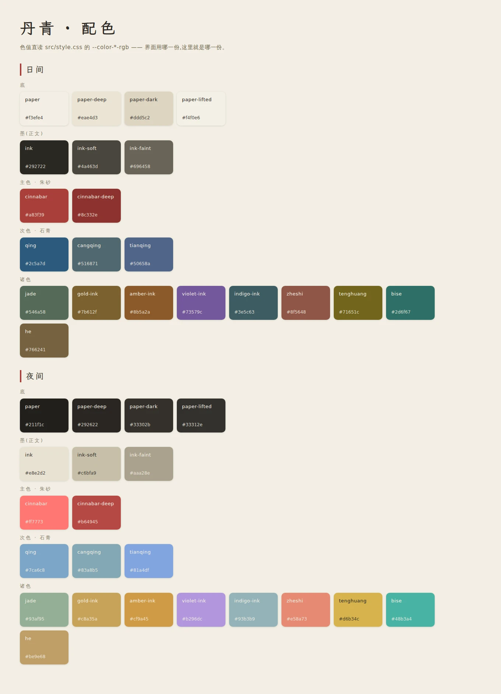

# 设计规范

## 配色:丹青 —— 水墨为底、朱砂为主、石青为次



> 上日间、下夜间。色值直读 `src/style.css` 的 `--color-*-rgb`(`bun run shots` 生成),
> 与界面同源 —— 改色只改一处,这张图跟着变。

`style.css` 存裸 RGB 通道变量(`--color-x-rgb`),`tailwind.config.js` 用
`rgb(var(...) / <alpha-value>)` 合成语义色 —— 斜杠透明度与 `color-mix` 两条路径共用一份变量。
夜间主题只覆盖通道值一处,就能同时换肤。

三色定了整幅画的调子:宣纸(`paper`)做底、松烟墨(`ink`)写字,**朱砂**(`cinnabar`,
主色:行动、要紧处)与**青**(`qing`,次色:信息、增益、可前往)是仅有的两个强色。

### 次色为什么是「青」而不是「蓝」

**题材**:国画里与朱砂并称的次色就是青 —— 「丹青」这个词本身即朱砂加青。蓝不是另一套
语言,它是青的深端(靛)。现代蓝色卡(blue/sky 那类)在暖宣纸底上读作网页超链接,
与水墨气质打架。

**可辨识**:色板里已有 `jade`(石绿一系的绿),青必须落在偏蓝的一侧才分得开,
故取石青而不是竹青。

**可读**:青是全站小字的主色(增益说明、属性数值、品阶名,10–11px)。原先照搬西式
`azure` 的明度(`#4F7699`)只有 4.17:1,低于 WCAG AA 的 4.5;国画颜料里的石青/花青
本身就是深色,压深到 `#2C5A7D` 得 6.38:1,反而更接近颜料真身。

界面实际承载文字的底色有三张:**纸**(页面)、**纸深**(顶栏底栏、胶囊)、**卡片**
(`--color-paper-lifted`,卡片与小册)。第三张最容易漏 —— 夜间主题里它比页面底色还亮,
浅色的字放上去对比度最低,只按前两张算会漏掉一整档(实测漏过一次:4.07:1)。
纸暗一档只做色块,不铺文字,故不参与。

| 用在哪 | 色 | 对纸 `#F3EFE4` | 对纸深 `#EAE4D3` |
| --- | --- | --- | --- |
| 正文 | `ink` | 12.99 | 11.75 |
| 次级正文 | `ink-soft` | 8.18 | 7.40 |
| 三级正文 | `ink-faint` | 5.13 | 4.64 |
| 主色(朱砂) | `cinnabar` | 5.32 | 4.81 |
| 次色(石青) | `qing` | 6.38 | 5.77 |

**承载文字的每一档都按 AA 取**(≥4.5:1,《palette.spec.ts》逐档核)。这条以前欠着:
石绿 2.95、藤黄 1.90、琥珀 2.84、天青 2.54 等十一档比现在还浅,而它们全在做 10–13px
的说明文字(增益、品阶名、灵根名)。压深之后反而更像国画颜料本身的颜色。

**纸上的墨只有三档**。原先还有第四档 `ink-ghost`(#B9B2A0,1.66:1)当最淡的一层,用在
118 处说明文字上 —— 但纸上放不下第四档还能读的字:再淡就低于 AA,再深就与 `ink-faint`
重合,故撤掉这一档,那些字落到 `ink-faint`。需要更淡的**装饰性**线条/色块(不是字),
用墨的透明度写:`border-ink/15`。

**印面是另一类角色**:`.btn-seal` 那行字是写死的奶油色 `#f6f1e5`,托它的底按
「奶油字 ≥4.5:1」取,而不是按它在纸上的对比度。暗色主题下这两种算法互相打架 ——
朱砂当字要够亮(255 119 115),当印面却要够深(182 73 69),故两边分工,见 `style.css`
夜间主题里那两行 `.btn-seal` 覆盖。

**禁用态:压色不压字**。按钮灰掉有两种做法,只有一种读得出来 —— 压色(边框/底色让位,
字保留一档能读的墨)读得出,压字(整块 `opacity-40`)读不出。禁用态那行字往往正是
「为什么不让我点」(「尚差 N 道源」「修为未至圆满」),它是答案不是装饰;整块压透明度
会让它和底一起向对方靠,实测浅色 2.31:1、夜间 2.94:1,连 3:1 都够不着,而
`getComputedStyle().color` 读到的仍是压之前的值 —— 源码里看着完全正常。
四个可禁用基类(`.btn-seal` / `.btn-ghost` / `.chip-ink`,以及当按钮用的 `.card-ink`)
各自带禁用态;夜间印面另有一档 `html[data-theme="dark"] .btn-seal:disabled`,
因为那条深朱覆写的特指度高过基类的 `:disabled`。

两条跟着来的写法约束(都由真浏览器那道门`scripts/layout-check.mjs`盯着):

- **文字不叠透明度**。`text-cinnabar/80` 这种写法算不出对比度,实测正好卡在 3.9:1;
  写字就用整色,要淡是设计的事(换一档 token),不是让浏览器去混。
- **同色底最多 6%**。「底 = 字色自己 6% 的墨」是品阶方块那类画法:底色比卡片亮一点,
  同色字放上去对比度就低一点。原先有 /8 /10 /15 几种写法,实测 8% 就已经掉到 4.44:1 ——
  6% 是既看得见底色、又托得住字的那一档,浓了就降回 6%(视觉上几乎看不出)。
- **投影墨不当纸上墨用**。色板上同名的两档墨分工:`--shadow-ink-rgb` 是投影的墨,夜间
  重定义成近黑(8 7 5);`--color-ink-rgb` 是纸上的墨,夜间翻成浅墨(232 226 210)。白天
  两者都是 41 39 34,看不出区别 —— 可一旦拿投影墨去画分隔线、进度槽、按下时的底色,
  夜间就成了「深纸上画深线」,22% 的透明度合成出来只差三五个色阶,等于没画。故 **只有
  `box-shadow` 许用投影墨**,凡是要在纸上被看见的(线、槽、滑块、冲击波)一律取纸上墨。
  背景里的墨浓度另有上限 25%:再浓就不是装饰,是第二条边框(`src/ui/ornament.spec.ts` 守着)。

### 命名与事实源

语义色名取中国传统色/国画颜料名,不取西式色名(`azure`/`amber` 这类):
`cinnabar` 朱砂、`qing` 石青、`jade` 石绿、`gold-ink` 赭金、`indigo-ink` 靛、
`violet-ink` 紫、`amber-ink` 琥珀、`zheshi` 赭石、`tenghuang` 藤黄、`bise` 碧色、
`he` 褐、`cangqing` 苍青、`tianqing` 天青。

九品色阶(凡→神)也照这套名字走,两两色差 ≥10(CIE76),相邻两档不许糊在一起 ——
压深之后最容易撞上的是地品(琥珀)与天品(藤黄),故一档偏赤、一档偏橄榄。

一份事实源在 `src/style.css`,界面与数据一律引用 `var(--color-*)` / utility 类名。
**引用的类名必须指向色板上真有的 token** —— Tailwind 对不存在的 token 不报错、不生成,
模板照写不误,浏览器照旧忽略:那个类编译后一个字节都没有,元素静默落到继承色。
这类缺陷行为测试看不见(元素在、字在、只是没颜色),人眼也容易当「设计就这样」;
实测清出九处,其中 `text-accent` / `text-ink-success` / `text-ink-warn` / `focus:border-azure`
指向的是**从来没定义过**的 token。判据按 `tailwind.config.js` 的 colors 与 theme.opacity
枚举(`uiLayering.spec.ts` 的「语义色类」),新增 token 自动纳入。
品阶九色(`qualities`)、器魂六阶(`souls`)、五行与特殊灵根(`linggen`)、天赋档位
(`talents`)原先各自手抄一份裸 hex,现全部改成引用变量 —— 它们从此跟着色板换肤,
也才有夜间档可言。

`public/privacy.html` 是唯一的例外:它是**独立成篇**的静态页(离线也要能直接打开),
只保留了它自己用到的几个颜色,与 `style.css` 是手抄关系 —— 改配色时两处都要动,
故 `palette.spec.ts` 会把这张手抄表与色板逐条核对。

## 版式:竖版文字风格,移动端优先

页面按手机竖屏的阅读节奏排:一屏一件事,长列表用卡片分组。
全量路由 × 五档视口的排版审计在 `scripts/layout-check.mjs`。

### 册页骨架:玄枢图 + 卷目栏

全站不再只靠五个底栏页签找路。顶栏左端是一枚方角「玄」印,打开 `玄枢图`:
十七册按修行、道场、行旅、身外、天机五卷展开,每册有一句「它回答什么」的说明,
当前页在图上留一枚「在」印。卷首先给一排「五卷总目」:五枚卷次快引同时报卷名与
册数,点哪卷就把下方对应卷宗卷到眼前;所有十七册仍完整留在卷宗里,不靠隐藏页签
省空间。桌面总图放宽到 52rem,五卷卷宗按两列铺开,末卷跨栏并把五册并读;
390 与 195 CSS px 仍按单列卷宗阅读。底栏仍只放洞府、修炼、历练、背包、人物五个
高频去处;其余页面从玄枢图进入,不再散落在人物页的入口卡里靠记忆寻找。

顶栏第二行是卷目栏,把原来的静态「分卷 · 当前册 · 此世何界」升级成五枚书口签:
修行、道场、行旅、身外、天机各落一枚单字签,直接翻到该卷首册,当前卷抬起并落一道
朱砂。它不重复页面内的大标题,也不替代页面里的可操作信息。矮屏隐藏这一行,窄到
195 CSS px 时五枚签仍保 28px 触达并收起册名与世界名,但「玄」印与当前卷落点始终保留。
同一档的五卷总目把快引从一排五列改成两列,末卷跨满末行,不再靠 27px 的超窄签硬塞。

顶栏本身是「书首」:左侧一枚双字玄枢印,中间是名号与境界,右侧灵石、灵气按账目
分开。卷目栏从 `navigationPositionOf` 同源读出「卷次 + 分卷 / 册次 + 册名」,
玄枢图、卷首和弹窗题签也读这一份位置;不再各自 `findIndex` 算一套序号。

详情页共用一枚 `FolioPageHeader`:分卷、册名与册目说明从玄枢图同一份数据读出,
父页兜底也收在组件里;页面不再各手搓「返回 / 标题 / 读数」三栏。卷首页口再摊出
本卷诸册签,同卷兄弟册可直接横跳,当前册与顶栏当前卷共用同一份 `navigationPositionOf`。
卷首主标题是真正的 `h1`,左侧返回只报父册,右侧动作与页内读数各有独立槽位;
195 CSS px 时动作落整行,不把册名与说明挤成竖排。

主五册(洞府、修炼、历练、行囊、道躯)与「人间」再走一层 `featured` 开卷版式:
册名、印章与读数放大成这一页的第一眼;`#backdrop` 铺世界色远山,
`#visual` 只放法球这类主视觉,默认正文槽承接行旅条与今日天时。它们仍与详情页
共用同一枚 `FolioPageHeader`,不是第二套页头;页面内不再另写 `h1`、旧 hero 或
同名的栏目标题。

修炼卷首用一枚「周天盘」承接仙路与修为进度:外圈二十一境读 `realmLadderPoints`
的三态,内圈读 `expProgress`,中心只报本境百分比与境界名;读数在正文完整呈现,
故整盘 `aria-hidden`,不重复进读屏。正文从「修行 / 破境 / 闭关」三张同权重卡收成
一张行功账:本境修为是主读数,行速与灵气退成两栏明细;破境与闭关共同归入
「下一步」,破境在前、闭关在后。桌面双页里卷首与行功账并读,「下一步」跨两栏
铺成一对;手机仍按同一阅读顺序单列。结构由 `cultivationDesk.spec.ts` 守住。

历练卷首用一枚「行旅罗盘」只报今日值日之宿与所利界域,四界位置从 `WORLDS`
现取,整盘同样 `aria-hidden`;本世路线、已行程数与眼下去处继续由
`worldView` / `mortalStageStatuses` 驱动,不另算一套进度。正文先把星象、本世所钟、
途中三档概率与遇事勿扰压成一张「今日行旅」说明账,再由「眼下可往」接住第一个
真正能出发的地界 —— 首个可行项读统一准入且排除镇压收益态,并在卡上抬出独立
青色左笔;秘境等旁路内容退到主线地界之后,行旅规则留在页尾。390px 首屏必须
看得到这枚出发入口,360px 起三档概率并读,桌面在原地展开三栏,不把历练顺序
拆成双页。结构与事实源由 `adventureDesk.spec.ts` 守住。

地界志把原来的卷首三格、行旅图、地界卡与来源卡收成一张「本世山河案」。卷首仍先报
世界名,但把地界、层级与已行压成一行总账,并把命数、所钟、换界代价摊在同一处;
桌面右侧的「山河盘」只做 `aria-hidden` 的段数与当前程方向感,精确状态全部留在正文。
正文的山河案先给 `MortalRouteMap` 全图,再沿同一条路线列出每段地名、镇守、事件密度、
眼下可往 / 旧路可往与统一准入结果;前尘山河另成一册,不复造一排同权卡片。
卷首山图、本世总账与路线标题共用 `worldDeskMeter`,阶段状态仍只来自
`worldView` / `mortalStageStatuses`;结构与事实源由 `worldDesk.spec.ts` 守住,
真浏览器首屏与 200% 缩放档由 `layout-check.mjs` 复核。

行囊卷首用一枚「九佩匣」只画九个装备席的已佩与空悬,外圈读行囊容量,整匣
`aria-hidden`;精确件数、新得与可换项都在正文完整出现。正文先把藏珍、新得、
可换、共鸣和收纳/分解入口收成一张「本批检点」账:新得切换、逐槽候选、一键换装
与穿齐共鸣分别继续读 `itemScope`、`equipUpgrades`、`equipAllBest` 与
`equipSetCombo`,不另算一套。九佩随后按三乘三落成器匣,全部藏品仍保留原来的
分批窗口与回翻。丹药页先给「丹房」的开炉与灵草坊,再列丹匣;材料页则按用途分
「炼制之材」与「修行所积」两组。手机检点账单列,360px 起容量与新得、可换并读;
220 CSS px 以下九佩、丹房与材簿改单列,藏品与丹匣保两列,避免 200% 缩放时把
席名与读数挤成竖排。结构与事实源由 `inventoryDesk.spec.ts` 守住。

洞府卷首用一枚「山门图」先给七作位置与状态意象:每座节点读真实等级与可达上限,
已营、满级与眼下一锤分别用石青、石绿与朱砂点标出,精确数字仍在正文,故整图
`aria-hidden`。正文的「营造总账」把已营座数、合府加成、每时藏收、门庭弟子与
离线存续阶梯收在同一处,并给出「眼前一锤」:它和建筑卡共用 `buildingUpgradeInfo`
与 `upgradeBuilding`,按下前就把目标级、灵石与玄铁一次摊开。七作从七张同形卡
平铺收成「基业 / 修行 / 丹器 / 生计」四组,每组建制数与可动工状态一眼可读;
坊市、门庭与灵脉退成三行门径,不再用大卡抢走营造主位。手机总账单列,
220 CSS px 以下七作与快捷键也改单列,避免 200% 缩放下价格与动作互相挤压。
结构与事实源由 `dongfuDesk.spec.ts` 守住。

门庭卷首用一枚「门庭图」先给谁在候差、谁在路上的方位感:每个门位读真实弟子状态,
在途者的弧长读差事进度,空位只按当前槽位补齐;姓名、归期与产出都在正文完整出现,
故整图 `aria-hidden`。卷首的「今日门庭」总账把候差、在途、最近归来与一键派发收在
同一处,最近归期直接报弟子名与差事名;一键派发仍按库存从 `needTargetDoor` 取单门
或退回各就本职,文案与回执不分叉。正文「值日簿」候差在前、在途按归期先后续列,
每名弟子同屏摊开品阶文字、本命门类、等级、羁绊下一档与进度;在途行只保留一条带
读屏语义的任务进度,并报归来可得之物,候差行仍保留「先展开说明、再点一次派出」
的两步动作。门规只读 `APPRENTICE_TALENT_BONUS`、`APPRENTICE_MAX_LEVEL` 与
`BOND_TRUECODE_MIN` 等机制源,品阶不再另借强色。手机总账单列,620px 起候差、
在途与最近归期并读;220 CSS px 以下读数、弟子行与门规退成单列,避免 200% 缩放时
归期和动作互相挤压。结构与事实源由 `apprenticeDesk.spec.ts` 守住。

坊市卷首用一枚「市桥图」先给货、赏、寄三摊方位:货摊读未售格数,赏摊读可交单数
并在有货可交时落一枚「可」印,寄摊按真实寄卖格点亮;精确件数、价格、缺口与倒计时
都在正文完整出现,故整图 `aria-hidden`。卷首的「今日行市」把可买/总格、可交/开单、
寄卖/格数与最近归账收在同一张总账里,三栏本身就能切到对应册页,不再只给一组读数
让玩家自己猜去向。正文货架改成逐格摊签:物件名、品阶、底档、价格与买不起/行囊满的
就地原因同屏;悬赏改成赏单,所需、缺口、酬劳与交货动作各占一位;售出拆成寄卖架与
即时柜,寄卖件报出售价、入账倒计时与真实进度,丹药与材料再逐项明码。总格数、可交数
与开单数仍由 `marketOverview` 一处汇总。手机总账三栏并读,960px 起货架、赏单与
寄卖架并读,220 CSS px 以下摊签、赏单与总账退单列,避免 200% 缩放时
价格和动作互相挤压。结构与事实源由 `src/ui/marketDesk.spec.ts` 守住。

天界卷首用一枚「天门星图」先给道、征、试、痕四册方位:道位读是否已择道途,
征位读已破天界与在途远征,试位读今日天道待战 / 已成,痕位读卷内道痕是否已开写;
精确道源、战次、首破数与余量都在正文完整出现,故整图 `aria-hidden`。卷首的
「今日天门」把道途是否已定、远征已破/总数、试炼首破/总数、道痕则数/上限收在同一张
总账里,四栏本身就能切到对应册页。先手只负责带路:在途远征先续行,未择道途先定道,
今日天道可战则先应题,其后才报可启程界数,不替玩家直接开战。道途正文把代价、章法、
剑意与叙事分层;熔炉与器魂仍是两处门径。手机总账两栏,960px 起四栏、道途两栏与
两处门径并读,220 CSS px 以下总账与门径退单列。总账、星图与页签朱点共用
`core/celestialOverview` 的同一份判据,结构与事实源由 `src/ui/celestialDesk.spec.ts`
守住。

器魂卷首用一枚「三席阵图」先把器魂、闲置与可凝落到同一张图上:三个席位只读真实
装配结果,空席报序号,闲置与可凝只在图下报当下能不能动手。卷首的「此刻器魂」再给
一条先手:有闲置先装配,三席已满先取舍,有可凝件再按道源是否够开炉带路,没有可凝
件才回行囊找下一件带形意的法器。三席正文仍逐席摊开名字、词条与卸下动作;两处门径
分别进入散置形意与凝炼台,章法退到页尾,但仍完整交代原器即毁、炉费与三席取舍。
手机总账三栏,960px 起两处门径并读,220 CSS px 以下总账、门径与章法退单列。
三席与阵图共用 `soulAt` 这一处判断,结构与事实源由 `src/ui/soulDesk.spec.ts` 与
`src/core/soulOverview.spec.ts` 守住。

藏珍卷首用一枚「九册藏珍格」把功名与藏珍两份总进度并置:九枚单字印按三乘三排布,
已开册用石青、尽收用石绿、新得用朱砂点亮,格下只报功名与藏珍的总数,精确册名、
来源与条目都在正文完整出现,故整图 `aria-hidden`。功名页的「功名状」只列最近三枚,
名称、条件、真实进度与去向同时摊开;方向卷目仍默认只开最近一路,点最近一枚或换一路
都会把焦点与展开态送到目标卷。藏珍页的「藏珍谱」先报九册整体与新得 / 将满,
最多先列三册新得,余册由同一枚收展入口带出;九册正文保留来源、尽收、分批、回翻与
「含新得」提示。手机最近三枚单列,620px 起并读;220 CSS px 以下格架入口与正文退单列,
避免 200% 缩放时册名、计数与动作互相挤压。九册单字印与格内读数由
`src/ui/collectionDesk.ts` 从同一份 `collectionProgress` 汇总搬运,结构与事实源由
`src/ui/collectionDesk.spec.ts` 守住。

界域志卷首用一枚「四界谱」先给四界长短与此刻落点:每界只读一枚单字印、已行境数
与当前三态,整图 `aria-hidden`;精确界名、范围与状态都在正文卷目完整出现。
「此刻在此」把当前境、界内序号、全路序号、前后境与二十一境刻度收在同一张卷首,
首屏不再从炼气一路滚到当前境。四界卷目用同一份 `realmCodexWorldRows` 汇总,
每界可独立展卷;境界谱格再按「已渡 / 此刻 / 未至」三态逐境列出,释文与典籍来路
默认收口,当前境默认展开,点典籍互链跳回时也会先开目标界与目标境。
手机卷目两列,620px 起四界并读、境界谱两列;220 CSS px 以下卷目与谱格退单列,
避免 200% 缩放时界名、范围与状态互相挤压。界印、范围、进度与三态由
`src/ui/realmCodexDesk.ts` 从 `core/realmCodex` 的同一份行搬运,结构与事实源由
`src/ui/realmCodexDesk.spec.ts` 守住。

名号与灵兽卷首用一枚「双印谱」把此刻佩印、相伴灵兽与两册收集进度并置:左印只读
当前名号与已藏数,右印只读当前灵兽与已结缘数,整图 `aria-hidden`,精确名字与状态
都在正文总案完整出现。名号总案把当前佩印与下一顶名号分成两栏,下一顶仍从成就进度
给出条件、比例与缺口;灵兽总案把当前相伴的品阶、词条、性子与结缘来路摊开。名号谱
与灵兽谱只负责逐条查阅、换佩 / 唤伴、分批续开与回翻,行态统一落成「佩 / 藏 / 未」
与「伴 / 契 / 未」。手机总案单列,620px 起当前与来路并读;220 CSS px 以下分数、
标签与换选动作退整行,避免 200% 缩放时名字和按钮互相挤压。两册进度与行态由
`src/ui/titlesDesk.ts` 从同一份拥有 / 当前选择搬运,结构与事实源由
`src/ui/titlesDesk.spec.ts` 守住。

设置页收成一册「天机匣」:卷首用一枚天机盘同时报声息、观照与存续三段,静音、主题
与备份旧新都只读真实设置 / `saveBackup` 状态,精确读数在卷首 meta 与正文完整出现,
故整盘 `aria-hidden`。正文先摊「声息 / 观照 / 行止」三案:背景音乐与音效各报开关和
当前音量,夜间模式与战报速度用账页式选项,减少动效与遇事勿扰把后果直接写在开关下。
其后的存续案把版本、修行时长、上次导出与备份状态摊在同一行账里,危险动作仍保留导入
确认与清档确认;留痕案只报最近一条异常与复制 / 清空;卷末索引再收关于、隐私与数值
来路。手机三案单列,620px 起前两案并读、第三案跨栏,960px 起三案并列;220 CSS px
以下选项、存续动作与留痕动作退整行,避免 200% 缩放时按钮与标签互相挤压。声息、
主题、备份与留痕读数由 `src/ui/settingsDesk.ts` 装配,结构与事实源由
`src/ui/settingsDesk.spec.ts` 守住。

轮回录收成一册「三生录」:卷首用一枚三生盘同报本世宿慧阶梯、随身所知与未了缘,
三弧各读 `legacyStageMeter` / `legacyCoverage` / 未了奇缘的真实比例,中心只留本世
境界与世数;精确读数在卷首 meta 与正文完整出现,故整盘 `aria-hidden`。修行画像
先于四册常驻,道痕不足时直接说出还差几则。轮回册把宿慧阶梯、灵材丹方器谱敌手与
此世命题收成一案,再以旧世归档续接;征程册分修行节点与宿敌,缘迹册分未了奇缘与
世界回响,纪录册只列跨世极境与「未立不是零」的说明。历世履历与行迹录仍按批续开、
回翻并把焦点送到新内容。手机四册单列,620px 起画像与两案并读,960px 起轮回三案
并读;220 CSS px 以下盘面、读数与行尾注记退整行,避免 200% 缩放时名字和数值互相
挤压。三生装配与事实源由 `src/ui/legacyDesk.ts` 搬运,结构与响应式契约由
`src/ui/legacyDesk.spec.ts` 与 `layout-check.mjs` 守住。

道躯卷首用一枚「命盘」先给根骨意象:外圈三段按攻 / 防 / 血在战力中的真实占比
分色,内圈最多五点读灵根,中心只报名号首字与修行倍率;精确读数都在正文完整出现,
故整盘 `aria-hidden`。正文的「道躯总案」把三围原值、`POWER_WEIGHTS` 权重与占战力比
放在同一行账里,右半账再讲灵根名号、资质、倍率与天然倾向,不再让同名的三项在上下
两张卡里各占一次主位。其下「行藏加成」仍逐项读 `finalStats.mods / breakdown`,
点开后保留来源、递增递减与软上限说明。九处去向从九张同形入口卡收成
「道途 / 缘法 / 行迹」三组册目:每行只报去向、当前事实与动作,原弹窗、徽标与
实时读数一个不少。手机总案单列并保留完整读数,720px 起战力与灵根并读;
220 CSS px 以下册目动作退到下一行,避免 200% 缩放时标题被挤成竖排。
结构与事实源由 `characterDossier.spec.ts` 守住。

首页的「修行志」不是若干同权重卡片的堆叠,而是一张有次序的案头:
壹「今日行止」只放系统递到眼前的一步(`firstStep` 优先,退场后由 `currentGoal`
接管),贰「主线」摊开长期方向、阶段进度与奖励,叁「今日日课」把完成数、逐项进度、
奖励与结算态放在同一格。洞府与天界退成「门径」书签,只保留去向和当下最要紧的读数;
天界有未做日课时才挂朱砂小印。案头不新增存档字段,也不替玩家改目标,所有数字仍读
`firstStep` / `goal` / `mainQuestAt` / `dailyRowsOf` 这组原有事实源。

案头在手机上是单列,360px 起日课两列;960px 桌面改成上方「今日行止 / 主线」并读、
下方日课横跨整张案头,不再把长账塞进右半页。320px 小屏若继续并排 140px 法球,
四字册名会被挤成四行,故收起纯装饰法球、先保住册名与今日一步;390px 仍保留同排主视觉。
结构与事实源由 `src/ui/homeDesk.spec.ts` 守住,真浏览器排版由 `layout-check.mjs` 复核。

视觉上采用册页而不是 App 卡片的语言:卡片方角、内收 3px 的纸边内框,章节头收成
一枚栏号签 —— 编号、世界色书脊与墨色副线同处一签,不再并列三套记号;弹窗沿用
同一道世界色上缘,底栏是一条有纸边内框的
五格册签。页内纸片与控件只留 2px 方倒角,旧的 `rounded` / `rounded-md` 中圆角、
旧底栏胶囊和旧顶栏布局不再作为视觉兼容层保留;
存档前缀迁移、旧 `.save` 导入与旧字段修复属于玩家数据安全,不是视觉 legacy,
继续保留并由 `saveMigration` / `rebrand` 判据守着。

常规页统一住在 `.folio-page` 页框里:左右留白、首尾留白与页面纵向节奏只从这里取,
195 CSS px 时页边自动收到 12px。页内 `SectionTitle` 由页框的 CSS counter 自动编号,
每页从 `01` 起,不再由各页手写章节号;眉题、标题、副读与右侧动作席也归这一处,
修炼账和行囊检点不再各画一套章首。卷首右上是一枚折角纸签,内层另有一道 3px
纸边内框;卡片也改成更平的压纸层,只留 2px 倒角、3px 内框与薄薄一层错版影。

未开启的终局册页不再用一块大白卡占位。天界与器魂共用 `UnopenedFolio`:前景先落
「封」印,再把**当前境界 / 门限 / 尚隔几重境**摊成一张门槛账,进度条与「此世行迹」
读同一对境界;末尾只给两条真实去处——回修炼与看境界谱。背景画天门与云气,只做
`aria-hidden` 的氛围层。这样玩家看到的是「离门还有多远、下一步去哪」,而不是一页
没有信息的留白;门槛数值由 `currentMajor / gateMajor` 现算,不再手抄「九重」。
结构与事实源由 `folioChrome.spec.ts` 守着。

构筑页的卷首是同一张「铸道盘」:六段契合弧、六枚路印与中心当前路印都读
`buildAffinityRows`,整盘只做 `aria-hidden` 的方向感,精确读数留在正文。道途未成时,
`BuildDiscovery` 先报眼下有没有核心词条、哪一路最近、差多少跨过雏形线,再把六路全谱
按实时契合排序摊开;每一路都列核心词条当前值、参考值与尚缺条数,末尾只给修行配功法
与行囊看装备两条真实去路。成路后,正文收成一张「铸道案」:道途阶梯报当前阶段与下一
门槛,五维形状可逐维展开词条贡献,下一步只列核心词条的当前值 / 参考值 / 尚差,实战面
把七类对局短板与主派封印后的韧性并读,构筑快照和旧构筑各成一账。阶段读数由
`buildStageMeter` 换算,缺口由 `buildCoreGaps` 从同一份 `BuildAffinityRow` 取,识别、
发现页与铸道案不许各算一套;结构与事实源由 `buildDesk.spec.ts` /
`buildDiscovery.spec.ts` 守住,真浏览器排版由 `layout-check.mjs` 复核。

### 开卷两页:山门总账与问心命书

欢迎页先立山门:题字、四界二十一境总账、三条本作守则与唯一的「启封入山」主入口同页;
桌面 820px 起把「山门 / 三则」并读,390 首屏主入口仍在折线内。建号页是一张命书:
留名、验根、定卷按一二三段展开,灵根圆盘、资质、倍率与天然牌面都从当前重掷真值读;
重掷保留读屏播报,踏入仙途才触发鉴定。760px 起桌面把留名与验根并读,极窄档仍单列并
锁住重掷动作一行。两页共用 `OpeningBackdrop` 的山影、日轮与纹线,不引入卡片皮肤;
结构与真浏览器判据由 `openingDesk.spec.ts` 与 `layout-check.mjs` 守着。

### 桌面书桌:左书脊导航,右册页阅读

手机与横屏仍是一张竖版单叶;960px 以上、游戏已经开局时,外壳从 430px 手机框展开成
最宽 88rem 的书桌。左侧不再是空白,而是一条真正可导航的「书脊」:它从玄枢图同一份
册目读出十七册,并常驻玩家名号、境界、寿元、此世与在世数。960~1099px 先收成
4.25rem 的图标书脊,保留 28px 触达高度;1100px 以上展开成 14rem,显示卷次、卷名与
册名。手机底栏在桌面退场,不再把五枚页签平均拉长到一千多像素。书脊本身也按 960px
断点真实挂载,不只在手机用 CSS 藏起 —— 十七册目录和身份读数不该占着手机 DOM。

顶栏收在正文列内。1100px 以上,它只报当前卷册、世界、灵石、灵气与设置,玩家身份
由书脊承担,避免同一份名号在左右两栏重复;960~1099px 的图标书脊没有册名,顶栏
仍保留玩家身份与玄枢入口。所有正文页先收成 48rem 的单叶,保证「历练」这类有严格
先后顺序的页面不会被无意义地拉长。

洞府、修炼、道躯三册的信息能成对阅读,再展开成
`1.08fr / 0.92fr` 的双页:修炼的「修行」与「破境」并置,道躯的「行藏加成 / 道途 /
缘法 / 行迹」按两栏续排;首页的「修行志」与人物页的「道躯总案」跨两栏,不把另一半
留成空白。双页中缝只画一道低浓度折影,真正的分栏由内容承担,不加第二套边框。

哪一册能双页读由 `src/ui/folioSpread.ts` 决定,不是「屏幕够宽就全部硬切」。外壳同时
带 `data-game-shell` 与 `data-folio-layout`:欢迎页与建号页不进入书脊书桌,而在开卷态
单独放宽到 72rem;单叶与双页也各有明确数据属性。源码契约在 `folioSpread.spec.ts`,
真实浏览器在 1280 档逐页核外壳宽度、
网格列数与单叶上限。书脊的册目完整度、当前册唯一与手机底栏退场由
`desktopSpine.spec.ts` 和同一轮真浏览器巡页守着,避免只改断点、App 没接上或宽屏
仍靠一条拉长的手机导航时假装完成。

导航与浮层也归同一套装帧,而不是另起一套控件皮肤:

- **玄枢图**是五卷总目加卷宗分册。顶部五枚卷次快引负责翻卷,下方每卷以方印、
  淡墨卷名水印与连续目录行展开;当前卷留朱砂书脊,当前册用「在」印标出。桌面
  总图按两列卷宗阅读,不再是一条从头滚到尾的窄目录。
- **页签**是书口索引签:上下两道墨线收住一叠方角索引,当前签只铺淡纸、底边落一道
  朱砂短线。选中态不是实心胶囊,滑动的是那条落款线,不是整块底色。
- **底栏**只在手机与横屏出现,是五枚书脚签:常态压回栏内,当前册抬成一张淡纸,
  顶端仍留朱砂短笔。图标角标与「可破境」提示与桌面书脊共用同一份信号,换壳不丢提醒。
- **弹窗**是一张摊开的笺:世界色上缘是书签带,题签先报分卷与卷页,右上角以
  「合」收卷;内收 6px 的纸边与纸纹共用同一层,不另加浮夸阴影。

这四处的结构判据在 `src/ui/folioChrome.spec.ts`,桌面书脊的独立判据在
`src/ui/desktopSpine.spec.ts`。旧版的圆角分段控件、两列入口卡、拉宽的手机底栏
和图标关闭键不再作为视觉兼容层保留。

### 字号只有五档，桌面按同一比例放大

**字号档位**：18 / 15 / 14 / 11 / 10
960px 以上的书桌按同一组变量抬成 20 / 16 / 15 / 12 / 11，卷首题字从 24 抬到 28。
手机与 200% 缩放档仍用前一组，不因桌面改版变大。

这些值只住在 `src/style.css` 的 `--type-heading / --type-section / --type-title /
--type-body / --type-note / --type-display`。模板写 `text-heading` 这类语义类，
不再写 `text-[18px]` 裸值；Tailwind 只负责把类名转发到变量。这样桌面放大时，
正文、卡片题头、页签、弹窗与导航一起换档，不会出现标题变大了、说明仍是手机 10px
的两套账。

这对数字与 `uiLayering.spec` 里的 `PAGE_TIERS` 是同一份清单 —— 判据会逐个数比对，
改动一处而不改另一处会当场红。
中间不许再长出 13 / 12 / 9 这类私档 —— 相邻两档只差 1px 时，读者分不出主次，
层次就塌了。这条由 `uiLayering.spec.ts` 的「主巡页 · 字阶同一套」逐页守着。

**排版角色**（`src/style.css`，每个角色只管字号/字距/行高，颜色由调用处挑）：

| 角色 | 用在 | 度量 |
| --- | --- | --- |
| `.t-card` | 卡片题头 | title 档 · 字距 0.1em |
| `.t-entry` | 入口卡 / 列表项的标题 | title 档 · 字距 0.2em |
| `.t-item` | 卡内条目名 | title 档 · 字距 0.25em |
| `.t-body` | 正文一句话 | body 档 · 行高 1.625 |
| `.t-note` | 脚注（紧跟正文，不另起一行） | note 档 · 行高 1.625 |

为什么要有名字：配色早有一整套 token 与五条判据，排版此前只有「竖版阅读节奏」
一句话。于是同一个角色被手写了上百遍 —— 正文那三连（`text-[11px] leading-relaxed
text-ink-*`）逐字重复 97 次，卡名四种字距并存。**没有名字的角色，每写一张新卡
就得凭印象抄一遍，抄歪了也没人发现**（字号档位那轮 9/12/13 私档正是这么长出来的）。

新增角色要先在这里登记，并想清楚它与前四个的差别；只差一点字距的不算新角色，
那是其中一档没写对。

**角色类住在 `@layer shared` / `@layer page` 里**。这两层定的是「谁让位」,不是装饰:角色
(`.card-ink` / `.chip-ink` / `.btn-seal` / `.t-*` / `.tap-row` …)裸写在
`@tailwind utilities` 之后时,同特指度下后出现的赢 —— 模板里拼在角色上的工具类会
**静默失效**(实测 36 处:胶囊上的 `text-[10px]` 仍是 11px、卡上的 `border-dashed`
仍是实线、`bg-cinnabar/6` 与 `shadow-lg` 一个都没落地,连秘境卡「未解锁 = 虚线框」
从上线起就没画出来过)。全局层序固定为 `reset < shared < page < app-utilities`;
页面样式随路由分片加载,但后到的 `page` 仍不会翻到工具类上面。角色定基线,
调用处的工具类永远能盖 —— 这才是上面「装饰性间距/颜色仍用 utility 拼」那句约定的
真实含义。层内仍是普通书写顺序,暗色覆写照旧按特指度与先后生效。

## 字体:三端统一用随包内置的楷体子集

正文走系统字体栈;标题、境界名、名号走 `font-kai`(楷体),**三端统一用随包内置的
霞鹜文楷子集**(`src/assets/fonts/`,1.7MB)。

为什么内置:iOS 的华文楷体与 Windows 的楷体(还属"中文补充字体",没装的机器本就没有)
各是各的字形,同一款游戏摆在一起会是三种气质。用的这一支是 **GB 屏幕阅读版** ——
GB 版按 G 源改了字形(原版源自日本的 Klee One,「这 边 过 运」的辶旁是日式两点辶),
屏幕阅读版把笔画调实,10~13px 的小字清楚得多。系统楷体退到字体栈第二位,
只替子集盖不住的生僻字兜底。

重做切片(加了新内容、字表不够用时,或要调片的大小):

```bash
uv run scripts/fonts/build-kai-font.py        # 每片约 180 常用字 + 700 储备字
```

子集分成二十来片按需下载(每片一段 `unicode-range`,声明是生成物 `src/assets/fonts/kai-subset.css`):
一份 1.8MB 的子集在冷启动时是整份下载的,而首屏真正用到的字不过一两百个 —— 切片之后浏览器
只取页面上真出现的那几片。字体覆盖与「切片 ↔ unicode-range 对得上」由
`kaiFontCoverage.spec.ts` 盯着,首屏到底取了几片、多少字节由 `scripts/first-paint.mjs` 量
(口径与实测见 [development.md](./development.md) 的「首屏与构建时长」)。

## 图标:全套水墨笔意(`src/ui/inkIcons.ts`)

图标是最后换掉的一层,如今**整层都是自己画的**:界面其余部分(宣纸底、松烟墨、楷体、
印章按钮、五声音阶配乐)本来就是古风的,唯独图标那一层曾是 lucide 的西式几何线性图标
—— 等宽笔画、圆头圆角、左右严格对称。单看没毛病,摆在楷体与印章旁边就是「现代 App」的
口音。

换的是**形与笔,不换语言**:同 24 网格、同线宽(2 起)、同圆头圆角。

- **形**用中式名物:山(洞府)、丹炉(修炼)、双剑(历练)、囊(背包)、打坐的人(人物)、
  灵石、云气(灵气)、墨齿毂(设置)、兽爪、枯骨、横头斧、长枪、仙禽、草檐屋舍、锻锤、
  灵苗、典籍、亭台(界域)、葫芦、文书、水纹…… 原先是火焰、登山包、人像、齿轮、
  西式尖顶小房子那一套。
- **笔**留一点手写偏差:峰不顶尖、两侧不对称、起收笔略短。
- **功能性图标只改笔不改形**:锁、开锁、分解、关闭、刷新这几枚是入口的形状约定 ——
  把「锁」画成中式挂锁可以,换成别的意象就让人找不到入口了。

每一枚都对着**真尺寸的真上下文**定稿(导航条 20px、背包格 16px、界域卡 16px)。其中两枚
改过两轮:斧(数据里刀、戈都归它)试过「大刃短柄」与「长柄小刃」,放进 16px 的背包格都
读成一把钩子,横头那版才立得住;长柄兵器(枪、钩都归它)原画「杖头一颗珠」,16px 下与
字母 P 无异,改成斜杆加倒刺才读得出是杆兵器 —— 只对着原型图看,这两处都会自以为是。

判据在 `src/ui/inkIcons.spec.ts`:常驻那八处必须是水墨版、每一枚都得在界面真的用得到
(画了没人用只是多出来的第二种语言)、笔路不许越出 24 网格、写死的图标名必须登记过
(认不出的名字会静静落成星芒,`shield-check` 就这样藏了很久)。

兵器的名目按件分开了:刀 `saber`、戈戟 `halberd`、枪 `spear`、钩 `hook`、斧 `axe`,
长条的鞭与尺归 `wand`。原先只分两类(刀戈斧都归 `axe`、枪钩戟都归 `wand`),于是
「长刀配斧形图标、长枪配枪形图标」这种近似对得上、细看不对的情形一直在。

敌人与灵宠的形按**族类**发(`src/data/beastFamilies.ts`),不按「大类够用」。原先是数据里
直接写 icon,于是 132 只敌人只用了 19 枚形:46 只挤在一枚骷髅里(独角妖狼、霞光巨蟒、
黑风妖王、玄冰蛟、万妖林主都是一枚骷髅),兽爪那一枚同时是野狼、野猪、石猿、灵狐 与
「麒麟」;灵宠那边应龙与螭龙幼子是星芒、麒麟是兽爪、雪背小龟是一面盾。现在数据里写的是
族类(`family`),形由 `BEAST_FAMILIES` 给出 —— 29 族对 29 枚形,146 条(132 名敌人 +
14 只灵宠)各归其族:狼 `wolf`、狐 `fox`、豕 `boar`、熊 `bear`、猿 `ape`、鹿 `deer`、
蛇蛟 `serpent`、龙 `dragon`、麒麟 `qilin`、龟 `turtle`、蝠 `bat`、羽禽 `bird`、鱼 `fish`、
走兽 `paw`、草木 `leaf`、水属 `waves`、亡灵 `ghost`、傀儡 `puppet`、剑器 `sword`、枪器
`spear`、甲士 `shield`、妖魔 `demon`、仙 `immortal`、神 `god`、灵 `sparkles`、星辰 `star`、
月华 `moon`、天外 `cloud`、金玉 `gem`(雷属那一条没立:御雷猴的名物是猴,归 `ape`)。

判据在 `inkIcons.spec.ts` 的「图标 · 族类」一节:**一枚形被一个以上族类共用即红**;另加
「同族共用同一枚形、数据不许自己写 icon」与「族类表里不留闲族」两条。新画的十五枚形都
在 16px(灵宠列表)与 18px(战斗面板)的真尺寸下核过 —— 走兽那一类形近,靠耳、角、吻、尾
这类可辨的部件拉开,不是靠原型图上的细节(斧与长枪当年就是这么返工的)。

## 动效

`rise-in` / `shimmer` / `pulse-ring` / `bar-grow` 等关键帧,`.stagger-in` 做入场序列;
动效只用来表达"发生了什么"(获得、进阶、进度推进),不用来点缀。

全站换页也按书页方向读,而不是统一上下淡入:从玄枢目录较前的册翻到较后的册时,
新页自右手边压进来、旧页向左退;回翻相反。欢迎页、建号页这类尚未入册的开卷才走
横向展开。方向由 `navigationPositionOf` 的卷次册次判定,顶栏书口签、卷首册签与
翻卷动效因此共用一套「前后」。位移只十余像素,不把正文甩出屏幕;
`prefers-reduced-motion` 与应用内「减少动效」仍把时长压到零。

书口签在常态优先报短册名,不只留单字猜谜:卷首册签从 390px 起露出两字短名,
顶栏五卷签到 720px 起露出卷名;320 与 195(200% 缩放)仍自动退回单字签,
不让导航本身把顶栏撑成两行。

## 无障碍

`prefers-reduced-motion` 下全局禁用动画;交互元素保留可聚焦性与语义标签。
小字的对比度账目(哪些一档过 AA、哪些还欠着)由 `src/ui/palette.spec.ts` 盯着。

**页面不许禁掉缩放**。`index.html` 的 viewport 从首个版本起写着
`maximum-scale=1.0, user-scalable=no` —— 低视力用户放大不了页面,而这条规范与 AGENTS
的移动端口径都在「按 200% 缩放防折行」上做了好几轮:一边修 200% 档的排版,一边把
200% 关了门。它当初大约是为了挡 iOS「输入框聚焦自动放大并顶偏布局」,而那是可以正面
解决的:**文本输入框字号 ≥16px**(iOS 的自动放大门槛是计算字号 <16px)。两条一起成立 ——
只关缩放是拿无障碍换省事。现由 `uiLayering.spec.ts` 两条判据守:viewport 不许含
`user-scalable=no` / `maximum-scale=1`,文本输入框一律 ≥16px。

另外两条在真浏览器里量(`scripts/layout-check.mjs`):

- **渐变与图片底上的对比度(第四十二条)**:`palette.spec.ts` 与「按声明色合成」那一条都只
  算得到色号 —— 底色一旦是渐变、纹理或图片,它们要么按最外层的默认白算,要么把半透明的纸
  当成不透明的纸。故这一条直接采样屏幕像素:把文字临时藏起来拍一张,逐像素问「这枚字落在
  这一像素上读不读得出来」,读不出来的像素超过两成就红。**它第一次跑就抓到一处真事**:
  外壳角上那两团云雾是 `bg-white/40`,白天是纸上的湿气,夜间把底色抬到 `rgb(78 76 74)`,
  没进卡片的淡墨小字(章节副题、栏目标签、列表注脚)掉到 3.8:1 以下。现在云雾按主题给
  明度(`.mist` / `.mist-soft`,夜间 0.06 / 0.04 —— 收到这个量才让 11px 的淡墨在
  最亮那一片雾上也过 AA)。
- **两百档字号(第四十一条)**:390 宽的机型按 200% 放大后,布局视口只剩 195 CSS px ——
  比 320 那一档还窄 125px,量的是**缩放档**而不是宽度档。尺子与巡页同源(同一个
  `measurePage`),判六条:横向溢出、外壳被滚偏、越界元素、主值行折行、**文字被挤成竖排**、
  **短动作标签被折行**(≤6 字)。
  后两条是补上的:此前只判前四条,而这一档恰恰最容易把「一行几块横排」挤成一条 ——
  实测 195 宽下 14 个页面把标题、属性名、动作键压成一字一行,门一路全绿。补它必须
  先逐页修完再收口(一把放开就是十几处同时红,逼人削判据)。
  按钮折行只算**短标签**:整宽长文案按钮(「散尽修为,重入轮回(清空存档)」这类)折行
  是读得出来的正常换行,不该判红。它抓到两处:
  设置页的 `input[type=range]` 按原生最小宽度把整行顶出去 6px(`min-w-0`),修炼页的
  修为行被挤成两行(`flex-wrap`,值整块落到第二行而不是折断)。
  器魂页的三列槽位在这一档改放开成两列:195 宽下每格只剩 49px,「显形·锋魂」六个字
  必然折成两截、动作键一字一行;放开后格宽 78px,名字与 36×32 的动作键都回到一行,
  320 / 390 两档不受影响。放开一律走 `tinylens:`(阈值 220px 只住在 tailwind.config.js
  那一行 —— 各处各写一遍 `max-[220px]` 就是两本账,改一处另一处不动,同一台 200% 的机器上
  会一处好一处坏)。
  这一档量**两遍存档**:主巡页那一遍是刚建号的空档,后期档那一遍是神人境 + 成套装备 +
  在途秘境。理由是空档量不出这一档真正的难处 —— 九位数灵石、满屏内容全挤在 195 宽里;
  与 320 那一遍同一个道理,只是那一遍的视口还没窄到 195。
  后期档这一遍当场量出四处(空档那一遍一页都碰不到,所以它们一直绿着):
  洞府建筑两列时每卡内宽只剩 51px,「连升×5 ·共 31.37万 石 400 铁」顶出卡片左右各 13px;
  在途秘境的「再入一层 / 出秘境」两枚并排各 61px,五字带字距放不下、折成三行;
  远征择路两径每格 52px,节点说明被压成三行竖排;修炼页灵气主值行两段(92px + 85px)
  挤在 128px 里,「· 已封顶」被甩到第二行。四处都改走 `tinylens:`(单列 / 上下叠),
  320 与 390 两档读数不动。**跨列的主卡在单列里要同时收回 `col-span-1`** —— 留着它
  会撑出第二条隐式列,卡片量到比整页还宽。
  另有一条量法上的坑:归来卷轴是 `:closable="false"`,Esc 关不掉;后期档的夹具
  `lastActiveAt` 在 9 小时前,于是**每个**新 context 一开都会弹它。320 那一遍从前没点
  「收下」,整轮巡页隔着一层遮罩在量,量到的是卷轴自己 —— 判据绿得毫无信息。现在先点
  「收下」,关不掉就直接报红(「这一轮量的不是页面本体」)。
  卷轴自己也在这一档量一次(压到 195 再还原,量完才收下):面板内宽只剩 113px,
  「修为」与「+46.39兆」并排时各自折成两行、整行 58px。这里判的是**数值那一段的行数**,
  不是「字有没有被压成竖排」—— 试过竖排那条:「修为」41px、「+46.39兆」48px 都够宽,
  一次都不会响。一条量不到真事故的判据比没有更糟。改法:极窄档标签一行、数值一行。
  判据还多一道分辨:数值的自然宽度**放得下**这一行却仍折了,才算被标签挤的;
  自然宽度本来就超出这一行的折行是正常换行(「7 件 · 尘+1,234」要 107px、行内只有 89px)。
  为此还收了两处:`BaseModal` 四层各 20px 的内边距在极窄档收成 12px(面板 155 → 171px,
  行内 113 → 145px —— 这是全库弹窗共用的原语,在它身上收一次比逐个弹窗补更省),
  「回收化尘」的数值改用通用简称(`7 件 · 尘+12`,全称在分解 / 重铸的代价行里仍在)。
  这一档还覆盖**只在某一步出现的浮层**:归来卷轴、渡劫结果、转世三步、引擎掷中的
  顿悟与洞府巡游。它们由 `clearOverlays` 收掉、或在巡页之前根本没触发,于是缩放档那一遍
  **一页都量不到它们** —— 归来卷轴就是这么一路绿着的。尺子只有一份
  (`measureDialogZoom` + `dialogZoomProblems`,判四条:顶出面板 / 竖排 / 短标签折行 /
  数值被挤折),四类场景各自在「按 Esc 之前」调它,读到的数并进 failures。
  **开局前两页**(欢迎 / 建号)同理:它们没有存档才可见,主巡页永远巡不到 ——
  实测旧欢迎页在 195 宽下把「开 始 游 戏」折成两行(79px 高)、把三枚底链各压成 25px
  宽的四字竖排,而这是玩家看到的第一屏。改法:主入口改为「启封入山」并锁一行,底链
  改为换行且每枚 `shrink-0 whitespace-nowrap`;建号页的重掷动作也锁一行,390 首屏
  仍量得到重掷入口。
  页面上**点得开**的那几扇弹窗(装备详情 / 丹房 / 器魂 / 灵脉)另起一个任务量:巡页
  不会去点它们,缩放档那一遍自然也碰不到。实测丹房方子卡三列并排时中间只剩 42px
  (代价折成六行、成品折成四行),器魂详情的「收 起 / 卸 下」各剩 68px、在空格处断成
  两行。这两类都不是溢出 —— 横向溢出与越界元素都量不出来。
  按钮族本身也在这一档收一次(`style.css` 的 `@media (max-width: 220px)`:
  两枚并排的页脚键各 68px,而 18px 的左右内边距吃掉四成 —— 内边距收成 8px、字距收成
  0.04em,`white-space` 不动:整宽长文案按钮在这一档仍该正常换行)。
- **28px 触达下限是两个轴(第四十三条)**:这条门曾经在 1280×800 的 /adventure 上
  报过一次「28px」的红 —— 打印出来四舍五入正好等于下限,实际是 27.6px 的子像素抖动,
  而那个按钮声明的是 `min-h-[28px]`。一条会自己变红的门比没有门更糟,故四处量 28px 的
  地方统一成:声明的 `min-*` 到了 28 的给半像素容差,报数带一位小数。
  原先只量**高度**:高度给足了,宽度可以窄到 7px 也算过 —— 实测「修为 5.7」那枚可点数
  只有 17.5px 宽、「▸来路」25px,高度都在 30~32px,判据一路绿灯。横向同样按 28 判,
  窄的那条用横向负外边距补(`-mx-1.5 px-1.5`),视觉位置一分不动。
- **控件的声明 = 控件的行为(第四十四条)**:器魂页的空槽位从前无论有没有器魂都挂着
  `role="button"`、`aria-label="空"`,tabindex 才给 -1 —— 读屏念出一个"空 按钮",按下去
  只把详情对象赋成 `null`,弹窗连开都不开。声明了 affordance 却不给操作,比不声明更坏:
  人会以为自己漏做了什么。现在的形状:卡壳不挂任何 role,「详情」与「卸下」是两枚同级
  原生 `<button>`,有无器魂由 `soulAt(i)` 一处判断(两枚按钮与空槽那句「空」都从它取值)。
  还有一笔账藏在排版里:词条行用 `w-full truncate` 收在一格之内,这要求祖先链上留着
  **有确定宽度**的 flex 容器 —— 容器自己若是 `max-content` 就跟着内容长,`w-full`
  退成 no-op。拆走外层 role 时顺手把这层容器删了,390 / 320 两档的三列网格就被最长的
  那条词条撑出去 53 / 64px(排版自检当场报出,量法见第四十条那一族)。
  三道门同守:`layout-check.mjs` 的 `deadControls` 与 `nestedControls` 逐页扫**看得见**
  的假按钮与套娃控件(前者豁免 role=tab 的 roving tabindex、置灰的 disabled /
  aria-disabled、零盒子;后者放过 `<label>` 里的原生关联与 role=tab 一类组合控件),
  `uiLayering.spec.ts` 的 `buttonNesting()` 再扫一遍**源码** —— 旧形状
  (`div[role=button]` 里嵌真 `<button>`)与「把卸下挪回详情里」都会当场红。
  同一道闸反过来也成立:**真能操作时才给入口**。空槽从前只写一个「空」,而玩家手上有
  闲置形意时那一格正是他下一步该按的地方 —— 现在补一枚「装配」,但它由
  `v-if="idleSouls.length > 0"` 决定**存不存在**,不是 disabled 灰着一枚(那又回到
  "念得出却按不动");点开的是那张清单由玩家挑一缕,不替玩家装某不知名的魂。
  夹具因此要留一缕不装:后期档原先两缕全装上,那枚按钮在 188 页 × 视口那一遍里
  一次都不存在 —— 门量不到的东西,绿得毫无信息(与 `data-value-row` 的活信号同一道理)。

## 镇压：收益受谁影响（查证记录）

- **灵石 / 材料 / 装备与境界无关**：`suppressYield()` 只看区域层级（`1 + tier × 0.15`），
  `stoneByTier()` 同理。同一区域同一时长，境界只影响修为那一路。
- **修为红利随修炼速度涨**：`expGain = cultPerSec × 每秒 8%(每区,封顶 40%) × 时长` ——
  这条本来就该跟着境界走，它是「同源挂机曲线」。玩家感觉到的「境界影响」来自这一条。
- **转世会清零**：`rebirth()` 清空 `suppressedRegions / suppressQualified / suppressedSince`
  （见 `core/samsaraAudit.ts`），界面也已写明「转世重修后需重新镇压」。
- 教训：此前两次「实测境界差 1.8 倍 / 18 万倍」的读数都是**测量方法错误**
  （两次结算塞进同一个测试、以及只比较 GNum 的尾数 `m`）。单次干净实测：两个境界都是 180。

## 洞府为什么不显示「回本时间」

看起来是个好指标,实际算不出来:七座建筑里 `洞府` 抬离线上限、`炼丹炉/炼器台/藏经阁` 给的是
能力或保底;真正产资源的是 `灵田`(灵草)、`聚灵阵`(灵气)等,而它们的**成本是灵石** —— **本作没有定义灵石与灵草的兑换率**,
所以「花 N 灵石多久回本」无法成立。灵脉那条有明确的分红数字,已在 `VeinInvestCard` 里给出。

要提供类似信息,先要有一个官方兑换口径(目前没有,也不该为一个界面而临时发明)。

## 数字一律等宽（tabular-nums）

界面上到处是每秒都在变的读数：灵石、修为、进度 `x/y`、趟数。比例数字的宽度随数值变化，
整行会跟着「抖」——同一屏里几个读数一起变时尤其明显。

规则写在 `body` 上（`font-variant-numeric: tabular-nums`），不是逐个加 `.tabular`：
漏一处就会有一处抖，而漏掉的那处恰恰最难被注意到。新增组件时无需再操心这件事。

## 视觉基线（可复算，别凭感觉）

改界面前后各算一次，数字变了就能对症：这些值都是**不靠眼睛也能量**的。

| 项 | 当前值 | 怎么算 |
| --- | --- | --- |
| 弱字对比（明亮） | `ink-faint` 对纸 **5.13 : 1** | token 取 `--color-ink-faint-rgb` / `--color-paper-rgb`，按 WCAG 公式 |
| 弱字对比（夜间） | **6.47 : 1** | 同上，取夜间那组通道值 |
| 字号分布（17 页合计） | 9/10/11/13/14/15/16/17/18/19/20/22/30 px | 每页遍历文本节点取 `font-size`，合计计数 |
| 外壳一致性 | 15 页共用一套内边距 | `visualRhythm.spec` |
| 裸色 | 组件内 0 处（2 处注明例外） | `visualRhythm.spec` |

口径说明:

- 弱字两档都高于 AA 的 4.5:1 —— 觉得「糊」时先看**字号**，再看颜色。
- 字号里没有 12px 是刻意的:11 → 13 之间不放档，避免两档只差 1px 而难以区分。
