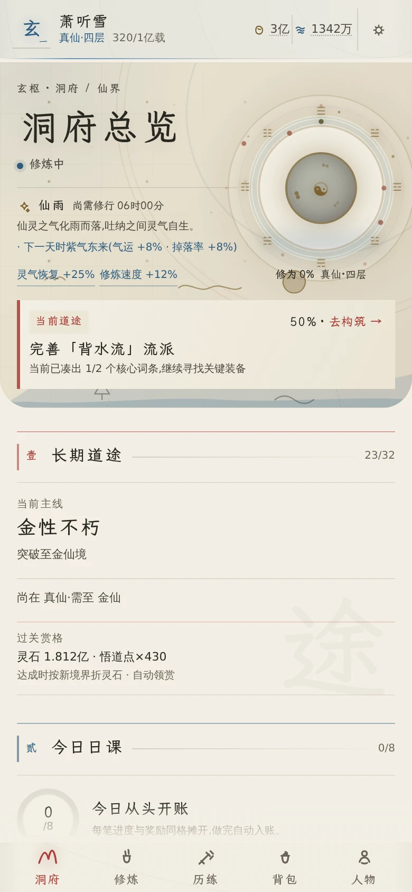
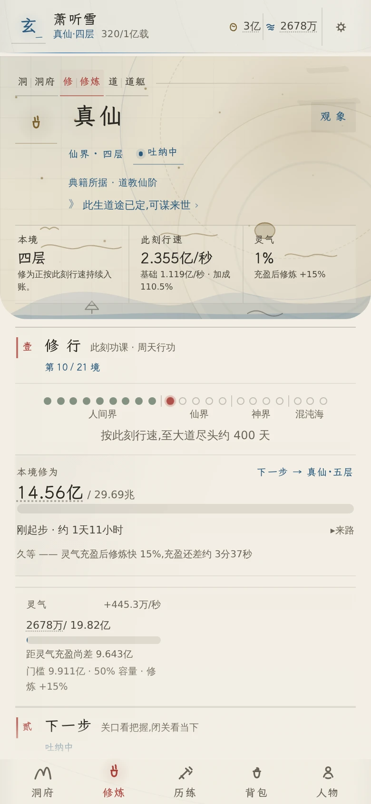
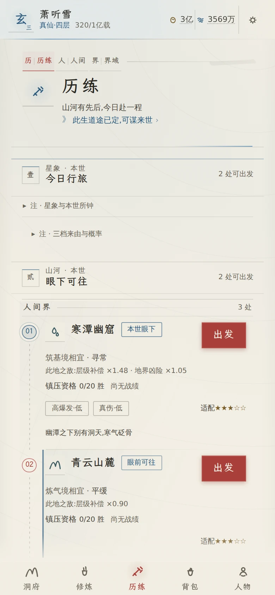
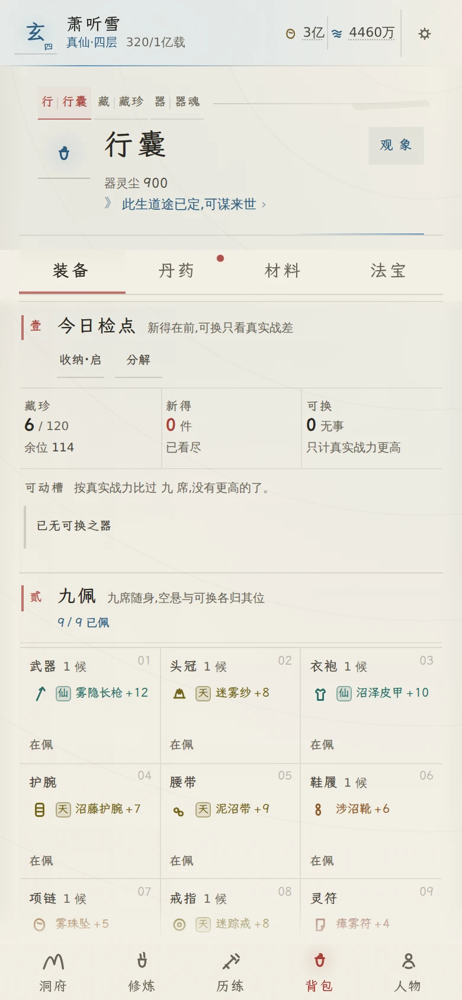

# 玩法与系统

这份文档回答"这游戏有什么、怎么玩、数值怎么算"。开发、部署与发版见
[development.md](./development.md) 与 [deployment.md](./deployment.md)。

## 界面速览

| 首页 · 下一步 | 修行 · 突破 | 历练 · 派遣 | 背包 · 装备 |
| :-: | :-: | :-: | :-: |
|  |  |  |  |
| 天时、今日一步与门径 | 闭关、突破与渡劫 | 秘境、地界与镇压 | 九部位与全部藏品 |

更多界面见 [README 的「界面一览」](../README.md#界面一览)。

## 开局长什么样

新建一世 → 测灵根、定天赋 → 引气入体,进入第一层。

- **首页**给你一张"下一步做什么"的指引卡(主线进度、可做的事、离线收益结算);
- **修行**攒修为,攒满可突破;**突破**要渡劫,失败会掉修为但不掉境界;
- **历练**是派遣式的:选一处去得了的地方、定下时长,回来看遭遇与掉落;
- **洞府**离线产出,回来收一次;
- **每日**给当天的方向:三条每日任务 + 可反复做的日常。

寿元耗尽入轮回,重开不是从零:见识、道侣与部分积累跨世保留,17 种人生主题决定新一世的命题。

## 一天的循环

1. 收洞府产出与离线收益(在线时也会自动结算);
2. 花掉修为与资源:突破、升功法、炼一炉、装备换一件;
3. 派历练(有时间就挂着),或者手动打一场;
4. 看一眼每日与主线,把"下一步"做掉。

## 游戏特色

**四界二十一境,渡劫而上。** 人间界(炼气 → 渡劫)、仙界(真仙 → 大罗)、神界(神人 → 神帝)、
混沌海(混沌真灵 → 混沌道祖),每境九层至圆满,突破需渡劫 —— 5 类天劫(雷鸣 / 逆流 / 裂魂 / 铁躯 / 重压)
各有克制之法。11 种灵根(五行 + 风雷冰光暗 + 混沌)与 34 种天赋决定这一世修炼的快慢与难关。

**66 部功法,147 条分支。** 主修、辅修、秘术三类可同时装配;练至圆满开启悟道分支,
同一部功法因此走出完全不同的流派 —— 加什么、舍什么,是这一世自己的选择。
择定那一刻会留下一行道记(见下文「悟道与道记」),此后每次翻开这部功法,
都还看得见当时几岁、走到哪一境、舍了哪几条路。

**44 个区域、140 种敌人,排着队等你。** 历练是派遣式的,首领通关解锁下一区;
途中穿插 104 个随机事件 + 12 类机缘,以及道侣、灵兽、天时与灵脉各自的变数。

**搭配,而不是单堆。** 10 个装备槽位、288 种模板(一阶一名)、113 条词条、9 级品质;
同类词条按 1 / 0.75 / 0.5 / 0.25 递减,攻击生命速度等超过软阈值后收益衰减 ——
把同一种堆满不如凑出组合。器魂是另一层:飞升后数值归零,6 类 × 6 阶器魂占 3 个槽位,改的是路数。

**技艺不足不是"不能炼",而是炼出什么样的成品。** 9 门技艺(识材 / 辨药 / 配伍 / 凝丹 / 淬药 / 养丹 /
控火 / 锻打 / 铭纹)各自成长,进炉之前你有得选:凑材料、换配比、还是赌一把。69 种丹药、45 件法宝。

**灵兽、道侣与师尊:让这一世不一样,而不是更快。** 40 只灵兽每界至少两只可挑,性子会改历练中的遭遇走向,
每一只还有一句只对你说的话(契语,见下文「灵兽契语」);
10 位道侣与 4 位师尊各有目标与理念 —— 它们不进效率链,只让你在同一个世界里活出不同的样子。

**轮回之后,重开不是从零。** 寿元耗尽入轮回,5 个阶段逐世积累"见识";17 种人生主题决定这一世的开局与禁忌。
真仙之后还有 7 条道途、5 重天界远征、8 种试炼、13 种契约、17 类变数,组合出每个周期都不同的规则宇宙。

**图鉴与目标:看得见的进度。** 装备、功法、悟道、丹方、灵材、法宝、灵兽、见闻、天赋九册逐条解锁(敌人认知在战斗里、界域志在「界域」页,是独立面);66 个成就、32 个主线任务
与 29 枚称号贯穿全程,每日任务负责给当天的方向 —— 打开游戏永远知道下一步做什么。

**国风音画。** Tone.js 播放 FluidR3 真实乐器采样:古筝主旋律、琵琶对答、木鱼点击、太鼓鼓点、
编钟突破、编磬提示;界面是水墨色系,三端同一份配色与字体(见[设计规范](./design.md))。

## 今日天道：一天一题，过了就白丢

天界页的「试炼」里有一道**每日题**:日出换新题,当天不做,第二天就换成另一道,昨天的不会补。
没做的时候,首页最上面会挂一枚朱印「今日天道未做」—— 只看首页的人也漏不掉。

## 系统一览

| 系统 | 说明 |
| --- | --- |
| 境界 | 4 界域 × 21 境 × (九层 + 圆满),突破渡劫,5 类天劫;突破卡给出成功率与平均尝试次数 |
| 灵根 | 11 种(五行 + 风雷冰光暗 + 混沌),影响修速、劫难减免、功法契合 |
| 天赋 | 34 种,分凡赋 / 灵赋 / 天赋 / 道赋四等 |
| 功法 | 66 部（主修 / 辅修 / 秘术），圆满后开启 147 条悟道分支 |
| 历练 | 44 区域 × 140 敌人,派遣制会话,104 事件 + 12 机缘,首领解锁下一区;派发前的模式行给出「预计材料 ≈ N 件」与「装备 / 丹药 各约 N 趟一件」 |
| 战斗 | 后台完整预解算再回放,速度 / 暴击 / 护盾 / 吸血 / 反击 / 控制 / 组合技 |
| 装备 | 10 槽位 · 32 阶 × 9 部位 = 288 模板(一阶一名)× 113 词条 × 9 品质,词条递减 + 软阈值;多余的件可分解成器灵尘;灵品以上另有器铭(见下) |
| 器魂 | 飞升后数值归零,6 类 × 6 阶器魂占 3 个槽位,改路数而非堆数值 |
| 洞府 | 7 建筑离线产出 + 7 条灵脉投资分红 |
| 技艺 | 9 门(识材 / 辨药 / 配伍 / 凝丹 / 淬药 / 养丹 / 控火 / 锻打 / 铭纹)独立成长 |
| 炼制 | 69 丹药 + 45 法宝,技艺水平决定成品品相而非成败;开炉卡写清成功率与「平均几炉成一炉」 |
| 灵兽 | 40 只,每界至少两只可挑,出战加成、性子与各自的契语 |
| 术数 | 星象 28 宿 · 紫微 12 宫 14 主星 · 周易 64 重卦 · 奇门八门 |
| 人缘 | 10 位道侣 + 4 位师承,道侣纯叙事不给属性,师承轻量词条并入终局属性(给方向不封构筑) |
| 轮回 | 5 阶段积累见识，17 种人生主题定开局与禁忌 |
| 终局 | 7 道途 + 5 天界远征 + 8 试炼 + 13 契约 + 17 变数 + 短期秘境 / 天道熔炉 |
| 任务 | 32 主线任务 + 每日任务 + 66 成就 + 29 称号 + 图鉴(装备 / 功法 / 悟道 / 丹方 / 灵材 / 法宝 / 灵兽 / 见闻 / 天赋) |
| 人物 | 道躯三围、灵根牌面的名号与 ×倍率、流派装配,及丹药增益的「现效合计」 |
| 坊市 | 货架三档(丹药 / 材料 / 兵刃)按墙钟换新、寄卖装备到期自售、悬赏交料换代金 |

## 多个标签页 / 多个窗口

同一份存档只允许一个页面写入 —— 两个页面各按自己的节拍落盘,后写的那份会把先写的进度盖回去。

- 先打开的那页是**写者**;后打开的那页进入**只读**,顶部常驻一条「已在另一处打开 · 本页只读,进度不会保存」;
- 只读页不跑心跳,也不结算寄卖自售、货架换新、弟子归来 —— 数字停在你打开存档的那一刻;
- 在只读页真动手(买、派遣、改设置)时会当场提示「这一步没有保存」,不用等刷新才发现;
- 想在这一页接着玩:关掉另一处,等横幅变成「另一处已关闭 —— 刷新本页」,点一下刷新就接回写权。

## 存档写不进去

浏览器存储满了(或不让写)的时候,这一会儿的进度落不了盘。游戏不装作没事:

- 首次失败会弹一条提示;设置页的「存档」卡片里还有一条**常驻**的:「上次写入存档失败 —— 浏览器存储可能已满」;
- 落盘每 5 秒会自己重试一次。腾出空间之后那条常驻提示会**自己消失**,并报一声「存档已恢复写入」—— 不必刷新,也不必重开;
- 失败时磁盘上留着的还是**上一版存档**,不会被半截写坏;但那一版之后的变化确实还没进去。

真要腾地方或换设备时,顺序是:**先在设置页「导出存档」留一份** → 清缓存 / 清理浏览器数据 / 换一台设备 → 在新设备上「导入存档」。导进来的文件解析不了(既不是本游戏的密文,也不是合法 JSON)会当场说「文件内容无法解析」,不会静默失败。

## 世界的记性（世界记忆）：区域的「混乱 / 稳定 / 繁盛」

历练页的地名旁会挂一枚小印。它是这一处的**兴衰**:初始为**混乱**,在这里稳稳守过一段时间、
或打出足够的胜场,就升到**稳定**,再往上到**繁盛**。反过来,久不来(约 72 小时)就一路回落到混乱。

它改的是**镇压**那一路的收益:混乱照常,稳定 +5%,繁盛 +10%。晋升是取先到的那个条件(守土时长或胜场),
两样都差一点就停在原档;回落是硬开关 —— 满 72 小时那一刻直接回最低档,不是慢慢衰减。

## 成色的话：67 分算好还是差

灵品以上的装备各有一道**成色**（词条掷点的均值，0~100）。器评帖上原本只写

```text
成色 67 /100
```

67 是什么水平？满掷才算好？及格就行？同品的另一件是 82，差多少？一个既像分数、
又没有任何标尺的数，是界面里最容易让人误读的东西。

现在那个数旁多一句评语：

```text
成色 67 /100 · 中上
```

| 成色 | 评语 |
| --- | --- |
| 0 | 尚未淬出 |
| 1–19 | 下下 |
| 20–34 | 下 |
| 35–49 | 中下 |
| 50–64 | 中 |
| 65–79 | 中上 |
| 80–99 | 上 |
| 100 | 掷满 |

中间五档等距（各 15）——掷点是**均匀**的，所以「中」正好在 50，不能按正态分布去切，
否则「中」会吃掉一大半、两端几乎不出现，评语就失去了分辨力。两端各留一段更宽的
过渡带（1–19 与 80–99），因为玩家最容易在「刚出坯」与「将近掷满」这两处问「这算不算好」。

坊市的验货签读同一句——买之前就该看得懂。

## 提示条的去路：拾得的那一条，点一下就能看

「灵光乍现，拾得「天品·玄铁重剑」· 铭「问山」」—— 这是玩家**唯一**看见「我得到了什么」的地方，
几秒后消失。此后想再看那一件的词条、器铭与对比，得自己判断它落在行囊哪一格、翻进去、再点开。

带回看价值的提示现在末尾多一个「**看 ›**」，点一下直接打开对应详情：

| 提示 | 点开 |
| --- | --- |
| 拾得装备（灵品以上） | 这一件的器评帖 |
| 法宝入手 | 法宝详情 |

不填去路的提示一字不多 —— 「灵石 +3」「丹药不足」这类没有可看的东西，点一下只是收掉自己。
去路是**动作**而不是路由链接：提示条浮在任意页面上，做成链接会把玩家从现在这一页带走，
而他可能正在看战斗回放。

## 册目读法：一句话里只有一种数字

「第几册」在界面上有三处读法，现在统一成汉字：

```text
顶栏      第三册 · 行囊
玄枢图    卷三 · 第三册
册目清单  一  二  三 ……
```

此前星图读作「卷三 · 第 03 册」——一句话里前半句汉字、后半句两位阿拉伯数字；顶栏读「03 · 行囊」，
更像页码而不是册次。

**但行号不是册次。** 成百条的列表（行囊 200 件、藏珍 400 枚）仍用两位数字：
那是**计量**，两位数字更易扫读、对齐也更整齐；而册次是**体例**（五卷、十七册），
读作序数词才与「卷三」「壹贰叁」「乙丙」同一套。

## 卷首水印：每页那枚最大的字，写的是汉字

每一页卷首都压着一枚水印（全屏最大的字），写着这一页是**第几册**。它现在是汉字：

```text
行囊 一    修炼 二    名号 三
```

从前它是 `01`、`02`——而这一作里所有读得出来的序数都是汉字：卷次写「卷三」、
章序写「壹贰叁」、页签写「乙」「丙」。页面上最重的视觉元素，反而是唯一一处阿拉伯序数。

汉字与册次同源（都从册目位置推出来）：机器核对用 `data-folio-ordinal` 上的数字，
玩家看到的是汉字。十以上读「十」「十七」，不会出现「一十」。

## 重铸预算：按下「开洗」之前，先把这一押的价摊开

自动重铸那一块原本有三样分散的读数：预算「至多洗 50 次」、单价「每洗 器灵尘×30 · 灵石 800」、
逐条的「按当前门槛，约 20 次」。唯独没有把它们乘起来的那一个数——**这一押最多花掉多少**。

玩家要决定的是「押不押」，而那个问题要的是总价：单看「每洗 30 尘」会觉得便宜，
乘上 50 次才是真的要花掉的数。

现在那一行写全：

```text
每洗 器灵尘×30 · 灵石 800
洗满 50 次至多 器灵尘×1500 · 灵石 40.76万
```

- **是「至多」不是「预计」**——自动重铸会提前收手（命中即停、付不起即停），
  所以预算次数对应的是上界，那是能算准的；「预计」要按命中概率加权，那另一个数
  已经由逐条的「约 N 次」给出。两个数混成一句会自相矛盾。
- **改预算就改总价**——它是乘出来的，不是写死的。
- **付不齐时写差多少**——与全库「灰钮要写差多少」同一条纪律，不只说一句「不足」。

## 未行之道：择定之后，另外几条路还在这一页

择道是这一作里少数**不可撤销**的决定之一，界面上为此写了二步确认、终身不改。
而按下「确认择道」之后，那段列表整个消失——只剩自己这一条的名字与词条。

**未行之道**补在已选分支那一块的最末一行：

```text
未行  守御 太玄入守道,护体更坚 · 归一 万法归一,气机更纯
```

- **只列没走的**——自己那条的名字与词条就在上一行，再列一遍是同一屏说两遍；
- **每条都带「它当时会给什么」**——只有名字等于「知道有个别的名字」；
- **顺序与择道那一刻相同**，不重排；
- **写成字，不写成按钮**——它们已经不可选了，长得像按钮才是骗人。

藏珍的悟道录那边一直留着它们的「已见」（`branchStage` 据此判定），这一行只是把同一个事实
放回玩家刚做完决定的那一页。

## 共鸣缺口：还差哪一件，以及下一步做什么

五组装备共鸣（铁壁 / 星斗 / 仙甲 / 神铠 / 混沌）各有名称与效果，但器评帖此前只写一句
「共鸣『铁壁共鸣』1/2」——知道不够，不知道**差哪一件**、那一件**在哪儿**。

现在那一行会说全：

```text
还差 1 件凑成「铁壁共鸣」：头冠·玄铁冠（在行囊，换上即可）
```

三种「差」分开说，因为下一步完全不同：

| 处境 | 读法 | 下一步 |
| --- | --- | --- |
| 在行囊（没穿） | （在行囊，换上即可） | 去行囊换上 |
| 见过、手上没有 | （见过，去刷） | 回那一带刷 |
| 连见都没见过 | （未曾见） | 先探到有货的地方 |

「见过」以**图鉴的见闻**为准（`lore.equipLore`），不是「行囊里有」。凑齐之后那一行整行不出。

## 道历：图鉴上写的是「你在第几世、多大岁数」收录了它

界面上其余每个时间字样都在世界内：寿元多少**载**、此去多少**时辰**、第 N 世、
若干**年**后。唯独图鉴每一条的页脚曾经写着系统日期——「收录时间 2026-11-04 14:32」。
它一眼就把人从道历里拽出来，还带时区：同一份存档在东八区与 UTC 会读到不同日期，
而「收录时间」听着像一件已经写在册上的事。

现在页脚读的是**道历**：

```text
收录时间    第 3 世 · 47 岁
```

历法不用发明——第几世与年岁这两枚事实早就有了（`player.reincarnation.count`、`player.age`）。
它们在收录**那一刻**被记下来，之后不随你变老而改：第三世四十七岁录进册的那一件，
第十一世再看它，仍写「第 3 世 · 47 岁」。

旧档里已收录的条目没有这对读数，照实说「早年收录」，不按现在的年岁往回编。

## 历世足迹：转世带得走的东西里，还有「你到过哪里」

转世会把境界折回起点——这是规则，新的一世从炼气重新开始。可它同时抹掉了另一件事：
**这一号人物曾经走到哪一境**。

界域志因此曾经有一处说不通：谱上专讲境界，却只知道「当下」。你上个月刚从真仙转世下来，
真仙那一行照样写「未至」，历世履历里明明记着。

**历世足迹**补的就是这一段：

- 谱上那一行改读「**曾至**」——当前境之上、历世到过的那几境，石绿字与虚线印面；
  当前境本身仍是「此刻」（「此刻在真仙」比「曾至真仙」信息量大）；
- 卷首多一行「此身曾至 X」——**只在这一世还没走回那高度时出现**，
  此刻即历世最高时整行不出（否则与「此刻在此」同屏说两遍）；
- 它**只增不减**：转世折回起点抹不掉，手改档写大也不算错；
  读档时若比此刻这一境低，按此刻补齐——老档没有这一栏时不至于把你现在的境界说成「未至」。

它**不进任何门槛**：`major` 仍是唯一决定你能做什么的数，历世足迹只用来读。

## 品阶印：好东西落地时，屏幕上要看得出来

得到一件高品之物与「灵石 +3」曾经长得一模一样：一句灰字、两秒、消失。
品阶印让那一条提示自己带上这一档的印 —— 阴文章,色与单字都取自品质表。

盖印的四处：**装备拾得**（灵品以上）、**法宝入手**、**神兽结缘**、**参悟出功法**。
其余一百多条提示不盖印，排版与从前一字不差。

印是**可选的载荷**：`notify(text, kind)` 多认一个可选的品质 id。
core 只说「哪一档」，色与字由界面去品质表取 —— core 不该知道十六进制色值。
写坏的档位整枚不出（半枚印比不盖更糟）。

## 品评：九档品质各有一句话

品质本身就有一条九档的梯子（凡 → 良 → 精 → 灵 → 玄 → 地 → 天 → 仙 → 神），
但它一直只以「颜色 + 名字 + 一条三条词条的上限」出现在界面上——玩家看得出哪件更贵，
说不出**凭什么**。

品评给每一档一句短评（「山野之物,堪用而已」→「开天之属,见之当拜」），落在三处：

- **装备详情**的眉题行：品阶名之后、器类之前，与那一行其他事实同处一行；
- **坊市买前验货**：买之前就知道这一档凭什么；
- **藏珍详情的图鉴条目**：装备、法宝、丹药、灵兽、功法与悟道分支带这一句；
  灵材、见闻、成就没有品阶，整句不出。

它与品阶名分工固定：品阶名管**分类**（两三个字，进得去格子与徽章），品评管**分量**
（一句半，进得去眉题一行）。不写数字、不重复品阶名——那两样各有出处。

## 悟道与道记：一次终身不改的选择，该留下什么

一部功法修到圆满,可以从它的几条道里择一条走到底 —— **一经择定终身不改,连转世都带得走**。
界面上把这句话写得很重,所以择完之后也不该只剩一枚词挂在功法名旁。

**道记**就是那一刻的落款,记三件事:

- **当时几岁、走到哪一境**。年岁取整、境界名与层数都从境界表读,不另写一份。
- **舍了哪几条路**。同一部功法当时可选的其余分支,一条条列出来 —— 「我没走的那条叫什么」,
  比「我走了哪条」更能说明这一次选择值多少。
- **它此后一直在**。翻开这部功法的详情、或在悟道录里读到这一条,落款都在同一行;
  关掉再开、整页重载、导出再导入,它一字不改。

道记**不进任何结算**:不给词条、不改概率、不参与排序。它记的是「你是怎样走到这里的」,
和器铭、契语同一条纪律 —— 描述,而不替你做决定。

> 分支加成与落款的寿命不同:转世把功法层数折回一层后,分支加成会随之失效(那是继承价),
> 但落款留着 —— 那一年你确实在那里。

## 灵兽契语：四十只各有一句只对你说的话

灵兽的说明写的是**它是什么**——尾生青羽、背驮山岳、鳞下流火。契语写的是另一件事：
**它对你是什么样**。精品写日常的相处（「火气上头时连你也要啄，转眼又落回你肩上」），
地品起写来历，仙品以上写天地与道的尺度（「睁眼为昼，闭眼为夜；它一睁眼，你就知道
自己还醒着」）。

- **只在相伴处出声**：名号页「此刻相伴」面板、灵兽册条目，以及三个动作时刻 ——
  唤它相伴的那一下、结缘的回执、它替你挡下一击的那一报（会署上是哪一只）。
  灵兽谱的逐行不铺契语：四十句并排就不再是契语。
- **不给任何数值，也不进排序**。它回答「它是谁」，不替你决定带哪一只。
- **不写数字**。数值归词条与性子那一行管，两处混写，改常数那天契语就开始撒谎。

## 器铭：同品同名的两件，凭什么不一样

掉落是「模板 + 品质 + 词条」的乘积，于是神品·玄铁重剑可以一连掉出好几件，名字、品阶、
可抽的词条池全都一样。器铭给**灵品以上**的每一件一件只属于它的出身：一枚两字铭名、
一句铭文，外加一道成色读数。器类与界域不重复写进去——装备详情抬头已经报过了。

- **只由这件东西自己决定**。同一件在哪里看都是同一句话：装备详情卷首、坊市买前验货、
  天品以上的拾得提示与归来卷轴说的是同一枚铭。存盘、刷新、导出再导入，它也不会改口。
- **不参与选件**。器铭不提供任何数值，也不进战力排序——它回答「这一件是谁」，
  不替你决定留哪一件。
- **成色读的是词条的成色**。0~100 的读数就是这件装备现有词条掷点的均值：洗过、重铸过
  （掷点被保底抬高）会跟着变，刚出炉的胚子落在最低档。它只是把这件东西已有的信息
  摊开，不新增第二套评分。
- **灵品以下没有**。凡品、良品、精品是寻常货，人人有铭就等于人人无铭。

## 重铸与封存：洗词条的账

**重铸**把一件装备上**未封存**的词条推倒重来:条数按品质区间重掷(至少给一条新的),数值全部重掷;
品质、阶数与强化等级都不动。**不限次数** —— 能不能继续洗,不由次数计数器决定。

重铸也会磨炼**铭纹**技艺;铭纹越熟,重铸出的**新词条**掷点下限越高。保底只抬数值,
不改变词条抽取池;**封存词条原样保留,不受保底改写**。

每次都重铸同一件装备模板,还会磨出这一件的**器谱**:器谱越熟,该模板的新词条额外获得
掷点保底;读通后与铭纹保底相加,合计有上限。器谱按模板分开记,常洗一把剑不会顺带看懂别的刀。
读通一张器谱也会折入宿慧,并在装备图鉴里留下研读进度 —— 它记在所知上,不跟着那一件装备走。

**封存**是付费永久锁住一条词条,重铸不会碰它;每件至少留一个可重掷位。因此**洗得越多越贵**
这件事,本作由「你保护了几条」表达:阶数越高、封存越多,一次重铸就越贵。

自动重铸候选旁的「约 N 次」,按该词条在可洗池里的权重、一次重掷的条数,
以及你选的最低掷点和当前铭纹保底一起换算(只给次数,不给概率)。封存词条不再进入
新词条池,也会占掉一个保留名额,估算按重铸实际补掷的新词条数计算;
目标若被封存或要求 100% 掷点,界面会直说「不会命中」,不允许空烧预算。

## 一方水土养一方人：世界的「所钟」

世界页抬头那行「此世命数」写的是这一世的规矩名 —— 它只参与成形时的难度校准,不改写战斗(见该行后面的括注)。

每一世的世界都有一处偏向 —— 世界页写「此地所钟」，历练页的地名旁也有一行小字。它只给**一个**渠道加成 **+15%**：

| 所钟 | 加成渠道 |
| --- | --- |
| 草木丰饶 | 灵草掉落 |
| 矿脉深厚 | 玄铁掉落 |
| 典籍散佚 | 功法残页掉落 |
| 药气氤氲 | 丹药掉落 |
| 灵石充盈 | 灵石收益 |

命中时战报会追加一句「所钟 · …」，离线归来的卷轴也会写明这一世多出来的那份。

它是**这一方天地的性格，不是你的资产**：换一世就换一处偏向，不随转世累积。

## 转世：什么留下、什么放下

寿元耗尽入轮回。转世确认页有一张「此生交割」清单（逐条可展开、每条都写明理由），这里是它的轮廓：

- **随神魂带走**：道果、先天之姿、宿命传承、宿慧、称号、师承、认知（丹方 / 药性 / 铭纹 / 器谱 / 敌手路数）、成就与图鉴、机缘与际遇的记忆、转世次数、历世履历。
- **折损带走**：功法的**门类**记得住，练到几层归零回一层 —— 顶阶宿慧可留一门满层，大乘道统可全带，确认页会写明这一世是哪一种；道友只入履历，人不留下；镇压权益与资格令清空，区域战绩、兴衰与宿敌留下。
- **随皮囊放下**：境界修为与年龄、装备 / 丹药 / 法宝 / 材料 / 灵石、历练进度与连胜、弟子与洞府建筑、灵脉投资、灵兽、逆旅契、短期秘境、进行中的区域异象、问卦所得、突破准备、本世命题；灵根重掷、道号重拟、本世之界换一方天地。

新一世能拿到什么、会失去什么，**确认之前**都写在那一页里 —— 它不可撤销，别急着点。

道果攒着不会自己生利息：它有两个花法 —— 签一张**逆旅契**（换来逆境与履历），或在世界页**换一方天地**（按余额一成半、至少 15 枚，重掷本世之界；历练途中不能换 —— 换界即换路）。两者发的是处境与选择，不是数值。

## 数值口径

几条贯穿设计、也写进了判据的规则:

- **词条递减**:同类词条按贡献降序,依次乘 1 / 0.75 / 0.5 / 0.25 —— 堆同一种的边际收益肉眼可见地掉;
- **软阈值**:攻击、生命、速度等超过阈值后收益衰减,阈值与衰减写在与系统同级的配置里;
- **突破是概率,不是门槛**:成功率由境界与层数决定,可用资源与天赋加成提高,失败不清零;
- **掉落按层取**:每一阶只出本阶之物(13 阶的地界不掉 8 阶的东西),名字与阶一一对应;
- **离线上限**:洞府等级决定最多计入多少小时,洞府页把五档摊成一条连续刻度并只标唯一现档;
  修为与灵气全额计入,材料、钻研与历练按 9 折挂机,超出上限的部分另有"未计"读数提示,不偷偷吞掉;
- **数值用大数**:后期数值超过 double,GNum(`m×10^e`)承担全部战力计算;
- **可消耗增益有上限**:丹药那类"再吃一颗就往后叠时长"的增益,最长只能攒到**单颗时长的 2 倍**
  (吃两颗刚好顶满)。上限是"相对服药那一刻"封的 —— 吃得比时长勤仍能保持常驻,但攒不成"半永久的余量"
  (从前没有上限:20 分钟一颗连吃 24 小时能余 12 小时)。到顶时界面会说"已至上限,这一颗只延续到顶 / 白费了",
  状态的详情里也写着"至多可攒"多少 —— 明改,不暗改。口径在 [`src/core/engineBuffs.ts`](../src/core/engineBuffs.ts),
  读数在 `engineBuffAblation.spec.ts`,判据在 `consumableBuffCap.spec.ts`。

数值体系的单一事实源是 [`src/data/progressionDoc.ts`](../src/data/progressionDoc.ts);
各内容表的头注释写着规模,并由 `dataHeaderAudit.spec.ts` 与真实数组长度比对。
