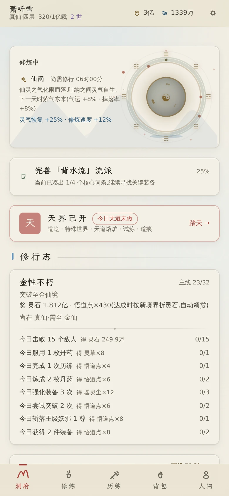
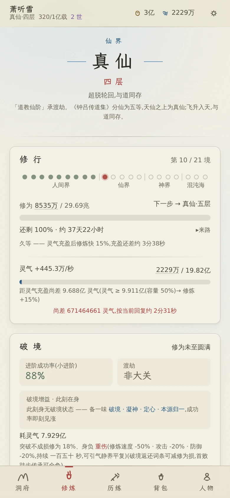
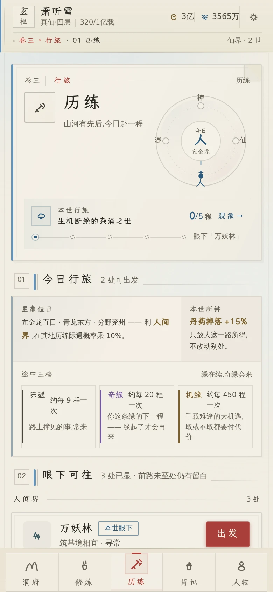
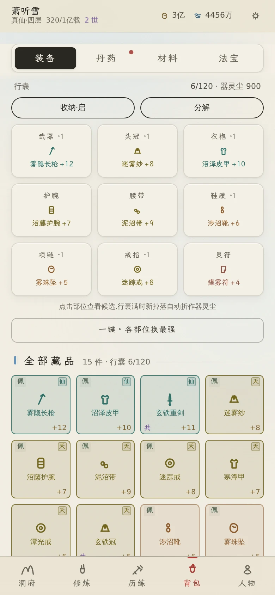

# 玩法与系统

这份文档回答"这游戏有什么、怎么玩、数值怎么算"。开发、部署与发版见
[development.md](./development.md) 与 [deployment.md](./deployment.md)。

## 界面速览

| 首页 · 下一步 | 修行 · 突破 | 历练 · 派遣 | 背包 · 装备 |
| :-: | :-: | :-: | :-: |
|  |  |  |  |
| 天时、修行志与入口 | 闭关、突破与渡劫 | 秘境、地界与镇压 | 九部位与全部藏品 |

更多界面见 [README 的「界面一览」](../README.md#界面一览)。

## 开局长什么样

新建一世 → 测灵根、定天赋 → 引气入体,进入第一层。

- **首页**给你一张"下一步做什么"的指引卡(主线进度、可做的事、离线收益结算);
- **修行**攒修为,攒满可突破;**突破**要渡劫,失败会掉修为但不掉境界;
- **历练**是派遣式的:选一处去得了的地方、定下时长,回来看遭遇与掉落;
- **洞府**离线产出,回来收一次;
- **每日**给当天的方向:三条每日任务 + 可反复做的日常。

寿元耗尽入轮回,重开不是从零:见识、道侣与部分积累跨世保留,17 种人生主题决定新一世的命题。

## 一天的循环

1. 收洞府产出与离线收益(在线时也会自动结算);
2. 花掉修为与资源:突破、升功法、炼一炉、装备换一件;
3. 派历练(有时间就挂着),或者手动打一场;
4. 看一眼每日与主线,把"下一步"做掉。

## 游戏特色

**四界二十一境,渡劫而上。** 人间界(炼气 → 渡劫)、仙界(真仙 → 大罗)、神界(神人 → 神帝)、
混沌海(混沌真灵 → 混沌道祖),每境九层至圆满,突破需渡劫 —— 5 类天劫(雷鸣 / 逆流 / 裂魂 / 铁躯 / 重压)
各有克制之法。11 种灵根(五行 + 风雷冰光暗 + 混沌)与 34 种天赋决定这一世修炼的快慢与难关。

**66 部功法,147 条分支。** 主修、辅修、秘术三类可同时装配;练至圆满开启悟道分支,
同一部功法因此走出完全不同的流派 —— 加什么、舍什么,是这一世自己的选择。

**44 个区域、140 种敌人,排着队等你。** 历练是派遣式的,首领通关解锁下一区;
途中穿插 104 个随机事件 + 12 类机缘,以及道侣、灵兽、天时与灵脉各自的变数。

**搭配,而不是单堆。** 10 个装备槽位、288 种模板(一阶一名)、113 条词条、9 级品质;
同类词条按 1 / 0.75 / 0.5 / 0.25 递减,攻击生命速度等超过软阈值后收益衰减 ——
把同一种堆满不如凑出组合。器魂是另一层:飞升后数值归零,6 类 × 6 阶器魂占 3 个槽位,改的是路数。

**技艺不足不是"不能炼",而是炼出什么样的成品。** 9 门技艺(识材 / 辨药 / 配伍 / 凝丹 / 淬药 / 养丹 /
控火 / 锻打 / 铭纹)各自成长,进炉之前你有得选:凑材料、换配比、还是赌一把。68 种丹药、45 件法宝。

**灵兽、道侣与师尊:让这一世不一样,而不是更快。** 40 只灵兽每界至少两只可挑,性子会改历练中的遭遇走向;
10 位道侣与 4 位师尊各有目标与理念 —— 它们不进效率链,只让你在同一个世界里活出不同的样子。

**轮回之后,重开不是从零。** 寿元耗尽入轮回,5 个阶段逐世积累"见识";17 种人生主题决定这一世的开局与禁忌。
真仙之后还有 7 条道途、5 重天界远征、8 种试炼、13 种契约、17 类变数,组合出每个周期都不同的规则宇宙。

**图鉴与目标:看得见的进度。** 装备、功法、悟道、丹方、灵材、法宝、灵兽、见闻、天赋九册逐条解锁(敌人认知在战斗里、界域志在「界域」页,是独立面);66 个成就、32 个主线任务
与 29 枚称号贯穿全程,每日任务负责给当天的方向 —— 打开游戏永远知道下一步做什么。

**国风音画。** Tone.js 播放 FluidR3 真实乐器采样:古筝主旋律、琵琶对答、木鱼点击、太鼓鼓点、
编钟突破、编磬提示;界面是水墨色系,三端同一份配色与字体(见[设计规范](./design.md))。

## 系统一览

| 系统 | 说明 |
| --- | --- |
| 境界 | 4 界域 × 21 境 × (九层 + 圆满),突破渡劫,5 类天劫 |
| 灵根 | 11 种(五行 + 风雷冰光暗 + 混沌),影响修速、劫难减免、功法契合 |
| 天赋 | 34 种,分凡赋 / 灵赋 / 天赋 / 道赋四等 |
| 功法 | 66 部（主修 / 辅修 / 秘术），圆满后开启 147 条悟道分支 |
| 历练 | 44 区域 × 140 敌人,派遣制会话,104 事件 + 12 机缘,首领解锁下一区 |
| 战斗 | 后台完整预解算再回放,速度 / 暴击 / 护盾 / 吸血 / 反击 / 控制 / 组合技 |
| 装备 | 10 槽位 · 32 阶 × 9 部位 = 288 模板(一阶一名)× 113 词条 × 9 品质,词条递减 + 软阈值 |
| 器魂 | 飞升后数值归零,6 类 × 6 阶器魂占 3 个槽位,改路数而非堆数值 |
| 洞府 | 7 建筑离线产出 + 7 条灵脉投资分红 |
| 技艺 | 9 门(识材 / 辨药 / 配伍 / 凝丹 / 淬药 / 养丹 / 控火 / 锻打 / 铭纹)独立成长 |
| 炼制 | 68 丹药 + 45 法宝,技艺水平决定成品品相而非成败 |
| 灵兽 | 40 只,每界至少两只可挑,出战加成与性子各异 |
| 术数 | 星象 28 宿 · 紫微 12 宫 14 主星 · 周易 64 重卦 · 奇门八门 |
| 人缘 | 10 位道侣 + 4 位师承,道侣纯叙事不给属性,师承轻量词条并入终局属性(给方向不封构筑) |
| 轮回 | 5 阶段积累见识，17 种人生主题定开局与禁忌 |
| 终局 | 7 道途 + 5 天界远征 + 8 试炼 + 13 契约 + 17 变数 + 短期秘境 / 天道熔炉 |
| 任务 | 32 主线任务 + 每日任务 + 66 成就 + 29 称号 + 图鉴(装备 / 功法 / 悟道 / 丹方 / 灵材 / 法宝 / 灵兽 / 见闻 / 天赋) |

## 多个标签页 / 多个窗口

同一份存档只允许一个页面写入 —— 两个页面各按自己的节拍落盘,后写的那份会把先写的进度盖回去。

- 先打开的那页是**写者**;后打开的那页进入**只读**,顶部常驻一条「已在另一处打开 · 本页只读,进度不会保存」;
- 只读页不跑心跳,也不结算寄卖自售、货架换新、弟子归来 —— 数字停在你打开存档的那一刻;
- 在只读页真动手(买、派遣、改设置)时会当场提示「这一步没有保存」,不用等刷新才发现;
- 想在这一页接着玩:关掉另一处,等横幅变成「另一处已关闭 —— 刷新本页」,点一下刷新就接回写权。

## 存档写不进去

浏览器存储满了(或不让写)的时候,这一会儿的进度落不了盘。游戏不装作没事:

- 首次失败会弹一条提示;设置页的「存档」卡片里还有一条**常驻**的:「上次写入存档失败 —— 浏览器存储可能已满」;
- 落盘每 5 秒会自己重试一次。腾出空间之后那条常驻提示会**自己消失**,并报一声「存档已恢复写入」—— 不必刷新,也不必重开;
- 失败时磁盘上留着的还是**上一版存档**,不会被半截写坏;但那一版之后的变化确实还没进去。

真要腾地方或换设备时,顺序是:**先在设置页「导出存档」留一份** → 清缓存 / 清理浏览器数据 / 换一台设备 → 在新设备上「导入存档」。导进来的文件解析不了(既不是本游戏的密文,也不是合法 JSON)会当场说「文件内容无法解析」,不会静默失败。

## 一方水土养一方人：世界的「所钟」

每一世的世界都有一处偏向 —— 世界页写「此地所钟」，历练页的地名旁也有一行小字。它只给**一个**渠道加成 **+15%**：

| 所钟 | 加成渠道 |
| --- | --- |
| 草木丰饶 | 灵草掉落 |
| 矿脉深厚 | 玄铁掉落 |
| 典籍散佚 | 功法残页掉落 |
| 药气氤氲 | 丹药掉落 |
| 灵石充盈 | 灵石收益 |

命中时战报会追加一句「所钟 · …」，离线归来的卷轴也会写明这一世多出来的那份。

它是**这一方天地的性格，不是你的资产**：换一世就换一处偏向，不随转世累积。

## 转世：什么留下、什么放下

寿元耗尽入轮回。转世确认页有一张「此生交割」清单（逐条可展开、每条都写明理由），这里是它的轮廓：

- **随神魂带走**：道果、先天之姿、宿命传承、宿慧、称号、师承、认知（丹方 / 药性 / 器纹 / 敌手路数）、成就与图鉴、机缘与际遇的记忆、转世次数、历世履历。
- **折损带走**：功法的**门类**记得住，练到几层归零回一层 —— 顶阶宿慧可留一门满层，大乘道统可全带，确认页会写明这一世是哪一种；道友只入履历，人不留下；镇压权益与资格令清空，区域战绩与兴衰留下。
- **随皮囊放下**：境界修为与年龄、装备 / 丹药 / 法宝 / 材料 / 灵石、历练进度与连胜、弟子与洞府建筑、灵脉投资、灵兽、逆旅契、短期秘境、进行中的区域异象、问卦所得、突破准备、本世命题；灵根重掷、道号重拟、本世之界换一方天地。

新一世能拿到什么、会失去什么，**确认之前**都写在那一页里 —— 它不可撤销，别急着点。

## 数值口径

几条贯穿设计、也写进了判据的规则:

- **词条递减**:同类词条按贡献降序,依次乘 1 / 0.75 / 0.5 / 0.25 —— 堆同一种的边际收益肉眼可见地掉;
- **软阈值**:攻击、生命、速度等超过阈值后收益衰减,阈值与衰减写在与系统同级的配置里;
- **突破是概率,不是门槛**:成功率由境界与层数决定,可用资源与天赋加成提高,失败不清零;
- **掉落按层取**:每一阶只出本阶之物(13 阶的地界不掉 8 阶的东西),名字与阶一一对应;
- **离线上限**:洞府等级决定最多计入多少小时,超出部分另有"未计"读数提示,不偷偷吞掉;
- **数值用大数**:后期数值超过 double,GNum(`m×10^e`)承担全部战力计算;
- **可消耗增益有上限**:丹药那类"再吃一颗就往后叠时长"的增益,最长只能攒到**单颗时长的 2 倍**
  (吃两颗刚好顶满)。上限是"相对服药那一刻"封的 —— 吃得比时长勤仍能保持常驻,但攒不成"半永久的余量"
  (从前没有上限:20 分钟一颗连吃 24 小时能余 12 小时)。到顶时界面会说"已至上限,这一颗只延续到顶 / 白费了",
  状态的详情里也写着"至多可攒"多少 —— 明改,不暗改。口径在 [`src/core/engineBuffs.ts`](../src/core/engineBuffs.ts),
  读数在 `engineBuffAblation.spec.ts`,判据在 `consumableBuffCap.spec.ts`。

数值体系的单一事实源是 [`src/data/progressionDoc.ts`](../src/data/progressionDoc.ts);
各内容表的头注释写着规模,并由 `dataHeaderAudit.spec.ts` 与真实数组长度比对。
